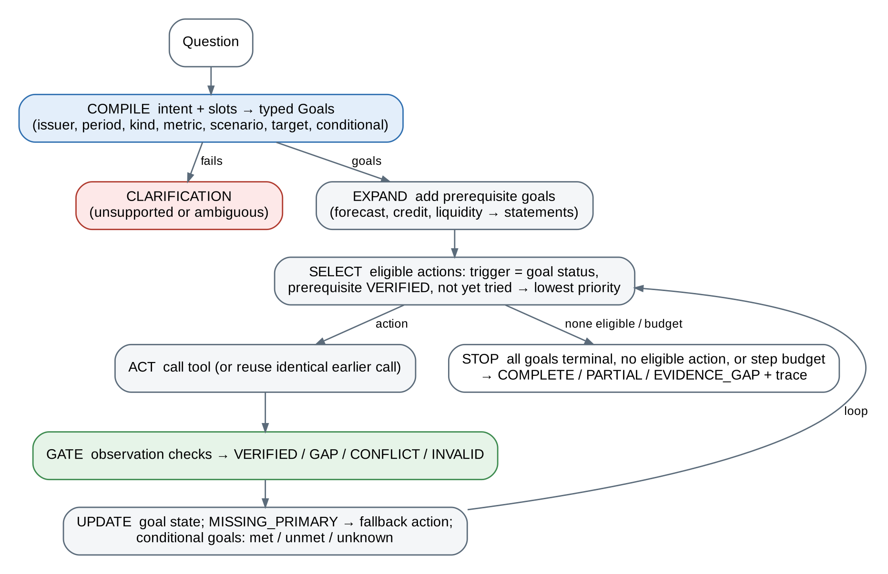

**FinAgent**

Project Blueprint — Version 3 (as built)

Agentic AI for Automated Financial Modelling & Decision Intelligence

AI/ML in Practice capstone · Team T17 (SHARP FinAgent) · C-MInDS ePGD, IIT Bombay

Prepared for: Vineet Ojha

Version 3.0 · 26 November 2026 · as built at commit 924e582 · supersedes Version 2.0 (22 November 2026), which is kept unchanged in docs/blueprint_v2.md

*Combines the best of two designs: the team's SHARP prototype (evidence store, investigation planner, observation gate, integrated three-statement model, credit and liquidity tools, point-in-time backtest, evidence replays) and the Version 1 blueprint (trained document extractor with held-back XBRL answer key, Correlation Agent, evidence retrieval, learned question understanding, multi-company evaluation, serving and observability).*

*Version 3 describes FinAgent as built and recorded at commit 924e582. The approved changes BC1-BC37 are folded in, each marked with its BC id after the passage it changed. Planned parts that were not built are marked "Not built", with the issue that records the cut, the reason and a fix path. Measured numbers come from docs/final_results.md, with their run ids. docs/blueprint_changes.md stays the change record.*

# Contents

**1** How to use this document

**2** Executive summary

**3** Problem, users and value

**4** Grading context and constraints

**5** Scope

**6** Design principles and vocabulary

**7** System architecture

**8** Component specifications

**9** Data plan

**10** Evaluation plan

**11** Deployment and observability

**12** Technology stack and repository

**13** Data schemas

**14** Course-topic coverage

**15** Build sequence

**16** Risks and mitigations

**17** Demo and presentation plan

**18** Viva preparation

**19** Limitations and fix paths

**20** Open decisions

**A** Appendix A — Canonical line-item taxonomy and model-input facts

**B** Appendix B — Identity and model-check library

**C** Appendix C — Credit ratios and risk signal library

**D** Appendix D — Supported goals and question catalogue

**E** Appendix E — Prototype review: issues and how Version 2 resolves them

**F** Appendix F — Logs and templates

**G** Appendix G — Glossary

# 1. How to use this document

This blueprint is the single reference for FinAgent. Version 3 describes the system as built at commit 924e582 and as recorded in the repository: what each component does, how it is built and tested, which course topic it demonstrates, what was measured, what to say about it in the viva, and what was planned but not built. Where Version 2 stated a target, Version 3 states what exists.

## 1.1 Reading order

- **First read:** Sections 2, 5, 6 and 7 (what FinAgent is as built, its scope with what was not built, principles and vocabulary, architecture).

- **Measured results:** `docs/final_results.md` (E1 to E8, the honest negatives and the blueprint 4.2 checklist). Every measured number in this document is copied from it, with its run id.

- **Limitations:** `docs/limitations.md`, each limitation with the issues behind it and a fix path (summarised in Section 19).

- **Changes and problems:** `docs/blueprint_changes.md` holds every approved change (BC1-BC37), each with the Version 2 text, the change, the reason and who approved it. `docs/issues_log.md` holds every problem met, with its cause and fix (#1-#373).

- **While maintaining a component:** its subsection in Section 8, its schema in Section 13, its evaluation in Section 10, its component report in `docs/` (for example `docs/statement_set_v1.md`, `docs/correlation_agent_v1.md`, `docs/planner_v1.md`) and, for a trained model, its card in `docs/model_cards/`.

- **Before the final:** Sections 17 (demo), 18 (viva), 19 (limitations) and Appendix E (prototype issues to avoid repeating).

**How the Version 3 markers read.** A BC id in parentheses right after a passage, for example "(BC22)", means the passage states an approved change; its row in `docs/blueprint_changes.md` gives the Version 2 text, the change and why. A paragraph that starts "**Not built**" records a planned part that was not built: the issue (and BC, where there is one) that records the cut, the reason, and a fix path. "#n" is an entry in `docs/issues_log.md`. A run id such as e1-0009 names a row of `eval/experiments.csv` or a directory under `runs/`. The Version 2 text is kept unchanged in `docs/blueprint_v2.md`.

## 1.2 Confidence tags

| **Tag**          | **Meaning**                                                                                          | **What to do**                                          |
|------------------|------------------------------------------------------------------------------------------------------|---------------------------------------------------------|
| **\[Certain\]**  | Verified against a source: course guidelines, TA feedback, SEC documentation, or the prototype code. | Rely on it.                                             |
| **\[Likely\]**   | Strong inference from experience with similar systems.                                               | Rely on it, but watch for evidence against it.          |
| **\[Guessing\]** | An estimate made to fill a gap (dataset sizes, run times, thresholds).                               | Replace with a measured number as soon as you have one. |

In Version 3 a tag remains in the body text only where something is still an estimate or a plan. Where a value is now known, the text gives it instead, with its source: a measured result (run id and `docs/final_results.md`), a configuration value (`configs/*.yaml`) or a BC. Headings keep their Version 2 tags, so that section references stay unchanged. Some configuration values are still marked \[Guessing\] in the configs themselves (for example the Correlation Agent's action priors in `configs/correlation_agent.yaml`).

## 1.3 Where each part of the design comes from

Version 2 merges two designs. The prototype contributes strong evidence discipline and financial modelling; Version 1 contributes the learned components, independent verification and the evaluation and serving layers. Each row records which design a component is taken from, what Version 2 changed, and what was built.

| **Component**                                                                                                    | **Source** | **Change in Version 2**                                                                        | **As built (Version 3)** |
|------------------------------------------------------------------------------------------------------------------|------------|------------------------------------------------------------------------------------------------|--------------------------|
| Pinned SEC evidence store with SHA-256 manifest and as-of cutoff                                                 | Prototype  | Extended from 2 to ~48 companies; integrity check kept for evidence only, not for code.        | 48 companies in `configs/universe.yaml`: 32 train, 8 validation, 8 held-out, ExxonMobil replaced by EOG Resources (BC5). Up to five consecutive fiscal years per company (BC1), the latest five visible at the as-of date (BC4); older submissions pages pinned and merged (BC3); fiscal-year numbering from the majority of DEI labels (BC2). Snapshot date 2026-11-24, set in `configs/ui.yaml` because the manifest records no date (#323). `finagent/evidence/`. |
| iXBRL splitter, held-back tags, leakage test                                                                     | Version 1  | Reuses the prototype's context parser and row-label reader (Filing.line).                      | Built: clean document with leakage check, tag store with cell addresses (`finagent/ixbrl/`). |
| Trained line-item extractor (document channel)                                                                   | Version 1  | Unchanged; now one of two reading channels.                                                    | M1 v3 (TF-IDF with logistic regression) ships. M2 and M3 were trained and evaluated and are not shipped (#308). `finagent/document/`, `finagent/training/`. |
| Tag channel (inline XBRL facts + Company Facts)                                                                  | Prototype  | Renamed honestly: a consistency check between two SEC tag views, not independent verification. | Company Facts is primary; the filing's inline XBRL corroborates it, or alone supplies a single-source value (MISSING_PRIMARY). `finagent/tags/`. |
| Dual-channel verification                                                                                        | New        | The document reading and the tags are compared; this is the genuinely independent check.       | VERIFIED, DISAGREE, SINGLE_CHANNEL or GAP per value; a document value equal to exactly one of several tag candidates is VERIFIED (BC15). `finagent/verify/dual_channel.py`. |
| Correlation Agent                                                                                                | Version 1  | Runs as planner actions and extends the prototype's reconcile tool.                            | Agent v1.2 runs inside the planner's reconcile action for a statements goal, with a final check of I9 and I10 (BC22, BC24) and the no-NCI rules (BC23, BC26). `finagent/verify/`. |
| Investigation planner (goals, action registry, prerequisites, conditional goals, step budget, trace, call reuse) | Prototype  | Front end replaced by a trained intent and slot model; the regex grammar becomes the baseline. | A trained intent classifier (intent v3) picks each clause's goal kind; slots are read by rule; the regex grammar is the fallback below the confidence threshold and the E5 baseline. A third fact action reads a document-only value (BC25). No LLM fallback (#121). `finagent/planner/`. |
| Observation gate                                                                                                 | Prototype  | Kept as the final evidence gate for every answer.                                              | Kept for every planner answer; it also checks every quote against the chunk rebuilt from the pinned document (#157). `finagent/planner/gate.py`. |
| Integrated three-statement forecast that balances every year                                                     | Prototype  | Promoted to core. Per-company code branches removed; dividends and buybacks read from history. | Built with Base, Moderate and Severe scenarios; general rules for filers with no cost-of-sales line (BC17, BC20), the effective interest rate (BC18) and debt run-off (BC19); a linked Excel workbook per company (BC21). `finagent/model/`, `finagent/workbook/`. |
| Credit ratios, liquidity headroom, securities reserve                                                            | Prototype  | One scenario set only; scoped debt-service coverage computed instead of always withheld.       | Scoped coverage on the cash flow available for debt service (BC27); headroom including haircut securities, shown beside cash-only headroom (BC28). `finagent/credit/`. |
| Point-in-time rolling-origin backtest                                                                            | Prototype  | Extended from one company to all validation companies.                                         | E6 on the 8 validation companies, with earlier years from Company Facts filtered by filing date (BC7); pre-registered and run once (BC34, BC35). `finagent/evaluation/e6.py`. |
| Evidence replays (hide a source in memory, rerun)                                                                | Prototype  | Becomes evaluation E8 and the injection mechanism for E2.                                      | E8 runs on evidence views (`finagent/statements/replay.py`); E2 injections and agent corrections share one in-memory edit hook (`finagent/verify/edits.py`). |
| Risk signals with quoted evidence (RAG)                                                                          | Version 1  | Combined with the prototype's credit ratios.                                                   | Signals R1-R11 (`configs/signals.yaml`) on the same inputs as the credit ratios; quotes under evidence v2, with a labelled low-confidence sentence on gap cards (BC32). `finagent/risk/`. |
| Evaluation suite, serving, dashboard, linked Excel export                                                        | Version 1  | Unchanged in intent; adds E8.                                                                  | E1-E8 run and recorded, E7 light only (BC33). Serving is a local Streamlit app over a pinned serving run, all 48 companies labelled by split (BC36), with statement-set reuse (BC37); the dashboard is the app's Results page; no FastAPI service (#316). `finagent/evaluation/`, `finagent/ui/`. |

# 2. Executive summary

**What FinAgent does.** A user picks one of the 48 pinned US-listed companies and asks a financial question, or opens the company's full analysis. FinAgent works offline from pinned copies of each company's annual 10-K filings, up to five consecutive fiscal years (BC1), as of a chosen date. It reads the financial statements in two independent ways: a trained model (M1 v3, TF-IDF features with logistic regression) reads the visible tables as an analyst would, and a parser reads the filer's machine tags (Company Facts, corroborated by the filing's inline XBRL). Where the two agree within displayed precision, the value is VERIFIED. Where they disagree (DISAGREE), or an accounting identity fails, a Correlation Agent re-picks a row, rescales or flips a sign to satisfy the identities, or leaves the value in REVIEW; it never inserts a figure. A value that only one channel reads is SINGLE_CHANNEL and is used, flagged, only under the acceptance rules of section 8.7.

From the validated statement set FinAgent builds an integrated three-statement model with a three-year forecast that is shown only when its balance checks pass in every year, under three scenarios (Base, Moderate and Severe; `configs/scenarios.yaml`). It adds credit ratios, liquidity headroom and shortfall, and a scoped debt-service coverage (BC27, BC28), and risk signals (R1-R11; `configs/signals.yaml`) whose insight cards quote the filing only when a reranked passage clears a threshold. Otherwise a card is EVIDENCE_GAP and shows one sentence labelled as low confidence, which never counts as evidence (BC32). Each company also gets a linked Excel workbook (BC21).

An investigation planner turns a question into typed goals with a trained intent classifier (intent v3) and rule-based slot filling, runs only the tools those goals need, in dependency order, and stops on a step budget. An observation gate rejects any value whose provenance does not check out, and a question the compiler cannot place gets a CLARIFICATION. No external AI API is called anywhere.

**How it is served.** A local Streamlit app (`finagent/ui/app.py`) has three pages: Ask (questions, plain-language answers, the gate's decisions and the trace), Company (statements, forecast and checks under each scenario, credit and liquidity, risk cards and the workbook, read from the pinned serving run serving-0002) and Results (every evaluation's headline, E7 latency and the limitations). It serves all 48 pinned companies, each labelled by its split: validation "Measured", train "In-sample", held-out "Unseen" (BC36). At the serving run's as-of date the Ask page reuses its statement sets when the build fingerprint matches, and otherwise builds them live and says why in the trace (BC37). There is no HTTP API and no public deployment (Section 5.1).

**Why it matters.** A linked historical model with forecast and downside cases takes an analyst about 20 hours for one company, by Vineet's estimate from experience (D10; not measured). FinAgent's build of one company from the filings (statements, three-scenario model, credit, risk cards and workbook) took a median of 36 s and at most 92 s in serving-0001, with a trace of every step and the source of every number (`docs/final_results.md`).

### Headline results

Every number below is copied from `docs/final_results.md`. Validation figures are optimistic wherever a change followed a validation result; the held-out companies were measured once, in held-out E1.

| **Eval** | **Question** | **Measured result** |
|---|---|---|
| E1 | Does the document channel read statements correctly on unseen companies? | Held-out field accuracy of the shipped M1 v3: 0.913 [0.846, 0.961] (e1-0009); M3 0.941 [0.887, 0.985] (e1-0010); paired M3 − M1 v3 +0.029 [0.000, +0.055], so M3 is not shipped. The 95% target is not met. Rules baseline M0, validation only: 0.773 [0.660, 0.876] against M1 v3 0.905 [0.859, 0.950] (e1-0005, e1-0006). |
| E2 | Does the Correlation Agent help, and is it safe? | Injected errors corrected 10/40 = 25.0% [12.5%, 35.0%]; 0 correct values wrongly changed; clean readings 90.5% → 90.8% (McNemar p = 0.25, no significant gain) (e2-0003). |
| E3 | Does retrieval find the explaining passage? | Primary MRR@5: BM25 0.677 [0.530, 0.815]; the best change, hybrid + reranker, +0.048 [-0.049, +0.140]. No paired interval lies above 0, so BM25 stays the default search (e3-0001). |
| E4 | Are insight cards faithful? | Unsupported-claim rate 0.704 [0.519, 0.852] of 27 quoted cards (Vineet's labels); judge agreement, three-label kappa 0.411 [0.077, 0.700] (e4-0001). Evidence v2 was adopted afterwards (post-hoc): 0.926 of the 27 slots become EVIDENCE_GAP (e4-0002). |
| E5 | Does the planner understand questions and answer correctly? | Trained compiler goal accuracy 68/92 = 73.9% [64%, 82%] against the regex grammar's 24/92 = 26.1% [18%, 36%]; on Vineet's blind questions 29/52; precision 100.0% → 93.2%, so the blueprint expectation is not met (e5-0001, e5-0002). |
| E6 | Is the forecast better than naive? | No accuracy claim on any row. For CFO the naive last value is better: APE difference -0.100 [-0.166, -0.012] (e6-0001). |
| E7 | Is it fast and cheap enough? | First answer about a company, cold p50 / p95 / max: 0.22 / 0.74 / 0.79 s (e7-0002), was 0.25 / 16.38 / 35.53 s (e7-0001); 0 of 40 calls failed. Cost was not measured. |
| E8 | Does FinAgent return gaps when evidence is missing? | Degraded goals correct 1150/1152 = 99.8% [99.6%, 100.0%]; 0 fabricated values (e8-0004). |

### What did not work

- **M3 is not shipped.** Held-out M3 − M1 v3 is +0.029 [0.000, +0.055]; the pre-registered rule needs the lower bound strictly above 0, and it is exactly 0 (e1-0010; `docs/final_results.md`).

- **The 95% held-out accuracy target is not met:** M3 0.941, M1 v3 0.913 (e1-0009, e1-0010; `docs/final_results.md`).

- **E6 supports no forecast accuracy claim.** For CFO the naive last value is better, and only 28 of 32 origins had a VERIFIED forecast (e6-0001; `docs/final_results.md`).

- **E4: most v1 quotes did not support their card.** Vineet judged 19 of 27 quoted cards unsupported (e4-0001); under evidence v2 most cards are EVIDENCE_GAP instead (`docs/final_results.md`).

- **E5: Vineet's blind questions were understood far less often than the builder's:** 29/52 = 55.8% against 39/40 = 97.5% (e5-0002; `docs/final_results.md`). The shipped intent v3 is measured only post-hoc (e5-0003).

- **E2: the agent sees few errors.** 29 of 40 injected errors leave every evaluation-mode check unchanged, and on clean readings there is no significant gain (e2-0003; `docs/final_results.md`).

- **E8: the first run fabricated values.** e8-0001 returned 5 fabricated values under the untagged view; they were fixed before e8-0003 and e8-0004, which are therefore not blind (`docs/final_results.md`).

- **E3: no retrieval variant beat BM25** on the primary measure (e3-0001; `docs/final_results.md`).

- **Not built or not run:** the LLM fallback and its pass^3 (#121, #217), the E1 M4 ceiling, the full E7 (#318), a public deployment (#322) and the outside-user session (#377) (Sections 5 and 15).

## 2.1 Where the intelligence is

| **Component**             | **What is learned or decided (as built)**                                                                       | **Why it is not a wrapper**                                                    |
|---------------------------|-----------------------------------------------------------------------------------------------------------------|--------------------------------------------------------------------------------|
| **Document extractor**    | M1 v3 (`m1-tfidf-lr-v3`): word and character TF-IDF features with logistic regression, trained by the team on train-split statement rows whose labels come from the held-back XBRL tags. It maps each face-statement row to a canonical line item (Appendix A) or OTHER, with its top-3 probabilities. M2 (LightGBM) and M3 (the pinned bge-small encoder fine-tuned on the development Mac, BC30) were also trained and evaluated; neither ships (#308). | Trained by the team; labels come free from held-back XBRL tags; reads visible text only; runs on a CPU. |
| **Goal compiler**         | Intent v3 (`intent-tfidf-lr-v3`): TF-IDF features with logistic regression classify each question clause into a goal kind, advice or unsupported. Below the confidence threshold (0.925, `configs/planner.yaml`) the regex grammar takes over, then CLARIFICATION. Slots (metric, period, scenario, target) are read by rule from the phrases in `configs/intents.yaml`; they are not learned. | Trained by the team on questions generated from `configs/intent_templates.yaml`; no language model. |
| **Correlation Agent**     | A check, diagnose, plan, act, re-check loop that chooses among swap (re-pick), rescale and flip_sign actions to bring failing identities within tolerance, or escalates. Each candidate action is scored by M1's probability times the reduction in the failing residual, with guardrails; at most 5 actions per filing (`configs/correlation_agent.yaml` `max_actions`). Each value it touches ends CORRECTED or REVIEW. The shipped agent is v1.2 (BC22-BC24, BC26). | An agent loop with tools, an objective success test and guardrails. Its choice rule is fixed, not learned. |
| **Investigation planner** | A loop that picks the next eligible action from the action registry (`configs/planner.yaml`) by prerequisite and priority, reuses identical calls, resolves conditional goals and stops on a step budget (default 12). | Planner logic is the team's; it is deterministic and records every step in a trace. |
| **Evidence retrieval**    | Ranks filing passages that explain a movement. BM25 is the default search (`configs/retrieval.yaml`). Insight-card and explain quotes use evidence v2: BM25 and a dense embedder (bge-small-en-v1.5) fused by reciprocal rank, reranked by a cross-encoder (ms-marco-MiniLM-L-6-v2), and quoted only from passages at or above a reranker-score threshold chosen post-hoc (D-EV, #301-#306). | Pretrained local models, pinned by revision and sha256 (`configs/models.yaml`) and loaded offline; not trained by the team; quotes only. |

**What is rule-based.** Everything else is deterministic code over configuration: statement location and row reading, the normaliser, the tag channel, dual-channel verification, derivations and identities, the forecast and its checks, scenario shocks, credit ratios, liquidity and debt service, risk signals, the planner's slot filling and action choice, the observation gate, and the app's plain-language view, which is built from the structured observations and adds no number.

No external AI API runs anywhere in FinAgent, in the product or in evaluation. The E4 judge is a local NLI cross-encoder (cross-encoder/nli-deberta-v3-xsmall), pinned by sha256 and used in evaluation only (BC31).

**Not built** (no issue logged): E1 M4 ceiling (a frontier or large open model as a comparison ceiling, Decision D1). Reason: not recorded; no M4 run exists in `eval/experiments.csv`, no external AI API was called (CLAUDE.md rule 9 forbids it in `finagent/`), and no local ceiling model was run. Fix path: an evaluation-only ceiling run on validation with a pinned local open model, recorded as an E1 row.

## 2.2 Headline claims the final presentation should support

The five claims planned in Version 2, against what was measured.

| **Planned claim (Version 2)** | **Supported?** | **Measured evidence** |
|---|---|---|
| 1. The document extractor reaches X% field-level accuracy on companies it never saw, scored against the filer's own XBRL, compared with Y% for a rules baseline. | Partly | Held-out field accuracy of the shipped M1 v3: 0.913 [0.846, 0.961] (e1-0009). The rules baseline M0 was run on validation only: 0.773 [0.660, 0.876] against M1 v3 0.905 [0.859, 0.950] (e1-0005, e1-0006). The 95% target is not met (`docs/final_results.md`). |
| 2. Dual-channel verification agrees on Z% of values; the Correlation Agent resolves W% of disagreements and of injected errors, with a measured false-correction rate. | Partly | Injected errors corrected 10/40 = 25.0% [12.5%, 35.0%]; 0 correct values wrongly changed (e2-0003). 29 of 40 injected errors leave every evaluation-mode check unchanged. The dual-channel agreement rate and the share of product-mode disagreements resolved are not reported in `docs/final_results.md`. |
| 3. The integrated forecast balances in every scenario and year; its one-year-ahead errors are compared with a naive baseline at filing-date origins. | Balance: yes, whenever a forecast is shown. Accuracy: not supported. | A forecast is VERIFIED only when every model check passes in every projected year; otherwise it is GAP or INVALID and shows no projected numbers. In E6 the Base forecast was VERIFIED at 28 of 32 origins, no row supports an accuracy claim, and for CFO naive is better: APE difference -0.100 [-0.166, -0.012] (e6-0001). Every E6 result applies only where the product issued a VERIFIED forecast (BC35). |
| 4. Under evidence replays, FinAgent returns a gap rather than a number in 100% of cases where the evidence was removed. | Supported after fixes; not blind | Degraded goals correct 1150/1152 = 99.8% [99.6%, 100.0%]; safe 1152/1152 = 100.0%; 0 fabricated values (e8-0004). The first run, e8-0001, found 5 fabricated values; the fixes were made on the same validation split. |
| 5. A full analysis of a new company takes M minutes on a CPU at no per-query cost. | Partly | Build of one company from the filings: median 36 s, at most 92 s (serving-0001). First answer about a company, cold p50 / p95 / max: 0.22 / 0.74 / 0.79 s (e7-0002). One machine and twenty questions, not a load test. Cost was not measured; no external AI API is called, so marginal API cost is zero by design (BC33). The manual baseline, about 20 hours, is an estimate (D10). |

> **One-line pitch**
>
> FinAgent reads a 10-K two independent ways, checks its numbers against the filer's own XBRL, builds a model that balances, and only says what the filing supports.

# 3. Problem, users and value

## 3.1 Problem

Annual filings are authoritative but not decision-ready. Statements, notes, MD&A and risk factors are spread across a long document. Analysts locate figures, normalise definitions, reconcile totals, build the model, forecast and test downside cases. The work is slow, hard to audit, and vulnerable to copy errors and unsupported assumptions.

## 3.2 Research question

> Can an evidence-grounded agentic system transform public filings into structured, validated and explainable financial intelligence without silently inventing missing information?

Made testable: "structured" by extraction accuracy (E1), "validated" by dual-channel agreement and identity pass rates (E2), "explainable" by provenance and evidence faithfulness (E3, E4), "without inventing" by gap behaviour under evidence replays (E8) and by the unsupported-claim rate (E4). Section 2 gives the measured answers.

## 3.3 Users

| **User**                                        | **What they need**                                                                                                                        |
|-------------------------------------------------|-------------------------------------------------------------------------------------------------------------------------------------------|
| Equity research and investment banking analysts | A correct, linked model they can extend; the source of every number.                                                                      |
| Credit and lending analysts                     | Liquidity headroom, working-capital and leverage measures with stated scope; explicit gaps where public data cannot support a conclusion. |
| Investors and research teams                    | Fast, sourced answers to factual and model questions.                                                                                     |

## 3.4 Why not simply read the XBRL tags?

1.  **Most financial documents carry no tags**: Indian annual-report PDFs, private-company accounts, lender packs. A model that reads statement tables is useful exactly there. As built, the document channel was trained and tested on US 10-K tables only; its transfer to untagged documents is not measured (Section 5.2).

2.  **US 10-Ks are where the reading can be proven.** The tags give an exact answer key at scale.

3.  **Two independent readings are stronger than one.** For tagged filings, FinAgent uses both and reports where they disagree, which catches tagging errors as well as reading errors.

4.  **Tags vary across filers** (extension concepts, alternative concepts), so a canonical analyst-level line-item set is still needed.

## 3.5 What FinAgent is not

- Not a credit-approval or investment-recommendation system. Modelled headroom and ratios are conditional analysis, not underwriting decisions. A question asking for advice gets a CLARIFICATION (reason ADVICE, `configs/intents.yaml`).

- Not designed for banks, insurers or REITs; the 48 pinned companies include none.

- Not a general chatbot: it answers the goal kinds of Appendix D (fact, statements, forecast, credit, liquidity, debt, explain, risk; `configs/planner.yaml`) and asks for clarification otherwise.

- Not a forecasting-accuracy tool: the one-year-ahead backtest supports no accuracy claim (Section 2).

- Not a live or hosted service: it reads pinned filings as of the snapshot date, never calls the SEC at run time, and runs locally, with no HTTP API and no public deployment (#316, #322).

# 4. Grading context and constraints

## 4.1 How the course grades the project \[Certain\]

| **Component**                     | **Weight** | **What it means for FinAgent**                                                                       |
|-----------------------------------|------------|------------------------------------------------------------------------------------------------------|
| **Scope and impact**              | ~25%       | A real analyst problem with a measurable time saving; ambitious but finished.                        |
| **Technical depth and execution** | ~25%       | Models the team trained, agents that actually decide, course topics visibly used, sound engineering. |
| **Presentation**                  | ~25%       | Clear story, measured results, honest limitations, a working demo with a recorded backup.            |
| **Viva (individual)**             | ~25%       | Each member redraws the architecture and defends their components.                                   |

The end-term carries 100% of course marks. The final is on **5 December 2026**, offline at IIT Bombay: 20 minutes per group covering presentation, demo and individual viva.

## 4.2 Final checklist from the course guidelines \[Certain\]

Status and evidence are copied from the checklist table in `docs/final_results.md`.

| **Checklist item**                                                | **Status** | **Evidence** | **Where covered**                                                    |
|-------------------------------------------------------------------|------------|--------------|----------------------------------------------------------------------|
| The system runs, and someone outside the team has used it         | Not done | Runs locally: the Streamlit app (`finagent/ui/app.py`) serves all 48 pinned companies, each labelled by its split (serving-0001, serving-0002; BC36, BC37). Outside user: not held (Vineet's decision, 2026-11-26; #377). What exists is the 20-minute session pack (65bf03b; `docs/outside_user_session.md`). | Sections 11 and 15 (phase 9) |
| Evaluation results with a baseline                                | Done | E1 against M0 rules (e1-0005), E5 against the regex grammar (e5-0001), E6 against naive last value (e6-0001); also E2 without the agent, E3 against BM25 and E8 against complete evidence. E7's manual baseline is an estimate (D10), not a measurement. All in `docs/final_results.md` and `eval/experiments.csv`. | Section 10 |
| Deployed and served, with a dashboard of latency, cost and errors | Partly | Local only: no public URL, because Hugging Face Docker Spaces need a paid plan (#322); the Dockerfile ships unbuilt (#326); no FastAPI service (#316). The dashboard is the app's Results page: every evaluation's headline, E7 latency and failures (e7-0001, e7-0002) and the limitations. No hosting cost or error-rate monitoring beyond E7; no external AI API is called, so marginal API cost is zero by design (BC33). | Section 11 |
| Contribution log                                                  | Done | `docs/contribution_log.md`, up to date through Phase 10. | Appendix F |
| Honest limitations with fix paths                                 | Done | `docs/limitations.md`, final pass in Phase 10; also shown on the Results page. | Section 19 |
| Demo recording as backup                                          | Not done | To be recorded by Vineet (BC33); there is no recording in the repository. | Section 17 |
| Rehearsed and inside the time limit                               | Not done | A later Phase 10 step, before the final on 5 December 2026. | Section 17 |

## 4.3 TA feedback from the midsem and the Version 2 response \[Certain\]

| **Feedback (Kaustubh)**                                                                           | **Response (as built)**                                                                                                        |
|---------------------------------------------------------------------------------------------------|--------------------------------------------------------------------------------------------------------------------------------|
| Prioritise a clean, reproducible run.                                                             | Pinned evidence store with a sha256 manifest, read-only and hash-checked; one Python package; one command per evaluation (README); every run recorded in `eval/experiments.csv` with its commit and single change. The pre-registered runs (held-out E1, E6) ran on clean trees; most other runs record uncommitted changes (`docs/final_results.md`). Shipped models and evidence are checked by sha256 (`python -m finagent.ui.verify`). The Docker image ships unbuilt (#326). |
| Reliable filing-to-analysis first; full three-statement modelling optional.                       | Extraction and verification were built first (Phases 1-3; `docs/contribution_log.md`). The integrated model is included: a forecast is VERIFIED only when its checks pass, and otherwise GAP or INVALID with the reason and no partial numbers. |
| Independently checked numerical answers and source evidence, including missing or ambiguous data. | Dual-channel verification (document reading vs tags); a DISAGREE value is never used and never falls back to the tag value; GAP, CONFLICT, INVALID and EVIDENCE_GAP are first-class outcomes. Under evidence replays, 0 fabricated values (e8-0004). |
| Separate facts, calculations and assumptions.                                                     | Five-way classification on every value (Section 6.2), checked by the observation gate against the classifications allowed for each metric (`configs/planner.yaml` `answers`). |
| Backtest against simple baselines if predictive accuracy is claimed.                              | Point-in-time backtest against the naive last value, pre-registered (`docs/e6_prereg.md`, committed at 698bb67) and run once (e6-0001): no accuracy claim is made (BC34, BC35). |
| Three to five companies is a pilot; reserve an unseen company.                                    | 48 companies (`configs/universe.yaml`), split before training into 32 train, 8 validation and 8 held-out. The held-out group was measured once, in a pre-registered E1 run (e1-0009, e1-0010), and is never debugged, tuned or evaluated again; it is now served in the app, labelled "Unseen" (BC36). |
| Credit support optional, evidence-qualified, after reliable extraction.                           | Credit and liquidity tools carry scope statements: scoped debt-service coverage on the cash flow available for debt service (BC27), liquidity headroom with and without haircut securities side by side (BC28), and the comprehensive forward DSCR always withheld as a gap with its reasons. |

## 4.4 Constraints

| **Constraint**                                                                   | **Consequence (as it played out)**                                                      |
|----------------------------------------------------------------------------------|-----------------------------------------------------------------------------------------|
| No external AI API inside the product.                                           | None is called anywhere in `finagent/`, in the product or in evaluation. Product models are the team's own (M1 v3, intent v3) or pinned open models loaded offline (embedder and reranker, `configs/models.yaml`). The E4 judge is a local NLI cross-encoder (BC31). No frontier ceiling was run (Section 2.1). |
| Build alongside the ML for Finance exam on 4 December.                           | Phases 0-8 followed the build order. With about 8 hours left for the whole project, Phase 9 was cut to a showcase of what was built (BC33); E6 and the outside-user session were then reinstated (BC34). The final written record (Phase 10) is at commit 924e582. |
| ₹40,000 team budget.                                                             | Nothing was spent (Phase 9 plan decision D11, `docs/phase9_plan.md`). No Colab: M3 was fine-tuned on the development Mac (BC30). No hosting: the public deployment needs a paid plan and was not bought (#322). No API calls. |
| SEC fair access: declared User-Agent, at most 10 requests per second.            | The fetch client (`finagent/evidence/fetch.py`) declares a User-Agent, stays below the rate limit and writes only to a staging directory; the staged files were reviewed and pinned once. The product never calls the SEC at run time. |
| One team, one 20-minute slot.                                                    | One system, one story. One builder, Vineet (Phase 9 plan decision D12, confirmed in BC34); `docs/contribution_log.md` maps each component and phase to the work done. |

# 5. Scope

## 5.1 Core (must work end to end)

| **Capability**                                      | **Definition of done**                                                                                                                       | **Status (as built)** |
|-----------------------------------------------------|----------------------------------------------------------------------------------------------------------------------------------------------|-----------------------|
| **Evidence store**                                  | Pinned 10-K, submissions, Company Facts and ticker snapshots for every company in the universe, with a SHA-256 manifest and an as-of cutoff. | Built (`finagent/evidence/`): 48 companies, up to five consecutive fiscal years each (BC1), older submissions pages pinned (BC3). A 10-K whose statements are incorporated by reference from an exhibit is a gap, never read (BC10). |
| **Document channel**                                | Three statements located; every row classified into the taxonomy (Appendix A) or OTHER; values normalised.                                   | Built (`finagent/document/`) with M1 v3. Statement location may receive per-table tagged-cell counts computed outside the channel (BC6); percentage sub-columns are never read as amounts (BC11); a filing-wide unit sentence gives the scale of a table with none (BC12). |
| **Tag channel**                                     | Inline XBRL facts for the same items, cross-checked against Company Facts.                                                                   | Built (`finagent/tags/`): Company Facts primary, inline XBRL corroboration, inline-only fallback flagged single-source. |
| **Dual-channel verification and Correlation Agent** | Every value VERIFIED, CORRECTED, REVIEW or a gap, with the reason and the trace.                                                             | Built (`finagent/verify/`): every value VERIFIED, SINGLE_CHANNEL, DISAGREE, CONFLICT, INVALID or GAP after verification (BC15); the agent (v1.2) leaves each value it touches CORRECTED or REVIEW, with its trace (BC22, BC23, BC24, BC26). |
| **Validated statement set**                         | Up to five fiscal years (as the evidence store returns them) with classifications and provenance; identities (Appendix B) pass or are explained. | Built (`finagent/statements/`): identities I1-I12 (`configs/identities.yaml`); I9 and I10 must pass the final check (BC22, BC24); unread funded-debt components may be nil (BC29). |
| **Integrated forecast and scenarios**               | Three-year forecast that balances in every year and scenario; one scenario set; assumptions classified.                                      | Built (`finagent/model/`): Base, Moderate and Severe (`configs/scenarios.yaml`); a forecast is shown only when checks F1-F5 pass, otherwise GAP or INVALID with the reason; general rules for filers with no cost-of-sales line, the interest rate and debt run-off (BC17, BC18, BC19, BC20). Many train and held-out companies' forecasts are GAP, with the reason shown (`docs/limitations.md`). |
| **Credit and liquidity**                            | Historical credit ratios, cash headroom and funding shortfall by scenario, scoped debt-service coverage.                                     | Built (`finagent/credit/`, `finagent/model/ratios.py`): scoped coverage (BC27); headroom on both bases (BC28); comprehensive forward DSCR withheld. |
| **Risk signals with evidence**                      | Signals (Appendix C) with quoted filing passages or explicit evidence gaps.                                                                  | Built (`finagent/risk/`): R1-R11 (`configs/signals.yaml`); evidence v2 quotes, with the low-confidence sentence on EVIDENCE_GAP cards (BC32). |
| **Investigation planner and observation gate**      | Supported goals (Appendix D) answered with verified observations, gaps or clarification; trace for every run.                                | Built (`finagent/planner/`): the document-only fact action (BC25); a trace for every run, written to JSON lines and SQLite when a directory is given; the app exports a trace on request and does not persist it (#320). |
| **Evaluation harness**                              | E1–E8 runnable with one command each; results in the experiment log.                                                                         | Built (`finagent/evaluation/`, `eval/`): one command per evaluation (README); results in `eval/experiments.csv` (E4 in its own score files); E6 run once as pre-registered (BC34, BC35); E7 light only (BC33). |
| **Serving**                                         | FastAPI service and UI in Docker on Linux, Windows and macOS; trace dashboard; linked Excel export.                                          | Partly built (`finagent/ui/`): a local Streamlit app (Ask, Company, Results) over all 48 companies labelled by split, reading the pinned serving run serving-0002 (BC36), with statement-set reuse when the build fingerprint matches (BC37). The Results page is the dashboard on real runs. The linked Excel workbook is built per company, recalculated with LibreOffice and downloadable from the Company page (BC21). |

**Not built** (#316, BC33): FastAPI service. Reason: time; Phase 9 was cut to a showcase of what was built, and the app calls the library directly in one process. Fix path: a FastAPI service over the same tools and gate, with persisted traces (blueprint 8.17).

**Not built** (#326, BC33): a built and tested Docker image on Linux, Windows and macOS hosts. Reason: there is no Docker on the development Mac, so the Dockerfile ships unbuilt and untested. Fix path: build and smoke-test the image on a machine with Docker, and build the serving run inside the image so that Ask can reuse it (#371).

**Not built** (#322, BC33): public deployment. Reason: Hugging Face now requires a paid PRO plan for Docker Spaces, and Vineet chose not to pay. Fix path: host the image on a paid plan or an institutional server.

**Not built** (#320, BC33): persistent traces and a trace dashboard (per-tool latency, error and INVALID rates). Reason: time and no hosting; the app saves no trace and offers one as a download. Fix path: persist the app's traces (JSON lines and SQLite, `finagent/planner/trace.py`) and add a dashboard that reads them.

**Not built** (#318, BC33): the full E7 (per-stage latency on a deployed service, error rates under load, logging, hosting cost). Reason: time and no deployment (#322); only the light E7 ran. Fix path: the full E7 on the deployed service.

## 5.2 Second tier

- **Fine-tuned transformer extractor (M3)** if it beats the best classical model on validation. As built: M3 (the pinned bge-small encoder, fine-tuned on the development Mac; BC30) had the best validation point estimate, 0.929 against M1 v3 0.905, but its paired interval included 0: +0.024 [-0.004, +0.056] (e1-0008). The held-out run decided (D-M3, #297), and M3 did not clear the pre-registered rule (e1-0010).

- **Local LLM fallback** in the goal compiler for questions the intent model is unsure about. Not built (below).

- **Cross-document transfer test** on hand-labelled Indian annual-report tables. Not built (below).

**Not built** (#297, #308): M3 in the shipped path. Reason: the pre-registered rule needs the held-out paired lower bound of M3 − M1 v3 strictly above 0, and it is exactly 0, +0.029 [0.000, +0.055] (e1-0010; `docs/final_results.md`). Fix path: more validation companies to narrow the interval, then a new pre-registered held-out run (`docs/limitations.md`).

**Not built** (#121, #217): local LLM fallback in the goal compiler, and its pass^3 in E5. Reason: skipped in Phase 6 by reviewer decision, confirmed by Vineet, and first in the cut order; below the confidence threshold the compiler falls back to the regex grammar, then CLARIFICATION (LOW_CONFIDENCE). Fix path: a local LLM fallback for clauses below the threshold, measured with pass^3, and intents grown from logged CLARIFICATION questions (`docs/limitations.md`).

**Not built** (no issue logged): cross-document transfer test on hand-labelled Indian annual-report tables. Reason: not recorded; the document channel was trained and tested on US 10-K inline XBRL only (`docs/limitations.md`). Fix path: hand-label Indian annual-report tables, measure transfer, fine-tune (`docs/limitations.md`).

## 5.3 Out of scope

| **Item**                                          | **Reason to give if asked**                                                                                    |
|---------------------------------------------------|----------------------------------------------------------------------------------------------------------------|
| Lending recommendations or approval decisions     | Public filings cannot support a sanctionable decision; FinAgent reports conditional analysis and gaps.         |
| Comprehensive forward DSCR across all obligations | Short-term rollover and other obligations are not scheduled in the 10-K; a scoped measure is reported instead, and the comprehensive measure is always a gap (COMPREHENSIVE_DSCR_WITHHELD, with its reasons). |
| Multi-agent architecture                          | One planner and one reconciliation agent are easier to test and fail in fewer ways.                            |
| Free-text answers written by an LLM               | Answers are built from verified observations and quotations. The app's plain-language view is built from the structured observations, never by parsing the answer text, and adds no number (audit ui-present-0002). |
| Kubernetes, distributed training                  | The app runs as one local process (no container was built, #326). M3 was fine-tuned on the development Mac, with no Colab run (BC30). |
| Banks, insurers, REITs                            | Different statement structures; the 48 pinned companies include none.                                          |

# 6. Design principles and vocabulary

| **Principle**                                   | **In practice**                                                                                                                                          |
|-------------------------------------------------|----------------------------------------------------------------------------------------------------------------------------------------------------------|
| **Evidence before inference**                   | No value appears in an answer unless it traces to a filing or to a deterministic calculation on traced values. The tools recompute calculations a second way before the gate sees them (ratios, signal measures and debt service in Decimal; forecasts through their checks). |
| **Missing is not zero**                         | Absent items are gaps, never zero. Derived values are computed only when every input exists; an absent input makes the result INPUT_GAP, never a partial sum. One general exception: an optional component of a rule marked `unread_year_nil` in `configs/derivations.yaml` (today the funded-debt components) that no channel read in one fiscal year, but that is read in other fiscal years of the same company with both channels visible, is treated as nil for that year. Its line carries value 0 as a MODEL_ASSUMPTION, flagged NIL_UNREAD_YEAR, with status GAP and a basis naming the years it was read; the total that uses it is flagged `NIL_UNREAD_YEAR:<component>`, and the forecast and workbook show it. A component never read in any year stays GAP NOT_REPORTED; a year that a hidden-channel view leaves unknown stays INPUT_GAP; a component that was read but disagrees or was rejected is never nil. Never per company (BC29). |
| **Models read, rules decide**                   | Trained models read rows (M1 v3) and classify question clauses (intent v3); pinned pretrained models rank passages (evidence v2). Slot filling, arithmetic, identities, forecasts, scenario shocks, signals and pass/fail decisions are deterministic. |
| **Two independent readings**                    | A value is VERIFIED for a tagged filing only when the document reading and the tag agree within displayed precision, or the document value equals exactly one of several tag candidates (BC15). A value only one channel reads is SINGLE_CHANNEL: a tag-only value is used, flagged; a document-only value is used only when every identity it enters passes. |
| **Point-in-time discipline**                    | Every tool takes an as-of date; no filing filed after it is used. The E6 backtest uses filing dates as origins, with earlier years from Company Facts filtered by filing date (BC7). The app's as-of date defaults to, and cannot exceed, the snapshot date 2026-11-24 (#323). |
| **Gate every answer**                           | Every planner answer passes the observation gate, which checks issuer, CIK, fiscal year, period end, metric, unit, classification, accession, URL and filing date, the SINGLE_CHANNEL flag on a single-channel fact, and every quote against the chunk rebuilt from the pinned document (#157), before anything is shown on the Ask page. The Company page shows the pinned serving run as built, without the planner's gate. |
| **No company-specific code**                    | Differences between filers are handled by configuration and data (`configs/*.yaml`: concept lists, taxonomy, derivations, label rules), never by if ticker == … branches. |
| **No plugs**                                    | Agents may re-pick, rescale or flip a sign; they may never insert a balancing figure. Every agent edit is a displayed cell value, rescaled or sign-reversed. Forecast opening lines are reported values or CALCULATIONs of reported values. |
| **Refusal and clarification are valid answers** | A correct gap or a request for scope is scored as a success (E5 correct clarification, E8 gap correctness).                                     |
| **One change per experiment**                   | Every evaluation run records its single change and its commit in `eval/experiments.csv`; every component version is named (M1 v3, intent v3, agent v1.2, evidence v2). |

## 6.1 Outcome statuses

The statuses below are those the code uses (`finagent/records.py` `Status`, and the modules named). DISAGREE, SINGLE_CHANNEL and the run status EVIDENCE_GAP are used but were not in the Version 2 table.

| **Status**             | **Level**         | **Meaning**                                                                | **Set in (as built)** |
|------------------------|-------------------|----------------------------------------------------------------------------|-----------------------|
| **VERIFIED**           | Value, observation, goal, forecast, statements check, insight card | Both channels agree within displayed precision, or the document value equals exactly one of several tag candidates (reason AGREE_WITH_ONE_CANDIDATE, BC15); in an answer, the value also passed the observation gate. A forecast is VERIFIED when every model check passes; a fiscal year's statements goal when I9 and I10 pass the final check (BC22, BC24); an insight card when it carries quotes above the threshold, or when its signal is model-derived (R10, #180). | `finagent/verify/dual_channel.py`, `finagent/tags/channel.py` (the two tag views agree), `finagent/model/forecast.py`, `finagent/verify/reconcile.py`, `finagent/risk/insights.py`, `finagent/planner/loop.py` |
| **CORRECTED**          | Value             | The Correlation Agent changed the document reading and every check the value enters passes; the original reading is kept. A corrected value that then agrees with the tag is VERIFIED, flagged CORRECTED. | `finagent/verify/correlation_agent.py` (agent outcome), `finagent/verify/reconcile.py` (flag) |
| **REVIEW**             | Value, identity   | Inconsistent and unresolved; the original reading is kept and shown with its residual. A REVIEW identity (I11 when computable and non-zero) never triggers the agent and never blocks a goal (BC22). | `finagent/verify/correlation_agent.py`, `finagent/statements/identities.py` |
| **MISSING_PRIMARY**    | Tool result       | The first source lacks the value. In the tag channel, Company Facts has none and an inline-only value is returned, flagged single-source. In a fact goal, only one channel read the value (DOC_MISSING or TAG_MISSING), and the planner tries the fallback action (reported_tag_only, or reported_document_only, BC25). | `finagent/tags/channel.py`, `finagent/tools.py`, `finagent/planner/state.py` |
| **CONFLICT**           | Tool result, value | Eligible sources disagree: several distinct Company Facts values for the period, or inline XBRL that does not corroborate them. The item gets no value, unless the document value equals exactly one candidate (BC15). | `finagent/tags/channel.py`, `finagent/tools.py` |
| **INVALID**            | Tool result, goal, forecast | A value failed a type, sign or recomputation check (for example a negative tag on a non-negative item, SIGN_VIOLATION); a forecast whose model check fails; a fiscal year's statements goal whose I9 or I10 fails (BC22). The gate also returns INVALID for a non-VERIFIED outcome that carries values. | `finagent/tags/channel.py`, `finagent/model/forecast.py`, `finagent/verify/reconcile.py`, `finagent/planner/gate.py` |
| **GAP**                | Value, goal, forecast, signal | The value could not be established; never 0. The reason code says why (table below). A statements goal whose I9 or I10 is NOT_COMPUTABLE is GAP (BC22). | `finagent/verify/dual_channel.py`, `finagent/statements/`, `finagent/model/`, `finagent/risk/signals.py`, `finagent/planner/` |
| **EVIDENCE_GAP**       | Insight card, explain answer, run | No quote above the threshold: the card's or the explanation's evidence could not be established; the card may show a labelled low-confidence sentence that is never evidence (BC32). As a run status: not every requested goal ended VERIFIED or SKIPPED, and none is VERIFIED. | `finagent/risk/insights.py`, `finagent/tools.py`, `finagent/planner/loop.py` |
| **SKIPPED**            | Conditional goal  | The condition was not met: a conditional debt goal whose liquidity goal shows no modelled shortfall (reason NO_SHORTFALL). | `finagent/planner/loop.py` |
| **CLARIFICATION**      | Question, run     | Outside the supported goals, ambiguous, advice, or below the intent model's confidence; FinAgent asks for scope. Reason codes are listed in `configs/intents.yaml` `clarifications` (for example MISSING_METRIC, MULTIPLE_PERIODS, ADVICE, LOW_CONFIDENCE). | `finagent/planner/compile.py`, `finagent/planner/slots.py`, `finagent/planner/investigate.py` |
| **COMPLETE / PARTIAL / EVIDENCE_GAP** | Run | All requested goals VERIFIED or SKIPPED / not all, but at least one VERIFIED / not all, and none VERIFIED. | `finagent/planner/loop.py` (`run_status`) |
| **DISAGREE**           | Value             | Both channels read a value and the values differ (reason VALUES_DIFFER). The value is never used downstream and never falls back to the tag value; in product mode it goes to the Correlation Agent. | `finagent/verify/dual_channel.py` |
| **SINGLE_CHANNEL**     | Value             | Only one channel read a value (reason DOCUMENT_ONLY or TAG_ONLY). A tag-only value is accepted, flagged; a document-only value is accepted only when every identity it enters passes, otherwise GAP IDENTITY_FAILED. In an answer the observation carries the flag SINGLE_CHANNEL, which the gate requires. | `finagent/verify/dual_channel.py`, `finagent/statements/identities.py`, `finagent/planner/gate.py` |

### Check, signal and driver states

| **State set** | **Values** | **Used for** | **Set in** |
|---|---|---|---|
| Identity status | PASS, FAIL, REVIEW, NOT_COMPUTABLE | Each identity of Appendix B for one filing. NOT_COMPUTABLE when an operand has no accepted value. | `finagent/statements/identities.py` (`records.IdentityStatus`) |
| Model check | PASS, FAIL | Checks F1-F5 for each projected year. | `finagent/model/checks.py` (`records.CheckStatus`) |
| Signal state | FIRED, NOT_FIRED, GAP, NOT_APPLIED | Each risk signal and condition. GAP is never read as not fired; NOT_APPLIED means the filer has no such line. | `finagent/risk/signals.py` (`records.SignalState`) |
| Driver status | SET, CAPPED, BOUNDED, DEFAULT, NOT_APPLIED, GAP | Each forecast driver (a MODEL_ASSUMPTION). A driver that does not apply to the filer is NOT_APPLIED with no value, never 0. | `finagent/model/drivers.py` (`records.AssumptionStatus`) |

### Reason codes and flags that qualify a status

| **Code** | **Kind** | **Meaning** | **Set in** |
|---|---|---|---|
| NEITHER | GAP reason | Neither channel read a value in this filing. | `finagent/verify/dual_channel.py` |
| NOT_REPORTED | GAP reason | No visible channel reads the item in any filing of the company; derivations leave it out. | `finagent/statements/build.py` |
| INPUT_GAP | GAP reason | A derived value with an absent input. | `finagent/statements/derive.py` |
| IDENTITY_FAILED | GAP reason | A document-only value in a failing identity is not accepted. | `finagent/statements/identities.py` |
| START_UNKNOWN | GAP reason | The period start cannot be established (no preceding 10-K; BC1). | `finagent/tags/channel.py` |
| HELD_OUT_ISSUER | GAP reason | A goal on a held-out company outside the serving path; no tool is called (BC36). | `finagent/planner/investigate.py` |
| STOPPED_STEP_LIMIT, STOPPED_NO_ELIGIBLE_ACTION | GAP reason | A goal still open when the planner loop stops. | `finagent/planner/loop.py` |
| COMPREHENSIVE_DSCR_WITHHELD | Gap with reasons | The comprehensive forward DSCR, always withheld. | `finagent/credit/debt_service.py` |
| NIL_UNREAD_YEAR | Reason and flag | An unread funded-debt component taken as nil for one year (BC29). | `finagent/statements/build.py`, `finagent/statements/derive.py` |
| CORRECTED | Flag | The Correlation Agent changed the document reading. | `finagent/verify/reconcile.py` |
| RESTATED | Flag | A later filing's value for a year, with the year's own filing value alongside. | `finagent/statements/build.py` |
| SINGLE_CHANNEL | Flag | A single-channel value in an answer. | `finagent/tools.py`, `finagent/planner/gate.py` |
| NO_COGS, CURRENT_PORTION_FALLBACK | Driver flags | No cost-of-sales line (BC17); year-1 principal from the current portion of long-term debt (BC19). | `finagent/model/drivers.py` |
| MODEL_DERIVED | Flag | A signal on model data (R10): no filing evidence expected, never EVIDENCE_GAP (#180). | `finagent/risk/insights.py` |
| NOT_MEANINGFUL | Flag | A ratio with no meaningful value (value None, reason in the detail). | `finagent/tools.py`, `finagent/planner/gate.py` |

## 6.2 Value classifications

The five classifications of Version 2 are the ones the code uses (`finagent/records.py` `Classification`); no other is used.

| **Classification**                    | **Meaning**                                                                     | **Set in (as built)** |
|---------------------------------------|---------------------------------------------------------------------------------|-----------------------|
| **REPORTED_FACT**                     | A value reported in the filing, verified by both channels where tags exist. A single-channel value is also a REPORTED_FACT, flagged SINGLE_CHANNEL (BC25). | `finagent/statements/verify_set.py`, `finagent/tools.py` |
| **CALCULATION**                       | Derived deterministically from reported facts (FCF, funded debt, ratios, identity residuals, a line the filer does not present, the forecast's opening lines from reported values). | `finagent/statements/derive.py`, `finagent/model/ratios.py`, `finagent/model/forecast.py`, `finagent/tools.py` |
| **MODEL_ASSUMPTION**                  | A forecast driver (from history by rule, `configs/forecast.yaml`) or a scenario shock (`configs/scenarios.yaml`); also the nil value of an unread funded-debt component (BC29). | `finagent/model/drivers.py`, `finagent/statements/build.py` |
| **CALCULATION_FROM_MODEL_ASSUMPTION** | An output of the forecast or a scenario, including liquidity headroom and the scoped debt-service coverage; conditional on the stated assumptions. | `finagent/model/forecast.py`, `finagent/credit/debt_service.py`, `finagent/tools.py` |
| **EVIDENCE_GAP**                      | A required value or explanation that could not be established: the classification of a gap value in the statement set, and of a period start that cannot be derived (BC1). | `finagent/statements/verify_set.py`, `finagent/statements/derive.py`, `finagent/evidence/store.py` |

# 7. System architecture

FinAgent has two layers. The **control layer** (planner and observation gate) decides what to do for a question and checks every result. The **analysis layer** is a set of tools: two reading channels over pinned evidence, verification and reconciliation, the integrated model, credit, risk and retrieval. As built, a presentation layer sits on top: a local Streamlit app (`finagent/ui/`) that computes no number and shows either the planner's answers or a pinned serving run.


*Figure 1. FinAgent Version 2. The planner (A) calls analysis tools (1–13); every answer passes the observation gate (B).*

*Figure note (Version 3): the bottom box's "API" was not built (no FastAPI service, #316); the UI is a local Streamlit app with Ask, Company and Results pages, and the dashboard is its Results page (BC33). Box 5 shows inline XBRL as the tag channel's primary source; as built, Company Facts is primary and the filing's inline XBRL corroborates it or, alone, supplies a flagged single-source value (`finagent/tags/channel.py`). Box 13: BM25 is the default search, and insight-card and explain quotes use evidence v2 (hybrid with the reranker, quoting only above a reranker-score threshold). Box 3–4: statement location also receives a per-table count of tagged cells, computed outside the document channel (BC6). Box 7: an agent outcome is CORRECTED or REVIEW.*

## 7.1 Component summary

| **\#** | **Component**                     | **Output**                                          | **Kind (as built)**           | **Module** |
|--------|-----------------------------------|-----------------------------------------------------|-------------------------------|------------|
| A      | Investigation planner             | Goals, tool calls, trace, run status                | Trained intent classifier (intent v3) + rule-based slots + deterministic agent loop | `finagent/planner/` (compile, intents, slots, grammar, clauses, issuers, registry, loop, state, investigate, render, trace) |
| B      | Observation gate                  | Accepted or rejected observations                   | Deterministic                 | `finagent/planner/gate.py`; quote check `finagent/retrieval/pinned.py` |
| 1      | Evidence store                    | Pinned, hashed SEC snapshots with as-of filtering   | Deterministic                 | `finagent/evidence/` (store, integrity, fetch, splits) |
| 2      | iXBRL splitter                    | Clean visible document; tag store                   | Deterministic                 | `finagent/ixbrl/` (clean, tagstore, contexts, tablemap) |
| 3–4    | Document channel                  | Row predictions and normalised values               | Trained model (M1 v3)         | `finagent/document/` (locate, rows, structure, classify, normalize, channel); training in `finagent/training/` |
| 5      | Tag channel                       | Tagged values, Company Facts primary with inline XBRL corroboration | Deterministic | `finagent/tags/` (channel, companyfacts, inline) |
| 6      | Dual-channel verification         | VERIFIED, DISAGREE, SINGLE_CHANNEL or GAP per value | Deterministic                 | `finagent/verify/dual_channel.py`; `finagent/statements/verify_set.py` |
| 7      | Correlation Agent                 | CORRECTED / REVIEW decisions with trace             | Agent loop with a fixed scoring rule | `finagent/verify/` (correlation_agent, agent_tools, workspace, edits, reconcile) |
| 8      | Validated statement set           | Up-to-five-year statements with classifications     | Deterministic                 | `finagent/statements/` (build, derive, identities, face_block, model_inputs, coverage, replay) |
| 9–10   | Integrated forecast and scenarios | Balanced three-year projections per scenario; linked Excel workbook | Deterministic | `finagent/model/` (history, drivers, forecast, shocks, scenarios, checks); `finagent/workbook/` |
| 11     | Credit and liquidity              | Ratios, headroom, shortfall, scoped coverage        | Deterministic                 | `finagent/credit/` (liquidity, debt_service); `finagent/model/ratios.py`, `ratio_inputs.py` |
| 12     | Risk signals and insight cards    | Signals with evidence or gaps                       | Deterministic + retrieval     | `finagent/risk/` (signals, insights) |
| 13     | Evidence retrieval                | Ranked passages and quotations                      | Pinned pretrained retrieval models + BM25 | `finagent/retrieval/` (sections, chunk, index, dense, rerank, variants, quotes, pinned, models) |
| –      | Tool layer                        | Outcomes with answer observations, calculations recomputed a second way; as_of on every call | Deterministic | `finagent/tools.py` |
| –      | App and serving                   | Ask, Company and Results pages; the pinned serving run; statement-set reuse | Presentation only (computes no number) | `finagent/ui/` (app, data, present, serving, snapshot, verify) |
| –      | Evaluation                        | E1-E8 harnesses and the default-path check          | Deterministic                 | `finagent/evaluation/`; runners in `eval/` |

## 7.2 Why this shape

- **Questions drive work.** The planner runs only the tools a question needs, in dependency order, reuses identical calls, and stops on a step budget (default 12, `configs/planner.yaml`).

- **Independence is structural.** The document channel never sees tags, concept names or tagged values; the tag channel never sees model output; they meet only at verification. One exception: statement location may receive a per-table count of tagged cells (`{table_index: count}`), computed outside `finagent/document`, never concept names, values or facts (BC6). In evaluation mode the tags are hidden from verification and the Correlation Agent, so only identities can trigger the agent, and the no-NCI rule reads visible row labels only (BC23).

- **Everything downstream of verification is deterministic or quoted**, so it can be recomputed and audited. The tools recompute calculations a second way, and the gate rebuilds each quoted chunk from the pinned document.

- **One gate at the end.** However a value was produced, it reaches the user of the Ask page only through the same provenance checks. The Company page shows the pinned serving run, built by the same functions as the pinned evaluation runs.

# 8. Component specifications

Each subsection gives a spec box, the method as built, failure handling, tests and viva points. Version 3 describes each component as it exists at commit 924e582. The tags in the headings record where each design came from: *(prototype)* components keep the team prototype's design with the stated changes; *(V1)* components keep the Version 1 design; *(new)* components were added in Version 2. An approved change from Version 2 is marked with its id in parentheses, e.g. (BC22); a planned part that was not built is marked **Not built** with the issue that records the cut.

## 8.1 Evidence store (prototype, extended)

| | |
|---|---|
| **Purpose** | Make every run reproducible and point-in-time correct by working only from pinned, hashed copies of SEC data. |
| **Code and data** | `finagent/evidence/` (`store.py`, `integrity.py`, `fetch.py`, `splits.py`); the snapshots and `manifest.json` in `evidence/`, read-only (CLAUDE.md rule 2). |
| **Contents** | Per company: each pinned 10-K primary document (inline XBRL HTML, gzipped), the submissions JSON and the older submissions pages it lists (BC3), and the Company Facts JSON; globally, the SEC ticker map. The manifest records, per snapshot name, the source URL, the gzipped file and the SHA-256 of the uncompressed bytes. It is keyed by bare file name, so two issuers could share a name: the fetcher refuses a name already pinned from another URL, but the format does not prevent a collision (#12, open). |
| **Output** | FilingRecord per fiscal year, up to five (BC1): issuer, CIK, form, fiscal year, start and its classification (CALCULATION or EVIDENCE_GAP), end, filed date, accession, primary document, filing URL, and the cover-page fiscal year when it disagreed with the chain and was corrected (`dei_fiscal_year_mismatch`, BC2). |
| **Course link** | Reproducibility and MLOps practice; tools with typed interfaces (S6). |

### Method

1. **One-time fetch, to staging only.** `python -m finagent.evidence.fetch` downloads snapshots through a rate-limited client (`SecClient`): the User-Agent must name a person and a contact email; requests are spaced at least 0.125 s apart, below the SEC's fair-access limit of ten per second; throttling and server errors (HTTP 429, 500, 502, 503, 504) are retried up to three times with exponential back-off, other errors are not. Per company it pins the ticker map, the submissions JSON, every older submissions page it lists (BC3), the Company Facts JSON and the 10-Ks of the latest five fiscal years visible at its `--as-of` date. Each snapshot is written gzipped (deterministic bytes) with its URL and SHA-256 into a staging directory: the fetcher refuses to write into the repository's `evidence/`, and a person reviews the staging copy and copies it in (rule 2). A pinned name is never overwritten: the same name with another URL or other bytes raises `ManifestCollisionError`, and a pinned file is never re-fetched, because the SEC adds a random script line to every HTML response (#16). The product never calls the SEC at run time.

2. **Hash check on every read.** `read_snapshot` decompresses the snapshot and checks its SHA-256 against the manifest. A name missing from the manifest, an unreadable gzip or a mismatch raises `EvidenceIntegrityError`, which stops the run.

3. **Filings** (`EvidenceStore.load_filings(ticker, as_of)`). The filing list is the submissions JSON with every pinned older page merged in; an older page that is not pinned is ignored (BC3). Keep form == "10-K" (no 10-K/A or transition reports) filed on or before the as-of date, one filing per period end (the first filed); a listed 10-K with no report date raises. Walk back from the latest visible 10-K, collecting up to five fiscal years that are pinned and consecutive (period ends 350–380 days apart: a 52-week year is 364 days, a 53-week year 371), and fewer when fewer exist (BC1). Stop at the first filing that is not pinned or whose period length is out of range. If no 10-K is visible, raise `InsufficientFilingsError`; if the latest visible 10-K is not pinned, raise `EvidenceNotPinnedError` naming it; never fall back silently to older data. Each selected filing's URL is built from CIK, accession and document name, checked to start with the issuer's EDGAR archive prefix and to equal the manifest URL, and the document's hash is checked when its cover page is read.

4. **Fiscal years** (BC2). The period ends fix the order of the consecutive chain; the fiscal-year numbering is the one implied by more than half of the chain's DEI `DocumentFiscalYearFocus` labels. A label that disagrees is corrected and kept in `dei_fiscal_year_mismatch`; with no majority the store raises, naming every filing and its label (BC2).

5. **Start dates** (BC1). The oldest returned year's start is the preceding listed 10-K's period end plus one day, classified CALCULATION, when that filing is consecutive (it need not be pinned). If no consecutive preceding 10-K is listed, start is None, classified EVIDENCE_GAP (BC1); the tag channel then returns GAP START_UNKNOWN for that year's duration items (8.6). Later years start the day after the previous period end.

6. **Earlier fiscal periods.** `fiscal_periods(record)` returns {fiscal year: period end} for the filing and up to two earlier fiscal years, read from the submissions listing as of the filing's own filing date and stopping at a fiscal-year change. It dates bare-year columns in the document channel (8.3, 8.5). `annual_filings` lists every 10-K visible as of a date, pinned or not; listed is not pinned, and E6 reads only the Company Facts of an unpinned one, never its document (BC7).

7. **As-of date.** Every tool call carries an **as-of date**; filings filed after it are invisible. The tag channel and the Correlation Agent's tools also refuse a filing filed after it.

8. **Splits without opening filings.** `finagent/evidence/splits.py` maps each pinned document to its company's split by the CIK in its pinned URL, reading only the manifest and the ticker map, so no held-out filing is opened to find out that it is held out (9.2).

### Changes from the prototype

- Universe extended from Amazon and Microsoft to the 48 companies of `configs/universe.yaml`: 32 train, 8 validation, 8 held-out (Section 9; ExxonMobil replaced by EOG Resources, BC5).

- Fiscal year taken from the filing's own DEI label instead of the calendar year of the period end, so Walmart and Nike are labelled as the companies label them; a filer's mislabelled cover is corrected from the chain and flagged (BC2; Salesforce FY2026 and Honeywell FY2021, #14).

- The earlier 10-Ks of large filers, which EDGAR lists only on older submissions pages, are found by merging the pinned older pages (BC3, #13).

- The integrity check covers evidence snapshots only. Code is versioned with git and is never loaded by executing notebook cells (CLAUDE.md rule 10).

**Not built** (#326, BC33): Docker image. Reason: there is no Docker on the development Mac and no deployment (#322), so the `Dockerfile` ships in the repository unbuilt and untimed. Fix path: build and smoke-test the image on a machine with Docker (`docs/limitations.md`).

### Tests

`tests/test_evidence_store.py`:

- A corrupted snapshot byte fails the hash check; a corrupted gzip byte, a missing manifest and a non-JSON snapshot raise.

- CIK resolution from the ticker map (an unknown ticker raises); the filing URL from CIK, accession and document; a manifest URL that does not match raises.

- Filing selection keeps 10-Ks filed by the as-of date, one per period end; an empty report date raises; the period-length bounds.

- Five consecutive fiscal years load for pinned companies, with starts from the preceding period end. Non-December fiscal years are labelled as the filer reports them (Microsoft's DEI label; the fiscal year is the DEI label, not the calendar year of the period end).

- With as-of set before a filing date, that filing is excluded.

- The walk-back stops at the first unpinned or non-consecutive filing (including a fiscal-year change), and the oldest start comes from the preceding listed 10-K; with no consecutive preceding 10-K, the oldest start is None and classified EVIDENCE_GAP.

- An unpinned latest 10-K raises; a corrupted pinned 10-K raises rather than stopping the walk; no visible 10-K raises.

- 10-Ks listed only on a pinned older submissions page are used; an unpinned older page is ignored (BC3).

- A mislabelled DEI year, latest or oldest, is corrected from the sequence and flagged; consecutive filings whose labels have no majority raise (BC2).

- `fiscal_periods` walks back through listed filings, is point-in-time and stops at a fiscal-year change.

- FilingRecord has the fields listed in the spec box.

`tests/test_evidence_fetch.py`: the User-Agent must name a contact; the client sends it and rate-limits; it retries throttling and then gives up, and does not retry a not-found; staging refuses the repository's `evidence/`; pinning writes gzip with the hash of the uncompressed bytes, is idempotent and never overwrites; older pages are merged; `fetch_issuer` pins what the store needs and respects the as-of date and older pages; the universe has the blueprint splits and rejects a ticker in two splits.

`tests/test_evidence_splits.py`: the CIK is read from an archive URL, and documents map to splits by issuer CIK, not by file name.

Per-filing tests in other files run on a fixed sample of nine train and validation filings by default and on every pinned train and validation filing with `pytest --all-filings`; held-out filings are added only with `--include-held-out`, for the final E1 run (`tests/conftest.py`; #9, #36).

## 8.2 iXBRL splitter (V1, reusing prototype parsing)

| | |
|---|---|
| **Purpose** | Separate what an analyst sees from the machine tags so the document channel cannot read the answer. |
| **Code** | `finagent/ixbrl/` (`clean.py`, `tagstore.py`, `contexts.py`, `tablemap.py`). |
| **Output** | (a) Clean document: ix:header and ix:hidden deleted (the text that follows them is kept), every other ix:\* wrapper removed with its text kept, the SEC's `-sec-ix-` inline-style declarations removed and unused namespace declarations dropped. (b) A tag store: one TagFact per ix:nonFraction with accession, concept, context id, period (start, or None for an instant, and end), explicit dimensions, unit, scale, sign, exact amount (Decimal; None only for an xsi:nil fact, never 0 for a missing value), format, decimals, fact id and the address of its table cell (table, row, column, row label; None outside tables). |

The tag store builder parses contexts (start and end or instant, explicit dimension members), units (simple and divide), scale, sign and number formats: no format (the xs:decimal form, including ".96" and "+70"), num-dot-decimal, the zero-dash formats, and the SEC's number words with a full English number grammar. "nil" written as a number word is a reported zero; an xsi:nil fact is not a value (#25). An unsupported format or an unreadable number raises `TagParseError` instead of guessing. Each tagged number is walked to its table cell and row label (the first non-numeric cell).

Tables are numbered as the clean document keeps them: tables inside ix:header are not counted (#34). `tagged_table_counts` gives the per-table count of tagged cells (non-nil facts) for statement location (8.3, BC6), and raises `TableAlignmentError` when the original's visible tables and the clean document's tables differ in number.

The leakage check (`find_leaks`) asserts that the clean document holds no tagging artefact: a declared namespace prefix followed by a name (ix:, us-gaap:, a filer's own prefix); a qualified concept, axis or member name from the tag store or from any ix:nonNumeric or ix:nonFraction (text blocks and DEI facts included); a multi-part CamelCase local name as a whole token; or the markers contextRef, unitRef, -sec-ix- and xbrli. Single-word local names (Revenues, Goodwill) are ordinary visible text and are not checked.

### Tests

`tests/test_ixbrl_clean.py`, `test_ixbrl_tagstore.py`, `test_ixbrl_contexts.py`, `test_ixbrl_tablemap.py`: no ix: element or hidden fact remains; the text after a deleted header and the text order are kept; table structure is unchanged; each leak rule catches its artefact and ignores visible text; every pinned filing in the test sample parses completely, has no leaks and keeps its visible text; amounts parse per format and refuse to guess; zero-dash and nil facts; nested facts share a cell; tag-store tables align with the clean document's.

## 8.3 Statement and row detection (V1)

| | |
|---|---|
| **Purpose** | Locate the income statement, balance sheet and cash flow statement in the clean document and turn each into row instances. |
| **Code** | `finagent/document/locate.py`, `rows.py`; `finagent/filing_rows.py`, outside the document package, builds the clean document, the tag store and the tagged-cell map and then the rows, so every real-filing caller (Phase 1 report, row dataset, E1, the statement set) locates statements the same way. |
| **Output** | RowInstance: row id, accession, statement, label, parent header and the chain of enclosing headers, indentation level, total and bold styling, position, cell texts per column, column periods, column kinds (amount or percent, BC11), table unit text, table index, source row and column spans. A statement that is not located is absent from the result (a GAP with a reason), never an empty placeholder. |

1. **Location** (`locate_statements`). Find the Item 8 heading: a text block outside any table that starts with "Item 8" (the table of contents sits in a table and is ignored). Score each table by anchor phrase groups per statement (general 10-K wording in `locate.py`, never tied to a company), position after Item 8 and numeric density. Every real-filing caller passes the per-table count of tagged cells, `{table_index: count}`, computed outside `finagent/document` (`finagent/ixbrl/tablemap.py`); only the E8 replay of a fully untagged filing withholds it (#119). It is the only tag-derived input the document channel receives: never concept names, values or facts (BC6; CLAUDE.md rule 7). Location by wording alone failed on many companies (#30). With the count, untagged tables are never candidates, and candidates rank by anchor groups, then position after Item 8, then the earliest table: the count filters and does not rank, because a quarterly table can hold more tagged cells than the statement itself. A table qualifies with 3 anchor groups when the count is given and 4 without it (constants in `locate.py`). A statement split across tables is scored as one, over at most 4 tables, only when no single table qualifies. Continuation tables are appended until the statement's closing anchor group; empty spacer tables are skipped, and with the count a continuation must hold tagged cells.

2. **Not located.** The statement is a GAP with reason NO_TABLES (a document with no table elements, e.g. a div layout, #31), STATEMENTS_INCORPORATED_BY_REFERENCE (the wording after Item 8 says the statements are in an exhibit; such statements are not read, BC10) or STATEMENT_NOT_LOCATED. The reason is read from the document's own wording, never from the issuer.

3. **Rows** (`statement_rows`). Label = first non-numeric cell (the same rule as the tag store's row label); figures kept as raw text and grouped under the period column whose header spans them; zero-width characters stripped, and a closing bracket in a cell of its own attached to its figure (#23, #35). Style flags come from inline CSS (indent in points, bold, borders). Rows without figures become parent headers; a total closes the open header it names, otherwise the parent is the nearest header with a smaller indent (#22). A row labelled with a period caption ("Fiscal Year Ended January 31,") belongs to the column header and is never a row (#38).

4. **Columns.** Column headers are read into period end dates: full dates (abbreviated months and a missing space after the comma allowed), a caption cell ending in a date, or bare years dated from the evidence store's fiscal periods (submissions metadata, not tags; 8.1, #41). A sub-column whose heading names a percentage, or whose every figure is a percentage (e.g. "% Sales"), is a non-period column on the row: its cells count as mapped for coverage but are never read as amounts (BC11).

5. **Unit line** (`find_unit_line`, `filing_unit_sentence`). Searched in the header cells, then the title block (short text blocks and up to three figure-less tables just before the table), then the nearest bracketed unit line in the text before the table. When the table states none, a filing-wide unit sentence ("All amounts are presented in millions of U.S. dollars, unless otherwise specified") gives its scale. Only a sentence at or after Item 8 counts: from the Item 8 heading or, when no heading is found outside tables, from the first located statement table. Sentences that disagree on the scale give no filing-wide unit, and the sentence used is recorded as `unit_text` (BC12). A continuation table without a unit takes its statement's. With no unit anywhere, `unit_text` is None and the value is a gap (8.5), never a default scale (BC12).

6. **Split statements.** Continuation tables are merged only when their header periods and column kinds are identical.

The Phase 1 coverage measure (`finagent/document/coverage.py`) counts tagged figures (non-nil facts outside the label cell, #24) that fall in a built row's period column. It takes plain cell addresses, so the document package never imports the tag store.

### Tests

`tests/test_document_rows.py`: location by wording alone and with the map; the map excludes untagged tables; ties break by position, not by tagged count; a split statement across a spacer table; continuation needs tags; merging only with identical headers; percentage sub-columns, from the heading or from the cells; the unit-line search order; the filing-wide sentence after Item 8 only, disagreeing sentences giving none, and no unit being a gap; a source scan that fails if any module in `finagent/document/` names the tag store or tag channel (rule 7). On real filings, all three statements are found with their tagged cells mapped for every Amazon and Microsoft year.

## 8.4 Line-item classifier — document channel (V1)

| | |
|---|---|
| **Purpose** | Map every statement row to one canonical line item (Appendix A) or OTHER, with calibrated probabilities. |
| **Labels** | From the tag store, for training and evaluation only (`finagent/dataset/labels.py`): the non-dimensional concepts tagged on the row's cells → canonical item via `configs/concept_map.yaml`; unmapped or extension concepts, dimensional-only rows and untagged rows → OTHER. Rows with two mapped items are excluded (AMBIGUOUS, recorded). The general rules of `configs/label_rules.yaml` then apply (BC14). Labels and concepts are never model inputs (rule 7). Dataset: `datasets/rows_v3.parquet`, train and validation rows only; held-out companies have no rows. |
| **Output** | Top-3 (line_item, probability) per row. The document channel (`finagent/document/channel.py`) reads, per item, a row whose top prediction is the item: rows in the item's primary statement first, then higher probability, then earlier position; the other such rows are kept as alternatives for the Correlation Agent. |
| **Shipped** | M1 v3, `m1-tfidf-lr-v3` (`finagent/document/classify.py`), with its validation-fitted temperature. |
| **Course link** | Model adaptation and fine-tuning; classical baselines; calibration. |

### Model ladder

Measured: E1 field accuracy with the 95% company-bootstrap interval. Validation runs e1-0005 to e1-0008; held-out runs e1-0009 and e1-0010.

| **ID** | **Model as built** | **Measured** |
|---|---|---|
| **M0** | Rules: label synonym dictionaries (regular expressions) per canonical item in `configs/label_synonyms.yaml`, written from general 10-K wording; the first match within the row's statement wins, else OTHER; probability always 1. Baseline. | Validation only: 0.773 [0.660, 0.876] (e1-0005; docs/final_results.md). |
| **M1** | TF-IDF (word 1–2-grams, character 3–5-grams) on statement + parent header + label → class-weighted logistic regression; probabilities are softmax(decision / temperature). Interpretable. **Shipped** as M1 v3. | Validation 0.905 [0.859, 0.950] (e1-0006); held-out 0.913 [0.846, 0.961] (e1-0009) (docs/final_results.md). |
| **M2** | LightGBM on truncated-SVD components of the M1 text features + structure (indent, total and bold styling, position, statement) + magnitude features (log share of the statement maximum, sign, subtotal detector). Tests whether structure helps: it does not beat M1 v3. | Validation 0.865; paired against M1 v3 -0.040 [-0.092, +0.004] (e1-0007; docs/final_results.md). Not run on held-out. |
| **M3** | Fine-tuned small encoder on serialised rows: \[STMT\] cash flow \[PARENT\] investing activities \[LABEL\] purchases of property and equipment \[INDENT\] 1 \[TOTAL\] 0. Built as the pinned bge-small encoder fine-tuned on this Mac (BC30; training protocol below). Second tier; **not shipped**. | Validation 0.929 [0.893, 0.966] (e1-0008); held-out 0.941 [0.887, 0.985] (e1-0010); paired M3 − M1 v3 on held-out +0.029 [0.000, +0.055] (docs/final_results.md). |
| **M4** | Frontier model, zero-shot with the taxonomy; evaluation ceiling only (D1). | Not built (below). |

**Not built** (no issue logged): M4, the frontier-model zero-shot ceiling. Reason: no M4 run was made, and the reason is not recorded; the final record (#373) lists it as not run. Fix path: run a frontier model zero-shot on the validation rows through an API in evaluation only (D1), outside `finagent/` (rule 9), and record the run in `eval/experiments.csv`.

**Wiring decision.** The pre-registered rule (`docs/heldout_e1_prereg.md`, committed at 089962e before the run) let M3 replace M1 v3 only if the paired 95% company-bootstrap interval of M3 − M1 v3 on held-out lay entirely above zero.

Measured: +0.029 [0.000, +0.055], a lower bound of exactly 0, so M1 v3 stays the document channel's classifier with its shipped temperature and M3 is not wired in (e1-0010; docs/final_results.md).

McNemar (secondary): 9 fields right only under M1 v3 and 34 only under M3, p = 0.00017 (e1-0009, e1-0010; docs/final_results.md).

The blueprint's starting target, 95% or more on held-out, is not met by either model (docs/final_results.md).

On validation, paired differences against M1 v3 are -0.132 [-0.222, -0.044] for M0 and +0.024 [-0.004, +0.056] for M3 (e1-0005, e1-0008; docs/final_results.md).

Validation figures are not blind: the v2 and v3 datasets followed validation errors (BC12; BC13, BC14), and M1 v3's C and temperature were chosen on validation, which tilts the comparison towards M1 v3. The held-out run is blind: models fixed by sha256, run once on a clean tree, no held-out error opened afterwards (`docs/heldout_e1_results.md`).

### Training protocol

- **Split by company.** A company's rows repeat across years, so a row-level split leaks. The company groups are fixed in `configs/universe.yaml` before training: 32 train companies (IBM contributes no rows, BC10), 8 validation, 8 held-out.

- **Held-out scored once.** Only the validation candidates M1 v3 and M3 were run on held-out, once, in the pre-registered run on a clean tree; held-out companies were never debugged or tuned on (9.2; `docs/heldout_e1_results.md`).

- **Choices per model.** M1 v3: C chosen on validation macro-F1 over 0.25, 1, 4, 16 and 64 (64 chosen), and the temperature (1.296) fitted on validation NLL (`docs/model_cards/m1_v3.md`). M2: SVD components {64, 128, 256} × leaves {15, 31} × trees {100, 200, 400, 800}, chosen by 5-fold cross-validation grouped by company within train (128 components, 15 leaves, 100 trees); validation chose nothing (`docs/model_cards/m2_v3.md`).

- **M3 (BC30).** M3 is the already-pinned bge-small-en-v1.5 (D8; read offline, no download) fine-tuned on this Mac (MPS, fp32: fp16 autocast gave no speed-up, #272) on the blueprint's serialised rows. Three settings at learning rate 1e-4 (class weighting balanced, square root or none) and early stopping (patience 2, at most 5 epochs) are scored on a company-grouped split within train (fold 0 of the 5 company folds: 7 of the 31 train companies with rows); square-root weighting at 4 epochs was chosen. The final model is trained on all of train for that number of epochs. Validation is used only for the final E1 run. The total wall time is capped at about 90 minutes. There is no Colab run: the rows stay on this machine (BC30; `docs/model_cards/m3_v3.md`, `docs/phase8_v1.md`).

- **Calibration.** Expected calibration error (top label, 15 bins) is checked on validation. The shipped M1 v3 is corrected with temperature scaling, because the Correlation Agent ranks alternatives by probability; a temperature fitted on train out-of-fold predictions corroborates the shipped one. For M1 v3, M2 and M3, calibrators are fitted on train out-of-fold predictions (5 company folds; Platt, chosen over isotonic by cross-validation on those predictions) and saved beside the models, report only. They change the top class of some validation rows, on which the Correlation Agent's ranking depends, and none is wired in (`docs/phase8_v1.md`; BC30 for M3).

- **Macro-F1** is reported with accuracy in each model card (`docs/model_cards/`), so rare items (interest expense, R&D) count; E1 field accuracy is the headline (10.1).

### Viva points

- Why company-grouped splits, and why M2 and M3 chose nothing on validation while M1 v3 did.

- Why M1 v3 ships although M3 scored higher: the wiring rule was written before the held-out run, and its paired lower bound is exactly 0.

- Why a closed-set classifier rather than a generative LLM (closed label set, calibrated probabilities, CPU serving; no external AI API in `finagent/`, rule 9).

- What label noise exists in XBRL and how it was measured (Section 9.5; `docs/label_audit_v2.md`).

- Audited label errors among validation rows, a lower bound: 0.0014 (docs/final_results.md).

## 8.5 Value normaliser (V1)

Code: `finagent/document/normalize.py`. Values are exact Decimals; a value that cannot be read is None with a reason code, never 0 (rule 4).

| **Issue** | **Rule as built** |
|---|---|
| **Scale** | From the table's unit text (8.3), or the filing-wide unit sentence when the table states none (BC12): thousands, millions or billions. No unit anywhere gives a gap with reason NO_UNIT_LINE, never a default scale (BC12). Per-share and share-count rows are exempt (scale 0): per-share wording is looked for in the label, the parent header and every enclosing header (#53, #64); a share count is a line that itself counts shares, not a dollar line that mentions shares. |
| **Parentheses** | "(1,234)" → −1,234 as displayed; a currency sign, with or without a space before the bracket, is allowed. |
| **Canonical sign** | Each line item is stored in the sign convention of its standard XBRL concept (Appendix A; `sign` in `configs/concept_map.yaml`), so channels compare like with like. An item whose sign is positive is stored as a magnitude: capex displayed as an outflow is stored as a positive cash payment, and the flip is recorded (`sign_flipped`). In the tag channel a negative value of a positive item is INVALID (SIGN_VIOLATION, 8.6), and I12 checks capex ≥ 0 (Appendix B). |
| **Period** | The value is read from the column whose period end equals the filing's own fiscal period end; with no such column the reading is NO_PERIOD_COLUMN. Prior-year columns are read as well, for the I8 restatement check and the RESTATED flag (8.9). |
| **Percentage columns** | A percentage sub-column is never read as an amount: NOT_AN_AMOUNT (BC11). |
| **Zero-dash and blanks** | A dash is 0 only because the filer displays a dash for zero (prototype rule); a blank is a gap (BLANK) and text that is not a figure is a gap (UNREADABLE), never 0. |

## 8.6 Tag channel (prototype)

| | |
|---|---|
| **Purpose** | Read the same line items from the filer's tags, as the second, independent reading. |
| **Code** | `finagent/tags/` (`channel.py`, `companyfacts.py`, `inline.py`); candidate concepts per item in `configs/concept_map.yaml` (synonyms for one quantity only). |
| **Output** | Outcome per item: status VERIFIED, MISSING_PRIMARY, CONFLICT, INVALID or GAP, a reason code, and the readings with the concept used and their source (companyfacts, inline, inline_only). |

Company Facts is the primary view; inline XBRL corroborates it, or alone supplies a single-source value when Company Facts lacks one.

1. **Primary:** Company Facts observations (USD) for the item's candidate concepts that match form 10-K, the accession, the period start and end (no start for an instant) and the filing date; repeated observations of one concept and amount collapse. Exactly one distinct value must remain, or the result is CONFLICT (MULTIPLE_VALUES_PRIMARY); none goes to the fallback. A duration item whose period start is an EVIDENCE_GAP (8.1) is GAP START_UNKNOWN.

2. **Corroboration:** for every concept behind the single primary value, the inline XBRL in the original filing must contain the same amount under the same concept, unit and non-dimensional context, and every other such fact must agree once rounded to its own decimals (the XBRL consistent-duplicates test; a tie may round half up or half even, #40). A fact that disagrees even at its own precision gives CONFLICT AMOUNT_MISMATCH; no exact fact gives CONFLICT NOT_FOUND_INLINE; otherwise VERIFIED (CORROBORATED).

3. **Fallback:** if Company Facts lacks the value, the inline XBRL alone may supply it: MISSING_PRIMARY (INLINE_ONLY), labelled as a single-source tag reading and never VERIFIED. Several distinct inline values give CONFLICT (MULTIPLE_VALUES_INLINE); a concept tagged only as xsi:nil gives GAP NIL; nothing gives GAP NOT_FOUND.

4. **Sign:** a negative value of an item that must be non-negative is INVALID (SIGN_VIOLATION), from either view.

5. **Dimensional lookups** (some A.2 model inputs, 8.9) read inline XBRL only, because Company Facts holds non-dimensional facts only; the result is at best MISSING_PRIMARY.

6. `read_items` refuses a filing filed after the as-of date.

> **Naming correction**
>
> The prototype called the Company Facts vs inline XBRL comparison "independent verification". The SEC builds Company Facts from the same filing's XBRL, so this is a consistency check between two views of the filer's tags. Versions 2 and 3 call it that, and reserve "independent" for the comparison between the document reading and the tags (8.7).

`tests/test_tags_channel.py` covers each outcome above on synthetic facts (primary matching, pooling and de-duplication, both tie rules, consistent and inconsistent duplicates, inline-only never VERIFIED, nil not zero, sign, start unknown, as-of refusal), real Amazon FY2025 readings, an outcome for every core item every year, and a scan for company-specific code.

## 8.7 Dual-channel verification (new)

| | |
|---|---|
| **Purpose** | Accept a reported value only when two independent readings agree. |
| **Code** | `finagent/verify/dual_channel.py` (`verify_item`); the product-mode combination and acceptance in `finagent/statements/verify_set.py` and `finagent/statements/identities.py` (`apply_acceptance`). |
| **Input** | Document-channel value and tag-channel Outcome per (company, fiscal year, line item). |
| **Output** | VERIFIED, DISAGREE, SINGLE_CHANNEL (document or tag), CONFLICT, INVALID or GAP per value, with a reason code (AGREE, AGREE_WITH_ONE_CANDIDATE, VALUES_DIFFER, DOCUMENT_ONLY, TAG_ONLY, NEITHER, ...) and flags. |

A tag value is usable when the tag channel returned VERIFIED (both views of the tags agree) or MISSING_PRIMARY (inline only). "Same value within reported precision" means the tag, rounded to the document's displayed unit, equals the document value; a tie may round half up or half even (`finagent/precision.py`).

| **Document channel** | **Tag channel** | **Result as built** |
|---|---|---|
| Value | Same value within reported precision | VERIFIED (AGREE), classification REPORTED_FACT; the value used is the tag amount (the exact figure) and the document value is kept alongside. |
| Value | Several distinct values (CONFLICT with MULTIPLE_VALUES_PRIMARY or MULTIPLE_VALUES_INLINE) | VERIFIED with reason AGREE_WITH_ONE_CANDIDATE when the document value equals exactly one of them within displayed precision; the value used is that tag amount and the other candidates are listed. Matching none, or more than one, leaves the document value single-channel (BC15). |
| Value | Different value | DISAGREE (VALUES_DIFFER): no accepted value, both readings kept; never a fall-back to the tag value. In product mode the Correlation Agent may correct the document reading (8.8). |
| Value | Missing (untagged filing, extension concept, or a tag CONFLICT or INVALID) | SINGLE_CHANNEL (document), REPORTED_FACT, pending: accepted only if every computed identity check it enters is tested, at least one passes and none fails; otherwise not accepted, with reason IDENTITY_FAILED or NO_IDENTITY_CHECK (#69). A document-only reading of a prior-year column is never accepted (COMPARATIVE_DOCUMENT_ONLY). Flagged in the answer: a fact goal returns an accepted document-only value through the planner action reported_document_only (trigger TAG_MISSING), flagged single-channel; otherwise the goal is GAP with the 8.7 reason (BC25). |
| Missing | Value | SINGLE_CHANNEL (tag), REPORTED_FACT, accepted and flagged TAG_ONLY (and INLINE_ONLY when only the inline view supplied it); counted as a document-channel miss in E1 when the tag value is VERIFIED and the item is on a face statement. |
| Missing | CONFLICT or INVALID | CONFLICT or INVALID with the tag channel's reason and the candidate values listed; no value. |
| Missing | Missing | GAP: NEITHER, START_UNKNOWN or STATEMENT_NOT_LOCATED; NOT_REPORTED when no channel of any filing of the company reads the item, concluded only when every channel that could show it is visible (#147). One exception, for the funded-debt components (BC29): below. |

**Missing is not zero, with one exception (BC29).** An optional component of a rule marked `unread_year_nil` in `configs/derivations.yaml` (today the funded-debt components: current portion of long-term debt, short-term borrowings, commercial paper) that no channel read in one fiscal year (GAP NEITHER, both channels visible) but that is read in other fiscal years of the same company is treated as nil for that year. Its line carries value 0 as a MODEL_ASSUMPTION with the flag NIL_UNREAD_YEAR; its status stays GAP, because nothing was read, and its basis names the years it was read, worded "not read in FYy; treated as nil; the amount may be disclosed inside a combined line or note" (#197). A component never read in any year stays GAP NOT_REPORTED; a year that a view hiding a channel leaves unknown stays INPUT_GAP (#147); a component that was read but disagrees or is rejected is never nil (BC29).

> **Evaluation mode versus product mode**
>
> **Product mode** (the statement set, the planner and the app): tags visible. A disagreement with the tag (a failing D:\<item\> check) or a failing identity that a document-only value enters triggers the Correlation Agent (8.8). NCI status comes from the tags (the BC13 rule: no non-dimensional NCI fact, or only nil or zero ones).
>
> **Evaluation mode (E1, E2):** tags are hidden from verification and from the agent. With mode "evaluation", `verify_item` ignores the tag, so every document value is single-channel. E1 reads the document channel with tags hidden and scores it against the tag channel's VERIFIED values, kept apart. E2's agent state is built from rows, predictions and the filing alone (there is no tag argument), so the agent is triggered only by identity failures. Otherwise the agent would be told which value is wrong and extraction accuracy after the agent would be inflated. A.2 facts are absent, so I10 and I11 are not computable in evaluation mode (#99). BC15 does not apply: tags are hidden.
>
> **NCI with tags hidden (BC23):** the filer is treated as having no NCI only when the document channel reads no total-equity line and no net-income-including-NCI line, and no income-statement or balance-sheet row label matches a noncontrolling or minority-interest pattern (`configs/correlation_agent.yaml` `evaluation_nci`: `non[- ]?controlling` and `minority\s+interest`, visible text only, #110). Then parent equity and net income stand for the consolidated operands. Product mode is unchanged (BC23).
>
> **Replays (E8):** product mode under evidence views that hide Company Facts, both tag sources or the document rows (`finagent/statements/replay.py`, 10.6). Under such a view an item no visible channel reads is GAP TAG_HIDDEN or DOCUMENT_HIDDEN, never NOT_REPORTED, and a derived sum never leaves it out (#147).

## 8.8 Correlation Agent (V1, run as planner actions)

| | |
|---|---|
| **Purpose** | Resolve disagreements and identity failures by choosing among alternative readings, or escalate. |
| **Code** | `finagent/verify/` (`correlation_agent.py`, `agent_tools.py`, `workspace.py`, `edits.py`, `reconcile.py`); settings in `configs/correlation_agent.yaml`. Shipped version: v1.2, that is v1 (BC22, BC23, BC24, #102, #103, #107) plus #109-#111 (v1.1) plus BC26 (v1.2). |
| **Output** | Per filing: CORRECTED or REVIEW per changed or unresolved value, the edits, the actions applied, the checks before and after, the stop reason and a step-by-step trace (tool, arguments, eligible tools, decision, status, observations, latency); per fiscal year, the final check (BC22, BC24). |
| **Course link** | Tools (S6), orchestration and state (S7), planning, replanning and guardrails (S10). |

**How it runs.** The agent's own tools are functions of `finagent/verify/agent_tools.py`, not entries of the 8.15 action registry. The agent runs inside a company's reconciliation (`reconcile_company`, `finagent/verify/reconcile.py`): the planner's `reconcile` action (statements goal) calls it, and every action that needs the post-agent statement set reuses it (one reconciliation per issuer, as-of date and evidence view; 8.15). The statement, forecast and workbook reports run it by default; `--no-agent` reproduces the Phase 4 statement sets. Every change is an in-memory edit of the document reading, applied right after the document channel reads the filing; `evidence/` is never written.


*Figure 2. Correlation Agent loop: check, diagnose, plan, act, re-check, with guardrails and escalation.*

*Figure note (Version 3): "max 5 steps" is at most five applied actions (swap, rescale, flip_sign) per filing (`max_actions` in configs/correlation_agent.yaml); identity runs and candidate listings are not counted. Every action, not only a swap, is scored as probability × residual reduction (a rescale or sign flip uses M1's probability of the current row times a prior), and only admissible actions are ranked: each must bring at least one failing check within tolerance (#103), break no passing check and, for a swap, pass the guards of #109 (an M1 probability floor and one item per row). Suspects are values entering at least one failing check, ranked by how many they enter, not only values in all of them. FCF = OCF − capex is a derivation (8.9), not one of the agent's checks.*

### Tools

| **Tool** | **What it does** |
|---|---|
| run_identities | Evaluates the agent's checks: identities I1–I7 and I9–I12 of Appendix B (I8 is not used; on failure it flags RESTATED), with variants and I12 sub-checks separately, and in product mode a document-versus-tag check D:\<item\> for each DISAGREE value. R is the sum over FAIL checks of the residual's excess over its tolerance. |
| candidates | The other rows of the filing that have the item among their top-3 M1 predictions and show a value for the period, with M1's probability of the item. |
| swap, rescale, flip_sign | Read the item from another row of the same filing; apply a ×1,000 or ÷1,000 unit correction (one at most, measured against the row's own cell, #102); or reverse the sign. A tool never acts on a missing value and never writes a value that is not a displayed cell. |
| mark_review | Stop and escalate: the original reading is kept and the value is REVIEW, with its residual. |

### Planning and guardrails

1. **Check.** run_identities. A REVIEW failure (I11) never triggers an action (BC22), but no action may make a passing I11 fail.

2. **Diagnose.** Suspects are the changeable values entering at least one FAIL check, ranked by how many FAIL checks they enter (more first), then by M1 probability (lower first). In product mode only DISAGREE and document-only values are changeable; in evaluation mode every document value is. The items read on the component rows of a face-block total (e.g. total current liabilities inside a derived total liabilities) count as inputs of every check that uses the total (#111).

3. **Plan.** For each suspect: a swap to each candidate row, a rescale by each configured factor (×1,000 and ×0.001) and a sign flip. Swap guards (#109): a candidate needs an M1 probability of at least 0.10 for the item (a setting marked as a guess in the config), and its row must not already supply another item in the filing's own period (one item per row); a refused swap is listed in the trace with its reason. Score = probability × (R − R′): M1's p(item | candidate row) for a swap; p(item | current row) × the prior 0.5 (also marked as a guess in the config) for a rescale or a flip.

4. **Admit.** An action is admissible only if R′ < R strictly, it brings at least one failing check within tolerance (a partial reduction alone is rejected, #103), no passing check stops passing, and in product mode an action on a DISAGREE value makes it agree with its tag (the tag is the target; the value is always the document's own cell). The best admissible action is applied; then re-check.

5. **Stop** when no check fails, no action is admissible, or five actions have been applied. Never insert a plug; never set a missing value to zero.

6. **Settle.** A changed value is CORRECTED only if every check it enters passes at the end (and, for a DISAGREE value, it agrees with its tag); otherwise its original reading is kept and it is REVIEW, as are values left in failing checks. If reverting breaks a correction that was kept, every change is reverted.

7. **Rebuild.** The statement set is rebuilt with the CORRECTED edits and 8.7 runs again, so a corrected value that now agrees with its tag is VERIFIED with the flag CORRECTED and its original reading kept (`corrected_from_value`, `corrected_from_row`). A correction is carried to the next filing's prior-year column of the same fiscal year only when that column is the same row (same statement, and the same position or the same label) and still holds the same original value; it is flagged CORRECTED and I8 then checks it (#107, #108).

**I6 and NCI (BC26).** I6 compares the cash-flow starting row with parent net income only when the filing is known to report no NCI: from the tags by the BC13 rule, or, with tags hidden, by the BC23 visible-label rule. Otherwise it compares it only with net income including NCI, and is NOT_COMPUTABLE when that line is not read (`configs/identities.yaml` `items_when_no_nci`). So I6 alone can never move a parent net-income reading to the consolidated row. This applies in every mode (BC26).

**Evaluation mode.** E2 runs the agent with tags hidden (8.7 box; 10.2): the state holds rows, predictions and the filing only, NCI follows BC23, and I10 and I11 are not computable.

### Final check

The prototype's reconcile tool (three statement residuals that must be exactly zero) becomes the agent's final check (`final_check` in `finagent/verify/reconcile.py`; `final_check` in `configs/correlation_agent.yaml`). After the agent finishes, I9 and I10 are recomputed from the identity library on each fiscal year's final statement values and must be within their tolerance: exactly zero when every operand is a single reported total; when an operand is summed from rounded presented components (a face-block total, e.g. total liabilities summed from its face rows), half the reporting unit × the number of rounded components summed, counted per operand (`tolerance: rounded_components` in configs/identities.yaml; BC24). The same tolerance applies wherever I9 and I10 are evaluated: statement build, agent checks and final check (BC24). A FAIL makes the fiscal year's statements goal INVALID, and NOT_COMPUTABLE makes it GAP (BC22). I11 counts only when it is computable (distributions charged to retained earnings disclosed, #61); a non-zero I11 stays REVIEW with its residual and does not block the goal (BC22). The planner's reconcile action returns the I9, I10 and, when computable, I11 residuals as CALCULATIONs.

> **Measured result (E2)**
>
> E2 runs the agent in evaluation mode on the 8 validation companies, on clean readings and with one injected error per company-year (10.2; `docs/e2_agent.md`).
>
> Shipped agent (e2-0003; docs/final_results.md): injected errors detected 11/40 = 27.5% [17.5%, 37.5%] and corrected 10/40 = 25.0% [12.5%, 35.0%]; 0 correct values wrongly changed in either condition; field accuracy before → after, clean 90.5% → 90.8% (McNemar 0 / 3, p = 0.25, no significant gain), corrupted 86.4% → 87.7% (0 / 13, p = 0.000244).
>
> The first run (e2-0001, agent v1) corrected 8/40 injected errors (20% [10%, 30%]) and wrongly changed 2 correct values in the corrupted condition and 1 in the clean one (docs/final_results.md).
>
> The agent sees few errors: 29 of 40 injected errors (73%) leave every evaluation-mode check unchanged, because only about 45% of scored fields enter a computed check; no agent working from this identity library can see them (#112, deferred; docs/final_results.md).
>
> Not blind: the guards (#109-#111) and BC26 were decided after seeing e2-0001, e2-0002 and e8-0001 on the same 40 company-years, so the gains of e2-0002 and e2-0003 over e2-0001 are partly fitted (docs/final_results.md).
>
> No decision was pre-registered. The agent is kept as a safety net.

## 8.9 Validated statement set and Excel export

Up to five fiscal years per company, as the evidence store (8.1) returns them; fewer when fewer pinned consecutive 10-Ks exist (BC1). The set is built by `build_statement_set` (`finagent/statements/build.py`) in product mode, with the Correlation Agent on by default. Each value is an Observation with its status, classification, reason, flags and channels, and its source: accession and filing URL, plus the concept, the row or the inputs. The build refuses held-out tickers unless the serving build passes `include_held_out` (BC36) and refuses any filing filed after the as-of date. The pinned validation run is statements-0009 (model `m1-tfidf-lr-v3`).

**Per filing:** (1) the document channel (M1 rows, the same `read_filing_rows` path as E1) and the tag channel for every canonical item, for the filing's own period and for the prior-year columns it shows, combined by 8.7; (2) the A.2 model-input facts from the year's own filing; (3) derivations (provisional) and identities I1–I7 and I9–I12; (4) acceptance of document-only values by those identities (8.7). I8 compares each filing's prior-year column with the filing before it.

**Per fiscal year:** face items use the latest filing within the as-of date that shows the year with an accepted value, flagged RESTATED when it differs from the year's own filing, whose value is kept alongside; model inputs come from the year's own filing; an item no channel of any filing reads is GAP NOT_REPORTED, only when every channel that could show it is visible (#147); depreciation takes D&A where depreciation alone is not tagged; the derivations are recomputed on accepted values only; then the Correlation Agent and its final check run (8.8).

Beyond the canonical line items, the set holds the model-input facts the integrated model needs (Appendix A.2; `configs/model_inputs.yaml`): non-current debt, its current portion, short-term borrowings and commercial paper; operating and finance lease liabilities (current, non-current and total) and the operating right-of-use asset (finance-lease right-of-use assets sit in PP&E); retained earnings and their opening balance; opening and closing statement cash including restricted cash; the FX effect on cash; depreciation; operating lease cost; dividends and repurchases paid and charged to retained earnings; and years 1–3 of the 10-K maturity schedules for debt principal and for operating and finance lease payments. Other inputs cover NCI, temporary equity, equity-method income, discontinued operations, interest and capex variants. A fact with no document-channel class is read from the tag channel only (Company Facts corroborated inline; dimensional facts inline only) and reported SINGLE_CHANNEL (tag) with a display check against the face statement.

Derived items are CALCULATION (`configs/derivations.yaml`, applied to every filer): gross profit (only when not presented), net income attributable to the parent when no channel reads it (net income including NCI less the NCI share), net interest expense, the EBIT proxy for a single-step income statement (pre-tax basis + interest expense, flagged EBIT_PROXY, #68), operating expense after cost of sales, non-operating net, below-tax net, free cash flow (CFO − capex), the operating and finance lease liability totals, funded debt and total liabilities. A derived value is computed only when every input has an accepted value, otherwise it is GAP INPUT_GAP; its status is the weakest input status and its inputs are listed; a derivation never overwrites a presented value. Bases (pre-tax, interest, capex, EBIT) choose one metric per filing from listed alternatives and record the choice.

Where a total is not presented (Amazon reports no total liabilities line), it is derived from presented components **by a rule in configuration that applies to every filer**, not by company-specific code: a face-block sum of total current liabilities and the rows below it, up to the first row whose label or parent header matches a stop pattern (commitments, redeemable or temporary equity, the equity section). Total rows and rows without a value for the period are skipped, each component is checked against the tag at its cell, and the rows used are recorded. It is never derived as liabilities-and-equity minus equity, which would make I9 pass by construction.

Funded debt is long-term debt plus its current portion, short-term borrowings and commercial paper where reported; a debt input read from a concept that includes finance leases flags the result. Under BC29 a funded-debt component that no channel read in one fiscal year but that is read in other years of the same company is nil for that year (8.7): funded debt carries NIL_UNREAD_YEAR:\<component\>, and the forecast's opening basis and flags and the workbook show it (BC29). A component never read in any year is NOT_REPORTED and left out (listed as OMITTED). Known limitation: a per-year nil cannot tell a nil balance from an amount inside a combined line or note (#196, #197). The pinned statements-0009 and workbooks-0009 keep the earlier nil wording until their next rebuild (#197).

**Coverage.** `finagent/statements/coverage.py` reports, for each need of `configs/forecast_inputs.yaml` and each fiscal year it needs (counting back from the latest), PRESENT when the set holds an accepted value, otherwise the reason. DISAGREE and NOT_REPORTED are counted apart from the other gaps, and a year the evidence store does not return is INSUFFICIENT_HISTORY. Report: `docs/statement_set_v1.md`.

**Final checks.** Each fiscal year's statements goal is the final check of 8.8 (BC22, BC24): VERIFIED, INVALID or GAP, recorded per run in `final_check.csv` with the I9, I10 and I11 status and residual. The planner's reconcile action returns it, and the forecast, credit, liquidity, debt and risk goals take the statements goal as their prerequisite (8.15).

### Excel export

`finagent/workbook/` (`python -m finagent.workbook.build`; rows and number formats in `configs/workbook.yaml`) writes one workbook per company from the post-agent statement set and the three-scenario forecast. Each statement sheet is one continuous table: every line item is one row across up to five historical and three projected years (FY-4 … FY0 (A) | FY+1 … FY+3 (E)), in normal statement order (BC21).

| **Workbook sheet** | **Contents as built** |
|---|---|
| **Cover** | Company, CIK, as-of date, run ID, commit, M1 version, evidence hash and units; a status banner (forecast VERIFIED, or GAP / INVALID with the reasons); scenario statuses, the selected scenario and "all model checks"; filings; a verification summary; the legend. |
| **Income Statement · Balance Sheet · Cash Flow** | History: REPORTED_FACT inputs in blue; CALCULATION rows (gross profit, FCF, funded debt, EBIT proxy, face-block totals over their component rows) as formulas; model lines with no single reported row (other cash costs, other assets / liabilities / equity, working capital) as formulas over the reported rows; GAP cells empty with a short note, never 0; a BC29 nil component as a grey nil input cell with a note. Projections: the integrated model's formulas, starting from the FY0 cell of the same row and driven by the Forecast sheet. Reported lines the model does not project are indented, history-only rows. Subtotals bold with a top border; italic % rows (growth, gross margin, EBIT margin, tax rate). Bottom check rows, both 0: the balance sheet A − L − E (F1 in projections) and the cash flow (roll-forward in history; closing cash − balance-sheet cash in projections) (BC21). |
| **Ratios** | Credit and operating ratios (Appendix C.1) as formulas, historical and projected; "n.m." for a non-positive denominator. |
| **Forecast** | In titled sections: the scenario selector, its status and all checks; the scenario table; switches; MODEL_ASSUMPTION drivers in blue with basis, status and flags; the 10-K maturity schedules in the projected year columns; the working-capital, PP&E, debt, lease, equity and liquidity schedules; checks F2–F5 as formulas (BC21). |
| **Verification** | Every value with its 8.7 status, reason, channels, document value and tag value; for a CORRECTED value, "Corrected from" (the action and the original reading and row); the Correlation Agent block (CORRECTED and REVIEW values with their actions and checks); the final check per fiscal year (BC22, BC24); identities I1–I12 with residuals; statement-location GAP reasons; the Python model checks per scenario. |
| **Sources** | Accession, filed date, URL, statement, row label, row id and concepts for every reported fact and every face-block component. |

Amounts are stored in full dollars and displayed in $ millions (BC21). A company whose Base forecast is GAP or INVALID gets history, ratios, verification and sources, with empty projected columns and the reason shown, also on the Cover (BC21). The class and note columns are removed, and the only cell comments are the GAP notes (BC21) and the nil notes (BC29). The workbook asks for a full recalculation on load.

Two checks compare every formula cell with the Python model, per scenario: an independent evaluator (`finagent/workbook/evaluate.py`) that reads the saved formulas and computes them, and a LibreOffice headless recalculation (`finagent/workbook/recalc.py`) that sets the selector, recalculates, reads the cached values back and compares them. Tolerance: $0.01 for dollars, 1e-9 for ratios, exact for text; a cell left uncalculated counts as a failure, and the check reports PENDING when LibreOffice is not installed. Structure checks: every non-empty projected cell is a formula, the only literals in projected formulas are 0, 1 and 2, every GAP cell is empty, and the FY0 cells equal the model's opening position.

The pinned validation run is workbooks-0009 (`docs/workbook_v1.md`). The serving run holds a LibreOffice-recalculated workbook for every served company (BC36), and the app's download shows each workbook's recalculation result. Open: the MCD (train) workbook fails the recalculation check at two Ratios cells in every scenario, a rounding difference in the equity input (#357).

## 8.10 Integrated three-statement forecast (prototype, with fixes)

|             |                                                                                                                                                                                    |
|-------------|------------------------------------------------------------------------------------------------------------------------------------------------------------------------------------|
| **Purpose** | Projects the income statement, balance sheet and cash flow three years ahead from the latest fiscal year of the validated, post-agent statement set, so that the balance sheet balances and cash ties in every year (`finagent/model/forecast.py` `build_forecast`; `configs/forecast.yaml` `horizon_years: 3`). |
| **Output**  | One Forecast record per scenario: status (VERIFIED, GAP or INVALID) with reasons, the drivers (MODEL_ASSUMPTION records with their inputs and basis), the opening balance sheet, the projected years, the checks and flags. Per projected year: revenue; COGS and other cash costs (one cash operating cost line for a NO_COGS filer, BC17); depreciation; operating lease cost; EBIT; debt and finance-lease interest; pre-tax income; tax; net income; dividends; repurchases; capex; working-capital cash flow; CFO, CFI, CFF; principal and new debt; cash, short-term investments, receivables, inventory, PP&E, ROU asset, other assets; payables, debt, operating and finance lease liabilities, other liabilities; retained earnings, other equity; total assets, liabilities and equity; liquidity, liquidity headroom and shortfall. A line the filer does not have is absent, never 0. |

How the forecast is built (`finagent/model/forecast.py`):

- **Inputs.** Only accepted values of the validated statement set, after the Correlation Agent, read point in time: a statement set or a value from a filing filed after as_of raises an error (`finagent/model/history.py`). The inputs and the years each needs are listed in `configs/forecast_inputs.yaml`.
- **Precondition.** I9 (assets = liabilities + equity) and I10 (cash roll-forward) PASS in the origin year, so the opening balance sheet is the one the identities tested.
- **Opening balance sheet.** Accepted reported lines. Other assets, other liabilities and other equity are each a CALCULATION from their own side's reported total and are held constant; none is ever solved for as assets − liabilities − equity. Funded-debt components taken as nil in an unread year are named in the opening basis and flags (BC29, #152).
- **No plug.** Every projected flow is posted twice: net income to retained earnings and to CFO; depreciation off PP&E and back in CFO; capex onto PP&E and out of cash; working-capital balances against CFO; principal off debt or lease and out of cash; operating-lease principal off both the ROU asset and the liability; dividends off retained earnings and cash; repurchases off other equity and cash; new debt onto debt and cash. Cash is the result of the cash flow statement, so check F1 is a real test.
- **Negative cash.** A negative projected cash or liquidity is allowed, shown and flagged (CASH_SHORTFALL, LIQUIDITY_SHORTFALL, HEADROOM_SHORTFALL). It is never funded by a plug or an automatic revolver (Phase 4b decision 7).
- **Missing is never zero.** An item the filer never reports has no line (its driver is NOT_APPLIED, flagged). Any other missing input makes the forecast a GAP with the reason. Any failed check makes it INVALID.

### Drivers (MODEL_ASSUMPTION unless stated)

Each driver is a MODEL_ASSUMPTION record with the accepted values it rests on and its basis (`finagent/model/drivers.py`). Status: SET, CAPPED or BOUNDED (raw value kept), DEFAULT (a stated default rate), NOT_APPLIED (the filer never reports the item) or GAP. Values are from `configs/forecast.yaml`.

| **Driver**                           | **Rule as built**                                                                                                                                                                             |
|--------------------------------------|------------------------------------------------------------------------------------------------------------------------------------------------------------------------------------------------|
| **Revenue growth**                   | CAGR over the latest four fiscal-year revenues, capped to \[−10%, +30%\] (CAPPED keeps the raw rate). A non-positive revenue is a GAP. |
| **COGS, other cash costs**           | COGS share = cost of revenue ÷ revenue. Other cash cost share = (operating expense after COGS − depreciation − operating lease cost) ÷ revenue, latest year. Operating expense after COGS = gross profit − EBIT basis, where the EBIT basis is the presented operating income, else the flagged EBIT proxy = pre-tax basis + gross interest expense (#68, `configs/derivations.yaml`). A filer with no operating leases has no lease cost term. For a filer whose cost of revenue has no accepted value and no tag reading: one total cash operating cost share = (revenue − EBIT − depreciation − operating lease cost) ÷ revenue, basis and flag NO_COGS; a document-only reading is not used, and a tag reading that is not accepted (DISAGREE, CONFLICT, IDENTITY_FAILED) is still a GAP (BC17). |
| **Receivables, inventory, payables** | Receivables as a share of revenue; inventory and payables as shares of COGS, or of revenue for a NO_COGS filer (BC17). Latest year by default; the switch `working_capital_basis: median_3y` takes the three-year median. A balance the filer never reports is NOT_APPLIED (no line). |
| **Depreciation**                     | Latest-year depreciation ÷ latest closing PP&E (basis LATEST_ON_CLOSING_PPE), applied to each year's opening PP&E. |
| **Capex**                            | Share of revenue, latest year. Capex is the capex basis: capital expenditure, else the us-gaap capex variants of `configs/model_inputs.yaml` (#81). |
| **Tax**                              | Latest effective rate (income tax ÷ pre-tax basis), bounded to \[10%, 35%\] (BOUNDED keeps the raw rate). When historical pre-tax income is zero or negative, the 21% statutory rate is used, flagged STATUTORY_FALLBACK (Phase 4b decision 5). A projected year with pre-tax income of zero or less books no tax and no benefit (NO_TAX_BENEFIT). |
| **Interest rates**                   | Effective rate = gross interest expense (the interest basis) ÷ average (funded debt + finance lease liabilities) over the origin year and the year before, finance leases counted once when the debt concept already includes them; it applies to debt and finance leases, with no separate finance-lease rate (BC18). With no effective rate (an input missing, or a filer that reports only net interest, #73): 4% as an explicit assumption (DEFAULT_RATE), for finance leases too. Operating leases: 4% on the opening liability, as an assumption; the period cost equals the scheduled payment and stays in operating costs (LEASE_COST_EQUALS_PAYMENT). |
| **Debt and lease run-off**           | Scheduled debt principal for years 1–3 from the 10-K maturity tables; fiscal-year and rolling-year maturity concepts are synonyms. When no year-1 maturity is tagged, year-1 principal = the current portion of long-term debt from the balance sheet, flagged CURRENT_PORTION_FALLBACK; a later year with no schedule stays a GAP, so the forecast is a GAP (BC19). Operating and finance lease payments for years 1–3 from their maturity tables; a reported liability with no schedule is a GAP, never assumed to be zero. New debt: zero by default (basis NO_NEW_DEBT); the switch `refinance_maturities: true` sets new debt = scheduled principal each year. |
| **Dividends and repurchases**        | Three-year median payout ratio (dividends ÷ net income, over years with positive net income only) and three-year median repurchases. With a year missing, the median of at least two accepted years, flagged PARTIAL_HISTORY; fewer is a GAP. An item the filer never reports is NOT_APPLIED (no line). Dividends = payout ratio × max(net income, 0); repurchases reduce other equity. This replaces the prototype's zero, which overstated projected cash for companies that return capital (Appendix E). |

### Checks on every projection

Checks F1–F5 (`finagent/model/checks.py`; Appendix B) recompute each year from the projected lines, independently of the projection code. The dollar tolerance is $0.01 (`configs/forecast.yaml` `tolerance`).

- F1: assets = liabilities + equity, summed afresh, in the opening year and in every projected year of every scenario.
- F2: closing cash = opening cash + EBIT + depreciation + working-capital cash flow − cash tax − interest − capex − principal − dividends + new debt − repurchases (as in the prototype's \_validate_projection).
- F3: working-capital cash flow = −(change in receivables + inventory − payables).
- F4 (exact): 0 ≤ scheduled debt principal ≤ opening debt, and 0 ≤ operating and finance lease principal ≤ the opening lease liability.
- F5: liquidity headroom and shortfall recomputed on the configured basis from projected cash, short-term investments and the scenario's haircut and floor (BC28; 8.12). It is not run for a year with no headroom (HEADROOM_NOT_COMPUTED).
- Absent lines are left out of every sum, never counted as 0.
- Failure of any check makes the forecast INVALID; no projected numbers are shown, and no forecast, liquidity or debt goal is answered from it.

Backtest: the prototype's point-in-time rolling-origin design is kept as E6 (section 10.5). Each FY t 10-K of a validation company whose FY t+1 10-K is pinned gives an origin at its filing date. The shipped Base forecast, one year ahead, is compared with the naive last value on first-reported VERIFIED actuals. It was run once, as pre-registered (`docs/e6_prereg.md`).

Measured (e6-0001; docs/final_results.md): 32 origins, all qualifying; the Base forecast was VERIFIED at 28 and GAP at 4; no accuracy claim on any row; for CFO the naive last value is better, APE difference -0.100 [-0.166, -0.012].

## 8.11 Scenario engine (prototype credit scenarios, one set)

The table is `configs/scenarios.yaml` (field names in brackets).

| **Shock (MODEL_ASSUMPTION)**                             | **Base** | **Moderate** | **Severe** |
|----------------------------------------------------------|----------|--------------|------------|
| **Revenue growth (shift to annual growth rate)** \[revenue_growth_shift\] | 0        | −5 pp        | −12 pp     |
| **COGS share of revenue** \[cogs_share_shift\]           | 0        | +1.5 pp      | +3.5 pp    |
| **DSO / DIO (days)** \[dso_days, dio_days\]              | 0 / 0    | +5 / +5      | +12 / +12  |
| **DPO (days)** \[dpo_days\]                              | 0        | −3           | −8         |
| **Funded debt interest rate** \[funded_debt_rate_shift\] | 0        | +2 pp        | +4 pp      |
| **Capex multiplier** \[capex_multiplier\]                | 1.0      | 1.0          | 1.0        |
| **Haircut on short-term securities (liquidity reserve)** \[securities_haircut\] | 0%       | 20%          | 50%        |
| **Minimum cash floor** \[minimum_cash_floor\]            | \$0      | \$0          | \$0        |

- Shocks are stored as decimals and applied once to the base drivers (`finagent/model/shocks.py` `shock_drivers`). Each shocked driver stays a MODEL_ASSUMPTION record, with the base value kept as its raw value and the scenario in its basis and flags. A unit test checks each shock (`tests/test_model_scenarios.py`).
- Mapping: the revenue shift is added to the growth rate in every projected year, so its effect compounds, and the driver's detail says so ("each year; compounds"). Receivables share += DSO days ÷ 365 (on revenue); inventory and payables shares += DIO and DPO days ÷ 365 on their own basis. The rate shift applies to funded debt only; finance leases keep their unshocked rate. Capex share × the multiplier. The haircut and floor are two records used only by liquidity headroom (F5).
- For a NO_COGS filer (BC17), the COGS-share shock applies to the total cash operating cost share (the same points of revenue), and the DIO and DPO shocks to inventory and payables on revenue (BC20).
- A driver that does not apply (NOT_APPLIED, e.g. no inventory) is not shocked. A share or rate that a shock takes below zero is never floored: the scenario is then a GAP.
- The prototype notebook's separate stress table (revenue −5%/−10% level shocks, margin −0.5/−1 pp, inventory shocks) is retired, so there is one definition of "Severe" in the whole system.
- Every scenario runs through the integrated forecast and checks F1–F5. The pinned scenario run is forecast-0007 (`docs/scenarios_v1.md`), built after the Correlation Agent.

## 8.12 Credit and liquidity (prototype, with fixes)

### Historical credit ratios

One definition table (`finagent/model/ratios.py`) serves the workbook's Ratios sheet, as live formulas, and the planner's credit tool, from the same inputs (`finagent/model/ratio_inputs.py`). Credit ratios: current ratio, quick ratio, funded debt to equity, debt plus leases to equity, total liabilities to assets, EBIT to gross interest, CFO to current liabilities, FCF to funded debt, DSO / DIO / DPO on average balances and the filing's actual period days, cash conversion cycle, and the operating working-capital change (receivables + inventory − payables, closing minus opening, in dollars; #156). Operating ratios beside them: revenue growth, gross margin, EBIT margin, net margin, capex to revenue and FCF margin. Formulas in Appendix C.1.

- Inputs are accepted statement-set values only. EBIT is the EBIT basis (operating income, else the flagged EBIT proxy, #68); gross interest is the interest basis; capex is the capex basis; funded debt is the statement set's funded_debt; equity is the sum of I9's equity operands.
- An optional line the filer does not report is left out of a sum, never 0. A missing required input makes the ratio a GAP (#120). A non-positive denominator gives "n.m." (not meaningful) with its reason, never a number (#120). A days ratio for a balance the filer does not report is NOT_APPLIED.
- Each ratio is recomputed a second way, in Decimal from the statement-set values, before the credit tool accepts it; a relative difference above 1e-9 makes that ratio a gap (RECOMPUTATION_MISMATCH).
- The pinned credit run is credit-0003 (`docs/credit_v1.md`), on the statement sets after the Correlation Agent.

### Liquidity under scenarios

For each scenario and projected year (`finagent/credit/liquidity.py`), both headroom measures are shown side by side everywhere: in the forecast's lines, in the liquidity table of the credit run and in the workbook's basis cell (BC28).

- **Liquidity headroom** = cash + short-term securities × (1 − haircut) − floor, and shortfall = max(0, −headroom). This is the default basis, `configs/forecast.yaml` `switches.headroom_basis: cash_plus_haircut_securities` (D1 of the Phase 7 plan, #154, #158). It drives the forecast's liquidity_headroom and liquidity_shortfall lines, check F5, the planner's liquidity answers, signal R10 and the conditional debt-service goal (BC28).
- **Cash-only headroom** = cash − floor, with the securities reserve, securities × (1 − haircut), shown beside it. The switch value `cash_only` makes this the basis (BC28).
- A filer with no short-term investments has no reserve (absent, never 0), so both measures equal the cash headroom. When the investments are reported but not accepted, the reserve and the headroom including it are NOT COMPUTED.
- Also per year: projected cash, the funding shortfall, scheduled long-term principal, funded interest, and finance-lease principal and interest.
- A shortfall is labelled MODELLED CASH SHORTFALL (otherwise NO MODELLED SHORTFALL) and is conditional on the scenario.
- The forecast's own headroom lines are checked against the matching measure; a difference above $0.01 makes the row INVALID.

### Debt service: scoped measure plus explicit withholding

| **Measure**                              | **Status**                                  | **Definition**                                                                                                                                                                          |
|------------------------------------------|---------------------------------------------|-----------------------------------------------------------------------------------------------------------------------------------------------------------------------------------------|
| Scheduled debt-service coverage (scoped) | Reported, CALCULATION_FROM_MODEL_ASSUMPTION | Cash flow available for debt service ÷ scheduled debt service = (CFO + funded interest + finance-lease interest − capex) ÷ (scheduled long-term principal + funded interest + finance-lease principal + finance-lease interest), per scenario and projected year. The interest in the denominator is added back to the numerator because the model's CFO is after interest; lines the filer does not have are left out of both sides (BC27). Principal is gross of any refinancing (D6 of the Phase 7 plan, #163). Recomputed a second way: closing cash − opening cash − CFF + the model's interest line (BC27). A negative coverage is shown as computed, never clamped, with "capex exceeds modelled operating cash flow" in the basis (#169). A non-positive debt service gives n.m.; a filer with no debt and no finance lease is NOT_APPLIED. The answer states which obligations are excluded: short-term borrowings and commercial paper; operating-lease payments (already in CFO); purchase obligations, pensions and other financing obligations; dividends and repurchases. |
| Comprehensive forward DSCR               | Withheld with reasons (COMPREHENSIVE_DSCR_WITHHELD) | Requires reconciled forward cash interest on all obligations, scheduled short-term rollover and other financing, and an independently established cash flow available for debt service. Always a gap in the debt answer, shown with these reasons. |

The prototype always returned a gap for debt service. As built (`finagent/credit/debt_service.py`; the `debt_service_scoped` tool), FinAgent reports what the 10-K does support and withholds only the comprehensive measure, so the conditional liquidity → debt-service question returns a number with its scope and a stated gap.

## 8.13 Risk signals and insight cards (V1, merged with credit ratios)

The signal library (Appendix C.2; `configs/signals.yaml`; `finagent/risk/signals.py`) is evaluated for one fiscal year of the validated statement set. It uses the same accepted inputs as the credit ratios of 8.12, plus two signal ratios: CFO to net income, and funded debt to (EBIT + D&A), with D&A from the cash flow statement, else depreciation + amortisation of intangibles when both are read (#179). R1–R9 and R11 run on history; R10 runs on the Moderate scenario's projection from the latest 10-K and is NOT_APPLIED for earlier years (D3 of the Phase 7 plan, #160). The C.2 thresholds are kept as written and severity is fixed per signal (D5, #162):

| Signal | Name | Severity | Fires when (any condition, unless stated) |
|---|---|---|---|
| R1 | Receivables outpacing sales | medium | DSO up more than 5 days; receivables growth minus revenue growth above 10 pp |
| R2 | Inventory build | medium | DIO up more than 10 days; inventory growth minus COGS growth above 10 pp. GAP NO_COGS for a filer with no cost-of-sales line (D4, #161) |
| R3 | Capex intensity spike | medium | capex to revenue up more than 2 pp; capex to revenue above 1.5x its median of the three prior years |
| R4 | Weak cash conversion | medium | CFO to net income below 0.8x in each of two years; FCF margin down more than 3 pp |
| R5 | Rising leverage | medium | funded debt to (EBIT + D&A) above 3.0x; up more than 0.5x (D2, #159) |
| R6 | Thin interest cover | medium | EBIT to gross interest below 4x |
| R7 | Tight liquidity | high | all of: current ratio below 1.0x, and falling |
| R8 | Margin compression | medium | EBIT margin down more than 3 pp |
| R9 | Payables stretch | medium | DPO up more than 10 days. GAP NO_COGS for a filer with no cost-of-sales line (D4) |
| R10 | Scenario cash shortfall | high | the largest liquidity shortfall in a Moderate projected year is above 0 (on the configured headroom basis, BC28) |
| R11 | Operating and investing cash pressure (composite) | high | R1 or R2 fired, R3 and R4 both fired, while revenue grows |

- A missing input is never read as "not fired". A condition without a value is GAP, or NOT_APPLIED when the filer has no such line; a signal is NOT_FIRED only when no condition can fire any more.
- The risk tool recomputes every fired measure a second way, in Decimal from the statement-set values; a mismatch makes that signal a gap (RECOMPUTATION_MISMATCH).

Evidence for each fired signal (evidence v2, D-EV, #301-#306; `docs/evidence_v2.md`; `finagent/retrieval/quotes.py`, `finagent/risk/insights.py`):

- The signal's frozen query (`configs/query_templates.yaml`, hash-pinned by `configs/query_templates.sha256`) is searched with hybrid_rrf_rerank (8.14) over the text chunks of Item 7 and of Item 8 with its notes, in the same 10-K. Explain answers use the same rules over Item 7 only.
- A passage may supply a quote only when its cross-encoder score is at least the reranker threshold, `min_rerank_score` in `configs/signals.yaml`.
- Candidate sentences, in the passages' rank order: whole sentences of 6 to 60 words, never truncated (#173); containing one of the signal's anchor terms; not naming only an earlier year; and, for an explanation, not stating a change that contradicts the computed one (AMOUNT_MISMATCH, #185).
- Each sentence's score is the share of the query's IDF weight it contains. It must be at least `min_score` 0.30, which is provisional: it was chosen by reading dev-company candidates without labels (#180). At most two sentences are quoted, verbatim, with their 10-K section and chunk.
- If no sentence qualifies, the card is EVIDENCE_GAP: "the filing does not explain the movement".
- An EVIDENCE_GAP card also shows one low-confidence sentence, labelled "Low confidence: may not explain the movement" (`versions.v2.low_confidence_label`). It is the sentence v2 would have quoted first without the reranker gate: from a passage below `min_rerank_score`, passing every sentence rule and `min_score`. The card stays EVIDENCE_GAP. The sentence is never evidence: it is not among the card's quotes, the gate never checks or counts it, and explain answers never use it. InsightCard and AnswerObservation carry it in an optional `low_confidence` field (BC32).
- R10 is a model output: its card searches and quotes nothing and is labelled "model-derived; no filing evidence expected" (#180), never EVIDENCE_GAP.
- No model writes free text on a card. The card text is a template filled with the numbers.
- The gate re-checks every quote against the pinned document (8.16, #157). The switch `evidence_version: v1` reproduces the BM25-ordered quotes of insights-0002. The pinned card run is insights-0004 (`docs/insights_0004.md`).

The reranker threshold in `configs/signals.yaml` is 5.263246297836304.

It was chosen once, by a rule written before the curve, leave one company out on the E3 labels: 5.263, with cross-validated coverage 0.267 and strict precision 0.625 (e3-0002; docs/final_results.md).

Measured faithfulness (docs/final_results.md): under evidence v1, Vineet judged 0.704 [0.519, 0.852] of 27 quoted cards unsupported (e4-0001). Under evidence v2, 0.926 [0.815, 1.000] of the 27 slots become EVIDENCE_GAP (e4-0002, post-hoc and optimistic).

> **Composite signal R11 — operating and investing cash pressure**
>
> Fires when receivables or inventory outpace sales (R1 or R2), capex intensity spikes and cash conversion weakens (R3 and R4), while revenue grows. Individually routine; together, growth is consuming cash.

## 8.14 Evidence retrieval (V1)

Retrieval works on one 10-K at a time, as of a date (`finagent/retrieval/`; `configs/retrieval.yaml`).

| **Step**     | **Choice as built**                                                                    |
|--------------|----------------------------------------------------------------------------------------|
| **Sections** | Split by 10-K Item headings, in Form 10-K order, and Item 8 note headings, on the clean document (no tags). A table of contents yields no heading; a bare "Item 7" running header is not one; text before the first Item heading is UNKNOWN, never guessed. An Item 7 or Item 8 that only points elsewhere takes the relocated content (#171). |
| **Chunks**   | Sentences merged within a section to about 150 words (about 200 tokens), closed at a sentence boundary, at most 250 words (a single longer sentence is one chunk). Deterministic ids with the text's sha256. Data tables are their own chunks, stored separately and not searched. |
| **Sparse**   | BM25 (k1 1.5, b 0.75), one index per 10-K, so term statistics are never pooled across filings; stop words removed, plural endings folded. |
| **Dense**    | bge-small-en-v1.5 embeddings on CPU, with the model's query instruction; cosine similarity of unit vectors in NumPy; embeddings cached on disk by model fingerprint and chunk sha256. |
| **Fusion**   | Reciprocal rank fusion of the BM25 and dense rankings, k = 60, top 20.                  |
| **Rerank**   | Local cross-encoder (ms-marco-MiniLM-L-6-v2) over the fused list; keep top 3; a quote is at most two sentences (8.13). |
| **Models**   | Both models pinned by Hugging Face revision and by the sha256 and size of every file (`configs/models.yaml`), verified before every load and loaded offline only (D8 of the Phase 7 plan, #165). |
| **Point in time** | Only 10-Ks filed on or before as_of are read, from their hash-checked pinned documents; every hit is checked to come from the requested filing; held-out issuers are refused except on the serving path (BC36). |

Which variant serves which path:

- Four variants rank the same text chunks: bm25, dense, hybrid_rrf and hybrid_rrf_rerank (`finagent/retrieval/variants.py`). A non-BM25 variant loads the pinned models on first use.
- The search tool's default stays BM25 (`search.default_variant: bm25`). E3's switch rule, written before scoring, replaced BM25 only if a variant's paired interval lay above zero; none did.
- The quotes of insight cards and explain answers use hybrid_rrf_rerank with the reranker threshold (evidence v2, 8.13). This was Vineet's post-hoc decision after E4 (D-EV, #301), not an outcome of E3's switch rule.

Measured, primary MRR@5 on the six test companies (e3-0001; docs/final_results.md): BM25 0.677 [0.530, 0.815]; hybrid + reranker +0.048 [-0.049, +0.140] over BM25. No variant beat BM25, so BM25 stays the default; the reranker's gain shows only on the strict secondary measure, +0.164 [+0.012, +0.331], reported only.

## 8.15 Investigation planner (prototype loop, learned front end)

|                 |                                                                                                                                               |
|-----------------|-----------------------------------------------------------------------------------------------------------------------------------------------|
| **Purpose**     | Turns a question into typed goals, chooses tools step by step from their results, and stops with a COMPLETE, PARTIAL or EVIDENCE_GAP outcome, or a CLARIFICATION, and a trace (`finagent/planner/`; entry point `investigate`). |
| **Course link** | Tool use (S6), orchestration (S7), reasoning and planning with replanning and budgets (S10).                                                  |



*Figure 3. Planner loop: compile, expand prerequisites, select, act, gate, update, stop.*

### Goal compiler

The compiler (`finagent/planner/compile.py`) reads only configs and the pinned SEC ticker map, never a filing. A question that asks for investment advice is a CLARIFICATION (ADVICE) before any other step.

1.  **Issuer resolution:** names from `configs/universe.yaml`, tickers and CIKs from the pinned SEC ticker map, generalising the prototype's two hand-written patterns (`finagent/planner/issuers.py`). A one-word name that is also a common English word needs a capital letter or a possessive. A question that names no company takes the selected company (in the app, the one chosen in the sidebar), else CLARIFICATION (NO_ISSUER). A company outside the universe, or one other than the selected company, gives a CLARIFICATION. A second issuer is accepted only for an explicit comparison, and at most two; otherwise CLARIFICATION. Held-out issuers resolve, but their goals are GAP HELD_OUT_ISSUER with no tool call, except on the app's serving path (BC36). A quarterly or part-year period gives CLARIFICATION (UNSUPPORTED_PERIOD).

2.  **Clause splitting:** on semicolons, sentence ends and ", if", and on "and" or ", then" before an action word (the prototype rule; action words in `configs/intents.yaml`), so "assess severe liquidity; if there is a shortfall, check debt service" becomes two goals, the second conditional. A condition is accepted only when it is a liquidity shortfall or a back reference ("if so"). A clause with no request content (no company, period, metric, scenario or request word) is dropped and named in the answer (#232).

3.  **Intent and slots (trained):** each clause goes to the intent classifier v3 (`models/intent_v3.joblib`; TF-IDF word and character n-grams + logistic regression, temperature-calibrated; trained on code-generated template and paraphrase clauses from `configs/intent_templates.yaml` for train-split issuers; `docs/model_cards/intent_v3.md`) and to a slot filler (metric synonyms per goal kind, fiscal year, scenario, target year; `finagent/planner/slots.py`). Two rules then fix the kind from the metric named: a ratio written as its formula is that credit ratio (#228), and a forecast or liquidity clause that names only the other kind's metrics is that kind (#227). A slot that cannot be filled unambiguously gives a CLARIFICATION code (for example MISSING_METRIC, MIXED_REQUEST, RELATIVE_PERIOD or AMBIGUOUS_SCENARIO), never a guess. This replaces the prototype's exact-match regex grammar (`finagent/planner/grammar.py`), which is the M0 baseline in E5.

4.  **Fallback:** if the top intent probability is below the confidence threshold, the clause goes to the regex grammar; if the grammar does not match either, the answer is a CLARIFICATION (LOW_CONFIDENCE). The threshold is 0.925 (`configs/planner.yaml` `compiler.confidence_threshold`): the lowest value whose accepted validation clauses reach the target precision of 0.98, a target fixed before any E5 run (#130).

5.  **Constraints:** one fiscal period per goal (MULTIPLE_PERIODS); only a debt-service goal may be conditional, and only on a liquidity shortfall (UNSUPPORTED_CONDITION); a conditional debt-service goal requires a liquidity goal in the same question (CONDITIONAL_WITHOUT_LIQUIDITY) and takes its scenario and target unless it names its own (prototype rules). A forecast, liquidity or debt goal with no scenario named runs Base, and the answer says so (#120). The compiler makes one goal per issuer and metric.

**Not built** (#121, #217): the local LLM fallback (a 4-bit Qwen2.5-1.5B constrained to the Goal JSON schema) and its pass^3 measure. Reason: skipped by reviewer decision in Phase 6 (blueprint 15 placed it in Phase 8, and no external AI API may be called) and not built later. Fix path: a local LLM fallback for the LOW_CONFIDENCE clauses, measured with pass^3, and new intents grown from logged CLARIFICATION questions (`docs/limitations.md`).

Measured (docs/final_results.md): the trained compiler, intent v2 (the blind headline), reached goal accuracy 68/92 = 73.9% [64%, 82%] against the grammar's 24/92 = 26.1% [18%, 36%] (e5-0002, e5-0001).

Its precision fell from 100.0% to 93.2%, and Vineet's blind questions reached 29/52, so the blueprint's expectation (more coverage without lower precision) is not met (e5-0002; docs/final_results.md).

The shipped intent v3 is measured only post-hoc, on the same frozen set: goal accuracy 78/92 = 84.8%, precision 78/78 = 100.0% (e5-0003; docs/final_results.md).

### Goal kinds and action registry

The registry is `configs/planner.yaml` `actions`; each action is a method of `FinAgentTools` (`finagent/tools.py`) that takes as_of.

| **Goal kind**      | **Actions (trigger → action)**                                                                                     | **Prerequisite**    |
|--------------------|--------------------------------------------------------------------------------------------------------------------|---------------------|
| fact               | start → reported_verified (both channels agree, post-agent statement set; a restated year gives the latest filing's value, flagged RESTATED, with the original, #117); DOC_MISSING → reported_tag_only (flagged SINGLE_CHANNEL); TAG_MISSING → reported_document_only (flagged SINGLE_CHANNEL, returned only when 8.7 accepted the document-only value, every identity it enters passing; otherwise GAP with the 8.7 reason; classification REPORTED_FACT) (BC25) | —                   |
| statements         | start → reconcile (Correlation Agent and its final check; the I9, I10 and, when computable, I11 residuals as CALCULATIONs) | —                   |
| forecast           | start → project (default metrics: revenue, free cash flow, cash)                                                   | statements VERIFIED |
| credit             | start → credit_ratios (default metrics: current ratio, quick ratio, EBIT to gross interest)                         | statements VERIFIED |
| liquidity          | start → liquidity (default metrics: liquidity headroom and shortfall, on the configured basis)                     | statements VERIFIED |
| debt (conditional) | start → debt_service_scoped. A conditional goal runs only when its liquidity shortfall goal is VERIFIED above zero; otherwise SKIPPED (NO_SHORTFALL), or GAP (CONDITION_UNKNOWN) when the liquidity goal ends without a verified value. An unconditional debt goal runs directly. | statements VERIFIED |
| explain            | start → explain_movement (the value, its change from the previous fiscal year, and quoted Item 7 sentences; no quote gives GAP EVIDENCE_GAP, and the answer still shows the verified figure) | fact VERIFIED       |
| risk               | start → risk_signals (every signal of the fiscal year, the fired measures with their cards' quotes or EVIDENCE_GAP flag, and the count fired) | statements VERIFIED |

Priorities, lowest first: reported_verified 0; reported_tag_only and reported_document_only 1; reconcile 2; project, credit_ratios and liquidity 3; debt_service_scoped, explain_movement and risk_signals 4.

Before the loop, goals are expanded (`finagent/planner/registry.py`): a goal with no metric whose kind has default metrics becomes one goal per default metric, sharing one reused tool call; each goal gets its prerequisite goal for the same issuer and fiscal year; a conditional debt goal gets its liquidity shortfall goal, and its statements prerequisite only once the condition is met.

### Loop rules (prototype)

- Each iteration settles conditional goals, then picks the eligible action with the lowest priority (ties by goal order): its trigger matches the goal's trigger ("start", or the reason code of a MISSING_PRIMARY outcome), its prerequisite goal is VERIFIED, and it has not been tried for that goal (`finagent/planner/loop.py`).
- Identical tool calls (same action, arguments and as_of) are reused, not repeated; reuse is recorded on the earlier trace step and does not count against the budget.
- A terminal prerequisite failure turns dependants into gaps with the prerequisite's reason (`PREREQUISITE_<status>`).
- A tool that raises an error gives INVALID (TOOL_ERROR), shown in the trace; no value from it is accepted.
- Step budget of 12 tool calls (configurable 0–30; `configs/planner.yaml` `step_budget`). Stop reasons: goals_resolved, evidence_gap, no_eligible_action, step_limit. Goals still open at the stop become GAP. The run is COMPLETE when every requested goal is VERIFIED or SKIPPED, PARTIAL when some are VERIFIED, and EVIDENCE_GAP otherwise.
- Comparisons render each issuer's own fiscal year and, for matching metrics, the difference as a CALCULATION (CALCULATION_FROM_MODEL_ASSUMPTION when either side is a model output), citing both 10-Ks (`finagent/planner/render.py`).

## 8.16 Observation gate (prototype)

Every observation a tool returns is checked again by the gate (`finagent/planner/gate.py`), independently of the tool, against the goal and the issuer's 10-Ks filed by as_of, read from the evidence store. An outcome that is not VERIFIED (a gap, a conflict, a missing primary) passes through unchanged, unless it carries values, which makes it INVALID. For a VERIFIED outcome, each observation of a requested metric must pass these rules, in order; the first rule that fails rejects it with its code, and the goal is INVALID:

1. The metric is in the goal kind's allowed set and is the one requested.
2. The issuer and CIK match the goal and the filings.
3. The fiscal year matches the goal (forecast, liquidity and debt: the target year), and the period end matches that year's 10-K (a projection carries none).
4. The unit and the classification are those configured for the goal kind and metric (`configs/planner.yaml` `answers`; #118): for example USD for facts, x for most ratios, days for DSO, DIO and DPO.
5. The cited filing is one of the issuer's 10-Ks filed by as_of, with the same URL and filing date. A projection, ratio or residual cites the fiscal year's (or origin's) 10-K; a reported fact for a restated year may cite a later 10-K, flagged RESTATED or FROM_LATER_FILING (#117).
6. The filing date is on or before the as-of date.
7. The value is finite; None is allowed only for a ratio flagged NOT_MEANINGFUL with its reason (#120).
8. A basis is recorded.
9. A fact read by one channel only carries the SINGLE_CHANNEL flag; every other observation is validated.
10. Every quotation comes from a chunk of the observation's own accession.
11. Every quotation passes the quote check (#157). The gate rebuilds the cited chunk from the pinned primary document: it reads the document through the manifest hash check, cleans it and chunks it with the same deterministic code, sharing no state with the retriever. The chunk must still have the cited sha256, be a text chunk of a section the goal kind may quote (risk: Items 7 and 8; explain: Item 7) and contain the quote verbatim; the quote is at most 60 words. A quote with no check available is rejected.

The goal is then answered by exactly one passing observation per requested metric; a duplicate makes it INVALID. A required metric with neither an observation nor a gap reported by the tool makes it INVALID; a required metric the tool reported as a gap makes the goal GAP with that reason. The D-EV2 low-confidence sentence is not a quotation: the gate never checks or counts it (BC32).

Measured (docs/final_results.md): no value returned in E5 was unverified or untraced, 0 of 84 under the grammar (e5-0001) and 0 of 274 under the trained compiler (e5-0002). Under hidden evidence, the first run e8-0001 returned 5 fabricated values; after fixes made on validation, e8-0003 and e8-0004 have 0, and those two runs are therefore not blind.

## 8.17 Orchestration, state, trace and integrity

- **Package, not notebook.** All logic lives in the `finagent` package, with pytest tests under `tests/`. The prototype's pattern of executing selected notebook cells at import time is dropped. No notebook is checked in; the app (`finagent/ui/app.py`) and the evaluation scripts call the package.

- **as_of on every tool.** Every `FinAgentTools` method takes as_of and refuses anything but a calendar date. Filings come from the evidence store as of that date, every statement set passes the point-in-time check (`finagent/model/history.py`), and retrieval reads only 10-Ks filed by as_of. `investigate` requires as_of and records it on every trace step.

- **Run state:** typed goals with their status, trigger, outcome, observations and gate decisions; the tool calls made, for reuse; and the trace (`finagent/planner/state.py`). The tools cache one reconciliation per (issuer, as_of, evidence view) and one forecast per (issuer, as_of, view, scenario). The view is FULL except in the E8 replays.

- **Snapshot hook.** `FinAgentTools` takes an optional `snapshot`; the default, None, builds every reconciliation live, so every other path is unchanged. When its reconciliation cache misses, the tools ask the snapshot (`finagent/ui/snapshot.py`). It answers only at its own as_of, under the FULL view, when the recorded build fingerprint equals the current one and the pickle's sha256 matches; otherwise the tools build live. The fingerprint covers the sha256 of every `finagent/**/*.py` except `finagent/ui/**`, every `configs/` file except `ui.yaml`, the document model and its metadata, the evidence manifest and every evidence file, the Python version and platform, and every installed package's version; the git commit is recorded for information only. The held-out guard runs before the snapshot is asked, and the point-in-time check runs on every reconciliation. Only the app passes a snapshot, from serving-0002; the proof ask-proof-0001 found each reused reconciliation equal to a live build apart from the agent trace's measured latency (#363), and the audit answers identical on both paths (BC37).

- **Measured speed** (docs/final_results.md): first answer about a company, cold p50 / p95 / max: 0.22 / 0.74 / 0.79 s (e7-0002), was 0.25 / 16.38 / 35.53 s (e7-0001); 0 of 40 calls failed. In the Docker image the fingerprint cannot match, so Ask builds live there (#371).

- **Trace:** per step (TraceStep, `finagent/records.py`): the tool, its arguments with as_of, the eligible tools, the decision reason, the status and reason, the goal, the observations, the gate's decision on each observation, reuse by later goals, and the measured latency. The run record adds the question, as_of, the compiler, the run status, the stop reason, the steps used, the reused calls, the budget, every goal with its outcome, the answer, and the clauses the compiler dropped (#232). `investigate` appends the run to `trace.jsonl` and `trace.sqlite` when it is given a trace directory (`finagent/planner/trace.py`); the evaluation runs (E5, E8) write theirs under `runs/`. The app passes no trace directory and saves nothing. On the Ask page the run, its steps, the raw answer and the path that built each statement set (reused from the serving run, or built live with the reason; BC37) are exported on request as a JSON download (`finagent/ui/data.py` `trace_export`) (BC33).

**Not built** (#320, BC33): persisted traces in the served app, and a dashboard that reads them. Reason: Phase 9 was cut down for time, and there is no hosting (#322). Fix path: a FastAPI service with persisted traces and a dashboard reading them (`docs/limitations.md`).

- **Plain-language view.** The app shows each answer as a plain-language view built from the structured records (goals, observations, gaps, gate decisions), never by parsing the rendered text, and computing no value (`finagent/ui/present.py`, #352). The audit answer (`finagent/planner/render.py`) and the trace do not change and stay available under "Raw answer and trace". A no-new-numbers audit checks the plain view (ui-present-0002).

- **Integrity:** evidence snapshots are hash-checked against `evidence/manifest.json` on every read (`finagent/evidence/integrity.py`); pinned local models are verified by sha256 before every load (`configs/models.yaml`). Each row of `eval/experiments.csv` records the git commit and the evidence manifest hash, and run reports record the commit (with its dirty flag), the manifest hash and the model version. No external AI API is called anywhere in `finagent/`.

- **No magic counts:** assertions such as "exactly 45 facts" (prototype) are replaced by per-item completeness checks that work for any company. For example, the forecast's input coverage is measured need by need and year by year against `configs/forecast_inputs.yaml` (`finagent/statements/coverage.py`), and the gate requires one observation per requested metric.

# 9. Data plan

## 9.1 Sources

| **Source** | **Role** | **As pinned** |
|---|---|---|
| SEC company_tickers.json | Issuer resolution (names, tickers, CIKs). | One file. |
| Submissions API | Filing list, dates, accessions, primary documents. | 147 files: each company's submissions JSON and the older pages that list large filers' earlier 10-Ks (BC3). |
| 10-K primary documents (inline XBRL HTML) | Document channel input (tags stripped); tag channel input; answer key; retrieval corpus. | 240 documents, five per company. |
| Company Facts API | Tag channel primary source; inline XBRL corroborates it, or alone supplies a single-source value (finagent/tags/channel.py). | One file per company (48). |

All four were fetched once and are pinned in the evidence store (8.1). `python -m finagent.evidence.fetch` is a rate-limited, one-time fetch into a staging folder that a person reviews and copies into `evidence/`; where the prototype's pinned copies exist they are kept, because a re-download differs by an injected script line (#16). `evidence/manifest.json` lists each file's URL, file name and sha256 (436 files) and records no date, so the snapshot date, 2026-11-24, is set in `configs/ui.yaml` (#323). Nothing is fetched at run time.

Fiscal years are the latest five visible as of the as-of date, for example FY2022–FY2026 for June and September year-ends (BC4). A company has up to five consecutive fiscal years, fewer when fewer exist (BC1). The first year's start date comes from the preceding 10-K in the submissions listing, which need not be pinned; without a preceding 10-K it is an EVIDENCE_GAP (BC1). Every company in the universe has five pinned 10-Ks.

Statements incorporated by reference from an exhibit (for example IBM's Annual Report to Stockholders) are not read. Such a filing is reported as a gap with the reason STATEMENTS_INCORPORATED_BY_REFERENCE, never guessed (BC10). The row dataset and the tag-channel check read all 200 train and validation filings (docs/dataset_v3.md); held-out filings are not opened there.

## 9.2 Company universe and splits

| **Split** | **Companies (configs/universe.yaml)** | **Role as built** |
|---|---|---|
| **Train (32)** | Apple, Alphabet, Meta Platforms, NVIDIA, Oracle, Cisco, Adobe, Salesforce, Intel, Qualcomm, IBM, Walmart, Target, Home Depot, Lowe's, McDonald's, Starbucks, Coca-Cola, PepsiCo, Procter & Gamble, Caterpillar, Deere, Honeywell, Lockheed Martin, UPS, EOG Resources (replaces ExxonMobil, BC5), ConocoPhillips, Johnson & Johnson, Pfizer, Verizon, Comcast, Union Pacific | Fit the document models (M1–M3) and their calibration. IBM contributes no rows, so 31 companies train the models (BC10). The E6 harness was built and debugged on train only (e6-train-0001 to e6-train-0003; BC34). Served in the app labelled "In-sample: the document model was trained on this company's rows, so its accuracy here is optimistic" (BC36). |
| **Validation (8)** | Amazon, Microsoft, Chevron, Nike, Merck, AT&T, Colgate-Palmolive, Abbott | Model selection, thresholds, error analysis, the label audit, agent and planner development, demo. E1 (validation), E2, E5, E6, E7 and E8 run here; E3 and E4 use the six companies other than the dev companies Amazon and Microsoft. Served labelled "Measured: validation". Amazon and Microsoft stay here for continuity with the prototype. |
| **Held-out test (8)** | Costco, Netflix, Texas Instruments, General Mills, FedEx, Eli Lilly, Danaher, Marriott | Measured once, in the pre-registered held-out E1 (e1-0009, e1-0010), the headline E1 numbers. Never opened for debugging, tuning or any other evaluation. Served by the app labelled "Unseen: measured once in held-out E1" (BC36). |

The prototype called Microsoft a "holdout", but its rules and its three-statement code were written with Microsoft in view, so it cannot serve as unseen evidence. Version 2 places both prototype companies in validation and draws held-out companies from firms nobody has inspected.

ExxonMobil was replaced by EOG Resources because the XOM ticker now maps to a new 2026 holding company with no 10-K yet (BC5).

Held-out policy (D2b; BC36). The held-out measurement is finished, so held-out companies may be served in the product. Only the serving build (`python -m finagent.ui.serving build`) and the app run them, through an explicit `include_held_out` flag (FinAgentTools, Retriever, analyse_company, reconcile_company, investigate); every other path keeps the default, which refuses them. They are never used for debugging, tuning, evaluation or any change: anything that looks wrong on them is logged in docs/issues_log.md, not fixed. They are not added to E3, E4, E5, E6 or E8, and tests never open their evidence (the guard is tested with stub tools) (BC36).

Validation figures are optimistic wherever a change followed a validation result; each evaluation in section 10 says which runs are post-hoc.

## 9.3 Dataset size \[Guessing\]

Measured counts of row dataset v3 replace the Version 2 guess of about 20,000 row instances (docs/dataset_v3.md; `python -m finagent.dataset.build --version v3 --as-of 2026-11-24`, commit a89cce5 with uncommitted changes; train and validation only).

| **Split** | **Companies read** | **Filings** | **Rows** | **IS** | **BS** | **CF** |
|---|---|---|---|---|---|---|
| Train | 32 | 160 | 13,637 | 3,228 | 4,958 | 5,451 |
| Validation | 8 | 40 | 3,475 | 804 | 1,265 | 1,406 |
| Held-out | 0 of 8 | 0 | 0 | — | — | — |
| Total | 40 | 200 | 17,112 | 4,032 | 6,223 | 6,857 |

Of the 17,112 rows, 5,178 carry a canonical item and 11,934 are OTHER; none is excluded as AMBIGUOUS (docs/dataset_v3.md).

The concept map has 35 canonical items; 2 are rare (fewer than 20 train rows): pretax_income_before_equity_method and total_receivables (docs/dataset_v3.md).

Six filings have no located statement: IBM FY2021–FY2025 (STATEMENTS_INCORPORATED_BY_REFERENCE, BC10) and COP FY2021 (NO_TABLES) (docs/dataset_v3.md).

Held-out rows are built only inside the held-out E1 run, never into the dataset.

## 9.4 Labels

Labels come from the filer's own tags (finagent/dataset/labels.py, finagent/dataset/build.py). They are training and evaluation targets only, never model inputs (CLAUDE.md rule 7).

1.  Collect the concepts tagged on each statement row's cells (non-dimensional contexts; nil facts ignored). A row with only dimensional facts (a segment or component row) is labelled OTHER with reason DIMENSIONAL_ONLY, because a segment split of an item is not the item (BC9).

2.  Map to canonical items with configs/concept_map.yaml (35 items, from blueprint Appendix A; the candidate concepts of one item must measure the same quantity). Unmapped and extension concepts → OTHER (UNMAPPED_CONCEPT); a row with no fact in its cells → OTHER (UNTAGGED).

3.  Exclude rows with two mapped items (AMBIGUOUS; none in dataset v3). Header rows carry no amounts, so they are not dataset rows; they give the rows below them their parent_header feature and header_chain.

4.  Then apply the general labelling rules of configs/label_rules.yaml (BC14). Today there is one rule, `pretax_before_equity_method_without_equity_line`: an income-statement row labelled pretax_income_before_equity_method is labelled pretax_income unless a later row on the same income statement carries a non-dimensional `us-gaap:IncomeLossFromEquityMethodInvestments` fact. Relabelled rows get label_reason MAPPED_BY_RULE and the rule id (BC14).

Every row records its label_reason: MAPPED, MAPPED_BY_RULE, UNMAPPED_CONCEPT, DIMENSIONAL_ONLY, UNTAGGED or AMBIGUOUS. Training and evaluation labels use the same rules. Extension concepts mapping to OTHER remains a limitation (docs/limitations.md; #20, #43).

## 9.5 Label quality audit

The audit is docs/label_audit_v2.md (`python -m finagent.evaluation.label_audit --version v2`). Its pool is every validation row of dataset v2 where M1 v2 disagrees with the tag-derived label, OTHER included on either side: 270 rows in 76 audit units, each row pattern judged once across its fiscal years. The first pass was written by Claude and every unit was reviewed by Vineet (the reviewer column of eval/label_audit_v2.csv). Classes: MODEL_ERROR, LABEL_ERROR, TAXONOMY_AMBIGUITY and NEEDS_FINANCE_REVIEW (docs/label_audit_v2.md).

Label-error rate among all validation rows: 0.0014, a lower bound, because label errors the model agrees with are not in the pool (docs/final_results.md; docs/label_audit_v2.md).

The audit's patterns were resolved by approved changes: the NCI patterns C and D by the E1 scoring rule (BC13), pattern B by the label rule (BC14), and pattern G by concept-map additions in dataset v3. The one label error (a face "Inventories" row tagged with a prepaid-expense concept) is left as labelled; labels are not edited.

Company Facts against inline XBRL, from the tag channel (docs/dataset_v3.md; all 35 items, 194 comparable train and validation filings, 6,790 item-filings): no AMOUNT_MISMATCH among the 5,068 item-filings compared (amount_mismatch_rate 0.0000); 64 CONFLICT with MULTIPLE_VALUES_PRIMARY (conflict_share 0.0094). Both are views of the same filer tags, so this is a consistency check, not independent verification (8.6).

## 9.6 Storage layout

| **Path** | **As built** | **In git** |
|---|---|---|
| evidence/ | {file}.gz, manifest.json (url, file and sha256 per file; no date, #323) and README.md. Pinned, read-only, hash-checked on every read (finagent/evidence/integrity.py). | Yes |
| datasets/ | rows_{version}.parquet (features, labels, split; v1 to v3) and intents_{version}.parquet (the intent compiler's training questions; v1 to v3), each with a .meta.json reproducibility record (commit, manifest sha256, as_of). | Parquet ignored; .meta.json tracked |
| derived/ | embeddings/{model fingerprint}/{accession}.npz: the dense retriever's passage-embedding cache (configs/retrieval.yaml `cache_dir`). | Ignored |
| models/ | M1 v1 to v3, M2 v3, M3 v3, intent v1 to v3 and the calibrators, each with a .meta.json; hf/ holds the embedder, the reranker and the E4 judge, pinned in configs/models.yaml. | Ignored except *.meta.json |
| gold/ | Frozen hand labels: E3 queries, pool, hidden variant key and labels; E4 cards, slots, labels and hidden judge keys; the E5 gold set (intents_test.jsonl with its sha256), its labels and coverage grid. | Yes |
| runs/ | {run_id}/: each pinned run's outputs (for example statements-0009/statements.json, forecast-0007/scenarios.json, workbooks-0009/{ticker}.xlsx with its manifest); each evaluation run's header.json (commit, manifest sha256) and metrics.json, with trace/trace.jsonl and trace/trace.sqlite for planner runs; the serving run serving-0002 with its ask/ snapshot (BC37). | Ignored |
| eval/ | Evaluation runners, experiments.csv (one row per run) and the label sheets. | Yes |

**Not built** (no issue logged): derived/{cik}/{accession}/clean.htm, tags.parquet and rows.parquet. Reason: not recorded; every build parses the pinned filings in memory (finagent/ixbrl, finagent/filing_rows.py), and only passage embeddings are cached. Fix path: cache the cleaned document, tag store and rows per accession, keyed by the code and evidence hashes as the BC37 snapshot is.

# 10. Evaluation plan

Each evaluation has a fixed dataset, metric definitions in its harness (finagent/evaluation/ and configs/e*.yaml), a baseline and one command that reproduces it (README, "Reproduce the evaluations"). Each run is a row of eval/experiments.csv with its single change, the git commit (suffixed "-dirty" when the tree had uncommitted changes) and the evidence manifest hash; E4 is recorded in its own run files (header.json and metrics.json). The measured results are collected in docs/final_results.md, and `tests/test_final_results.py` checks every number there against its cited source.

| **ID** | **Question** | **Data (as run)** | **Primary metrics** | **Comparison** | **Runs** | **Measured headline (docs/final_results.md)** |
|---|---|---|---|---|---|---|
| **E1** | Does the document channel read statements correctly on unseen companies? | Held-out companies, all pinned years, 869 fields; validation, 971 fields; tags as answer key (BC8, BC13, BC14) | Field-level accuracy [95% company bootstrap]; strict accuracy; coverage; error classes; row macro-F1 | M0 (validation only) vs M1 v3 vs M2 vs M3; held-out M1 v3 and M3 only, as pre-registered; no M4 ceiling | e1-0005 to e1-0008 (validation); e1-0009, e1-0010 (held-out) | Held-out: M1 v3 0.913 [0.846, 0.961]; M3 0.941 [0.887, 0.985]; paired +0.029 [0.000, +0.055]: M3 not shipped |
| **E2** | Does the Correlation Agent help, and is it safe? | Validation, 40 company-years, 971 fields; clean and with one injected error per company-year; evaluation mode | Detection, correction, wrongly changed values; field accuracy before and after; identity pass rate | With vs without agent | e2-0001 to e2-0003 | e2-0003: corrected 10/40 = 25.0% [12.5%, 35.0%]; 0 correct values wrongly changed; clean 90.5% → 90.8% (McNemar p = 0.25) |
| **E3** | Does retrieval find the explaining passage? | 30 queries on six validation companies, 23 scored | MRR@5 (primary); Recall@5 | BM25 vs dense vs hybrid vs + reranker | e3-0001; e3-0002 (post-hoc) | BM25 MRR@5 0.677 [0.530, 0.815]; best change +0.048 [-0.049, +0.140]: BM25 stays |
| **E4** | Are insight cards faithful? | 27 quoted cards of the same six companies | Supported / partial / unsupported; unsupported-claim rate | Vineet's labels vs a local NLI judge (kappa; BC31) | e4-0001; e4-0002 (post-hoc) | Unsupported-claim rate 0.704 [0.519, 0.852]; kappa 0.411 [0.077, 0.700] |
| **E5** | Does the planner understand questions and answer correctly? | 120 frozen questions on validation companies: Vineet's 70 written blind, the builder's 50; 92 with goals, 28 clarifications | Goal accuracy; precision; slot F1; answer correctness; correct-clarification rate | Prototype regex grammar vs trained compiler; no LLM fallback | e5-0001, e5-0002; e5-0003 (post-hoc) | Trained 68/92 = 73.9% [64%, 82%] vs grammar 24/92 = 26.1% [18%, 36%]; precision 100.0% → 93.2%: expectation not met |
| **E6** | Is the forecast better than naive? | Validation companies; 32 origins at filing dates; BC7 history | MAE and MAPE; APE difference with a paired company bootstrap; coverage | Naive last value | e6-0001 | No accuracy claim on any row; CFO -0.100 [-0.166, -0.012], naive better |
| **E7** | Is it fast and cheap enough? | 20 canonical E5 questions on validation companies, cold then warm, one machine | p50 / p95 / max latency; start time; failures; peak memory | Manual build, about 20 hours (D10, an estimate) | e7-0001, e7-0002 | Cold p50 / p95 / max 0.22 / 0.74 / 0.79 s (e7-0002), was 0.25 / 16.38 / 35.53 s; 0 of 40 calls failed |
| **E8** | Does FinAgent return gaps when evidence is missing? | Validation companies × goal kinds × 3 degraded views; 384 goals per view | Correct and safe rates; fallback correctness; fabricated, stale and leaked values (target 0) | Complete vs Company Facts hidden vs both tag sources hidden vs document hidden | e8-0001 to e8-0004 | 1150/1152 = 99.8% [99.6%, 100.0%] correct; 0 fabricated (e8-0004) |

## 10.1 E1 — Document channel accuracy

- Field-level accuracy: the share of (company, year, item) fields whose document-channel value equals the item's verified tag value within displayed precision. Only items shown on a face statement are scored; an item tagged only in the notes is not a document-channel miss (BC8).

- NCI pairs (configs/e1_scoring.yaml: net income vs net income including NCI; equity attributable to the parent vs total equity): when the filing reports no noncontrolling interest for the period, the two items are the same amount and a reading of either counts for the other. The headline field_accuracy uses this rule; field_accuracy_strict (each item from its own row) is recorded alongside. Labels are unchanged (BC13).

- For an item a label rule relabelled, the answer is the filing's verified source-item tag when the target has no verified tag of its own (BC14).

- Secondary, reported only: coverage (field found), row accuracy and row macro-F1 (OTHER excluded), and an error taxonomy of MISSED, WRONG_ROW, SIGN, SCALE and PERIOD. Label noise is measured by the label audit (9.5).

- 95% intervals by a percentile bootstrap over companies (2,000 draws); model comparisons by a paired company bootstrap of the difference, with an exact McNemar test as a secondary measure (finagent/evaluation/e1.py).

- Version 2's starting targets were M0 at least 80% and the best model at least 95% on held-out companies. Neither is met: M0 is below 80% on validation, and no model reaches 95% on held-out.

- Measured on validation: M0 0.773 [0.660, 0.876] (e1-0005), M1 v3 0.905 [0.859, 0.950] (e1-0006), M2 0.865 (e1-0007), M3 0.929 [0.893, 0.966] (e1-0008) (docs/final_results.md).

- Measured on held-out, pre-registered (docs/heldout_e1_prereg.md): M1 v3 0.913 [0.846, 0.961] (e1-0009) and M3 0.941 [0.887, 0.985] (e1-0010); paired M3 − M1 v3 +0.029 [0.000, +0.055]; McNemar 9 / 34, p = 0.00017 (docs/final_results.md).

- Pre-registered decision: M3 replaces M1 v3 only if the paired interval's lower bound is strictly above 0. It is exactly 0, so M1 v3 (`m1-tfidf-lr-v3`) is the shipped document model and M3 is not wired in (#308).

- Blind: the held-out run (e1-0009, e1-0010), pre-registered at commit 089962e with models fixed by sha256, run once on a clean tree; no held-out error was opened afterwards. Not blind: every validation figure (e1-0005 to e1-0008, all on trees with uncommitted changes), because datasets v2 and v3 (BC12, BC13, BC14) followed validation errors and M1 v3's C and temperature were chosen on validation (docs/final_results.md).

- GIS was scored on one fiscal year, 27 of the 869 held-out fields; the cause was not investigated, and held-out is never re-run (#309, #311).

**Not built** (no issue logged): the E1 M4 ceiling (a frontier or largest open model reading the same rows). Reason: no M4 run is recorded in eval/experiments.csv, and no external AI API may be called from finagent/ (CLAUDE.md rule 9). Fix path: a pinned local large model run once on validation through the E1 harness, reported as a ceiling only.

## 10.2 E2 — Correlation Agent ablation

Run in evaluation mode: tags are hidden from the agent, and NCI is decided by the visible-label rule (BC23). The 40 validation company-years are read by M1 v3. The clean condition uses the real readings. The corrupted condition injects one error per company-year through the in-memory edit hook, the type rotating over wrong_row, rescale_1000 (× 1,000), flip_sign and second_candidate (the highest-ranked other candidate row), on an item drawn at random among the scored face items read correctly. The answer key is E1's (BC8, BC13, BC14); the agent never reads it. Reported: injected errors visible, located, detected and corrected; correct values wrongly changed; field accuracy before and after with an exact McNemar test; identity pass rate; actions per company-year; percentile bootstrap intervals over companies (docs/e2_agent.md).

Measured, e2-0003 (agent v1.2, the shipped agent): injected errors detected 11/40 = 27.5% [17.5%, 37.5%] and corrected 10/40 = 25.0% [12.5%, 35.0%]; 0 correct values wrongly changed in either condition; field accuracy clean 90.5% → 90.8% (McNemar p = 0.25), corrupted 86.4% → 87.7% (p = 0.000244); identity checks passing after 99.0% (docs/final_results.md).

The first run, e2-0001 (agent v1), corrected 8/40 injected errors (20% [10%, 30%]) and wrongly changed 2 correct values in the corrupted condition and 1 in the clean one (docs/final_results.md).

Decision: none was pre-registered. The agent is kept as a safety net: 29 of 40 injected errors leave every evaluation-mode check unchanged, so no agent working from this identity library can see them (#112).

Blind and post-hoc: e2-0001 is the first result. e2-0002 and e2-0003 are not blind: the guards (#109-#111) and BC26 were decided after seeing e2-0001, e2-0002 and e8-0001 on the same 40 company-years. All three ran on trees with uncommitted changes. Held-out companies are never run in E2.

## 10.3 E3 and E4 — Retrieval and faithfulness

E3 (docs/e3_v1.md). The six test companies are the validation split without the dev companies AMZN and MSFT: CVX, NKE, MRK, T, CL and ABT. Thirty queries, signal and explain, were chosen by a rule written before retrieval ran on them. The four variants' top 5 passages were pooled and shuffled, and Vineet labelled the pool (2 explains, 1 partly, 0 does not) with the variant key hidden (gold/e3_*); one annotator. The primary measure is MRR@5 with a partial passage counted relevant; Recall@5 is relative to the pool, so it can overstate true recall (#237). The four variants are BM25, dense (bge-small-en-v1.5), hybrid (reciprocal rank fusion) and hybrid + reranker (ms-marco-MiniLM-L-6-v2), scored together in one run; intervals are bootstraps over queries.

Measured, e3-0001: BM25 MRR@5 0.677 [0.530, 0.815]; the largest gain, hybrid + reranker, +0.048 [-0.049, +0.140] (docs/final_results.md).

Decision rule, written before scoring: a variant replaces BM25 only if its paired interval lies above 0. None does, so BM25 stays the default retrieval variant (configs/retrieval.yaml).

Post-hoc, e3-0002: the evidence v2 quote threshold on the reranker score was chosen on these labels by leave-one-company-out: 5.263, with cross-validated coverage 0.267 and strict precision 0.625 (D-EV; docs/final_results.md). Evidence v2 is the shipped quote path for insight cards and explain answers: hybrid + reranker, quoting only passages at or above that threshold (configs/signals.yaml `evidence_version: v2`), with the labelled low-confidence sentence on an EVIDENCE_GAP (BC32).

E4 (docs/e4_v1.md). The cards are the six test companies' quoted cards, selected by a rule written before labelling (configs/e4.yaml): 27 cards. Vineet labelled every card supported, partial or unsupported before seeing the judge, whose output was kept in a hidden key (gold/e4_judge_key.jsonl). The independent judge is a local NLI cross-encoder, cross-encoder/nli-deberta-v3-xsmall (about 0.3 GB), pinned by revision and every file's sha256 and size in configs/models.yaml (`nli_judge`), loaded offline on CPU and used in evaluation only. Its label rule (one hypothesis per fired condition; supported, partial or unsupported) is fixed in configs/e4.yaml. No API and no Colab (BC31). Reported: unsupported-claim and partial rates, Cohen's kappa (three labels, and supported vs not) and the share of cards ending as EVIDENCE_GAP.

Measured, e4-0001 (evidence v1, BM25 quotes; commit d1bcefc, clean tree): unsupported-claim rate 0.704 [0.519, 0.852] by Vineet's labels and 0.741 [0.556, 0.889] by the judge; kappa, three labels 0.411 [0.077, 0.700], supported vs not 0.270 [-0.145, 0.665]; EVIDENCE_GAP share of cards 0.227 (15 of 66) (docs/final_results.md).

Post-hoc, e4-0002 (evidence v2; b877923 with uncommitted changes): 0.926 [0.815, 1.000] of the 27 slots become EVIDENCE_GAP, and the unsupported-claim rate on the 2 slots still quoted is 0.500 [0.000, 1.000]. It favours v2, which was designed after e4-0001 with its threshold chosen on the same companies (docs/final_results.md).

Decision: the scoring rule was written before any label, with no pass mark. After e4-0001, Vineet chose evidence v2 (D-EV, #301-#306).

## 10.4 E5 — Planner

- Gold set: gold/intents_test.jsonl, frozen by sha256: 120 questions on the validation companies, Vineet's 70 written blind to the intent training templates and the builder's 50 canonical questions. 92 have goals and 28 are clarifications (advice, two periods, wrong company, unsupported), so wrong-company and two-period traps are included (docs/e5_gold_v1.md). All labels were written after training (#207).

- Goal accuracy: the compiled goals (kind, issuer, metric, period, scenario, target, conditional) exactly match the hand label; a blank target and the first projected year score as equal. Also reported: coverage, precision (correct when compiled), slot F1 per slot and false clarification (finagent/evaluation/e5.py, fixed before the first run).

- End-to-end correctness: the answer's observations equal the validated values (answer correct, on end-to-end questions).

- Correct clarification on the 28 clarification questions.

- Baseline: the prototype's exact-match regex grammar (M0). Version 2 expected it to be precise but brittle on paraphrases, and the trained compiler to raise coverage without lowering precision.

- Measured: trained compiler (intent v2, e5-0002) goal accuracy 68/92 = 73.9% [64%, 82%] against the grammar's 24/92 = 26.1% [18%, 36%] (e5-0001); precision 24/24 = 100.0% against 68/73 = 93.2%; Vineet's blind questions 29/52 = 55.8%, the builder's 39/40 = 97.5%; correct clarification 25/28 = 89.3% against 26/28 = 92.9%; answer correct 24/90 = 26.7% against 67/90 = 74.4% (docs/final_results.md).

- Decision: the expectation is not met. Coverage rose, but precision fell, with 5 silent wrong goals (e5-0002; docs/final_results.md).

- Post-hoc: e5-0003, the shipped intent v3, run on the same frozen set after changes prompted by e5-0002's errors (#234): goal accuracy 78/92 = 84.8%, Vineet's questions 39/52 = 75.0%, precision 78/78 = 100.0%. It is not the headline (docs/final_results.md).

- Blind: Vineet's 70 questions. Not blind: the builder's 50 and all 120 labels. e5-0001 and e5-0002 ran at 5dce109 and e5-0003 at 0b303e8, all with uncommitted changes.

**Not built** (#121, #217): the LLM fallback and its pass^k (k = 3). Reason: no external AI API (CLAUDE.md rule 9) and no local LLM; the fallback was skipped in Phase 6 (reviewer decision, confirmed by Vineet), so below the intent model's confidence threshold the compiler falls back to the regex grammar, then CLARIFICATION (LOW_CONFIDENCE). Fix path: a local LLM fallback measured with pass^3 on the LOW_CONFIDENCE questions.

## 10.5 E6 — Point-in-time backtest

For each validation company, the origins are the filing dates of its pinned 10-Ks. At each origin t, the statement set as of d(t) is built from filings filed by then, the shipped Base forecast projects one year, and it is compared with the naive last value against FY t+1's first-reported VERIFIED actual. Earlier fiscal years for the drivers come from Company Facts (tag channel), filtered by filing date at or before the origin, so the backtest stays point-in-time; pinned 10-Ks stay at up to five years (BC7). Without this history only about one target year per validation company would have qualified (BC7).

E6 was cut by BC33 and reinstated with its full design by BC34: where operating income is not reported, the flagged EBIT proxy is used, reported separately as well as pooled; the time cap was lifted. The harness was built and debugged on train companies only (e6-train-0001 to e6-train-0003, coverage only, no error computed), and the validation run was pre-registered in docs/e6_prereg.md, committed at 698bb67 before the run (BC34).

Harness choices, as built (finagent/evaluation/e6.py, e6_history.py; configs/e6.yaml; BC35):

- BC7 history: each canonical item and each non-dimensional A.2 input is read from Company Facts for the years before the earliest pinned 10-K of the set as of d(t), back to the first year the drivers read. The value comes from the latest 10-K listed in the pinned submissions as filed by d(t) that tags the year with one value. It is SINGLE_CHANNEL (tag), flagged TAG_ONLY and BC7_HISTORY; no unpinned document is opened, so nothing in the history is identity-checked. Where a source tags several values, the concept carrying the set's own accepted value in its pinned years is kept, flagged CONCEPT_FROM_PINNED_YEARS (#340).

- A readable year has an accepted revenue as of d(t); an origin qualifies when t-2 to t are all readable.

- Operating income is grouped by the basis of its actual (reported or EBIT proxy) and pooled; a point whose bases differ between FY t and FY t+1 is excluded (BASIS_CHANGED). FCF = CFO − capex, VERIFIED only if both are.

- When the model gives GAP or INVALID at an origin, its points are excluded and counted, so every result applies only where the product issued a VERIFIED forecast. Coverage (scored / qualifying origins, and companies) is printed in the row of every result, and each excluded point gets one primary reason in a fixed order.

- A row with points from fewer than three companies gets no interval and no claim. Leakage (an input filed after d(t), or an actual that is not FY t+1's first-reported value) stops the run (BC35).

Metrics: MAE and MAPE one year ahead for revenue, operating income, CFO, capex and FCF, and the APE difference (naive APE − model APE, positive favouring the model) with a 95% paired company-bootstrap interval, the decision statistic.

Measured, e6-0001 (commit 698bb67, clean tree, run once as pre-registered): 32 origins, all qualifying; the Base forecast was VERIFIED at 28 and GAP at 4. APE difference: revenue -0.019 [-0.072, +0.027] (28 / 32 scored); operating income -0.025 [-0.111, +0.058] (15 / 32); CFO -0.100 [-0.166, -0.012] (14 / 32); capex -0.009 [-0.040, +0.034] (28 / 32); FCF +0.035 [-0.241, +0.310] (14 / 32) (docs/final_results.md).

Operating income by basis: reported 15 / 20, EBIT proxy 0 / 12 (e6-0001; docs/final_results.md).

Pre-registered decision: the model beats naive on a row only if the 95% paired company-bootstrap interval lies entirely above 0. No row qualifies, so no accuracy claim is made on any of the 7 rows; for CFO the interval lies entirely below 0, so naive is better (e6-0001; docs/final_results.md).

Blind: the harness was built and checked on train companies, the run was pre-registered and committed before it ran, and nothing was chosen afterwards. A descriptive selection check compares naive errors where the product forecast and where it gave GAP, with no claim (BC35).

## 10.6 E8 — Evidence replays

Prototype replay design, made systematic (finagent/evaluation/e8.py and configs/e8.yaml, fixed before the run; the replay hook is finagent/statements/replay.py). For each validation company at its latest origin year and each goal kind replayed (fact, statements, forecast, credit, liquidity), the goals are rerun under four views: complete evidence; Company Facts hidden; both tag sources hidden, a fully untagged filing (#119); document reading hidden. Expected behaviour: fallback to the other channel with a single-channel flag, or a gap; never a fabricated, stale or leaked value. Reported: the correct and safe rates per view and goal kind, fallback correctness, and the counts of fabricated, stale, leaked and new values (target zero).

Measured, e8-0004: degraded goals correct 1150/1152 = 99.8% [99.6%, 100.0%]; safe 1152/1152 = 100.0%; fallback to the other channel correct 201/202 = 99.5%; 0 fabricated, stale, leaked or new values (docs/final_results.md).

The target of zero fabricated values is met from e8-0003. The first run, e8-0001, stopped with 5 fabricated values under the untagged view; after the fixes (#147, #151, BC26), e8-0003 and e8-0004 have 0, so they are not blind (docs/final_results.md).

In the single-channel views the forecast, credit and liquidity goals are mostly correct refusals, so they are lightly exercised (#150). All four runs were on trees with uncommitted changes.

## 10.7 E7 — Operations

Only a light E7 was run (BC33). `eval/e7_light.py` times 20 fixed E5 canonical questions about validation companies, chosen by a rule fixed in code before the run, in a fresh process (cold) and again in the same process (warm), on one Mac, CPU only, offline. It records start time, per-question latency (p50, p95, max), failures and peak memory. Its `--serving-run` option times the app's start and path (BC37).

Measured, e7-0001 (before BC37): cold p50 / p95 / max 0.25 / 16.38 / 35.53 s; warm p50 / p95 0.22 / 0.76 s; start with models loaded 2.02 s; peak memory 870 MB (docs/final_results.md).

Measured, e7-0002 (after BC37, statement sets reused from the serving run): cold 0.22 / 0.74 / 0.79 s; warm 0.23 / 0.59 s; start 5.57 s; peak memory 1043 MB. Both runs: 0 of 40 calls failed (docs/final_results.md).

Beside it, the manual build of one company's three-statement model is about 20 hours, Vineet's estimate (D10), not measured. FinAgent's own full build of one company from the filings took a median of 36 s and at most 92 s in serving-0001 (docs/final_results.md).

No external AI API is called, so the marginal API cost is zero by design (BC33). Hosting cost was not measured. e7-0001 ran at 5eaac6c and e7-0002 at d94c889, both with uncommitted changes; neither is pre-registered.

**Not built** (#318, BC33): the full E7 (per-stage latency and error rate per stage on a deployed service, end-to-end minutes per new company in service, logging, load, hosting cost per month). Reason: Phase 9 was cut down for time (#315) and nothing is deployed (#322). Fix path: run the full E7 on a deployed service with persisted traces.

## 10.8 Protocol

- One change per run; named versions: held. Each row of eval/experiments.csv names its single change, and every component carries a version (datasets v1 to v3, M1 v1 to v3, Correlation Agent v1 to v1.2, intent v1 to v3, evidence v1 and v2).

- Held-out test only for validation winners: held. Held-out E1 ran M1 v3 and M3 only, pre-registered at 089962e and run once on a clean tree (e1-0009, e1-0010); held-out companies were never debugged, tuned or evaluated again (BC36).

- Negative results kept and reported: held. docs/final_results.md opens with the honest negatives (M3 not shipped, the held-out target not met, no E6 claim, unsupported E4 quotes, E5 on Vineet's questions, invisible E2 errors, E8's first-run fabrications, no E3 variant beating BM25), and docs/limitations.md gives each limitation a fix path.

- Every result row records the git commit and evidence manifest hash: held in form, but most trees were dirty. Only e1-0009, e1-0010, e4-0001 and e6-0001 ran on a clean tree; every other run's commit carries "-dirty", so its commit alone does not reproduce it exactly. E4 is recorded in its own run files, not in eval/experiments.csv.

- Where the protocol did not hold: post-hoc runs decided after seeing validation results on the same split (e2-0002, e2-0003, e3-0002, e4-0002, e5-0003, e8-0002 to e8-0004). Each is labelled post-hoc in docs/final_results.md and on the app's Results page, and none is a headline.

- Pre-registration, added during the build: held-out E1 (089962e) and E6 (698bb67) were pre-registered and run once on clean trees; E3's and E4's scoring rules were written before any score was computed.

# 11. Deployment and observability

As built, FinAgent is served by one local Streamlit app that calls the library in the same process, offline, over the pinned evidence and the pinned serving run of all 48 companies (BC33, BC36, BC37). There is no HTTP API, no hosted deployment and no persistent trace store. The operations view is the app's Results page with the light E7.

## 11.1 Service

**Not built** (#316, BC33): FastAPI service (/health, /investigate, /analyze, /runs/{id}, /runs/{id}/workbook, /metrics). Reason: Phase 9 was cut down to a showcase of what is built (#315); the app calls finagent directly in one process, so nothing outside it can call the tools (D5: no public API). Fix path: a FastAPI layer over finagent.planner.investigate and FinAgentTools, with as_of required on every call, gated outputs and persisted traces, as specified in docs/phase9_plan.md section 2.

What stands in for each planned endpoint today:

| **Endpoint (planned)** | **As built** |
|---|---|
| /health | The Docker image's health check on Streamlit's /_stcore/health (unbuilt, 11.3); model and evidence versions checked by sha256 with `python -m finagent.ui.verify`. |
| /investigate | The Ask page calls `finagent.planner.investigate(question, as_of, selected_issuer=...)` in process. |
| /analyze | `python -m finagent.ui.serving build`, an offline batch over every served company. |
| /runs/{id} | The Company page reads the pinned serving run. |
| /runs/{id}/workbook | The Company page's Download tab. |
| /metrics | The Results page (11.4). |

## 11.2 User interface

The app is `streamlit run finagent/ui/app.py` (layout only; every value comes from finagent/ui/data.py and finagent/ui/present.py, which read the library and the pinned runs and compute no reported or model number). Its settings are in configs/ui.yaml, which names no ticker. The sidebar holds the page (Ask, Company, Results), the company and the as-of date. The company picker lists all 48 companies of configs/universe.yaml, each with its split: validation "Measured", train "In-sample", held-out "Unseen"; the full label is shown under the picker and on the Company page (BC36). The as-of picker defaults to 2026-11-24, which is also its maximum, the evidence snapshot date (#323). A company outside the universe is refused.

Ask. A question about the selected company, typed or chosen from six example buttons (configs/ui.yaml: a fact, a forecast, liquidity then debt service if short, an explanation, risk signals, and a two-period clarification trap). The question is compiled first; a company outside the universe is refused before any tool runs. Otherwise `investigate` answers it as of the chosen date, with include_held_out set (BC36). The answer shows a status badge and a plain-language view built from the structured observations, never by parsing the answer text (finagent/ui/present.py, #352): one finding per value with a status badge (Verified, One source, Corrected, Calculated, Model forecast and so on), its quote or "The filing does not explain this movement.", and the D-EV2 sentence boxed as "Possibly related (low confidence, not evidence)" (BC32). A clarification reads as a question with clickable rephrasings. "How this was computed" holds the technical lines, the values and the observation gate's decisions. "Raw answer and trace" holds the unchanged raw answer, the goals, the tool calls with latency, the sources by accession, which path built each statement set, and downloads of the trace with the raw answer (JSON) and of the plain answer (text). Traces are exported on request and never saved (#320). The no-new-numbers audit (`python -m finagent.ui.present audit`, run ui-present-0002) checks that every number the plain view shows equals a recorded value, over 68 answers (#352).

First answers (BC37). The app loads the planner, M1 v3, the embedder and the reranker once at start. At the serving run's as-of date, a company's first question reuses that run's post-agent statement set (runs/serving-0002/ask/) when the build fingerprint matches: the sha256 of every finagent/**/*.py except finagent/ui, of every configs/ file except ui.yaml, of the document model, its meta and the dataset meta, of the evidence manifest and every evidence file, plus the Python version, the platform and every installed package's version; never the git commit. Otherwise, or at any other as-of date, the statement set is built live. The held-out guard runs before the snapshot is asked, and the point-in-time check runs on every reconciliation. The trace names each company's path: "reused from serving-0002" or `built live: <reason>` (BC37). The proof run ask-proof-0001 found each reused reconciliation equal to a live build, apart from measured latencies, and every audit question's investigation identical on both paths (#365).

Company. The selected company's pinned results from the serving run serving-0002 (BC36), shown only at that run's as-of date; at another date the page points to Ask, which answers at any date. It shows headline cards for the latest reported year (revenue, operating income, net income, operating cash flow, total assets, cash), a scenario selector (Base, Moderate, Severe) and five tabs: Statements (the workbook's statement sheets in USD millions, reported and forecast columns, n/a cells with their reason on hover, nil inputs per #152); Forecast & checks (scenarios, assumptions and the F1-F5 checks); Credit & liquidity (debt service and liquidity per scenario, the scoped DSCR, the comprehensive DSCR withheld by design); Risk cards (fired signals with their quotes, or EVIDENCE_GAP with the labelled low-confidence sentence, and the signals not flagged); Download (the LibreOffice-recalculated workbook and its recalc check).

Results. Headline cards (E1 held-out, E5 planner blind, E4 insight evidence, E3 retrieval, E8 evidence replays); the full results table read from eval/experiments.csv and the runs' metrics files, with post-hoc runs labelled; interval charts for E1 (by model and split) and E5 (grammar against the trained compiler); E7 before and after BC37 beside the manual-build estimate (D10) and the serving build time; E7 per question; and docs/limitations.md (#353, #370).

Version 2's tabs map onto these pages: Ask FinAgent is the Ask page; Statements and verification, Forecast and scenarios, Credit and liquidity, and Risk insights are the Company page's tabs (each value's verification status is shown in Ask answers and in the downloadable workbook); Operations is the Results page (11.4).

**Not built** (#321, BC33): the Evidence replay tab (choose a condition and rerun). Reason: Phase 9 was cut down for time (#315); E8 appears only as headline rows on the Results page. Fix path: a replay page over the E8 replay hook (finagent/statements/replay.py).

## 11.3 Packaging

- One Dockerfile, shipped unbuilt (#326, BC33). Base python:3.11-slim; CPU-only torch from the PyTorch CPU index first, then docker/requirements-demo.txt, whose exact versions equal the tested environment (scikit-learn equal to the models' recorded version; tests/test_dockerfile.py checks this); the package itself with --no-deps.

- The image holds configs, the evidence store, the dataset meta, the shipped models (M1 v3, intent v3, bge-small-en-v1.5, ms-marco-MiniLM-L-6-v2; not M2, M3, the calibrators or the E4 judge), the passage-embedding cache and the runs the pages read: the serving run of every served company (BC36), serving-0001's recorded build times, the E4 and E7 runs, eval/experiments.csv and docs/limitations.md.

- At build, `python -m finagent.ui.verify` checks the evidence manifest and every shipped model by sha256 and fails on any difference. Evidence is made read-only, the app runs as an unprivileged user (uid 1000) that can write only the embedding cache, Hugging Face is offline, the port is 7860, and a health check calls Streamlit's /_stcore/health.

- In the container the Ask page builds statement sets live: the serving snapshot's fingerprint was taken on the Mac (macOS on arm64, with its package builds), so it cannot match in the Linux image, and first answers are as in e7-0001 (cold p95 16.38 s, max 35.53 s, measured on the Mac). The trace names the reason (BC37, #371).

- Version 2 expected 3–4 GB of memory at peak. The image's memory is unmeasured; the light E7 process on the Mac peaked at 870 MB (e7-0001) and 1043 MB (e7-0002) (docs/final_results.md).

**Not built** (#326, BC33): a built and tested image. Reason: there is no Docker on the development Mac, so the image has never been built, run or timed; "runs on Linux, Windows and macOS hosts" is untested, and the base image is tagged, not digest-pinned. Fix path: build and smoke-test the image on a machine with Docker, then build the serving run inside it so Ask can reuse it there.

**Not built** (no issue logged): a hash-pinned lock file for Linux. Reason: not recorded as a cut; the shipped docker/requirements-demo.txt pins exact versions without hashes (#326). Fix path: generate the lock file with hashes (pip-compile --generate-hashes) and install with --require-hashes.

**Not built** (no issue logged): the prototype's Windows offline wheelhouse as a secondary offline path. Reason: not recorded; the README installs into a virtual environment with pip. Fix path: build a wheelhouse from docker/requirements-demo.txt for Windows and test an offline install.

**Not built** (#121, #217): the optional 4-bit Qwen file in the image. Reason: the LLM fallback was never built (10.4). Fix path: as for the LLM fallback.

**Not built** (#322, BC33): hosting on Hugging Face Spaces (Docker) or Railway. Reason: Hugging Face now requires a paid PRO plan for Docker Spaces, and Vineet chose not to pay (D11: no spending); the demo runs locally. Fix path: host the image on a paid plan or an institutional server.

**Not built** (no issue logged): local docker compose as the offline fallback. Reason: not recorded; the README gives `docker build` and `docker run` commands instead. Fix path: a compose file that wraps the same image, port and read-only evidence.

## 11.4 Observability

As built, observability is the Results page and the light E7 (BC33). The Results page reads every evaluation's headline from eval/experiments.csv and the runs' metrics files, labels post-hoc runs, shows E7 latency and failures before and after BC37 (e7-0001, e7-0002) beside the manual-build estimate (D10) and the serving build time, and ends with docs/limitations.md. Each investigation's trace (step, tool, arguments, eligible tools, decision, status, reuse, latency, gate decisions) can be downloaded from the Ask page. Evaluation runs write their traces to runs/{run_id}/trace/ as trace.jsonl and trace.sqlite (finagent/planner/trace.py).

| **Panel (planned)** | **Why** | **As built** |
|---|---|---|
| Requests per day; outside-user sessions | Usage and the checklist's outside user. | No request log (#318). The outside-user session was reinstated as a later step (BC34), then dropped by Vineet's decision (#377): it is not held, so there are no outside-user sessions to count. The 20-minute session pack stays committed (docs/outside_user_session.md). |
| p50 / p95 latency per tool and per planner step | Where time goes. | Per question only, in the light E7 (10.7); each step's latency_ms is in the trace and its download. |
| Error and INVALID rates per tool | Reliability; drives the alert. | Not built (#318); E7 counts failures (exceptions) only. |
| Dual-channel agreement rate; CORRECTED / REVIEW shares | Extraction health on new companies; drift. | Not built as a panel (#318). |
| Run outcomes: COMPLETE / PARTIAL / EVIDENCE_GAP / CLARIFICATION | Whether users ask what the system supports. | Not built as a panel (#318); each answer shows its own status. |
| Steps per investigation; step-limit stops | Planner efficiency. | Not built as a panel (#318); each answer's badge shows its steps used and stop reason. |

**Not built** (BC33, #316, #318, #320): the operations dashboard (the panels above, read from persisted traces) and its alert (a tool error rate above 10% over 20 runs, or dual-channel agreement more than 5 points below the validation baseline). Reason: Phase 9 was cut down for time (#315); traces are not persisted and nothing is deployed. Fix path: a FastAPI service with persisted traces (blueprint 8.17) and a dashboard reading them.

**Not built** (#320, BC33): persistent traces. Reason: time and no hosting; the app calls investigate with no trace directory, so it saves nothing, and a trace is exported only on request (D7). Fix path: write trace.jsonl and trace.sqlite per session in the served app, as finagent/planner/trace.py already does for evaluation runs.

**Not built** (#318, BC33): request logging and error-rate and cost monitoring. Reason: no deployment (#322) and only the light E7. Fix path: the full E7 on a deployed service (10.7).

**Not built** (#322, BC33): public deployment. Reason: Hugging Face now requires a paid PRO plan for Docker Spaces, and Vineet chose not to pay; nothing is published and the repository stays private (D3, BC34). Fix path: host the image on a paid plan or an institutional server.

# 12. Technology stack and repository

| **Area** | **Choice as built** |
|---|---|
| **Core** | Python 3.11 (pyproject.toml: >=3.11,<3.12); pandas; NumPy; lxml; PyYAML; pyarrow; decimal.Decimal for reported amounts; pytest. pydantic is a declared dependency, but the records are frozen dataclasses (finagent/records.py) and finagent/ does not import it. |
| **Classical ML** | scikit-learn (M1: TF-IDF + logistic regression, shipped; the intent compiler); LightGBM (M2). |
| **Deep learning** | torch and transformers: M3, bge-small-en-v1.5 fine-tuned on the development Mac (MPS, fp32; no Colab) (BC30); trained and evaluated, not shipped (#308). The `datasets` and `accelerate` packages of the `dl` extra are not imported. |
| **Retrieval** | rank_bm25; sentence-transformers with bge-small-en-v1.5 (embedder) and ms-marco-MiniLM-L-6-v2 (reranker), plus cross-encoder/nli-deberta-v3-xsmall as the E4 judge (evaluation only, BC31); all pinned by revision and sha256 in configs/models.yaml and loaded offline. |
| **Local LLM (optional)** | Not built (#121, #217); the `llm` extra stays in pyproject.toml, unused. |
| **Excel** | openpyxl; a headless LibreOffice recalculation check of every workbook (finagent/workbook/recalc.py). |
| **Service and UI** | Streamlit, with Altair charts. No FastAPI or uvicorn (#316, BC33). |
| **Storage** | Gzipped evidence + manifest; Parquet datasets; JSON, CSV and xlsx run outputs; trace.jsonl and trace.sqlite for evaluation runs (the app persists none, #320). |
| **Packaging** | pyproject.toml extras (dev, ml, dl, retrieval, excel, serve, llm, all); a Dockerfile shipped unbuilt (#326) with docker/requirements-demo.txt (exact versions, no hashes). |

**Not built** (#121, #217): llama-cpp-python with Qwen2.5-1.5B-Instruct Q4 GGUF and a JSON grammar. Reason: the local LLM fallback was skipped in Phase 6 (reviewer decision, confirmed by Vineet) and never built. Fix path: a local LLM fallback measured with pass^3 (10.4).

**Not built** (#316, BC33): FastAPI, uvicorn and the finagent/api/ package. Reason: Phase 9 was cut down for time (#315); the app calls the library directly. Fix path: as in 11.1.

The repository as built (README, "Repository layout"):

| **Path** | **Contents** |
|---|---|
| evidence/ | Pinned SEC snapshots + manifest.json (read-only, hash-checked; 9.6). |
| configs/ | universe, concept_map, label_synonyms, label_rules, derivations, identities, model_inputs, forecast, forecast_inputs, scenarios, signals, query_templates, retrieval, models, correlation_agent, intents, intent_templates, planner, workbook, e1_scoring, e3, e4, e5, e6, e8 and ui (all .yaml). |
| finagent/evidence/ | store.py, fetch.py, integrity.py, splits.py |
| finagent/ixbrl/ | clean.py, contexts.py, tablemap.py, tagstore.py |
| finagent/document/ | locate.py, structure.py, rows.py, classify.py, encoder.py, normalize.py, coverage.py, channel.py |
| finagent/tags/ | companyfacts.py, inline.py, channel.py |
| finagent/verify/ | dual_channel.py, correlation_agent.py, agent_tools.py, edits.py, reconcile.py, workspace.py |
| finagent/statements/ | build.py, derive.py, identities.py, face_block.py, coverage.py, model_inputs.py, verify_set.py, replay.py, report.py |
| finagent/model/ | forecast.py, drivers.py, history.py, scenarios.py, shocks.py, checks.py, ratios.py, ratio_inputs.py, report.py |
| finagent/workbook/ | build.py, layout.py, grid.py, statements.py, model.py, ratios_sheet.py, reported.py, info.py, evaluate.py, recalc.py |
| finagent/credit/ | liquidity.py, debt_service.py, report.py |
| finagent/risk/ | signals.py, insights.py, report.py |
| finagent/retrieval/ | sections.py, chunk.py, index.py, dense.py, rerank.py, variants.py, quotes.py, templates.py, models.py, pinned.py, compare.py, report.py |
| finagent/planner/ | compile.py, grammar.py, intents.py, intent_data.py, clauses.py, slots.py, issuers.py, text.py, registry.py, loop.py, state.py, investigate.py, gate.py, render.py, trace.py |
| finagent/dataset/, finagent/training/ | build.py, labels.py, report.py; m1.py, m2.py, m3.py, intent.py, calibration.py |
| finagent/evaluation/ | e1.py to e8.py, e3_score.py, e5_gold.py, e6_history.py, quote_threshold.py, label_audit.py, rows.py, phase1.py, default_path.py |
| finagent/ui/ | app.py, data.py, present.py, serving.py, snapshot.py, verify.py |
| finagent/ (top level) | tools.py (the typed tool facade used by the planner; as_of on every call), records.py, config.py, precision.py, filing_rows.py |
| eval/ | e1_document.py, e2_agent.py, e5_planner.py, e6_backtest.py, e7_light.py, e8_replays.py, experiments.csv and the label sheets (E3 and E4 run as `python -m finagent.evaluation.e3` and `e4`). |
| gold/ | Frozen hand labels and questions for E3, E4 and E5 (9.6). |
| models/, datasets/, derived/, runs/ | Git-ignored outputs (9.6). |
| notebooks/ | Empty (only .gitkeep). |
| scripts/ | Documentation tooling, not used by finagent/: md2docx.js builds docs/FinAgent_Blueprint_v3.docx from this file (npm packages docx and marked; README); build_deck.js builds docs/FinAgent_deck.pptx with pptxgenjs and a theme helper named by the PPTX_SKILL environment variable, which is outside the repository. |
| tests/ | Pytest tests mirroring the package. |
| docs/ | Blueprint (Version 3; Version 2 in blueprint_v2.md), blueprint_changes.md, final_results.md, limitations.md, issues_log.md, contribution_log.md, model_cards/ and the per-component reports; the Word version of this blueprint (FinAgent_Blueprint_v3.docx) and the final deck (FinAgent_deck.pptx). |
| Dockerfile, .dockerignore, docker/ | The unbuilt image (11.3). |

The commit message of 924e582 records 1,567 passing tests (`pytest -q`).

**Not built** (no issue logged): notebooks/demo.ipynb. Reason: not recorded; notebooks/ holds no notebook, and the Streamlit app is the demo. Fix path: a notebook that only imports finagent and replays the Ask page's example questions (CLAUDE.md rule 10).

**Not built** (BC30): notebooks/finetune_colab.ipynb. Reason: M3 was fine-tuned on the development Mac by finagent/training/m3.py, with no Colab run (BC30). Fix path: none needed; finagent/training/m3.py is the training entry point.

# 13. Data schemas

The records are frozen, typed dataclasses: most in finagent/records.py, FilingRecord in finagent/evidence/store.py, TagFact in finagent/ixbrl/tagstore.py, and the planner's results in finagent/planner/investigate.py. Statuses and classifications use the section 6 vocabulary (records.Status, records.Classification).

| **Record** | **Key fields (as built)** | **Source design** |
|---|---|---|
| FilingRecord | issuer, cik, form, fiscal_year, start, start_classification (CALCULATION or EVIDENCE_GAP), end, filed, accession, primary_document, filing_url, dei_fiscal_year_mismatch (BC2) | Prototype |
| TagFact | accession, concept, context_id, start, end, dimensions, unit, scale, sign, amount (Decimal; None only for an xsi:nil fact), cell_address, format, decimals, fact_id, is_nil | Prototype parsing |
| RowInstance | row_id, accession, statement, label, parent_header, indent, is_total, is_bold, position, cell_texts, column_periods, unit_text (BC12), table_index, source_row, column_spans, column_kinds (BC11), header_chain | V1 |
| Prediction | row_id, candidates (item, probability), model_version | V1 |
| Reading | issuer, fiscal_year, item, value (Decimal, or None when absent), channel (document / tag), status, concept, row_id, unit, start, end, accession, source (companyfacts / inline / inline_only), single_source | New |
| Observation | Two records. Observation, the statement set's value (8.7): issuer, cik, fiscal_year, metric, unit, value, classification, status, reason, accepted, accession, filing_url, filed, fiscal_period_start, fiscal_period_end, channels, verification, basis, row_id, concepts, inputs, document_value, tag_value, flags, candidates (BC15), original_value and original_accession (RESTATED), components, correction fields. AnswerObservation, an answer value checked by the gate (8.16): issuer, cik, fiscal_year, metric, unit, value, classification, accession, filing_url, filed, fiscal_period_end, basis, validated, channels, flags, scenario, detail, original_value, original_accession, sources, quotes, low_confidence (BC32) | Prototype + channels |
| Outcome | status, reason, observations, detail, gaps | Prototype |
| Goal | issuer, period, kind (fact, statements, forecast, credit, liquidity, debt, explain, risk), metric, scenario, target, conditional | Prototype |
| Action | name, kind, trigger, prerequisite, priority | Prototype |
| TraceStep | step, tool, arguments, eligible_tools, decision, status, reused_by, observations, latency_ms, goal, reason, as_of, gate | Prototype + latency |
| IdentityResult | issuer, fiscal_year, identity_id, residual, tolerance, status, accession, subject, operands, omitted, missing, provisional, inputs, detail, variants (VariantCheck) | V1 |
| InsightCard | signal_id, name, issuer, fiscal_year, metrics (ConditionResult), severity, evidence (Quote: chunk_id, accession, text, section, score, chunk_sha256), status (VERIFIED or EVIDENCE_GAP), accession, filing_url, filed, fiscal_period_end, text, scenario, query, detail, low_confidence (BC32) | V1 |

Further records as built:

| **Record** | **Key fields** | **Where** |
|---|---|---|
| LowConfidenceSentence | quote, rerank_score, threshold (min_rerank_score), label | records.py (D-EV2, BC32) |
| Forecast | issuer, cik, as_of, origin_year, status, reasons, assumptions (ModelAssumption), opening (OpeningLine), years (ProjectedYear), checks (ModelCheck), switches, flags, scenario | records.py |
| AgentResult | issuer, fiscal_year, accession, mode (product / evaluation), as_of, values (AgentValue: CORRECTED or REVIEW), edits (DocumentEdit), actions (AgentAction), checks_before, checks_after, trace, stop_reason | records.py |
| StatementsCheck | issuer, fiscal_year, status (VERIFIED, INVALID or GAP), reason, identities, review | records.py |
| SignalResult, ConditionResult | signal_id, name, issuer, fiscal_year, state (FIRED, NOT_FIRED, GAP, NOT_APPLIED), severity, data, conditions, reason; condition_id, label, state, value, unit, op, threshold, reason, values | records.py |
| Section, Chunk, Hit | section_id, heading; chunk_id, accession, section_id, ordinal, kind, text; chunk, score, rank, variant | records.py |
| Compilation, Clarification, ClauseParse | question, compiler, goals, clarification, issuers, comparison, clauses, held_out, dropped; reason, category, message; text, kind, metrics, period, scenario, target, conditional, route, confidence | records.py |
| Investigation, GoalResult | run_id, question, as_of, compilation, status (COMPLETE, PARTIAL, EVIDENCE_GAP or CLARIFICATION), stop_reason, goals, trace, answer, comparisons, max_steps, reused; goal, requested, status, reason, observations, gate decisions, steps | finagent/planner/investigate.py |

Under evidence v2, an InsightCard and an AnswerObservation carry an optional low_confidence field (records.LowConfidenceSentence): on an EVIDENCE_GAP card, the sentence v2 would have quoted first without the reranker gate, from a passage below min_rerank_score, with the label from configs/signals.yaml (`versions.v2.low_confidence_label`). It is never evidence: it is not in the card's quotes, the gate never checks or counts it, explain answers never use it, and the card stays EVIDENCE_GAP. Evidence v1 has none (BC32).

# 14. Course-topic coverage

| **Topic (sessions)** | **Where in FinAgent (as built)** | **Depth** |
|---|---|---|
| Agentic AI: tools (S6), orchestration (S7), planning, replanning, budgets, guardrails (S10) | Investigation planner (finagent/planner: goal compiler, action registry with prerequisites, a conditional debt-service goal when liquidity falls short, fallbacks to tag-only and document-only values (BC25), call reuse, a step budget, a trace); the Correlation Agent v1.2 with its guards (finagent/verify); the observation gate (finagent/planner/gate.py). Measured in E2, E5 and E8 (10.2, 10.4, 10.6). | Deep |
| Model adaptation; classical baselines | Document channel M0 (rules), M1 v3 (TF-IDF + logistic regression, shipped), M2 (LightGBM) and M3 (bge-small-en-v1.5 fine-tuned, BC30; not shipped under the pre-registered rule, #308); the trained intent compiler (v2 the blind headline, v3 shipped) against the regex grammar (E5). | Deep |
| Evaluating agents and LLM systems (S14) | E1–E8 (section 10): a pre-registered held-out answer key (E1), an injected-error ablation (E2), blind pooled relevance labels (E3), faithfulness against an independent local NLI judge (E4, BC31), a blind question set (E5), a pre-registered point-in-time backtest (E6, BC34), a light latency run (E7), evidence replays (E8); the record in docs/final_results.md. pass^k was not run (#217). | Deep |
| RAG (S3–4) | Evidence retrieval for insight cards and explain goals: BM25, dense, hybrid and reranker variants (E3); evidence v2 quotes only above a reranker threshold (D-EV), with the labelled low-confidence sentence (BC32). | Supporting |
| Memory (S9) | Run state and call reuse within an investigation; traces (trace.jsonl and trace.sqlite for evaluation runs; downloaded, not persisted, in the app, #320); the serving snapshot reused across sessions when its fingerprint matches (BC37). | Supporting |
| Containers and serving (S15–18) | A local Streamlit app over the library (11.2), with the Results page as the dashboard; a Dockerfile shipped unbuilt (#326); no FastAPI (#316) and no deployment (#322). | Light |
| Small models and quantisation | Small local models on CPU, offline and pinned by sha256: bge-small-en-v1.5, ms-marco-MiniLM-L-6-v2 and nli-deberta-v3-xsmall. No quantised model: the 4-bit LLM fallback was not built (#121). | Light |
| Distributed training (S19–22) | Not used: M3 was fine-tuned on one Mac in fp32, because fp16 autocast gave no speed-up (#272; BC30). | Not used |
| Multi-agent (S12) | Not used: one planner plus one reconciliation agent | Not used |
| Self-improving agents (S13) | Not used; future path: retrain from REVIEW cases | Not used |
| Kubernetes (S16–18) | Not used: one container, itself not built (#326) | Not used |

**Not built** (#121, #217): the optional 4-bit local LLM fallback (the quantisation topic). Reason: skipped in Phase 6 and never built; no external AI API (CLAUDE.md rule 9). Fix path: a local quantised LLM fallback measured with pass^3 (10.4).

**Not built** (#316, #322, #326, BC33): the FastAPI service, a built Docker image and a hosted deployment (the serving topic beyond the local app). Reason: Phase 9 was cut down for time (#315), there is no Docker on the development Mac, and Docker Spaces need a paid plan. Fix path: as in 11.1, 11.3 and 11.4.

# 15. Build sequence

Phases with exit criteria, in dependency order, and what happened in each. Components that already existed in the prototype were ported into the package in the phase where they belong. The build ran from 2026-11-23 to 2026-11-26 in 74 commits, from 10b3a98 to 924e582, by one builder (Phase 9 plan D12; #334). Phases overlapped: the 48-company fetch (Phase 2) and the first document-channel code (Phase 3) were committed before the Phase 1 exit was met, and the E5 gold set (Phase 6) was finished while Phase 7 ran. Dates and commit ranges come from `git log`; exit results come from `docs/contribution_log.md`, `docs/issues_log.md` and the measured results file named in each row. The Build and Exit criterion columns are the Version 2 plan.

| **Phase** | **Build (plan)** | **Exit criterion (plan)** | **Dates** | **Commits (first … last)** | **Exit result** |
|---|---|---|---|---|---|
| **0. Foundation** | Package skeleton; evidence store with manifest and as-of; port prototype filing logic; CI tests. | Amazon and Microsoft load from the store; hash and as-of tests pass. | 2026-11-23 | 10b3a98 … ab187f9 | Met. Amazon and Microsoft load from the store, and the hash and as-of tests pass (04fef2b, f1f9f24). The store keeps up to five consecutive fiscal years per company, not five plus one (BC1). Tests run locally with `pytest -q`; no CI service is configured. |
| **1. Readings** | iXBRL splitter and leakage test; tag store (port prototype parser); tag channel (port primary/inline logic); row builder. | For 3 companies × 5 years: statements found; ≥ 95% of tagged statement cells mapped to rows; leakage test passes. | 2026-11-23 to 2026-11-24 | 5fc5e28 … 02428ee | Met at 112a0a3, after the first exit report failed the third company, Apple, in all five years (#30). Apple, Amazon and Microsoft then pass in every year: all three statements located, every tagged statement cell mapped, no leak (`datasets/phase1_report.csv`, written by `python -m finagent.evaluation.phase1`). The fixes are general rules: per-table tagged-cell counts for statement location (BC6), percentage sub-columns (BC11), table alignment (#34) and cell reading (#35). A filing with no tables or with statements in an exhibit is a gap with a reason code (#31, #32, BC10). Held-out companies are refused unless a flag is passed (#36). |
| **2. Dataset** | Fetch and pin ~48 companies; concept map; labels; split file; label audit. | Row dataset with splits; measured counts recorded. | 2026-11-23 to 2026-11-24 | 3e4fa30 … 2e8bcd7 | Met. 48 companies pinned with up to five 10-Ks each (16ac1f0); the split was fixed in `configs/universe.yaml` before training, with ExxonMobil replaced by EOG Resources (BC5). Row dataset rows_v1 with its measured counts (`docs/dataset_v1.md`). IBM contributes no rows (BC10). The label audit ran in Phase 3, on rows_v2 (a89cce5; `docs/label_audit_v2.md`; #51-#53). |
| **3. Document channel** | M0, M1, normaliser; dual-channel verification; E1 harness. | E1 on validation for M0 and M1. | 2026-11-23 to 2026-11-24 | 666dadb … b7e163e | Met: E1 on validation for M0 and M1 at each dataset version (e1-0001 to e1-0006). With dataset v3, M0 0.773 [0.660, 0.876] and M1 v3 0.905 [0.859, 0.950] (e1-0005, e1-0006; docs/final_results.md). Datasets v2 and v3 followed validation errors (BC12, BC13, BC14), so these figures are not blind. |
| **4. Statements and model** | Validated statement set with configuration-driven derivations; port integrated forecast with fixes; one scenario set; checks; Excel. | Forecast balances for all validation companies in all scenarios; workbook recalculates. | 2026-11-24 to 2026-11-25 | ded2985 … cf18d18 | Met under a changed criterion: the Phase 4 exit counts the validation companies with no DISAGREE on a forecast input, and a company blocked only by DISAGREE (Amazon's income-tax sign, Merck's PP&E gross vs net) is a documented GAP, re-checked at the Phase 5 exit (BC16; #67). The full criterion was met at the Phase 5 exit (74d585c): every validation company's forecast is VERIFIED in all three scenarios. The workbooks recalculate in LibreOffice from the first workbook run (d0fea8c, workbooks-0001; layout BC21). One scenario set, Base, Moderate and Severe, with the shocks mapped for filers with no cost-of-sales line (fea04a5; BC20). |
| **5. Correlation Agent** | Identities, tools, loop, guardrails; injection hooks; E2. | E2 clean and corrupted results. | 2026-11-25 | 74d585c … 551cf7b | Met: e2-0001 (agent v1) and e2-0002 (v1.1), clean and corrupted. The shipped agent v1.2 was measured in Phase 6, after BC26 (e2-0003): injected errors corrected 10/40 = 25.0% [12.5%, 35.0%], 0 correct values wrongly changed, clean readings 90.5% → 90.8% (docs/final_results.md). e2-0002 and e2-0003 are not blind. |
| **6. Planner** | Port loop, registry and gate; trained goal compiler; regex baseline; E5 and E8 sets. | E5 and E8 measured. | 2026-11-25 | 52c9b07 … d471c2f | Met. E5: regex grammar 24/92 = 26.1% [18%, 36%] (e5-0001) against the trained compiler 68/92 = 73.9% [64%, 82%] (e5-0002, the blind headline). E8: e8-0001 stopped on 5 fabricated values; after fixes (#147, #151, BC26), e8-0003 has 0 (docs/final_results.md). The LLM fallback was skipped (#121). |
| **7. Credit, risk, retrieval** | Port credit ratios and liquidity; scoped debt service; signals; retrieval; E3, E4. | Insight cards for validation companies; E3 and E4 measured. | 2026-11-25 to 2026-11-26 | 6465554 … 5eaac6c | Met. Insight cards for the validation companies (insights-0001 to insights-0004). E3: no variant beats BM25, which stays (BM25 MRR@5 0.677 [0.530, 0.815]; e3-0001). E4: unsupported-claim rate 0.704 [0.519, 0.852] by Vineet's labels, with a local NLI judge as second rater (e4-0001; BC31; docs/final_results.md). Post-hoc afterwards: evidence v2 (D-EV; e3-0002) and its low-confidence sentence (D-EV2, BC32; e4-0002). Scoped DSCR with a cash-available-for-debt-service numerator (BC27); headroom basis (BC28). |
| **8. Better models (second tier)** | M2, M3 fine-tuning, calibration; optional LLM fallback. | Validation winner; one held-out E1 run with confidence interval. | 2026-11-25 | ef9fce8 … b877923 | Met. M2 does not beat M1 v3 (e1-0007: 0.865). M3, the pinned general small encoder fine-tuned on this Mac with settings chosen within train (BC30), is the validation winner (e1-0008: 0.929) but is not wired in (D-M3, #297). One held-out E1 run, pre-registered at 089962e (D-HO): M1 v3 0.913 [0.846, 0.961] (e1-0009), M3 0.941 [0.887, 0.985] (e1-0010), paired +0.029 [0.000, +0.055]. The lower bound is exactly 0, so M3 is not shipped (#308; docs/final_results.md). Calibration is reported only. The LLM fallback was not built (#121, #217). |
| **9. Serving** | FastAPI, Streamlit, Docker, deployment, dashboard; outside user; E6 and E7. | Public URL; dashboard on real runs; outside-user feedback recorded. | 2026-11-26 | da104fa … 65bf03b (plan in 5eaac6c) | The planned exit is not met: there is no public URL (#322) and no outside-user feedback (#319; the session was dropped, #377). Phase 9 was cut down to a showcase of what is built, and its exit replaced by a local demo on real runs, e7-0001, an unbuilt Dockerfile and the limitations list; that exit was met at da104fa (BC33). Then: E6 reinstated and run once as pre-registered, with no accuracy claim on any row (e6-0001; BC34); the app serves all 48 pinned companies, each labelled by its split (D2b; serving-0001, serving-0002; BC36); the first answer about a company reuses the serving run's statement sets, cold p95 0.74 s against 16.38 s before (e7-0002, e7-0001; BC37); the 20-minute outside-user pack is committed (65bf03b; BC34). The dashboard on real runs is the app's Results page. |
| **10. Final** | Freeze; demo recording; deck; limitations; viva rehearsal. | Recording saved; every box in Figure 1 explained from memory by each presenter. | 2026-11-26 | 924e582 … df87427, then the freeze (#378) | Not met: there is no recording yet. Committed: the final written record at 924e582 (`docs/final_results.md`, the limitations final pass, the README and the contribution log; #373), this Version 3 at 6fd51ff (#374, #376) and the deck at df87427 (`docs/FinAgent_deck.pptx`, 12 slides with speaker notes, built by `scripts/build_deck.js`). The freeze is documentation only, with the final checks recorded in #378. The outside-user session was dropped by Vineet's decision (#377). Still open: the recording (see the Demo runbook in section 17) and the rehearsals. The project has one builder (Phase 9 plan D12). |

**Not built** (no issue logged): continuous integration (Phase 0, "CI tests"). Reason: tests run locally with `pytest -q` (CLAUDE.md working method); no CI service is configured in the repository. Fix path: a CI workflow that runs `pytest -q` on every commit.

**Not built** (#121, #217): optional LLM fallback (Phase 8) and its pass^3. Reason: no external AI API may be called (CLAUDE.md rule 9) and no local LLM was added; below the intent model's confidence threshold the compiler falls back to the regex grammar, then CLARIFICATION. Fix path: a local LLM fallback constrained to the Goal schema, measured with pass^3 on the questions that end LOW_CONFIDENCE.

**Not built** (#316, BC33): FastAPI service. Reason: about 8 hours remained for the whole project (#315); the app calls the library directly in one process. Fix path: a FastAPI service with persisted traces (blueprint 8.17) and a dashboard reading them.

**Not built** (#318, BC33): the full E7 (load test, request logging, memory and cost on a deployed service). Reason: time, and no deployment; only the light E7 on one machine was run. Fix path: the full E7 on the deployed service.

**Not built** (#320, BC33): persistent traces in the served app. Reason: time and no hosting; the Ask page exports a trace as a JSON download on request and saves nothing (evaluation runs do write trace.jsonl and trace.sqlite, 8.17). Fix path: have the served app write each investigation's trace with `finagent/planner/trace.py`, behind the FastAPI service.

**Not built** (#319, #336, #377, BC34): the outside-user session and its recorded feedback. Reason: cut by BC33, reinstated by BC34 as a later step, then dropped by Vineet's decision on 2026-11-26 (#377): it will not be held before the final. The session pack is committed (65bf03b; `docs/outside_user_session.md`). Fix path: run the committed 20-minute pack with an outside user and write `docs/outside_user.md` from the observer sheet and the exported traces.

**Not built** (#373, BC33): the Phase 10 demo recording and viva rehearsals. Reason: Phase 10 is in progress; the final written record came first (924e582). Fix path: record the 17.1 script on the local app, then two timed rehearsals before the final on 5 December 2026.

## 15.1 Cut order if time runs short

The planned cut order, with what happened to each item:

1. Optional LLM fallback: cut. It was never built (#121, #217); see the Not built line above.

2. M3 fine-tuning: kept and built, on this Mac rather than Colab (BC30), then not shipped by the pre-registered held-out rule (D-M3, D-HO; #297, #308). The best classical model, M1 v3, ships.

3. Reranker: kept. It is pinned by revision and sha256 and loaded offline (#201). E3 found no search variant better than BM25, so search stays BM25; evidence v2 uses the reranker to decide which passages may be quoted (D-EV; #301, #302).

4. Retrieval-backed "explain" goals: kept (`explain_movement`). Under evidence v2 most end GAP EVIDENCE_GAP, with the verified figure still shown (#164, #305).

5. Excel export: kept. Each company has a recalculated workbook (BC21), downloadable from the Company page.

What was cut in the end came from Phase 9, by Vineet's decision with about 8 hours left (BC33; #315): FastAPI (#316), the full E7 (#318), persistent traces (#320), the evidence-replay page (#321) and the public deployment (#322). E6 and the outside-user session were cut and then reinstated (BC34; #336); the session was later dropped (#377). Their Not built lines are under the phase table above and in 17.1.

> **Never cut**
>
> The document channel with held-out E1, dual-channel verification, the observation gate, E2 and E8, the integrated model's balance checks, the Docker deployment with dashboard, and the backup recording.

Delivered: the document channel with its held-out E1 run (e1-0009, e1-0010), dual-channel verification, the observation gate, E2 (e2-0001 to e2-0003), E8 (e8-0001 to e8-0004) and the balance checks F1-F5 in every projected year and scenario. Two items were nevertheless not delivered as planned:

**Not built** (#322, #326, BC33): the Docker deployment with dashboard. Reason: Hugging Face now requires a paid PRO plan for Docker Spaces and Vineet chose not to pay, and there is no Docker on the development Mac, so the Dockerfile ships unbuilt and untested; the dashboard is the local app's Results page. Fix path: build and smoke-test the image on a machine with Docker, then host it on a paid plan or an institutional server.

**Not built** (#373, BC33): the backup recording. Reason: Phase 10 is in progress and the recording has not been made; BC33 leaves it to Vineet. Fix path: record the eight-minute script of 17.1 on the local app and store it locally and in the cloud.

# 16. Risks and mitigations

| **Risk** | **Likelihood** | **Impact** | **Mitigation** | **What happened** |
|---|---|---|---|---|
| Tag-to-row alignment fails for some layouts | High | High | Reuse prototype row reader; develop on 3 diverse companies; log and exclude failures. | It happened: the first Phase 1 exit report failed Apple in every year and many other filings (#30). General fixes (BC6, BC11, #34, #35) made Apple, Amazon and Microsoft pass; a filing with no tables or with statements in an exhibit is a gap with a reason code (#31, #32, BC10). |
| Configuration-driven derivations miss a filer's presentation | Medium | Medium | Derivation rules tested on all validation companies; unresolved totals become gaps, not code branches. | It happened, mostly on train companies: no cost-of-sales line (BC17, BC20), no reported operating income (EBIT proxy, #68), share-count scale (#64). Each became a general rule or a gap with its reason, never a ticker branch; forecasts that stay GAP list their reasons (#356). |
| Forecast fails balance checks for some companies | Medium | Medium | Report INVALID for that company; list causes; never show partial numbers. | On validation only DISAGREE inputs blocked forecasts at the Phase 4 exit (BC16, #67); after the Correlation Agent every validation company is VERIFIED in all three scenarios. Half the train companies and most held-out ones have no VERIFIED forecast; they are reported as GAP (not INVALID) with their reasons and empty projected columns (#356, #358; for example MCD, whose I10 misses by $1m, #347). |
| Leakage between channels inflates E1/E2 | Medium | High | Evaluation mode hides tags from the agent; leakage assertion; company-grouped splits. | Built as planned: the clean document's leakage check (ce4e8c8, e131b29), a split by company fixed before training, and evaluation mode for E2. The one allowed exception is a per-table count of tagged cells for statement location (BC6). Two held-out exposures were disclosed and closed: held-out filings parsed by tests before a guard existed (#36), and held-out filing dates read once (#328, #331); no held-out result depends on them. |
| Agent shows no lift on clean data | High | Medium | Injected-error condition; present as a safety net with measured detection. | It happened: clean readings 90.5% → 90.8%, McNemar p = 0.25, no significant gain; with injected errors it corrected 10/40 = 25.0% [12.5%, 35.0%] and changed no correct value (e2-0003; docs/final_results.md). It is presented as a safety net; 29 of 40 injected errors are invisible to its checks (#112). |
| Trained goal compiler underperforms the regex grammar on precision | Medium | Medium | Grammar remains a fallback; report both. | It happened: precision fell from 100.0% to 93.2% while goal accuracy rose from 24/92 = 26.1% [18%, 36%] to 68/92 = 73.9% [64%, 82%] (e5-0001, e5-0002; docs/final_results.md). The grammar is the fallback below the intent threshold, and both are reported. |
| Hosting memory limits | Medium | Medium | Measure early; drop the optional LLM in the hosted build. | Not reached: nothing is hosted (#322, BC33) and no LLM was built (#121). Peak memory in the light E7 on the Mac: 870 MB (e7-0001) and 1043 MB (e7-0002) (docs/final_results.md). |
| Live demo fails | Medium | High | Recording; local Docker; pinned evidence needs no network. | Partly mitigated: the app runs locally and offline on the pinned evidence, but the recording has not been made (#373) and the Docker image was never built (#326). In a container, a company's first answer would build its statements live (BC37, #371). |
| Time pressure alongside the ML for Finance exam | High | High | Exit criteria; cut order; never-cut list. | It happened: with about 8 hours left for the whole project, Phase 9 was cut down to a showcase of what is built (BC33, #315); E6 and the outside-user session were later reinstated (BC34). The exam is on 4 December and the final on 5 December 2026 (`docs/phase9_plan.md`). |

# 17. Demo and presentation plan

## 17.1 Eight-minute demo script

The script runs on the local app: `python -m finagent.ui.verify` (the shipped models and the evidence manifest against their sha256), then `streamlit run finagent/ui/app.py`. Leave "As of" at its default, 2026-11-24: the Company page shows the pinned serving run only at that date, and the Ask page reuses serving-0002's statement sets only there (BC37). The sidebar lists all 48 pinned companies, each labelled by its split: "Measured" (validation), "In-sample" (train) or "Unseen" (held-out) (BC36). The models load once at start, so no question waits for them.

Light E7 on the app's path: start 5.57 s; first answer about a company, cold p50 / p95 / max 0.22 / 0.74 / 0.79 s (e7-0002; docs/final_results.md).

| **Time** | **Segment** | **What is on screen, and where** |
|---|---|---|
| **0:00–0:45** | Problem | Slides: a 10-K and the manual workflow. Version 2's "three to four days" is replaced by D10: about 20 hours to build one company's three-statement model by hand, Vineet's estimate from experience, not measured (`configs/ui.yaml` `manual_build`; #353). The Results page shows it under "E7: speed, beside a manual build (D10)". |
| **0:45–1:30** | Objective | The one-line pitch is the tagline under the app's title (`configs/ui.yaml` `tagline`); the research question is on a slide. |
| **1:30–2:15** | Architecture | Figure 1 on a slide: planner, two channels, gate. Say what differs from the figure: no API was built (#316); the UI is the Streamlit app with pages Ask, Company and Results; the dashboard is the Results page. |
| **2:15–2:45** | Evidence | App sidebar: the company picker with split labels, the "As of" date picker (default and maximum 2026-11-24, set in `configs/ui.yaml` because the manifest records no date; #323) and the caption that the evidence is pinned and the app runs offline with no external AI service. Hashes, in a terminal: the output of `python -m finagent.ui.verify` and `evidence/manifest.json` (url, file and sha256 for each pinned file). |
| **2:45–3:15** | Two readings | No side-by-side view in the app (Not built line below). The two readings as values: Company page → Download tab → the workbook's Verification sheet, table "Values (channel agreement)": for every item its row label, status, document value and tag value, and the original reading of any value the Correlation Agent corrected. Ask page, Microsoft, example "Fact": "How this was computed" gives the basis, the statement row read ("Total assets") and the tag concept (us-gaap:Assets), recorded in `runs/ui-present-0002/answers.txt`. Tags removed for the document channel: `finagent/ixbrl/clean.py` and the `leaks` column of `datasets/phase1_report.csv` (from `python -m finagent.evaluation.phase1`). |
| **3:15–3:45** | Extraction | No row-level view of predicted line items with confidence (Not built line below). Shown instead: Company page with a held-out company selected (sidebar label "Unseen: measured once in held-out E1"), Statements tab, the statements read by M1 v3 and verified against the tags, from serving-0002, with n/a cells and their reasons on hover. Held-out row predictions are never opened (BC36). |
| **3:45–4:30** | Verification | Channel agreement: Ask page, Microsoft, example "Fact": the "Verified" badge (the filing text and the XBRL tags agree) and, under "How this was computed", the Values and Observation gate tables. A real correction: Ask page, Amazon, "Reconcile the three statements for Amazon for FY2021": "the statements tie out" and "The Correlation Agent corrected misread values before this check." The agent's trace for that filing (flip_sign on income tax expense; actions, probability, residual before and after, stop reason) is in `runs/statements-0009/agent.json`. One injected error, outside the app: `docs/e2_agent.md` section 4, "Every corrupted company-year", for example CL FY2024, total liabilities and equity rescaled by a thousand and corrected in one action, from `runs/e2-0003/injections.csv` and `runs/e2-0003/cases.jsonl`. To re-run: `python eval/e2_agent.py --run-id <new id> --as-of 2026-11-24 --agent-version v1.2 --report <a file outside docs/>`. |
| **4:30–5:15** | Model | Company page, Colgate-Palmolive: the headline metric cards for the latest fiscal year; the Scenario selector (Base, Moderate, Severe); Statements tab (A = reported, E = model forecast for the selected scenario); Forecast & checks tab, "Model checks F1-F5" for each projected year; Download tab, the LibreOffice recalculation result and "Download CL.xlsx". |
| **5:15–5:50** | Forecast | Same page, Forecast & checks tab, "Assumptions" for the selected scenario: each driver with its basis (revenue growth as a CAGR, cost and working-capital shares, tax and interest rates, debt and lease schedules) and the scenario shifts; the dividend payout ratio and repurchases come from the three-year median of history (`configs/forecast.yaml` `median_years`). A filer with no dividend line shows that driver NOT_APPLIED, not 0. |
| **5:50–6:40** | Investigation | Ask page, Colgate-Palmolive, example "Liquidity, then debt if short" ("Assess severe liquidity; if there is a shortfall, check debt service"). On screen: the Severe liquidity headroom and shortfall; because liquidity falls short, the group "Debt service (checked because liquidity falls short)" with the scoped coverage and its inputs; the comprehensive DSCR "Withheld by design" with its reasons; then "Raw answer and trace" with the goals, the tool calls with latency, the sources by accession and the JSON download. The recorded answer is in `runs/ui-present-0002/answers.txt`. Replay with evidence hidden, outside the app (no replay page, Not built line below): `runs/e8-0004/cases.jsonl`, condition `hidden:companyfacts+inline_tags`, where every validation company's liquidity goals end GAP with reason PREREQUISITE_GAP (the statements' final check cannot pass); step trace in `runs/e8-0004/trace/trace.jsonl`; summary in `docs/e8_replays_0004.md`. To re-run: `python eval/e8_replays.py --run-id <new id> --as-of 2026-11-24 --statements-run statements-0009 --forecast-run forecast-0007 --report <a file outside docs/>`. |
| **6:40–7:15** | Risk + evidence | Company page, Merck, Risk cards tab (FY2025): "R4 Weak cash conversion" with the "Quoted" badge, its quoted sentence and the 10-K source; "R1 Receivables outpacing sales" with "Not explained in filing" (EVIDENCE_GAP) and a "Possibly related (low confidence, not evidence)" box (D-EV2, BC32). The same answer on the Ask page (example "Risk") is recorded in `runs/ui-present-0002/answers.txt`. |
| **7:15–8:00** | Evaluation | Results page: the headline cards (E1 held-out, E5 planner (blind), E4 insight evidence, E3 retrieval, E8 evidence replays), the "All results" table with E2 and E6, the E1 and E5 interval charts, "E7: speed, beside a manual build (D10)", and the limitations (`docs/limitations.md`). Post-hoc runs are labelled. |

**Not built** (no issue logged): an on-screen view of a visible statement beside its hidden tags. Reason: the app shows the two readings as values (the workbook's Verification sheet, the answer's basis), not as the marked-up document. Fix path: a Company page view that renders the clean statement table and shows each cell's tag on demand, outside the document channel.

**Not built** (no issue logged): a view of the document channel's rows with predicted line items and confidence. Reason: the app shows the read and verified values, not the classifier's row predictions or probabilities. Fix path: a Company page tab listing each statement row's predicted item and probability, from the M1 v3 predictions the statement build already makes.

**Not built** (#321, BC33): the evidence-replay page. Reason: time (#315); E8 shows only as headline rows on the Results page. Fix path: a replay page over the E8 hook (EvidenceView) that hides one source and re-runs a question.

## 17.2 Slide list

The deck is `docs/FinAgent_deck.pptx` (12 slides with speaker notes, committed at df87427), built by `scripts/build_deck.js` with its numbers from `docs/final_results.md`. It follows this list, mapped to the measured results.

1.  Title and pitch: the app's tagline (`configs/ui.yaml`).

2.  Problem and users: one company's model by hand takes about 20 hours, an estimate (D10; #353).

3.  What FinAgent does: the app's three pages over all 48 pinned companies, each labelled by split (BC36).

4.  Architecture (Figure 1), with what differs: no API; a Streamlit app; the Results page as the dashboard.

5.  Evidence and the two readings: pinned snapshots with sha256, the as-of date, the document channel and the tag channel.

6.  Document extractor (model ladder). Validation M0 / M1 v3 / M2 / M3: 0.773 / 0.905 / 0.865 / 0.929 (e1-0005 to e1-0008); held-out M1 v3 0.913 [0.846, 0.961] and M3 0.941 [0.887, 0.985], paired +0.029 [0.000, +0.055], so M3 is not shipped (e1-0009, e1-0010; docs/final_results.md).

7.  Verification and the Correlation Agent (Figure 2): injected errors corrected 10/40 = 25.0% [12.5%, 35.0%], 0 correct values wrongly changed (e2-0003; docs/final_results.md).

8.  Integrated model and scenarios: checks F1-F5 in every projected year and scenario. E6: no accuracy claim; for CFO the naive last value is better, -0.100 [-0.166, -0.012] (e6-0001; docs/final_results.md).

9.  Planner and observation gate (Figure 3): goal accuracy 68/92 = 73.9% [64%, 82%] against the grammar's 24/92 = 26.1% [18%, 36%]; precision 100.0% → 93.2% (e5-0002, e5-0001; docs/final_results.md).

10. Results: E1, E2, as on slides 6 and 7, with the blind and post-hoc labels of `docs/final_results.md`.

11. Results: E5, E6, E8, E7; dashboard. E8: 1150/1152 = 99.8% [99.6%, 100.0%] of degraded goals correct, 0 fabricated values (e8-0004); E7: first answer 0.22 / 0.74 / 0.79 s cold (e7-0002); E3: BM25 stays (e3-0001); E4: unsupported-claim rate 0.704 [0.519, 0.852] (e4-0001); the Results page as the dashboard (docs/final_results.md).

12. Limitations and next steps: `docs/limitations.md` and the honest negatives of `docs/final_results.md`.

## 17.3 Backup and rehearsal

**Not built** (#373, BC33): the recording of the full demo, stored locally and in the cloud. Reason: Phase 10 is in progress and the recording has not been made. Fix path: record the 17.1 script on the local app and store it locally and in the cloud.

**Not built** (#326, BC33): a local Docker image with the evidence store. Reason: there is no Docker on the development Mac, so the Dockerfile ships unbuilt and untested. Fix path: build and smoke-test the image on a machine with Docker.

- The backup is therefore the local app itself, in the working copy that holds the git-ignored models, embedding cache and runs (README "Run the app"). It needs no network: evidence is pinned and the models load offline.

**Not built** (#373): two timed rehearsals, with each presenter rehearsing their own viva questions. Reason: Phase 10 is in progress; the project has one builder (Phase 9 plan D12). Fix path: two timed rehearsals of the 17.1 script and section 18 before the final on 5 December 2026.

## 17.4 Demo runbook

For recording the 17.1 script in one take. Run from the repository root of a working copy that holds the git-ignored models, embedding cache and runs (README, "Run the app").

**Start**, one command per line. The second must print "OK: … match their sha256"; the third must say "usable".

```
source .venv/bin/activate
python -m finagent.ui.verify
python -m finagent.ui.snapshot check --serving-run serving-0002
streamlit run finagent/ui/app.py
```

Open http://localhost:8501 and wait for the title and tagline: the models load once, at start. Leave "As of" at 2026-11-24 throughout (BC37). An example button on the Ask page fills the question box and asks it at once.

| **Time** | **Segment** | **Page, company** | **Click or ask** | **Fallback outside the app** |
|---|---|---|---|---|
| 0:00–1:30 | Problem, objective | Deck, then the app's title | Deck slides 1-2; then the tagline under the app's title. | `docs/FinAgent_deck.pptx` |
| 1:30–2:15 | Architecture | Deck | Slide 4 (Figure 1): no API was built; the UI is this app; the dashboard is its Results page. | `docs/FinAgent_deck.pptx`; Figure 1 |
| 2:15–2:45 | Evidence | Ask, any company | Open the Company list (split labels), the "As of" picker and the caption below them; then the terminal with the output of `python -m finagent.ui.verify`. | `evidence/manifest.json` |
| 2:45–3:15 | Two readings | Ask, Microsoft (MSFT) | Example "Fact"; open "How this was computed": row "Total assets", tag us-gaap:Assets. | `runs/ui-present-0002/answers.txt` (MSFT-fact) |
| 3:15–3:45 | Extraction | Company, one company labelled "Unseen" | Statements tab; hover an n/a cell for its reason. | Colgate-Palmolive (CL), Statements tab |
| 3:45–4:30 | Verification | Ask, Amazon (AMZN) | Type "Reconcile the three statements for Amazon for FY2021" and click Ask: "the statements tie out" and "The Correlation Agent corrected misread values before this check." | Agent trace: `runs/statements-0009/agent.json` (AMZN FY2021, flip_sign on income tax expense). Injected error: `docs/e2_agent.md` section 4 (CL FY2024), from `runs/e2-0003/cases.jsonl`. Recorded answer: `runs/ui-present-0002/answers.txt` (Q026). |
| 4:30–5:50 | Model, forecast | Company, Colgate-Palmolive (CL) | Scenario Base, then Severe. Tabs: Statements (A and E columns); Forecast & checks ("Model checks F1-F5", then "Assumptions"); Download (recalculation result, "Download CL.xlsx"). | `runs/serving-0002/workbooks/CL.xlsx` |
| 5:50–6:40 | Investigation | Ask, Colgate-Palmolive (CL) | Example "Liquidity, then debt if short": the Severe shortfall, "Debt service (checked because liquidity falls short)", the comprehensive DSCR "Withheld by design"; open "Raw answer and trace". | Evidence-hidden replay: `runs/e8-0004/cases.jsonl` (condition `hidden:companyfacts+inline_tags`), `runs/e8-0004/trace/trace.jsonl`, `docs/e8_replays_0004.md`. Recorded answer: `runs/ui-present-0002/answers.txt` (CL-liquidity). |
| 6:40–7:15 | Risk and evidence | Company, Merck (MRK) | Risk cards tab, FY2025: "R4 Weak cash conversion" (Quoted) and "R1 Receivables outpacing sales" (Not explained in filing, with the low-confidence box). | `runs/serving-0002/insights/cards.csv` (MRK, FY2025) |
| 7:15–8:00 | Evaluation | Results | Headline cards; "All results"; the E1 and E5 interval charts; "E7: speed, beside a manual build (D10)"; the limitations. | `docs/final_results.md` |

Rehearse the whole script once before recording, and choose the "Unseen" company then: held-out outputs were not opened to write this runbook (BC36). If the snapshot check does not say "usable", the app still answers but builds statement sets live, so each company's first answer is slower (BC37; README).

# 18. Viva preparation

| **Likely question** | **Core of the answer** |
|---|---|
| Why not just use XBRL? | Most documents have no tags; on 10-Ks the tags prove the reader, and two readings catch both reading and tagging errors (a DISAGREE goes to the Correlation Agent, as with Amazon's income-tax sign, #67). Held-out field accuracy of the shipped reader against the tags: 0.913 [0.846, 0.961] (e1-0009; docs/final_results.md). |
| What is independent about your verification? | The document channel never sees tags, concept names or tagged values; the clean document's leakage check enforces it, and in evaluation mode the Correlation Agent sees no tags. One exception: statement location receives a per-table count of tagged cells, computed outside the document channel (BC6). Company Facts vs inline XBRL is only a consistency check: Company Facts is primary and inline XBRL corroborates it, both from the filer's own tags (`finagent/tags/channel.py`). |
| What did you train? | The document model ladder: M1 (TF-IDF + logistic regression; M1 v3 ships), M2 (LightGBM) and M3 (bge-small-en-v1.5 fine-tuned on this Mac, BC30; not shipped); and the goal compiler's intent classifier (TF-IDF + logistic regression; intent v3 ships). The slot filler reads phrases from `configs/intents.yaml`; it is not trained. Retrieval uses pinned local pretrained models (bge-small-en-v1.5, ms-marco-MiniLM-L-6-v2), and the E4 judge is a pinned local NLI model, used in evaluation only (BC31). No external AI API is called anywhere. |
| Why split by company? | Rows repeat across a company's years; a row split leaks. The split (32 train, 8 validation, 8 held-out) was fixed in `configs/universe.yaml` before training, and M2 and M3 settings were chosen on company-grouped folds within train (BC30). |
| How does the planner decide what to run? | Each clause becomes a typed goal (eight kinds, `configs/planner.yaml`). The action registry chooses actions by goal kind, trigger and priority; an action runs only when its prerequisite goal is VERIFIED; a debt goal can be conditional on a liquidity shortfall; a repeated call is reused, not counted; the step budget is 12 tool calls by default. |
| Is the planner an agent if its rules are fixed? | It observes tool outcomes and changes course: fallbacks (tag-only, then document-only, BC25), conditional goals and gaps. The learned part is the goal compiler's intent classifier; below its confidence threshold the regex grammar, then a clarification, takes over. State both plainly. |
| What does the observation gate check? | Independently of the tool: the metric is allowed and requested; issuer and CIK; fiscal year and period end; unit and classification; the cited filing is one of the issuer's 10-Ks filed by as-of, with its own URL and filing date; the value is finite; a basis is recorded; a single-channel fact carries its flag; every quotation is verbatim in a chunk rebuilt from the pinned document (#157). In E5 the trained compiler returned 0 of 274 values unverified or untraced (e5-0002; docs/final_results.md). |
| How do you stop look-ahead? | Every tool takes an as-of date, and the gate rejects a filing filed after it. The app's date picker stops at the snapshot date, 2026-11-24 (`configs/ui.yaml`). E6 origins are filing dates, and an input filed after the origin stops the run (`docs/e6_prereg.md`). |
| Does the forecast balance? | Where a forecast is issued, yes: checks F1-F5 run in every projected year and scenario, F1-F3 within $0.01 (`configs/forecast.yaml`), with cash recomputed independently (F2). Every validation company is VERIFIED in all three scenarios. Where an input is missing or a check cannot pass, the forecast is GAP with its reason and shows no projected numbers: half the train companies and most held-out ones (`docs/limitations.md`; #356, #358). |
| Why include dividends and buybacks? | Zero would overstate cash for companies that return capital; the prototype did that and Version 2 fixed it. The dividend payout ratio and repurchases are three-year medians of history (`configs/forecast.yaml`); a filer that reports no dividend line gets no dividend line in the projection (NOT_APPLIED), not a filled-in zero. |
| Why is comprehensive DSCR withheld? | The 10-K does not schedule short-term rollover or all obligations. FinAgent reports a scoped coverage, cash available for debt service (CFO plus funded and finance-lease interest, less capex; BC27) over scheduled long-term principal (gross of refinancing, #163), funded interest and finance-lease payments, and returns the comprehensive DSCR as withheld with its reasons. |
| Did the agent help? | As a safety net, partly: with injected errors it corrected 10/40 = 25.0% [12.5%, 35.0%] and wrongly changed 0 correct values; on clean readings 90.5% → 90.8%, no significant gain (McNemar p = 0.25) (e2-0003; docs/final_results.md). 29 of 40 injected errors leave every evaluation-mode check unchanged, so no agent using this identity library can see them (#112). e2-0002 and e2-0003 are not blind. |
| How do you know it does not invent numbers? | E8 evidence replays: with a source hidden, 1150/1152 = 99.8% [99.6%, 100.0%] of degraded goals are correct and 0 values are fabricated (e8-0004; docs/final_results.md). The first run, e8-0001, found 5 fabricated values; they were fixed (#147, #151, BC26), so later runs are not blind. The app's plain-language view is built only from an answer's records and audited to add no number (ui-present-0002; #352). |
| What is pass^k? | Correct in all k runs; the blueprint used it for the consistency of the LLM fallback. No LLM fallback was built, so pass^3 was not run (#121, #217). |
| Why hybrid retrieval? | For search it did not win: in E3 no variant beat BM25 on primary MRR@5 (BM25 0.677 [0.530, 0.815]; hybrid + reranker +0.048 [-0.049, +0.140]; e3-0001), so search stays BM25. For quotes, evidence v2 uses hybrid + reranker with a threshold, because a quote must support its card: leave-one-company-out strict precision 0.625 at coverage 0.267 (e3-0002, post-hoc; docs/final_results.md). |
| What would you do next? | Indian annual-report PDFs (hand-label tables, measure transfer); calculation-linkbase mapping for extension concepts; short-term borrowing and obligation schedules from the notes for a comprehensive DSCR; identity checks that see more errors (face-block subtotals, cross-statement ties; #112); a new pre-registered held-out run for a better document model (#308); a blind question set from another writer (#234); the Docker image built and hosted (#326, #322). All with fix paths in `docs/limitations.md`. |
| Why did you not ship M3, the better model? | The rule was fixed before the held-out run: M3 replaces M1 v3 only if the paired interval's lower bound is above 0. It was +0.029 [0.000, +0.055] (e1-0010; docs/final_results.md), so M1 v3 stays. |
| Does the forecast beat a naive forecast? | No claim is made: in E6 no row's interval lies above 0, and for CFO the naive last value is better, -0.100 [-0.166, -0.012] (e6-0001; docs/final_results.md). |
| Why do most risk cards show no quotation? | Under evidence v1 most quotes did not support their card: unsupported-claim rate 0.704 [0.519, 0.852] (e4-0001). Evidence v2 quotes only above a reranker threshold, so 0.926 of the 27 slots became EVIDENCE_GAP (e4-0002, post-hoc; docs/final_results.md). A gap card may show one labelled low-confidence sentence, which is never evidence (BC32). |
| Why does the app serve held-out companies? | The held-out measurement is finished (e1-0009, e1-0010). Only the serving build and the app may run them, labelled "Unseen"; they are never debugged, tuned or evaluated, and anything that looks wrong on them is only logged (BC36). |
| How fast is it? | After a start of 5.57 s, the first answer about a company takes 0.22 / 0.74 / 0.79 s cold (p50 / p95 / max; e7-0002; docs/final_results.md), because the Ask page reuses the serving run's statement sets (BC37). The manual comparison, about 20 hours for one company's model, is Vineet's estimate, not a measurement (D10; #353). |

# 19. Limitations and fix paths

The full list, with why each limitation matters, is `docs/limitations.md` (final pass, Phase 10; #373). Its first eight rows (scope and data, then the document channel):

| **Limitation** | **Issues** | **Fix path** | **Status against Version 2** |
|---|---|---|---|
| Trained and tested on US 10-K inline XBRL only. | Blueprint section 19 (no issue logged) | Hand-label Indian annual-report tables; measure transfer; fine-tune. | Version 2 row; still in force. |
| Extension concepts map to OTHER. | #20, #43 | Map extension concepts through each filing's calculation linkbase. | Version 2 row; still in force. |
| Banks, insurers and REITs are excluded. | Blueprint section 19; `configs/universe.yaml` | Industry-specific taxonomies and identities. | Version 2 row; still in force. |
| The evidence is pinned and offline: US 10-Ks only, up to five fiscal years per company, snapshot 2026-11-24; the manifest records no date, so the snapshot date is configured. | BC1, #323 | Re-run the rate-limited fetch into staging, review it, and pin a new manifest that records its date. | New. |
| Statements incorporated by reference from an exhibit are not read, for example IBM's; the filing is a gap with a general reason code, never guessed, and IBM contributes no rows (BC10). | BC10, #32 | Pin and read the referenced exhibit as a second document of the filing. | New (BC10). |
| XBRL label noise caps measurable accuracy: audited label errors are 0.0014 of validation rows, a lower bound (docs/final_results.md). | #51, #43 | Keep the audited corrections; audit a sample of agreed rows as well. | Version 2 row; still in force, now measured. |
| The 95% target on held-out is not met: M1 v3 0.913, M3 0.941 (e1-0009, e1-0010; docs/final_results.md). | #308 | A new document model chosen on validation, then a new pre-registered held-out run. | New. |
| M3 is not wired in: it has the higher point estimate on both splits, but the paired interval's lower bound was exactly 0, not above it. | #297, #308 | As above; more validation companies would narrow the interval before the next held-out run. | New. |

The other four Version 2 rows are still in force, each with its row in `docs/limitations.md`:

| **Version 2 limitation** | **Status** | **Issues** | **Fix path** |
|---|---|---|---|
| Forecast drivers are simple historical rules; new financing off by default. | Still in force, and now measured: E6 makes no accuracy claim on any row (e6-0001; docs/final_results.md). | #163, #350; BC34 | Driver learning across companies; refinancing scenarios. |
| Comprehensive forward DSCR withheld. | Still in force; a scoped DSCR is reported with its basis instead (BC27). | BC27, #163, #168, #169 | Add short-term borrowing and obligation schedules from the notes. |
| Planner supports a defined goal set. | Still in force; no LLM fallback was built, so a question the compiler cannot parse gets a clarification. | #121, #217 | Grow intents from logged CLARIFICATION questions; a local LLM fallback measured with pass^3. |
| Small hand-labelled sets for E3–E5. | Still in force: one annotator for E3 and E4, E5 labels written by the builder, and E4's second rater is a local NLI judge, not a person. | #166, #207, #237 | A second annotator, agreement, larger sets. |

# 20. Open decisions

Every open decision of Version 2 is resolved. The tables below record each decision series with its answer and its source: blueprint section 20's own D1-D5, the Phase 7 plan's D1-D10, the Phase 9 plan's D1-D12 (`docs/phase9_plan.md`, cut-down plan), and the later named decisions.

**Blueprint section 20 (D1-D5).**

| **ID** | **Decision** | **Resolved as** | **Source** |
|---|---|---|---|
| **D1** | Ceiling and judge model | Judge: a local NLI cross-encoder, cross-encoder/nli-deberta-v3-xsmall, pinned by revision and every file's sha256 in `configs/models.yaml` (`nli_judge`), loaded offline on CPU and used in E4 only; no API and no Colab (BC31). Ceiling: no ceiling model was run (Not built line below). | BC31; #166, #284, #286 |
| **D2** | Hosting | None. Hugging Face now requires a paid PRO plan for Docker Spaces and Vineet chose not to pay, so the demo runs locally (`streamlit run finagent/ui/app.py`); the Dockerfile ships unbuilt; nothing is published and the repository stays private (BC33, BC34). | BC33, BC34; Phase 9 plan D1, D3, D11; #322, #326, #333 |
| **D3** | Encoder for M3 | General small encoder, as recommended: the already-pinned bge-small-en-v1.5, fine-tuned on this Mac (MPS, fp32), with settings and early stopping chosen on a company-grouped split within train; no finance-domain BERT was tried. M3 won on validation but is not shipped (D-M3, D-HO) (BC30). | BC30; #266, #271, #272, #274, #297, #308 |
| **D4** | Default policy for single-channel facts in answers | Show with flag, as recommended: a single-channel value is accepted only when every identity it enters passes (8.7); the planner's fallback actions return it flagged SINGLE_CHANNEL, from the tags (`reported_tag_only`) or from the document (`reported_document_only`, BC25); the gate rejects a single-channel fact without the flag; the app shows the "One source" badge. An explain answer needs both channels to agree (#186). | BC25; `configs/planner.yaml`; `finagent/planner/gate.py`; `configs/ui.yaml`; #186 |
| **D5** | Component ownership | One builder, Vineet, who records the backup video; every component is logged under his name in `docs/contribution_log.md`. | Phase 9 plan D12; BC34; #334 |

**Not built** (no issue logged): the E1 M4 ceiling run (D1's ceiling model). Reason: not recorded; `docs/final_results.md` lists it as not run, and no external AI API may be called (CLAUDE.md rule 9). Fix path: run the largest local open model that fits on the machine as an evaluation-only ceiling on validation, recorded in `eval/experiments.csv`.

**Phase 7 plan (D1-D10; #158-#167).**

| **ID** | **Decision** | **Resolved as** | **Source** |
|---|---|---|---|
| **D1** | Liquidity headroom basis | Cash plus short-term securities after the scenario haircut, minus the floor (the 4b/4c basis), stays the default (`configs/forecast.yaml` `switches.headroom_basis`); cash-only headroom is shown beside it everywhere (BC28). | #158, #84; BC28 |
| **D2** | R5 leverage denominator | EBIT + D&A (EBITDA convention), with D&A from the cash flow statement; where no single D&A line exists, depreciation + amortisation of intangibles when both are read, else GAP. | #159, #179, #190 |
| **D3** | Signals on projections | R10 runs on the Moderate scenario (the largest projected liquidity shortfall, CALCULATION_FROM_MODEL_ASSUMPTION); R1-R9 and R11 run on history. | #160; `configs/signals.yaml` |
| **D4** | R2 and R9 without a cost-of-sales line | GAP NO_COGS; no revenue substitute. | #161; `configs/signals.yaml` |
| **D5** | Signal thresholds and severity | The Appendix C.2 thresholds as written; severity high for R7, R10 and R11, medium for the others. | #162, #183; `configs/signals.yaml` |
| **D6** | Scoped DSCR principal when Base refinances | Gross scheduled principal, stated in every answer's basis together with the refinance switch's state. | #163; `finagent/credit/debt_service.py` |
| **D7** | Explain goal with no quote above the threshold | GAP EVIDENCE_GAP; the answer still shows the verified figure from its fact prerequisite, and the run is EVIDENCE_GAP or PARTIAL, never COMPLETE. Under evidence v2 the threshold is a reranker score (D-EV), and explain never uses the low-confidence sentence (BC32). | #164, #301, #310 |
| **D8** | Local retrieval models | bge-small-en-v1.5 and cross-encoder/ms-marco-MiniLM-L-6-v2, downloaded once, pinned by revision and sha256 in `configs/models.yaml`, loaded offline only. | #165, #201 |
| **D9** | E4 independent judge | A local NLI judge, cross-encoder/nli-deberta-v3-xsmall, pinned the same way (BC31). | #166, #284; BC31 |
| **D10** | E3 dev/test split and queries | AMZN and MSFT are dev; CVX, NKE, MRK, T, CL and ABT are test; queries by a rule written before retrieval; no analyst-phrased queries. | #167; `configs/retrieval.yaml`; `configs/e3.yaml` |

**Phase 9 plan (D1-D12; `docs/phase9_plan.md`, cut-down plan).**

| **ID** | **Decision** | **Resolved as** | **Source** |
|---|---|---|---|
| **D1** | Host | None: the demo runs locally; the public deployment was cut (BC33). | BC33; #322 |
| **D2** | Companies served | First the 8 validation companies only (BC33); replaced by D2b: all 48 pinned companies, each labelled by its split (BC36). | BC33, BC36; #351 |
| **D3** | Publishing | Nothing is published; the repository stays private (confirmed; BC34). | BC34; #333 |
| **D4** | Image | The CPU torch image (python 3.11 slim, models verified by sha256 at build, evidence read-only, port 7860), shipped unbuilt (BC33). | BC33; #326 |
| **D5** | API exposure | No public API and no FastAPI: the app calls the library directly (BC33). | BC33; #316 |
| **D6** | as_of in the UI | A date picker: default 2026-11-24, maximum the snapshot date, set in `configs/ui.yaml` because the evidence manifest records no date. | #323, #332 |
| **D7** | Traces | Exported on request (the Ask page's JSON download), never persisted (BC33). | BC33; #320 |
| **D8** | E6 | Reinstated as the full design: where operating income is not reported, the flagged EBIT proxy, reported separately and pooled; no time cap (BC34). Run once as pre-registered at 698bb67 (e6-0001): no accuracy claim on any row. | BC34; #336, #350; `docs/e6_prereg.md` |
| **D9** | Outside user | Reinstated as a later step (BC34), then dropped on 2026-11-26 by Vineet's decision: the session will not be held before the final (#377). The 20-minute pack, with the consent wording and a pseudonym, stays committed (65bf03b). | BC34; #319, #336, #377; `docs/outside_user_session.md` |
| **D10** | E7 manual-build comparison | About 20 hours for one company's three-statement model from scratch, Vineet's estimate from experience, not measured; the Results page shows it beside serving-0001's full build time. | #335, #353, #370 |
| **D11** | Spending cap | No spending (BC33). | BC33 |
| **D12** | Ownership | One builder, Vineet, who records the backup video (confirmed; BC34). | BC34; #334 |

**Later named decisions.**

| **ID** | **Decision** | **Resolved as** | **Source** |
|---|---|---|---|
| **D-M3** | Should M3, the validation winner, replace M1 v3? | Not on validation evidence, where its paired interval included 0 (e1-0008); the held-out run decides, by the rule pre-registered in `docs/heldout_e1_prereg.md`. | #297 |
| **D-HO** | How is held-out E1 run? | Once, for M1 v3 and M3 at one commit, pre-registered at 089962e (companies, model sha256, metrics, wiring rule) and run there: M1 v3 0.913 [0.846, 0.961] (e1-0009), M3 0.941 [0.887, 0.985] (e1-0010), paired +0.029 [0.000, +0.055]. The lower bound is exactly 0, so M1 v3 stays (docs/final_results.md). | #298, #308; `docs/heldout_e1_results.md` |
| **D-EV** | Evidence for insight cards after e4-0001 | Evidence v2, reported post-hoc beside e4-0001, never instead of it: card and explain quotes come from hybrid_rrf_rerank, and only a passage at or above a reranker threshold may supply a quote, else EVIDENCE_GAP. The threshold was chosen by a rule written first: 5.263 (e3-0002). Search's default stays BM25. | #301-#306; `configs/signals.yaml`; `docs/evidence_v2.md` |
| **D-EV2** | What a v2 EVIDENCE_GAP card shows | One low-confidence sentence, labelled "Low confidence: may not explain the movement". The card stays EVIDENCE_GAP; the sentence is never evidence, never checked or counted by the gate, and never used by explain (BC32). | #310; BC32 |
| **D2b** | Which companies the app serves | All 48 pinned companies, each labelled by its split ("Measured: validation", "In-sample: …", "Unseen: measured once in held-out E1"). Held-out companies run only in the serving build and the app, through an explicit `include_held_out` flag, and are never debugged, tuned or evaluated. One pinned serving run (serving-0001, then serving-0002) holds every company's outputs; its validation companies match the pinned runs (BC36). | BC36; #351, #356, #358 |
| **BC37** | Speed of the first Ask answer | The Ask page reuses the serving run's statement sets at its as-of date when the build fingerprint matches, and otherwise builds live and says why in the trace; `finagent/ui` and `configs/ui.yaml` are left out of the fingerprint; serving-0001's full build stays the headline build time (BC37). | BC37; #360-#372 |

# Appendix A — Canonical line-item taxonomy and model-input facts

## A.1 Canonical line items (document channel classes)

The document channel classifies every face-statement row as one of 35 canonical line items or OTHER: 36 classes, the classes of the shipped M1 v3 (`models/m1_v3.joblib`; `docs/model_cards/m1_v3.md`). M2 and M3 were trained on the same classes (dataset v3). The items and their candidate concepts are `configs/concept_map.yaml`. A row's training label comes from the filing's own tag through the concept map (9.4) and the general label rules of `configs/label_rules.yaml` (BC14); the model itself reads only the visible row (CLAUDE.md rule 7).

The concept map follows one synonym rule: the concepts listed for one item must measure the same quantity. The tag channel pools them and requires one distinct value (8.6); otherwise the reading is a CONFLICT, which a document value equal to exactly one candidate resolves as VERIFIED, reason AGREE_WITH_ONE_CANDIDATE (BC15). Quantities that differ are separate items: parent and consolidated net income, total costs with and without cost of revenue, pre-tax income with and without equity-method income, trade and total receivables, parent and total equity. This is why Version 2's 30 items are 35 here: four Version 2 rows (6, 9, 11 and 23) were each split into two items, and total receivables was split off accounts receivable. No Version 2 item was removed. Concepts added after reading the data are general taxonomy synonyms, never a rule for one company (#43, #51). Sign: "positive" means a negative stored value is INVALID; "either" allows both signs; capital expenditure is stored as a positive outflow. The `us-gaap:` prefix is omitted below.

| **\#** | **Line item (id)** | **Stmt** | **Sign stored** | **Concepts (configs/concept_map.yaml)** | **What it means** | **Change from Version 2** |
|---|---|---|---|---|---|---|
| 1 | Revenue (`revenue`) | IS | \+ | Revenues; RevenueFromContractWithCustomerExcludingAssessedTax; SalesRevenueNet | Total revenue or net sales. | SalesRevenueNet added in Phase 1 (174140a). Revenues and contract revenue differ when a filer has non-contract revenue; a CONFLICT between them is VERIFIED when the document reading equals exactly one of them (BC15). |
| 2 | Cost of revenue (`cost_of_revenue`) | IS | \+ | CostOfRevenue; CostOfGoodsAndServicesSold | Cost of goods and services sold. | Unchanged. A filer with no cost-of-sales line is forecast on one total cash operating cost share, flagged NO_COGS (BC17). |
| 3 | Gross profit (`gross_profit`) | IS | +/− | GrossProfit | Revenue less cost of revenue, as presented. | Unchanged. Often not presented; then derived as a CALCULATION (revenue − cost of revenue, `unless_presented`), and I3 runs only on a presented line. |
| 4 | Research and development (`research_and_development`) | IS | \+ | ResearchAndDevelopmentExpense; ResearchAndDevelopmentExpenseExcludingAcquiredInProcessCost | R&D expense. | Unchanged. |
| 5 | Selling, general and administrative (`selling_general_and_administrative`) | IS | \+ | SellingGeneralAndAdministrativeExpense | SG&A expense. | Unchanged. Where a filer splits it, the parts are OTHER. |
| 6 | Total costs and expenses (`total_costs_and_expenses`) | IS | \+ | CostsAndExpenses | All operating costs, cost of revenue included. | Version 2 row 6 split (740e0f5): OperatingExpenses moved to row 7. Operand of I4 variant 1. |
| 7 | Operating expenses (`operating_expenses`) | IS | \+ | OperatingExpenses | Operating expenses excluding cost of revenue. | Added (740e0f5), split from Version 2 row 6. Operand of I4 variant 2, which runs only with a presented gross profit (#74). |
| 8 | Operating income (`operating_income`) | IS | +/− | OperatingIncomeLoss | Operating income (EBIT as presented). | Unchanged. A single-step income statement has none; the forecast then uses the flagged EBIT proxy (#68). |
| 9 | Interest expense (`interest_expense`) | IS | \+ | InterestExpense; InterestExpenseNonoperating | Gross interest expense. | Concepts unchanged. Where the face shows only net interest, the forecast reads the tag-only fallbacks of A.2 (`interest_basis`; #72, #73). |
| 10 | Pre-tax income (`pretax_income`) | IS | +/− | IncomeLossFromContinuingOperationsBeforeIncomeTaxesExtraordinaryItemsNoncontrollingInterest | Income from continuing operations before income taxes, including equity-method income. | Version 2 row 9 split (740e0f5). A row tagged as row 11 is labelled row 10 unless a later row on the same income statement carries an equity-method income fact (label rule, BC14). |
| 11 | Pre-tax income before equity-method income (`pretax_income_before_equity_method`) | IS | +/− | IncomeLossFromContinuingOperationsBeforeIncomeTaxesMinorityInterestAndIncomeLossFromEquityMethodInvestments | Pre-tax income excluding income from equity-method investments. | Added (740e0f5), split from Version 2 row 9. Rare in train (`docs/dataset_v3.md`). The pre-tax basis is the first accepted of rows 10 and 11 (#60). |
| 12 | Income tax expense (`income_tax_expense`) | IS | +/− | IncomeTaxExpenseBenefit | Income tax expense; a benefit is negative. | Unchanged. |
| 13 | Net income (`net_income`) | IS, CF | +/− | NetIncomeLoss | Net income attributable to the parent. | Version 2 row 11 split in Phase 1 (174140a): ProfitLoss is row 14. When neither channel reads the line, it is derived as row 14 less the NCI share (a CALCULATION; #77). |
| 14 | Net income including NCI (`net_income_including_nci`) | IS, CF | +/− | ProfitLoss | Consolidated net income, including non-controlling interests. | Added (174140a). The cash flow statement starts from it (I6, BC26). |
| 15 | Cash and cash equivalents (`cash_and_cash_equivalents`) | BS | \+ | CashAndCashEquivalentsAtCarryingValue | Balance-sheet cash. | Unchanged. Cash including restricted cash is the A.2 fact `statement_cash`. |
| 16 | Short-term investments (`short_term_investments`) | BS | \+ | MarketableSecuritiesCurrent; ShortTermInvestments; DebtSecuritiesAvailableForSaleExcludingAccruedInterestCurrent | Marketable securities held as current assets. | AvailableForSaleSecuritiesDebtSecuritiesCurrent removed as a subset (740e0f5); the AFS debt-securities concept added (label audit v2 pattern G, #51). The liquidity measure counts it after the scenario haircut (BC28). |
| 17 | Accounts receivable (`accounts_receivable`) | BS | \+ | AccountsReceivableNetCurrent; AccountsNotesAndLoansReceivableNetCurrent | Trade receivables, net. Accounting receivables are not bank-eligible receivables. | ReceivablesNetCurrent moved to row 18 (740e0f5). |
| 18 | Total receivables (`total_receivables`) | BS | \+ | ReceivablesNetCurrent | Total current receivables, trade and other. | Added (740e0f5). Rare in train, no validation rows (`docs/dataset_v3.md`). I7 uses it when accounts receivable is not read. |
| 19 | Inventory (`inventory`) | BS | \+ | InventoryNet | Inventories, net. | Unchanged. A filer that never reports it is NOT_REPORTED, never 0. |
| 20 | Total current assets (`total_current_assets`) | BS | \+ | AssetsCurrent | Total current assets. | Unchanged. |
| 21 | Property, plant and equipment, net (`ppe_net`) | BS | \+ | PropertyPlantAndEquipmentNet; PropertyPlantAndEquipmentAndFinanceLeaseRightOfUseAssetAfterAccumulatedDepreciationAndAmortization | Net PP&E, including finance-lease ROU assets where the filer presents them together. | Second concept added (#43); Version 2 listed it in A.2 only. |
| 22 | Total assets (`total_assets`) | BS | \+ | Assets | Total assets. | Unchanged. |
| 23 | Accounts payable (`accounts_payable`) | BS | \+ | AccountsPayableCurrent; AccountsPayableTradeCurrent | Trade payables. | AccountsPayableTradeCurrent added (label audit v2 pattern G, #51). |
| 24 | Total current liabilities (`total_current_liabilities`) | BS | \+ | LiabilitiesCurrent | Total current liabilities. | Unchanged. |
| 25 | Long-term debt (`long_term_debt`) | BS | \+ | LongTermDebtNoncurrent; LongTermDebtAndCapitalLeaseObligations | Non-current funded debt. | Second concept added (#43). A debt figure read from it already includes finance leases, so funded debt is flagged FINANCE_LEASES_INCLUDED and finance-lease liabilities are not added again (`configs/model_inputs.yaml`). |
| 26 | Total liabilities (`total_liabilities`) | BS | \+ | Liabilities | Total liabilities. | Not presented by some filers. Then derived as a face-block sum: total current liabilities plus the presented rows below it, up to the first commitments, temporary-equity or equity row (`configs/derivations.yaml`; #57, #58). It is never derived from I2 (total liabilities and equity minus equity), which would make I9 pass by construction; Version 2 said "derive as CALCULATION via identity I2". |
| 27 | Total equity (`total_equity`) | BS | +/− | StockholdersEquityIncludingPortionAttributableToNoncontrollingInterest | Total equity including non-controlling interests. | Version 2 row 23 split in Phase 1 (174140a): StockholdersEquity is row 28. |
| 28 | Equity attributable to parent (`equity_attributable_to_parent`) | BS | +/− | StockholdersEquity | Shareholders' equity of the parent. | Added (174140a). Stands for equity in I2 and I9 only when the filing reports no NCI (Appendix B operands; BC23 with tags hidden). |
| 29 | Total liabilities and equity (`total_liabilities_and_equity`) | BS | \+ | LiabilitiesAndStockholdersEquity | Total liabilities and equity. | Unchanged. Anchor for I1 and I2. |
| 30 | Operating cash flow (`operating_cash_flow`) | CF | +/− | NetCashProvidedByUsedInOperatingActivities | Net cash from operating activities. | Unchanged. |
| 31 | Capital expenditure (`capital_expenditure`) | CF | \+ (outflow) | PaymentsToAcquirePropertyPlantAndEquipment; PaymentsToAcquireProductiveAssets | Cash paid for PP&E. | Unchanged. When it has no accepted value, the forecast reads the A.2 capex fallbacks (`capex_basis`; #81). |
| 32 | Depreciation and amortisation (`depreciation_and_amortisation`) | CF | \+ | DepreciationDepletionAndAmortization; DepreciationAndAmortization; DepreciationAmortizationAndAccretionNet | D&A on the cash flow statement. | Unchanged. The risk signals use depreciation + amortisation of intangibles when no D&A line is read (#179). |
| 33 | Investing cash flow (`investing_cash_flow`) | CF | +/− | NetCashProvidedByUsedInInvestingActivities | Net cash from investing activities. | Unchanged. |
| 34 | Financing cash flow (`financing_cash_flow`) | CF | +/− | NetCashProvidedByUsedInFinancingActivities | Net cash from financing activities. | Unchanged. |
| 35 | Net change in cash (`net_change_in_cash`) | CF | +/− | CashCashEquivalentsRestrictedCashAndRestrictedCashEquivalentsPeriodIncreaseDecreaseIncludingExchangeRateEffect | Change in cash including restricted cash and the FX effect. | Concept unchanged. It is not an operand of I10, which uses opening and closing statement cash (A.2). |
| — | OTHER | any | — | Everything else | Rows whose concept is unmapped or a company extension (UNMAPPED_CONCEPT), untagged rows (UNTAGGED), and rows with only dimensional facts, such as segment splits (DIMENSIONAL_ONLY, BC9). | Not an error class; most rows land here. |

- **Scoring.** E1 scores an item only where it is shown on a face statement (BC8). Where the filing reports no NCI, E1 counts a reading of net income for net income including NCI, and of parent equity for total equity, and the reverse (BC13; `configs/e1_scoring.yaml`).
- **Rare and absent classes.** `pretax_income_before_equity_method` and `total_receivables` are rare in train; `operating_expenses` and `total_receivables` have no validation rows (`docs/dataset_v3.md`; `docs/model_cards/m1_v3.md`).
- **Left unmapped by decision.** A long-term debt concept that includes current maturities and a finished-goods inventory concept stay unmapped, so their rows are OTHER (#48).

## A.2 Model-input facts (read for the integrated model and credit tools)

`configs/model_inputs.yaml` lists every input the integrated model (8.10) and the credit tools (8.12) read from the validated statement set; `configs/forecast_inputs.yaml` lists what the forecast needs and for how many fiscal years. Entries are of two kinds. A canonical item (A.1) enters with its dual-channel result (8.7); the entry only states that the model needs it and its tier. A fact with no document-channel class is read from the tag channel for its configured period (Company Facts, corroborated by inline XBRL; dimensional facts from inline XBRL only). It is reported SINGLE_CHANNEL (tag), accepted and flagged TAG_ONLY, with a display_check: the visible cell at the tag's address, normalised, compared with the tag (MATCH, DIFFER, NOT_ON_FACE or NO_CELL). Such a fact is not verified by the document channel in the 8.7 sense (approved answer 1, 2026-11-24, recorded in `configs/model_inputs.yaml`); Version 2 said facts on the face statements would be. Maturity schedules come from the notes. No Version 2 fact was dropped.

Tier is `required` (the integrated model needs it; coverage counts it) or `optional` (a stated fallback exists, or the item does not apply to every filer).

### Canonical items the model reads

| **Item** | **Tier** | **Use** |
|---|---|---|
| `revenue` | required | Revenue growth, all shares of revenue. |
| `cost_of_revenue` | required | COGS share; inventory and payables shares on COGS. A filer with no cost-of-sales concept tagged uses one total cash operating cost share and revenue-based inventory and payables, flagged NO_COGS (BC17, BC20). |
| `operating_income` | required | EBIT (`ebit_basis`): operating income, else the EBIT proxy = pre-tax basis + interest expense, flagged EBIT_PROXY (#68). |
| `interest_expense` | optional | Gross interest expense (`interest_basis`): effective rate on average funded debt plus finance-lease liabilities (BC18). |
| `income_tax_expense` | required | Effective tax rate. |
| `net_income` | required | Payout ratio. |
| `cash_and_cash_equivalents` | required | Opening cash. |
| `short_term_investments` | optional | Short-term securities: the liquidity reserve (8.12, BC28). |
| `accounts_receivable` | required | Receivables share; opening balance. |
| `inventory` | required | Inventory share; opening balance. |
| `ppe_net` | required | PP&E including finance-lease ROU; depreciation rate. |
| `accounts_payable` | required | Payables share; opening balance. |
| `long_term_debt` | required | Non-current funded debt. |
| `capital_expenditure` | required | Capex share (`capex_basis`). |
| `depreciation_and_amortisation` | optional | Substitute for `depreciation` when that is not tagged at all (basis "D&A"); R5's D&A. |

### Facts read from the tag channel

| **Fact (id)** | **Concepts** | **Period** | **Tier** | **Notes** |
|---|---|---|---|---|
| `long_term_debt_current` | LongTermDebtCurrent; LongTermDebtAndCapitalLeaseObligationsCurrent | instant | required | Current portion of long-term debt. Year-1 principal when no year-1 maturity is tagged (CURRENT_PORTION_FALLBACK, BC19). Funded-debt component. |
| `short_term_borrowings` | ShortTermBorrowings | instant | optional | Funded-debt component. |
| `commercial_paper` | CommercialPaper | instant | optional | Funded-debt component. |
| `operating_lease_rou_asset` | OperatingLeaseRightOfUseAsset | instant | required | Opening ROU asset. |
| `operating_lease_liability` | OperatingLeaseLiability | instant | required | Total; derived as current + non-current when no total is presented. |
| `operating_lease_liability_current`, `_noncurrent` | OperatingLeaseLiabilityCurrent; OperatingLeaseLiabilityNoncurrent | instant | optional | Parts of the total. |
| `finance_lease_liability` | FinanceLeaseLiability | instant | optional | Total; derived as current + non-current when no total is presented. |
| `finance_lease_liability_current`, `_noncurrent` | FinanceLeaseLiabilityCurrent; FinanceLeaseLiabilityNoncurrent | instant | optional | Parts of the total. |
| `operating_lease_cost` | OperatingLeaseCost | duration | required | Other cash cost share (8.10). |
| `other_noncurrent_liabilities` | OtherLiabilitiesNoncurrent | instant | optional | Other non-current liabilities. |
| `temporary_equity` | TemporaryEquityCarryingAmountIncludingPortionAttributableToNoncontrollingInterests; RedeemableNoncontrollingInterestEquityCarryingAmount | instant | optional | I2 and I9 term, only when shown as its own face row. |
| `noncontrolling_interest_equity` | MinorityInterest | instant | optional | Equity operand (parent + NCI). |
| `retained_earnings` | RetainedEarningsAccumulatedDeficit | instant | required | Closing RE; I11. |
| `retained_earnings_opening` | RetainedEarningsAccumulatedDeficit | opening instant (the day before the fiscal year starts) | required | Opening RE; I11. |
| `statement_cash` | CashCashEquivalentsRestrictedCashAndRestrictedCashEquivalents | instant | required | Closing statement cash; I10. |
| `statement_cash_opening` | CashCashEquivalentsRestrictedCashAndRestrictedCashEquivalents | opening instant | required | Opening statement cash; I10. |
| `fx_effect_on_cash` | EffectOfExchangeRateOnCashCashEquivalentsRestrictedCashAndRestrictedCashEquivalents; …IncludingDisposalGroupAndDiscontinuedOperations; EffectOfExchangeRateOnCashAndCashEquivalents | duration | optional | I10 optional term. |
| `dividends_paid` | PaymentsOfDividendsCommonStock; PaymentsOfDividends; PaymentsOfOrdinaryDividends | duration | required | Cash dividends; payout ratio (#62). Distributions to NCI are another quantity and are not listed. |
| `repurchases_paid` | PaymentsForRepurchaseOfCommonStock | duration | required | Repurchases. |
| `depreciation` | Depreciation | duration | required | Depreciation rate. When not tagged at all, the accepted D&A stands in, flagged with basis "D&A" (approved answer 7). |
| `amortisation_of_intangibles` | AmortizationOfIntangibleAssets | duration | optional | Risk signals only: D&A = depreciation + amortisation when no D&A line is read (#179). |
| `equity_method_income` | IncomeLossFromEquityMethodInvestments | duration | optional | I5 term, only with the pre-tax basis before equity-method income. |
| `discontinued_operations` | IncomeLossFromDiscontinuedOperationsNetOfTax; IncomeLossFromDiscontinuedOperationsNetOfTaxAttributableToReportingEntity | duration | optional | I5 term. |
| `nci_net_income` | NetIncomeLossAttributableToNoncontrollingInterest | duration | optional | Net income operand (parent + NCI); the net income derivation. |
| `dividends_charged_to_re` | DividendsCommonStockCash; DividendsCommonStock; Dividends (StatementEquityComponentsAxis = RetainedEarningsMember) | duration, dimensional | optional | I11. |
| `repurchases_charged_to_re` | StockRepurchasedDuringPeriodValue; StockRepurchasedAndRetiredDuringPeriodValue (RetainedEarningsMember) | duration, dimensional | optional | I11. |
| `interest_expense_gross` | InterestExpense; InterestExpenseNonoperating | duration | optional | Gross interest from the notes, where the face shows only net interest (#73). |
| `interest_and_debt_expense` | InterestAndDebtExpense | duration | optional | Single-step "Interest and debt expense" line (#72). |
| `interest_expense_debt` | InterestExpenseDebt | duration | optional | Interest expense on debt (#72). |
| `interest_income_expense_net` | InterestIncomeExpenseNonoperatingNet; InterestIncomeExpenseNet | duration | optional | EBIT proxy only, when no gross amount is reported, flagged EBIT_PROXY_NET_INTEREST; never the effective rate (#73). |
| `capex_oil_and_gas` | PaymentsToAcquireOilAndGasPropertyAndEquipment | duration | optional | Capex fallback (#81). |
| `capex_other_productive_assets` | PaymentsToAcquireOtherProductiveAssets | duration | optional | Capex fallback (#81). |
| `debt_principal_y1` … `_y3` | LongTermDebtMaturitiesRepaymentsOfPrincipalIn{NextTwelveMonths, YearTwo, YearThree} and the rolling variants {NextRollingTwelveMonths, RollingYearTwo, RollingYearThree} | instant | required | Scheduled principal, years 1–3. Fiscal-year and rolling-year concepts are synonyms (BC19). |
| `operating_lease_payments_y1` … `_y3` | LesseeOperatingLeaseLiabilityPaymentsDue{NextTwelveMonths, YearTwo, YearThree} and {NextRollingTwelveMonths, InRollingYearTwo, InRollingYearThree} | instant | required | Operating lease run-off, years 1–3. |
| `finance_lease_payments_y1` … `_y3` | FinanceLeaseLiabilityPaymentsDue{NextTwelveMonths, YearTwo, YearThree} and {NextRollingTwelveMonths, InRollingYearTwo, InRollingYearThree} | instant | optional | Finance lease run-off, years 1–3. |

### What the forecast needs (configs/forecast_inputs.yaml)

Years count back from the latest fiscal year (1 = the latest year only). Coverage is measured per need and per year (`finagent/statements/coverage.py`): PRESENT, or the reason, with DISAGREE and NOT_REPORTED counted apart.

| **Need** | **Tier** | **Years** | **Feeds** |
|---|---|---|---|
| `revenue` | required | 4 | Revenue growth: CAGR over the latest four fiscal-year revenues. |
| `cost_of_revenue` | required | 1 | COGS share of revenue. |
| `operating_expense_after_cost_of_sales` | required | 1 | Other cash cost share. |
| `depreciation` | required | 1 | Depreciation rate; other cash cost share. |
| `operating_lease_cost` | required | 1 | Other cash cost share. |
| `ebit_basis` | required | 1 | EBIT: operating income, else the EBIT proxy (#68). |
| `income_tax_expense` | required | 1 | Effective tax rate. |
| `pretax_basis` | required | 1 | Effective tax rate. |
| `interest_basis` | optional | 1 | Effective interest rate, else the default rate (`configs/forecast.yaml`). |
| `accounts_receivable`, `inventory`, `accounts_payable` | required | 2 | Shares; opening balances for the working-capital change. |
| `capex_basis` | required | 1 | Capex share of revenue: capital expenditure, else the capex fallbacks (#81). |
| `ppe_net` | required | 1 | Depreciation rate; opening PP&E. |
| `cash_and_cash_equivalents` | required | 1 | Opening cash. |
| `short_term_investments` | optional | 1 | Securities reserve (8.12). |
| `total_assets`, `total_liabilities`, `equity_attributable_to_parent` | required | 1 | Opening balance sheet. |
| `retained_earnings` | required | 1 | Retained earnings roll-forward. |
| `statement_cash` | required | 1 | Closing statement cash. |
| `long_term_debt` | required | 1 | Opening non-current debt. |
| `long_term_debt_current` | optional | 1 | Opening current debt, where reported. |
| `funded_debt` | required | 2 | Opening debt; the effective rate on the average of funded debt plus finance-lease liabilities (BC18). |
| `operating_lease_liability`, `operating_lease_rou_asset` | required | 1 | Opening operating lease liability and ROU asset. |
| `finance_lease_liability` | optional | 1 | Opening finance lease liability, where reported. |
| `debt_principal_y1` … `_y3` | required | 1 | Scheduled principal, years 1–3. |
| `operating_lease_payments_y1` … `_y3` | required | 1 | Lease run-off, years 1–3. |
| `finance_lease_payments_y1` … `_y3` | optional | 1 | Finance lease run-off, years 1–3. |
| `net_income`, `dividends_paid` | required | 3 | Three-year median payout ratio. |
| `repurchases_paid` | required | 3 | Three-year median repurchases. |

### Bases, derived inputs and the nil rule

The bases of `configs/derivations.yaml` choose one metric per filing, the first with an accepted value, and every rule and identity uses the same choice: `pretax_basis` (row 10, else row 11; #60), `interest_basis` (canonical interest expense, else `interest_expense_gross`, `interest_and_debt_expense`, `interest_expense_debt`), `ebit_interest_basis` (the same, then net interest expense), `capex_basis` (capital expenditure, else the two capex fallbacks) and `ebit_basis` (operating income, else the EBIT proxy). The interest and capex bases stop at a DISAGREE canonical reading: a disputed value never falls back to a tag.

A derived value is a CALCULATION, computed only when every input has an accepted value; otherwise it is GAP with reason INPUT_GAP. Its status is the weakest input status. Funded debt = long-term debt + current portion + short-term borrowings + commercial paper, the last three where reported.

The funded-debt rule is marked `unread_year_nil`. A component that no channel read in one fiscal year, but that was read in other fiscal years of the same company with both channels visible, is nil for that year: value 0 as a MODEL_ASSUMPTION, status GAP, flag NIL_UNREAD_YEAR, and a basis naming the years it was read; funded debt carries `NIL_UNREAD_YEAR:<component>`. A component never read in any year stays GAP NOT_REPORTED, and one that was read but disagrees or is rejected is never nil. The rule is general, never per company (BC29). The basis reads "not read in FYy; treated as nil; the amount may be disclosed inside a combined line or note" (#196, #197).

When several eligible facts carry different values, the fact on a located face-statement row is kept (flag FACE_ROW_RESOLVED); if more than one value remains, the result is CONFLICT (`finagent/statements/model_inputs.py`). This replaces the prototype's one-company row-label filters. Version 2 also asked that the row label match the item's synonyms; the built rule uses the face-row location only.

# Appendix B — Identity and model-check library

`configs/identities.yaml` defines I1–I12, evaluated per filing on that filing's own readings (`finagent/statements/identities.py`). Each result is PASS, FAIL or NOT_COMPUTABLE (missing operands listed); I11 adds REVIEW. Optional terms the filer does not present are left out and listed, never stored as 0; a presented but unaccepted optional term makes the identity NOT_COMPUTABLE.

### Where the identities are computed

- **Statement build (8.7, 8.9).** Every identity, per filing. A document-only value is accepted only if every computed check it enters is tested (every variant of I4, #69), at least one passes and none fails; otherwise it is IDENTITY_FAILED or NO_IDENTITY_CHECK. I8 and REVIEW results are not used for acceptance.
- **Correlation Agent (8.8).** The agent reads I1–I7 and I9–I12 (`configs/correlation_agent.yaml`); I8 is not an agent identity. In product mode it also reads a document-against-tag check `D:<item>` for each DISAGREE value. A REVIEW result (I11) never triggers an action, but no action may make a passing check fail, I11 included.
- **Final check (8.8; `finagent/verify/reconcile.py`).** After the agent, I9 and I10 are recomputed on each fiscal year's final statement values and must pass at their tolerance: FAIL makes that fiscal year's statements goal INVALID, NOT_COMPUTABLE makes it GAP. I11 counts only when it is computable; a non-zero I11 stays REVIEW with its residual and does not block the goal (BC22).
- **Planner.** A statements goal answers the I9 and I10 residuals (required) and the I11 residual (when computable) as CALCULATIONs (`configs/planner.yaml`).

### Tolerance

- `default`: the larger of rounding at the reported scale (half a displayed unit per operand) and 0.1% of the largest operand. Version 2 marked this [Guessing]; it is the configured value.
- `exact`: zero (I11, I12).
- `rounded_components` (I9, I10): exactly zero when every operand is a single reported total. When an operand is summed from rounded presented components (a face-block total, such as total liabilities summed from its face rows), the tolerance is half the reporting unit times the number of rounded components summed, counted per operand: a face-block total liabilities of 7 rows at a $1M unit gives 3.5M. A filer's own single reported totals that do not tie stay INVALID. This applies wherever I9 and I10 are evaluated: statement build, agent checks and final check (BC24).

### Identities

| **ID** | **Identity as configured** | **When computed** | **Tolerance** | **On failure** |
|---|---|---|---|---|
| **I1** | Total assets − total liabilities and equity = 0 | Both read | default | Agent |
| **I2** | Total liabilities + equity (+ temporary equity, only as its own face row) − total liabilities and equity = 0 | Operands read; total liabilities may be its face-block sum, never derived from I2 | default | Agent |
| **I3** | Gross profit − revenue + cost of revenue = 0 | Gross profit presented by a channel, never derived | default | Agent |
| **I4** | Variant 1: operating income − revenue + total costs and expenses = 0. Variant 2: operating income − gross profit + operating expenses = 0, only with a presented gross profit (#74) | A computable variant; passes if a computable variant passes (the first passing variant is reported; every variant counts for acceptance, #69) | default | Agent |
| **I5** | Net income (consolidated operand) − pre-tax basis + income tax − equity-method income − discontinued operations = 0; equity-method income only when the pre-tax basis is row 11, discontinued operations when presented | Always | default | Agent. Version 2's "REVIEW if unexplained" is not a separate outcome: a value the agent cannot settle is marked REVIEW (8.8) |
| **I6** | The first cash-flow row read as net income = the income statement's reading. Parent net income is compared only when the filing is known to report no NCI (BC13 from the tags; the BC23 visible-label rule without them); otherwise only net income including NCI is compared, and I6 is NOT_COMPUTABLE when that is not read (parent net income listed as not compared). So I6 alone can never move a parent reading to the consolidated row. Every mode (`items_when_no_nci`) (BC26) | Always | default | Agent |
| **I7** | Cash + short-term investments + receivables + inventory ≤ total current assets ≤ total assets, over the presented lower terms | Presented items | default | Agent |
| **I8** | Prior-year column in filing t = current-year column in filing t−1, each face item, both channels | Consecutive filings | default | Flag RESTATED: the later filing's value is used, the original kept alongside (#117). Not an agent identity |
| **I9** | Total assets − total liabilities − equity (− temporary equity, only as its own face row) = 0 | Always | rounded_components (BC24) | Agent; final check: FAIL → INVALID, NOT_COMPUTABLE → GAP (BC22) |
| **I10** | Opening statement cash + CFO + CFI + CFF (+ FX effect) − closing statement cash = 0 | Always | rounded_components (BC24) | Agent; final check: FAIL → INVALID, NOT_COMPUTABLE → GAP (BC22) |
| **I11** | Opening RE + net income − dividends charged to RE − repurchases charged to RE − closing RE = 0 | Only when the filing discloses distributions charged to RE (#61); a disclosed kind the filer does not report is left out and listed; else NOT_COMPUTABLE | exact | REVIEW with its residual: never triggers the agent, never blocks the statements goal, the forecast or acceptance; other charges to RE are not modelled (BC22) |
| **I12** | Sanity, one result per check: revenue > 0; capex ≥ 0; depreciation basis ≥ 0; capex < revenue | Always | exact | Agent (sign and scale suspects) |

### Operands

| **Operand** | **Product mode (tags visible)** | **Evaluation mode (tags hidden)** |
|---|---|---|
| `equity` (I2, I9) | The first that is read: total equity; parent equity when the filing reports no NCI (BC13 rule: no non-dimensional MinorityInterest fact at the year end, or only nil or zero facts); parent equity + `noncontrolling_interest_equity` | No NCI only when the document channel reads no total-equity line and no net-income-including-NCI line, and no income statement or balance sheet row label matches `non[- ]?controlling` or `minority\s+interest` (visible text only; `configs/correlation_agent.yaml` `evaluation_nci`); then parent equity stands for equity. The parent + NCI alternative needs a tag and is not available (BC23) |
| `net_income_consolidated` (I5) | Net income including NCI; parent net income when no NetIncomeLossAttributableToNoncontrollingInterest fact for the fiscal year, or only nil or zero facts; parent net income + `nci_net_income` | The same visible-label rule; then parent net income stands for the consolidated figure (BC23) |
| I6 compared items | Parent net income only when no NCI is known from the tags | Parent net income only when no NCI by the BC23 rule (BC26) |
| `receivables` (I7) | Accounts receivable, else total receivables | The same |
| `depreciation_basis` (I12) | Depreciation (A.2), else D&A | D&A (A.2 facts are absent) |

Product mode is unchanged by BC23. With tags hidden, the A.2 facts are absent, so I10 and I11 are NOT_COMPUTABLE in evaluation mode, and face blocks and I6 read document cells only (#99).

## Model checks (every forecast year and scenario)

`finagent/model/checks.py` recomputes F1–F5 from the projected lines, independently of the projection code, for every scenario of `configs/scenarios.yaml`: F1 on the opening balance sheet (year 0), then F1–F4 on every projected year, and F5 on every projected year with a liquidity headroom line. Any FAIL makes that scenario's forecast INVALID, with the failing checks as its reason. Lines the filer does not have are left out of the sums, never counted as 0. The dollar tolerance is `tolerance` in `configs/forecast.yaml`.

| **ID** | **Check as built** | **Tolerance** |
|---|---|---|
| **F1** | Assets = liabilities + equity: (cash + short-term investments + receivables + inventory + PP&E + operating ROU + other assets) − (payables + debt + operating lease + finance lease + other liabilities) − (retained earnings + other equity), summed afresh | \$0.01 |
| **F2** | Closing cash = opening cash + EBIT + depreciation + working-capital cash flow − cash tax − interest − capex − principal − dividends + new debt − repurchases. EBIT is after the scheduled operating-lease payment (the forecast's operating-lease cost line); interest and principal are funded debt plus finance leases | \$0.01 |
| **F3** | Working-capital cash flow = −(change in receivables + change in inventory − change in payables), over the lines the filer has | \$0.01 |
| **F4** | 0 ≤ scheduled debt principal ≤ opening debt; 0 ≤ operating- and finance-lease principal ≤ opening lease liability. The residual is the largest breach. Version 2 required only lease principal ≥ 0 | Exact |
| **F5** | Liquidity headroom = cash + short-term investments × (1 − haircut) − minimum cash floor, and shortfall = max(0, −headroom), recomputed from the projected cash and investments and the scenario's haircut and floor (`configs/forecast.yaml` `switches.headroom_basis: cash_plus_haircut_securities`, the default; `cash_only` gives cash − floor) (BC28). Not run for a year with no headroom line (flag HEADROOM_NOT_COMPUTED) | \$0.01 |
| **F6** | Credit ratios recomputed independently from statement values. Not a named check in `finagent/model/checks.py`; it is done in two places: the planner's credit tool recomputes each ratio in Decimal from the statement-set values and requires agreement within 1e-9 relative (`finagent/tools.py`), and the workbook's Ratios sheet formulas are evaluated by an evaluator independent of the Python code and compared with the Python value (`finagent/workbook/build.py`: 1e-9 for ratio cells, \$0.01 for dollar cells) | 1e−9 |

# Appendix C — Credit ratios and risk signal library

## C.1 Credit ratios (prototype definitions)

The prototype definitions are kept; this section states them as implemented. One definition table, `RATIOS` in `finagent/model/ratios.py`, serves the planner's credit tool, the credit run (`finagent/credit/report.py`) and the workbook's Ratios sheet, where the same definition becomes a live formula. Values are floats (model calculations). Inputs are accepted values of the validated statement set (`finagent/model/ratio_inputs.py`).

| **Ratio (id)** | **Formula as built** | **Unit** |
|---|---|---|
| **Current ratio** (`current_ratio`) | Total current assets ÷ total current liabilities | x |
| **Quick ratio** (`quick_ratio`) | (Cash + short-term investments + receivables) ÷ current liabilities; investments and receivables left out when the filer has none | x |
| **Funded debt to equity** (`funded_debt_to_equity`) | Funded debt ÷ equity | x |
| **Debt plus leases to equity** (`debt_plus_leases_to_equity`) | (Funded debt + operating lease liability + finance lease liability) ÷ equity; a lease the filer does not have is left out; finance leases are left out when funded debt already includes them | x |
| **Total liabilities to assets** (`total_liabilities_to_assets`) | Total liabilities ÷ total assets | x |
| **EBIT to gross interest** (`ebit_to_gross_interest`) | EBIT (`ebit_basis`: operating income, else the EBIT proxy) ÷ gross interest (`interest_basis`) | x |
| **CFO to current liabilities** (`cfo_to_current_liabilities`) | Operating cash flow ÷ current liabilities | x |
| **FCF to funded debt** (`fcf_to_funded_debt`) | (CFO − capex) ÷ funded debt; capex is `capex_basis` | x |
| **DSO / DIO / DPO** (`dso`, `dio`, `dpo`) | Average balance × period days ÷ revenue (DSO) or cost of revenue (DIO, DPO); average = (opening + closing) ÷ 2, opening from the previous fiscal year of the set | days |
| **Cash conversion cycle** (`cash_conversion_cycle`) | DSO + DIO − DPO; DIO and DPO left out when NOT_APPLIED | days |
| **Operating working-capital change** (`operating_working_capital_change`) | (Receivables + inventory − payables) at the close minus the same at the opening; a line the filer does not report is left out on both dates (#156) | USD |
| Revenue growth (`revenue_growth`) | Revenue ÷ prior-year revenue − 1 (operating group) | percent |
| Gross margin, EBIT margin, net margin (`gross_margin`, `ebit_margin`, `net_margin`) | Gross profit, EBIT or net income ÷ revenue (operating group) | percent |
| Capex to revenue, FCF margin (`capex_to_revenue`, `fcf_margin`) | Capex ÷ revenue; (CFO − capex) ÷ revenue (operating group) | percent |

- **Inputs.** Equity is I9's equity operands: total equity, or parent equity plus NCI, plus temporary equity shown on the face. Funded debt is the statement set's `funded_debt` (A.2). Period days are the filing's end − start + 1, unknown when the start is unknown (BC1).
- **Outcomes.** A ratio is a number; or not meaningful when its denominator is not positive, shown as "n.m." with the reason, never as a number; or GAP when a required input has no accepted value (missing is never zero); or NOT_APPLIED when the filer has no such line (no inventory for DIO).
- **Where shown.** Historical ratios for every fiscal year: the credit run, the planner's credit goal and the Ratios sheet. Projected ratios: the Ratios sheet only, where current assets and current liabilities are not modelled (an empty cell with the reason). A scenario named for a credit goal is asked back (SCENARIO_NOT_APPLICABLE).
- **Signal ratios** (`configs/signals.yaml`): CFO to net income = CFO ÷ net income; funded debt to (EBIT + D&A), with D&A from the cash flow statement (D2, #159).

### Liquidity and debt-service measures (8.12)

- **Liquidity headroom**, per scenario and projected year: cash + short-term investments × (1 − haircut) − minimum cash floor, and shortfall = max(0, −headroom), on the default basis `cash_plus_haircut_securities`. Both measures stay visible side by side everywhere (forecast lines, the liquidity table, the workbook's basis cell): cash-only headroom over the floor, and headroom including the haircut securities. The cash-only basis remains available through the switch (BC28).
- The securities reserve, investments × (1 − haircut), is shown separately. A filer with no short-term investments has no reserve (absent, never 0). A shortfall is labelled MODELLED CASH SHORTFALL and is conditional on the scenario. The forecast's own headroom lines are checked against this measure; a difference above the dollar tolerance is INVALID.
- Haircuts and floors (`configs/scenarios.yaml`): Base 0, Moderate 0.20, Severe 0.50; the minimum cash floor is 0 in all three.
- **Scoped debt-service coverage** = (CFO + funded interest + finance-lease interest − capex) ÷ (scheduled long-term principal + funded interest + finance-lease principal + finance-lease interest) (BC27). Lines the filer does not have are left out of both sides; principal is gross of refinancing (D6, #163); a negative value is shown as computed, labelled "capex exceeds modelled operating cash flow" (#169). Each value is recomputed a second way, from closing cash − opening cash − CFF + interest; a relative difference above 1e-9 is INVALID. Classification CALCULATION_FROM_MODEL_ASSUMPTION.
- The comprehensive forward DSCR is always withheld (COMPREHENSIVE_DSCR_WITHHELD), with three reasons: forward cash interest coverage across all obligations is not reconciled; short-term rollover and other financing obligations are not fully scheduled; a comparable forward cash flow for inclusive debt service is not independently established.

## C.2 Risk signals

`configs/signals.yaml` (version 1) defines R1–R11, evaluated by `finagent/risk/signals.py` for one fiscal year t from the same accepted inputs as the credit ratios, so a signal's numbers match the Ratios sheet. The thresholds are Version 2's, kept as written; severity is fixed per signal (reviewer decision D5, confirmed by Vineet, #162). Interpretations of the wording are recorded in #183. Measures: `level` (the ratio in t), `change` (t − (t−1); percentage ratios in pp), `growth_gap` (growth of a − growth of b, in pp, from year-end balances), `vs_median` (ratio(t) ÷ the median of the three preceding years), `level_years` (the test holds in each of n years), `growth` and `scenario_max`.

| **ID** | **Signal** | **Fires when (configs/signals.yaml)** | **Severity** | **Evidence query focus** | **Notes** |
|---|---|---|---|---|---|
| **R1** | Receivables outpacing sales | Any: DSO up > 5 days; receivables growth − revenue growth > 10 pp | medium | Collections, customer terms | DSO uses average balances, the growth gap year-end balances, so the two can point different ways (#183) |
| **R2** | Inventory build | Any: DIO up > 10 days; inventory growth − COGS growth > 10 pp | medium | Demand, supply chain | Needs cost of sales: a filer with none is GAP NO_COGS, never a revenue substitute (D4, #161) |
| **R3** | Capex intensity spike | Any: capex to revenue up > 2 pp; capex to revenue > 1.5× its median over the three preceding years | medium | Capital expenditure, capacity | The median excludes the current year (#183) |
| **R4** | Weak cash conversion | Any: CFO to net income < 0.8 in each of the current and previous years; FCF margin down > 3 pp | medium | Operating cash flow, working capital | (#183) |
| **R5** | Rising leverage | Any: funded debt ÷ (EBIT + D&A) > 3.0×; up > 0.5× | medium | Borrowings, notes | EBITDA convention, D&A from the cash flow statement (D2, #159); else depreciation + amortisation of intangibles when both are read, never depreciation alone (#179) |
| **R6** | Thin interest cover | EBIT to gross interest < 4× | medium | Interest, financing costs | |
| **R7** | Tight liquidity | All: current ratio < 1.0; current ratio down (any decline) | high | Liquidity and capital resources | (#183) |
| **R8** | Margin compression | EBIT margin down > 3 pp | medium | Costs, pricing | Operating margin read as EBIT margin (#183) |
| **R9** | Payables stretch | DPO up > 10 days | medium | Supplier terms, supply-chain finance | GAP NO_COGS for a filer with no cost of sales (D4, #161) |
| **R10** | Scenario cash shortfall | Largest liquidity shortfall over the Moderate scenario's projected years > 0 (USD) | high | Liquidity, commitments | Model-derived: evaluated only for the forecast origin (the latest 10-K), NOT_APPLIED for earlier years (D3, #160); measure CALCULATION_FROM_MODEL_ASSUMPTION on the configured headroom basis (BC28). Its card searches nothing and is labelled "model-derived; no filing evidence expected", never EVIDENCE_GAP (#180) |
| **R11** | Operating and investing cash pressure (composite) | (R1 or R2) and R3 and R4, while revenue growth > 0 | high | Union of R1–R4 (the R1–R4 queries combined) | |

- **Three-valued logic.** A condition is FIRED or NOT_FIRED when its measure has a value, GAP when it cannot be established, NOT_APPLIED when the filer has no such line. An "any" signal is NOT_FIRED only when every condition is NOT_FIRED or NOT_APPLIED; an "all" signal is NOT_FIRED when one condition is NOT_FIRED. A missing input is never read as "not fired". In a company's earliest pinned year most changes are GAP NO_YEAR (#182).
- **Evidence.** A fired signal's frozen query (`configs/query_templates.yaml`, version 1, hash in `configs/query_templates.sha256`) runs over the text chunks of Item 7 and Item 8 (with its notes) of the same 10-K. A quote is a whole sentence of 6 to 60 words with one of the signal's anchor terms, not about an earlier year only (#181), whose stated change does not contradict the computed one (#185), with a sentence score of at least 0.30; at most 2 quotes. Explain answers quote Item 7 only.
- **Evidence v2** is the shipped quote path (`evidence_version: v2`): the hybrid_rrf_rerank retrieval, sentences ordered by the passage's reranker rank, and a passage may supply a quote only when its cross-encoder score is at least `min_rerank_score` (`configs/signals.yaml`). Otherwise the card is EVIDENCE_GAP. Version 2 of the blueprint planned BM25 only; v1 (BM25) remains selectable.
- The reranker threshold was chosen in e3-0002 by a rule written before the curve was seen: leave one company out on the E3 labels (`docs/e3_threshold_0002.md`).
- Under v2 an EVIDENCE_GAP card also shows one low-confidence sentence, labelled "Low confidence: may not explain the movement": the sentence v2 would have quoted first without the reranker gate. The card stays EVIDENCE_GAP; the sentence is never evidence, the gate never checks or counts it, and explain answers never use it (BC32).

# Appendix D — Supported goals and question catalogue

A question compiles to typed goals (8.15; `finagent/planner/compile.py`). The eight goal kinds and their slots are `configs/planner.yaml` `goal_kinds`; the question vocabulary is `configs/intents.yaml`. Every goal has an issuer, a period (a fiscal year in the filer's own numbering, BC2, or "latest") and a kind; a metric ("" means the kind's defaults); for forecast, liquidity and debt goals a scenario (Base when none is named, and the answer says so, #120) and a target year (the first projected year by default; "+2", "+3" or a fiscal year); a debt goal may be conditional. An action runs once its prerequisite goal of the same issuer and period is VERIFIED (`configs/planner.yaml` `actions`). An investigation has a budget of 12 tool calls (configurable 0–30); a reused call is not counted.

| **Goal kind** | **What it answers** | **Slots** | **Action (prerequisite)** | **Example question** |
|---|---|---|---|---|
| fact | One statement-set metric for one fiscal year. REPORTED_FACT when both channels agree (VERIFIED). Flagged SINGLE_CHANNEL when only the tag has it (DOC_MISSING → reported_tag_only) or only the document has it and 8.7 accepted it (TAG_MISSING → reported_document_only, BC25); otherwise GAP with the reason. Derived metrics are a CALCULATION (free cash flow, funded debt; gross profit, net income and total liabilities when not presented). A restated year gives the latest filing's value, flagged RESTATED, with the original alongside (#117) | Metric required (A.1 items, derivations, A.2 facts; `metrics.fact`); period | reported_verified, then reported_tag_only or reported_document_only | "What were total assets in the latest reported year?" (Ask page) |
| fact (comparison) | Two issuers named with an explicit comparison cue (`comparison_cues`; at most two): one goal per issuer and metric, each in its own fiscal year, and for matching metrics the difference, a CALCULATION (CALCULATION_FROM_MODEL_ASSUMPTION when either side is a model output), citing both filings | As the kind compared, for two issuers | As the kind compared | "Compare {issuer} and {issuer2} {metric} in {year}" (template `fact_07`) |
| statements | The I9 and I10 residuals of the fiscal year (required) and I11 when computable, as CALCULATIONs, after the Correlation Agent and the final check (BC22, BC24) | No metric; period | reconcile | "Reconcile the three statements for {issuer}" (template `stmt_01`) |
| forecast | A projected line at the target year under the scenario, CALCULATION_FROM_MODEL_ASSUMPTION with its drivers; free cash flow = CFO − capex (#134) | Metric optional (defaults revenue, free cash flow, cash; also EBIT, net income, CFO, capex, debt, total assets, total liabilities, total equity, dividends, interest); scenario; target | project (statements) | "Forecast revenue under the Moderate scenario" (Ask page) |
| credit | Historical credit and operating ratios of the fiscal year (C.1), CALCULATION, each recomputed in Decimal; "n.m." with its reason; a missing input is a gap | Metric optional (defaults current ratio, quick ratio, EBIT to gross interest; any C.1 ratio except the working-capital change, #156); a ratio written as its formula is read as that ratio (#228) | credit_ratios (statements) | "Show historical credit ratios for {issuer}" (template `cred_01`) |
| liquidity | Liquidity headroom and shortfall at the target year under the scenario, on the configured basis (BC28), CALCULATION_FROM_MODEL_ASSUMPTION | Metric optional (defaults headroom and shortfall); scenario; target | liquidity (statements) | "Assess severe liquidity; if there is a shortfall, check debt service" (Ask page, first clause) |
| debt (conditional) | Scoped debt-service coverage and its components (BC27), CALCULATION_FROM_MODEL_ASSUMPTION, with the comprehensive DSCR withheld and its reasons. Conditional: runs only when the liquidity goal of the same question is VERIFIED with a shortfall above zero in the target year; no shortfall makes it SKIPPED (NO_SHORTFALL); a liquidity goal without a verified value makes it GAP | No metric; scenario; target; conditional (takes the liquidity goal's scenario and target unless it names its own) | debt_service_scoped (statements) | The same Ask page question, second clause |
| explain | The fiscal year's value (fact prerequisite), its change from the previous fiscal year (CALCULATION) and one or two quoted Item 7 sentences of that 10-K. With no accepted sentence the goal is GAP EVIDENCE_GAP and the answer still shows the verified figure (D7, #164). A year one channel read is used when 8.7 accepted it, flagged (#186) | Metric required (the fact phrases); period | explain_movement (fact) | "Why did revenue change in the latest year?" (Ask page) |
| risk | Every C.2 signal for the fiscal year: the count of fired signals (required) and each fired signal's measures with their quotes, or EVIDENCE_GAP with the low-confidence sentence (BC32), or R10's model-derived label; signals not fired or not computable are listed without numbers | No metric; period | risk_signals (statements) | "What are the main risk signals?" (Ask page) |
| clarification | CLARIFICATION with a reason code and message (below); no goal runs | — | — | "What was operating income in FY2023 and FY2024?" (Ask page; MULTIPLE_PERIODS) |

### How a question is compiled

- Advice patterns are checked first (ADVICE). Issuers are resolved from names, tickers and CIKs; a second issuer is accepted only with a comparison cue. Quarterly and part-year periods are refused (UNSUPPORTED_PERIOD).
- The question is split into clauses at ";", at a sentence end, and at "and" or ", then" before an action word. A clause with no request content is dropped and recorded in the trace (#232). A clause naming two or more years is MULTIPLE_PERIODS.
- Each clause goes to the trained intent classifier, intent v3 (TF-IDF + logistic regression; classes: the eight goal kinds, advice and unsupported; `docs/model_cards/intent_v3.md`). Below the confidence threshold the regex grammar (M0, the E5 baseline) is tried, then CLARIFICATION. A ratio written as its formula is read by rule first (#228).
- The confidence threshold is 0.925 (`configs/planner.yaml` `compiler`): the lowest value whose accepted validation clauses reach the target precision 0.98 (`models/intent_v3.meta.json`).
- There is no LLM fallback (#121, #217).

### Clarifications (configs/intents.yaml)

| **Code** | **E5 category** | **Message** |
|---|---|---|
| NO_ISSUER | wrong_company | Name the company: its name, ticker or SEC CIK. |
| ISSUER_MISMATCH | wrong_company | The question names a company other than the one selected. |
| SECOND_ISSUER | wrong_company | The question names two companies. Ask for an explicit comparison, or name one company. |
| TOO_MANY_ISSUERS | wrong_company | A comparison covers two companies; name at most two. |
| UNSUPPORTED_ISSUER | wrong_company | That company is not in FinAgent's universe. |
| ADVICE | advice | FinAgent reports and models filed figures; it does not give investment advice. |
| OUT_OF_SCOPE | unsupported | That request is outside the supported goals: reported facts, statements, forecasts, credit ratios, liquidity, debt service, explanations and risk signals. |
| LOW_CONFIDENCE | unsupported | The request was not understood with confidence. Rephrase it as one of the supported goals. |
| OUT_OF_GRAMMAR | unsupported | The request does not match a supported question form. |
| MULTIPLE_PERIODS | two_periods | A goal covers one fiscal period. Ask for one fiscal year per goal. |
| RELATIVE_PERIOD | unsupported | Name the fiscal year (for example FY2024). |
| UNSUPPORTED_PERIOD | unsupported | FinAgent reads annual 10-K filings; quarterly and part-year periods are not supported. |
| MISSING_METRIC | unsupported | Name the measure, for example revenue or operating cash flow. |
| MIXED_REQUEST | unsupported | The clause mixes measures of different kinds; ask for each in its own clause. |
| UNSUPPORTED_RATIO | unsupported | That ratio is not one FinAgent computes. Ask for a supported credit ratio, for example the current ratio or CFO to current liabilities. |
| SCENARIO_NOT_APPLICABLE | unsupported | Scenarios apply to forecasts, liquidity and debt service, not to reported figures or historical ratios. |
| TARGET_NOT_APPLICABLE | unsupported | A future year applies to forecasts, liquidity and debt service; reported figures are for filed fiscal years. |
| AMBIGUOUS_SCENARIO | unsupported | Name the scenario: Base, Moderate or Severe. |
| UNSUPPORTED_CONDITION | unsupported | Only a debt-service check can be conditional, on a liquidity shortfall. |
| CONDITIONAL_WITHOUT_LIQUIDITY | unsupported | A conditional debt-service check needs a liquidity assessment in the same question. |

The app (`finagent/ui/app.py`) shows each clarification as a question back to the user, with suggested questions (`configs/ui.yaml`).

### Ask page examples (configs/ui.yaml)

The Ask page offers six example questions, sent with the company selected in the sidebar (the text names no company). Each compiles to its kind for every validation company (`tests/test_ui_data.py`).

| **Label** | **Kind** | **Question** |
|---|---|---|
| Fact | fact | What were total assets in the latest reported year? |
| Forecast | forecast | Forecast revenue under the Moderate scenario |
| Liquidity, then debt if short | liquidity | Assess severe liquidity; if there is a shortfall, check debt service |
| Explain | explain | Why did revenue change in the latest year? |
| Risk | risk | What are the main risk signals? |
| Clarification trap | clarification | What was operating income in FY2023 and FY2024? |

Natural phrasings ("How much did {issuer} sell last year?") must compile to the same goals as the canonical forms; E5 measures this on a frozen gold set.

Measured, headline (blind): the trained compiler (intent v2, e5-0002) reached goal accuracy 68/92 = 73.9% [64%, 82%] against 24/92 = 26.1% [18%, 36%] for the regex grammar (e5-0001), but precision fell from 100.0% to 93.2%, so the blueprint expectation is not met (`docs/final_results.md`).

Measured, post-hoc: the shipped intent v3 (e5-0003) reached goal accuracy 78/92 = 84.8% and precision 78/78 = 100.0%; it is not the headline (`docs/final_results.md`).

# Appendix E — Prototype review: issues and how Version 2 resolves them

Findings from the code review of the SHARP prototype (22 November 2026), each with its resolution. These are also the viva questions most likely to expose a weak answer. The last column states what Version 3 built.

| **\#** | **Finding \[Certain unless tagged\]** | **Version 2 resolution** | **Version 3 (as built)** |
|---|---|---|---|
| 1 | No learned component: regex goal grammar, fixed action order, fixed concept lists. | Trained document extractor (8.4) and trained goal compiler (8.15); grammar kept as baseline. | As planned. M1 v3 reads the document channel; the intent classifier v3 compiles goals; the regex grammar is the E5 baseline and the fallback below the confidence threshold. Actions run from a configured registry with priorities and prerequisites (`configs/planner.yaml`). |
| 2 | Company Facts vs inline XBRL described as "independent verification"; both come from the same filing's tags. | Renamed a consistency check; independent verification is document reading vs tags (8.7). | As planned. Company Facts is the tag channel's primary source and inline XBRL corroborates it; their agreement is a consistency check (`finagent/tags/channel.py`). |
| 3 | Microsoft labelled "held out from model fitting"; no model is fitted and the statement code was written with Microsoft in view. | Both prototype companies in validation; held-out companies never inspected (9.2). | As planned: AMZN and MSFT are validation companies and the E3 development companies (D10). The held-out companies were measured once (e1-0009, e1-0010); the app now serves them, labelled "Unseen", and they are never debugged, tuned or evaluated (BC36). |
| 4 | Company-specific code branches (if ticker == "AMZN"; Microsoft-only retained-earnings adjustments; one-company label filters). | Configuration-driven derivations and disambiguation rules for all filers (8.9, Appendix A.2). | As planned: general rules in `configs/` (concept map, label rules, derivations, model inputs). The A.2 rule keeps the fact on a located face row, else CONFLICT. |
| 5 | Hard-coded counts (exactly 45 facts, 50 validation rows). | Per-item completeness checks (8.17). | As planned: coverage per need and per year against `configs/forecast_inputs.yaml` (`finagent/statements/coverage.py`). |
| 6 | Forecast sets dividends and repurchases to zero, overstating projected cash for companies that return capital. \[Likely material for Microsoft\] | Three-year median payout and repurchases from history (8.10). | As planned: three-year medians, from at least two accepted years (`configs/forecast.yaml` `history`). |
| 7 | Two different "Severe" scenario definitions (notebook stress table vs credit scenarios). | One scenario set (8.11). | As planned: Base, Moderate and Severe in `configs/scenarios.yaml`; the prototype's stress table is retired. |
| 8 | Debt-service tool always returns a gap, so the showcase conditional question can only end in a refusal. | Scoped coverage reported; only the comprehensive measure withheld (8.12). | As planned, with the numerator corrected to the cash flow available for debt service, CFO + funded interest + finance-lease interest − capex (BC27). |
| 9 | Code loaded by executing selected notebook cells at import time. | Python package; notebooks call the package (8.17). | As planned: the `finagent` package; notebooks only import it. |
| 10 | Not deployed; no dashboard; install tested only on Windows with Python 3.13. | Docker image for all platforms; FastAPI; dashboard (Section 11). | Differs. The dashboard is the Results page of a local Streamlit app (`finagent/ui/app.py`: Ask, Company, Results) that serves all pinned companies, each labelled by split (BC33, BC36). Developed and tested on macOS with Python 3.11 (#1). A Dockerfile ships unbuilt; there is no FastAPI service and no public deployment (the Not built lines below). |
| 11 | Backtest on one company, two origins. | All validation companies (E6). | Built after it was reinstated (BC34): E6 ran once, as pre-registered, on all validation companies, with earlier years from Company Facts (BC7) and the harness choices of BC35 (e6-0001). No accuracy claim on any row (`docs/final_results.md`). |
| 12 | Fiscal year taken from the calendar year of the period end. | Filer's own fiscal-year focus (8.1). | As planned, with BC2: the period ends fix the order of the filings, and the numbering a majority of DEI labels implies fixes the fiscal year; a disagreeing label is corrected and flagged `dei_fiscal_year_mismatch`. |

**Not built** (#316, BC33): FastAPI service. Reason: Phase 9 was cut down to a local showcase of what Phases 0–8 built, with about 8 hours left for the whole project; the app calls the library directly in one process. Fix path: a FastAPI service with persisted traces (blueprint 8.17) and a dashboard reading them.

**Not built** (#326, BC33): Docker image (the Dockerfile ships unbuilt and untimed). Reason: there is no Docker on the development Mac. Fix path: build and smoke-test the image on a machine with Docker.

**Not built** (#322, BC33): public deployment. Reason: Hugging Face now requires a paid PRO plan for Docker Spaces, and Vineet chose not to pay; the demo runs locally. Fix path: host the image on a paid plan or an institutional server.

## Strengths kept from the prototype

- Pinned, hashed evidence and as-of filtering. Built: `evidence/manifest.json` holds each file's sha256; every tool takes `as_of`, and every statement set is checked point in time.

- The observation gate. Built: `finagent/planner/gate.py` re-checks every observation against the goal and the issuer's filings as of the run date.

- The planner loop: typed goals, prerequisites, conditional goals, fallback on missing primary data, call reuse, step budget and trace. Built: `finagent/planner/loop.py`.

- An integrated three-statement forecast that balances, with independent cash recomputation. Built: F1–F5 (Appendix B).

- Credit ratios with independent recomputation; liquidity headroom with the securities reserve shown separately. Version 3 counts the haircut securities in the default headroom, cash + short-term investments × (1 − haircut) − floor, and shows the cash-only headroom beside it everywhere (BC28).

- Point-in-time backtest design and evidence replays. Built: E6 (e6-0001) and E8 (e8-0001 to e8-0004).

- Exact decimal arithmetic for reported amounts. Built: reported amounts are `decimal.Decimal`; floats only in model calculations.

# Appendix F — Logs and templates

Five records are kept in the repository. Each states what changed, why and with what evidence.

| **Record** | **File** | **What it holds** |
|---|---|---|
| Contribution log | `docs/contribution_log.md` | One row per component step (F.1). |
| Experiment log | `eval/experiments.csv` | One row per evaluation run (F.2). |
| Issues log | `docs/issues_log.md` | Every problem met, numbered #1 to #373 and never reused, in 19 sections by topic and phase. Columns: ID, Date, Phase, Problem, Cause, Solution, Status, Evidence. Status is most often Fixed, Decided, Done or Open; others include Recorded, Limitation, Implemented and Expected. |
| Blueprint changes | `docs/blueprint_changes.md` | Every deviation from the blueprint, BC1 to BC37. Columns: ID, Date, Section, Blueprint says, Changed to, Why, Approved by, Status (Approved or Proposed), Issue. Version 3 folds each in-force BC into its section, marked (BCn). |
| Model cards | `docs/model_cards/` | One card per trained model version (F.3). |

## F.1 Contribution log (required by the guidelines)

`docs/contribution_log.md` is one Markdown table with these columns. It runs from Phase 0 (2026-11-23) to Phase 10 (2026-11-26), with separate rows for the E5 test questions and the E3 and E4 labels. The Person column reads "Vineet", or "Vineet (with Claude)" for steps built with the coding assistant under Vineet's direction. Decisions are written in bold in "What was done"; evidence is commits, files, run ids or test results.

| **Date** | **Person** | **Component / phase** | **What was done** | **Evidence (commit, file, result)** |
|----------|------------|-----------------------|-------------------|-------------------------------------|

## F.2 Experiment log (experiments.csv)

`eval/experiments.csv` has these columns, in this order. Each run's outputs are under `runs/<run_id>/` (git-ignored).

| **Column** | **Content as built** |
|---|---|
| **run_id** | Unique id `e<n>-<NNNN>`. An E2 run has two rows, `/clean` and `/corrupted` (e.g. e2-0001/clean). |
| **date** | Run date. |
| **eval_id** | E1, E2, E3, E5, E6, E7 or E8. E4 is not in the file: its scores are in `docs/e4_scores_0001.md` and `docs/e4_scores_0002.md` (runs e4-0001 and e4-0002). |
| **component, version** | For example `document_channel`, `m1-tfidf-lr-v3`; `planner`, `planner-v1+m1-tfidf-lr-v3+intent-v3`. |
| **single_change** | The one thing changed relative to the previous run. |
| **dataset_version, split** | Which row dataset, and which split: `validation`, `held_out`, or `validation (test companies)` for E3. |
| **metrics** | One JSON object with the metrics defined for that evaluation, with confidence intervals where defined. |
| **git_commit** | Commit hash; with `-dirty` when the run was made on an uncommitted tree (#45, #50, #106). |
| **evidence_manifest_hash** | Added in Version 3: the start of the sha256 of `evidence/manifest.json`. |
| **conclusion** | One line: keep, revert, investigate, or where the result is reported. |

## F.3 Model card (one per shipped model)

`docs/model_cards/` holds one card per trained model version: `m1_v1`, `m1_v2` and `m1_v3` (the shipped document model), `m2_v3` and `m3_v3` (trained and evaluated, not shipped), and `intent_v1`, `intent_v2` and `intent_v3` (the shipped intent classifier). Each card is generated by its training command (`python -m finagent.training.m1`, `.m2`, `.m3` or `.intent`, with `--version`), and a hand-written section at the end is kept on regeneration.

- Name and version; task; input (visible text only, no tags); features or base encoder; classifier and settings; calibration (temperature for M1 and the intent model; report only for M3); training data and split; dataset build hash; commit.

- Validation metrics: row accuracy, macro-F1, OTHER precision and recall, ECE before and after temperature, NLL, per-item F1 and the most frequent confusions (intent cards: clause accuracy and compiled-question goal accuracy). Where validation chose a setting, the card says the numbers are optimistic. The E1 field accuracy with its company-bootstrap interval is in `docs/e1_validation.md`.

- What changed from the previous version; known failure modes from error analysis; intended and out-of-scope use.

- Held-out results are not in the cards, which were not regenerated after the held-out run and still say it was not run. They are in `docs/heldout_e1_results.md`: measured: M1 v3 0.913 [0.846, 0.961] (e1-0009), M3 0.941 [0.887, 0.985] (e1-0010; `docs/final_results.md`).

- The pinned pre-trained models (the embedder bge-small-en-v1.5 and the reranker ms-marco-MiniLM-L-6-v2, shipped for evidence v2; the E4 NLI judge, evaluation only) are pinned by revision and every file's sha256 and size in `configs/models.yaml`, with no card.

**Not built** (no issue logged): model cards for the shipped pre-trained retrieval models (embedder and reranker). Reason: not recorded; they are used as downloaded, not trained here, and `configs/models.yaml` pins them. Fix path: a short card per model with its source, revision, use in evidence v2 and its E3 result.

# Appendix G — Glossary

| **Term** | **Meaning** |
|---|---|
| **10-K** | Annual report filed by US public companies with the SEC. |
| **EDGAR** | The SEC's public filing system. |
| **CIK** | Central Index Key: the SEC's company identifier. |
| **Accession number** | Unique identifier of a specific filing. |
| **XBRL / inline XBRL (iXBRL)** | Machine-readable tagging of financial data; inline XBRL embeds the tags inside the human-readable HTML. |
| **Concept** | An XBRL element name such as us-gaap:Assets. |
| **Context** | The period, entity and optional dimensions a tagged value refers to. |
| **Extension concept** | A company-defined concept (for example amzn:…) used when no standard concept fits. FinAgent labels such rows OTHER. |
| **DSO / DIO / DPO** | Days sales outstanding, days inventory outstanding, days payables outstanding. |
| **FCF** | Free cash flow: operating cash flow minus capital expenditure. |
| **Macro-F1** | F1 score averaged equally over classes. |
| **Calibration / ECE** | Whether predicted probabilities match observed accuracy; expected calibration error summarises the gap. |
| **McNemar's test** | Paired test of whether two classifiers differ in errors on the same items. |
| **BM25** | Keyword ranking function based on term frequency and document length. |
| **RRF** | Reciprocal rank fusion: combines rankings by summing 1/(k + rank). |
| **Cross-encoder reranker** | A model that scores a query and a passage together; more accurate than embeddings, slower. FinAgent uses ms-marco-MiniLM-L-6-v2 (evidence v2). |
| **pass@k / pass^k** | Success in at least one of k tries / in all k tries. pass^3 was not run: no LLM fallback was built (#217). |
| **Cohen's kappa** | Agreement between two annotators corrected for chance. |
| **GGUF, Q4_K_M** | File format for llama.cpp models; a 4-bit quantisation scheme. Not used: no LLM was built (#121). |
| **Plug** | A balancing figure inserted to force a model to balance; forbidden in FinAgent. |
| **Company Facts** | SEC API of all XBRL facts a company has filed, built from its filings. The tag channel's primary source; the inline XBRL of the same filing corroborates it, so their agreement is a consistency check, not independent verification. |
| **As-of date** | The point in time a run is restricted to; later filings are invisible. Every tool takes `as_of`; the app's default and maximum is the snapshot date. |
| **Observation gate** | Final provenance and consistency checks every answer value must pass (`finagent/planner/gate.py`). |
| **Dual-channel verification** | Accepting a value only when the document reading and the tag agree: the same value within the document's displayed precision gives VERIFIED (8.7). |
| **BC** | Blueprint change: an approved deviation from the blueprint, BC1 to BC37 in `docs/blueprint_changes.md`, with what the blueprint said, what it changed to, why, who approved it, its status and issue. |
| **Issue (#n)** | An entry of `docs/issues_log.md`: a problem met, its cause, solution and status. |
| **D1, D2, … (decisions)** | Numbered decisions. The numbering restarts in each plan: section 20's D1–D5; the Phase 7 plan's D1–D10 (#158–#167); the Phase 9 plan's D1–D12 (`docs/phase9_plan.md`; BC33, BC34). Named decisions: D-M3 (#297), D-HO (#298, #308), D-EV (#301–#306), D-EV2 (#310, BC32), D2b (BC36). |
| **Split** | The company groups of `configs/universe.yaml`: train (IBM contributes no rows, BC10), validation and held-out. The app labels them In-sample, Measured and Unseen (BC36). |
| **Product mode / evaluation mode** | Product mode: tags visible; 8.7 verification, A.2 facts and NCI status from the tags. Evaluation mode: tags hidden (E2); every document value is single-channel, A.2 facts are absent, and NCI follows BC23. |
| **Statement set** | The validated statement set (8.9): one observation per fiscal year and metric (A.1 items, A.2 facts, derivations) with its 8.7 status, reason, flags and provenance. |
| **SINGLE_CHANNEL** | 8.7 result when only one channel has a value. Tag only: the tag amount, accepted and flagged TAG_ONLY (INLINE_ONLY when only inline XBRL has it). Document only: accepted only if every identity it enters is computed and at least one passes and none fails; otherwise IDENTITY_FAILED or NO_IDENTITY_CHECK. Answers carry the flag. |
| **DISAGREE** | 8.7 result when both channels have a value and they differ beyond displayed precision. Never accepted and never replaced by the tag value; only the Correlation Agent resolves it, by a change to the document reading that makes it agree with the tag. |
| **CORRECTED** | Flag on a value the Correlation Agent changed and kept: every check it enters passes at the end. The original reading is kept alongside. |
| **REVIEW** | A non-zero I11 residual (reported, never blocking, BC22); also a value the Correlation Agent left in a failing check or whose change it reverted (its value unchanged). |
| **RESTATED** | Flag on a fiscal year's value taken from a later filing that shows the year differently; the original value and filing are shown alongside (#117). |
| **NOT_REPORTED / INPUT_GAP** | GAP reasons. NOT_REPORTED: an item the filer never reports. INPUT_GAP: a derived value with an input that has no accepted value. Neither is ever 0. |
| **NIL_UNREAD_YEAR** | A funded-debt component no channel read in one year but read in other years of the same company: value 0 as a MODEL_ASSUMPTION, status GAP, "not read in FYy; treated as nil" (BC29, #197). |
| **Face-block sum** | A derived total over the presented face rows between two boundaries, such as total liabilities when the balance sheet shows none (`configs/derivations.yaml`). Its component count sets the I9 tolerance (BC24). |
| **display_check** | For a tag-only A.2 fact: whether the visible cell at the tag's address, normalised, equals the tag (MATCH, DIFFER, NOT_ON_FACE, NO_CELL). |
| **EBIT proxy** | For a filer with no operating-income line: pre-tax basis + interest expense, a CALCULATION flagged EBIT_PROXY, or EBIT_PROXY_NET_INTEREST when only net interest is reported (#68, #73). |
| **NO_COGS** | A filer with no cost-of-sales line: the forecast uses one total cash operating cost share and revenue-based inventory and payables (BC17, BC20); R2 and R9 are GAP NO_COGS (#161). |
| **Correlation Agent** | The bounded agent of 8.8, shipped as v1.2 (BC22–BC24, BC26): it checks the identities, ranks suspect values, tries swap, rescale and sign-flip actions scored by M1 probability × residual reduction, under guardrails and an action limit (`configs/correlation_agent.yaml`), and keeps a change only when every check it enters passes. |
| **Final check** | I9 and I10 recomputed on a fiscal year's final statement values after the agent: FAIL makes the year's statements goal INVALID, NOT_COMPUTABLE makes it GAP; I11 counts only when computable and is REVIEW when non-zero (BC22, BC24). |
| **M0, M1, M2, M3** | Document-channel classifiers (8.4): M0 synonym rules (`configs/label_synonyms.yaml`); M1 TF-IDF + logistic regression (M1 v3 is shipped); M2 SVD features + LightGBM; M3 fine-tuned bge-small-en-v1.5 (BC30), trained and evaluated but not shipped by the pre-registered held-out rule (#308). No M4 ceiling run exists. |
| **Goal compiler, intent classifier** | The goal compiler turns a question into typed goals or a CLARIFICATION (8.15). Its intent classifier (intent v3) labels each clause with a goal kind, advice or unsupported; below the confidence threshold the regex grammar, then CLARIFICATION, take over. |
| **Evidence v1 / evidence v2** | How insight cards and explain answers find quotes. v1: BM25, sentences ordered by score. v2 (D-EV, shipped): hybrid_rrf_rerank, sentences ordered by the passage's reranker rank, and only passages at or above the reranker threshold may supply a quote; otherwise EVIDENCE_GAP. The sentence rules are the same in both. |
| **hybrid_rrf_rerank** | Retrieval variant (8.14): the BM25 and dense (bge-small-en-v1.5) rankings fused by RRF, the fused top list re-scored by the cross-encoder (`configs/retrieval.yaml`, `configs/models.yaml`). |
| **Low-confidence sentence (D-EV2)** | Under evidence v2, the sentence shown beside an EVIDENCE_GAP card, labelled "Low confidence: may not explain the movement". Never evidence: not a quote, never checked or counted by the gate, never used by explain (BC32). |
| **Serving run** | One pinned run (`serving-<n>`; `finagent/ui/serving.py`) with statements, the three-scenario forecast, credit, insights and recalculated workbooks for every served company, built with the same functions as the pinned evaluation runs; its validation companies must match those runs field by field. The app reads serving-0002 (`configs/ui.yaml`; BC36). |
| **Snapshot** | Two meanings. The evidence snapshot: the pinned SEC files in `evidence/` with their sha256 in the manifest, which records no date (#323); the snapshot date, 2026-11-24 in `configs/ui.yaml`, is the as-of date of every pinned run. The Ask snapshot: `runs/<serving run>/ask/`, each company's reconciliation exactly as the serving build made it, with `snapshot.json`; the Ask page reuses it only at its as-of date, under the full view, when the fingerprint matches (BC37). |
| **Fingerprint** | The hashes of everything that decides a reconciliation: the package source except `finagent/ui`, every config except `ui.yaml`, the document model and its metas, the evidence manifest and files, the Python version and platform, and installed package versions; never the git commit (BC37). |
| **Pre-registration** | A document committed before a run that fixes the models or inputs (by sha256), the metrics and the decision rule: `docs/heldout_e1_prereg.md` for held-out E1, and `docs/e6_prereg.md` for E6, which also states the E6 harness choices (BC35). |
| **Company bootstrap** | Confidence intervals from resampling companies rather than rows, so they reflect variation between companies (E1, E6). |
| **APE, naive forecast** | E6: absolute percentage error of a one-year-ahead forecast against the first-reported actual; the naive forecast repeats the last value. |
| **MRR@5** | E3's primary measure: 1 / rank of the first relevant passage in a variant's top 5, or 0 if there is none, averaged over queries. |
| **NLI judge** | E4's independent judge: the local cross-encoder nli-deberta-v3-xsmall, pinned in `configs/models.yaml`, used in evaluation only (BC31). |
| **Trace** | The record of one investigation: compiled goals, each tool call, gate decisions and the stop reason. The app exports it on request as JSON; it is not persisted (#320). |
| **Not built** | Version 3's marker for a planned item that was not built, with its issue or BC, the reason and a fix path. |
