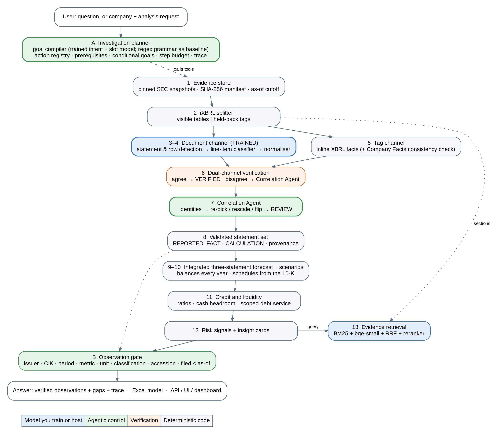
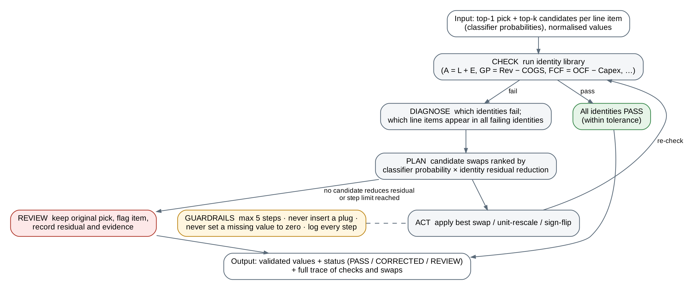

**FinAgent**

Project Blueprint — Version 2 (merged design)

Agentic AI for Automated Financial Modelling & Decision Intelligence

AI/ML in Practice capstone · Team T17 (SHARP FinAgent) · C-MInDS ePGD,
IIT Bombay

Prepared for: Vineet Ojha

Version 2.0 · 22 November 2026 · supersedes Version 1.0 (21 November
2026)

*Combines the best of two designs: the team's SHARP prototype (evidence
store, investigation planner, observation gate, integrated
three-statement model, credit and liquidity tools, point-in-time
backtest, evidence replays) and the Version 1 blueprint (trained
document extractor with held-back XBRL answer key, Correlation Agent,
evidence retrieval, learned question understanding, multi-company
evaluation, serving and observability).*

*The design is written as a target state. It does not depend on which
parts exist today.*

# Contents

**1** How to use this document

**2** Executive summary

**3** Problem, users and value

**4** Grading context and constraints

**5** Scope

**6** Design principles and vocabulary

**7** System architecture

**8** Component specifications

**9** Data plan

**10** Evaluation plan

**11** Deployment and observability

**12** Technology stack and repository

**13** Data schemas

**14** Course-topic coverage

**15** Build sequence

**16** Risks and mitigations

**17** Demo and presentation plan

**18** Viva preparation

**19** Limitations and fix paths

**20** Open decisions

**A** Appendix A — Canonical line-item taxonomy and model-input facts

**B** Appendix B — Identity and model-check library

**C** Appendix C — Credit ratios and risk signal library

**D** Appendix D — Supported goals and question catalogue

**E** Appendix E — Prototype review: issues and how Version 2 resolves
them

**F** Appendix F — Logs and templates

**G** Appendix G — Glossary

# 1. How to use this document

This blueprint is the single reference for FinAgent. It defines what
each component does, how it is built and tested, which course topic it
demonstrates, and what to say about it in the viva. It is written as a
target design: it describes the system the team should present, not the
state of any notebook.

## 1.1 Reading order

- **First read:** Sections 2, 5, 6 and 7 (what FinAgent is, scope,
  principles, architecture).

- **While building a component:** its subsection in Section 8, its
  schema in Section 13 and its evaluation in Section 10.

- **Before the final:** Sections 17 (demo), 18 (viva), 19 (limitations)
  and Appendix E (prototype issues to avoid repeating).

## 1.2 Confidence tags

| **Tag**          | **Meaning**                                                                                          | **What to do**                                          |
|------------------|------------------------------------------------------------------------------------------------------|---------------------------------------------------------|
| **\[Certain\]**  | Verified against a source: course guidelines, TA feedback, SEC documentation, or the prototype code. | Rely on it.                                             |
| **\[Likely\]**   | Strong inference from experience with similar systems.                                               | Rely on it, but watch for evidence against it.          |
| **\[Guessing\]** | An estimate made to fill a gap (dataset sizes, run times, thresholds).                               | Replace with a measured number as soon as you have one. |

## 1.3 Where each part of the design comes from

Version 2 merges two designs. The prototype contributes strong evidence
discipline and financial modelling; Version 1 contributes the learned
components, independent verification and the evaluation and serving
layers. Each row records which design a component is taken from and what
was changed.

| **Component**                                                                                                    | **Source** | **Change in Version 2**                                                                        |
|------------------------------------------------------------------------------------------------------------------|------------|------------------------------------------------------------------------------------------------|
| Pinned SEC evidence store with SHA-256 manifest and as-of cutoff                                                 | Prototype  | Extended from 2 to ~48 companies; integrity check kept for evidence only, not for code.        |
| iXBRL splitter, held-back tags, leakage test                                                                     | Version 1  | Reuses the prototype's context parser and row-label reader (Filing.line).                      |
| Trained line-item extractor (document channel)                                                                   | Version 1  | Unchanged; now one of two reading channels.                                                    |
| Tag channel (inline XBRL facts + Company Facts)                                                                  | Prototype  | Renamed honestly: a consistency check between two SEC tag views, not independent verification. |
| Dual-channel verification                                                                                        | New        | The document reading and the tags are compared; this is the genuinely independent check.       |
| Correlation Agent                                                                                                | Version 1  | Runs as planner actions and extends the prototype's reconcile tool.                            |
| Investigation planner (goals, action registry, prerequisites, conditional goals, step budget, trace, call reuse) | Prototype  | Front end replaced by a trained intent and slot model; the regex grammar becomes the baseline. |
| Observation gate                                                                                                 | Prototype  | Kept as the final evidence gate for every answer.                                              |
| Integrated three-statement forecast that balances every year                                                     | Prototype  | Promoted to core. Per-company code branches removed; dividends and buybacks read from history. |
| Credit ratios, liquidity headroom, securities reserve                                                            | Prototype  | One scenario set only; scoped debt-service coverage computed instead of always withheld.       |
| Point-in-time rolling-origin backtest                                                                            | Prototype  | Extended from one company to all validation companies.                                         |
| Evidence replays (hide a source in memory, rerun)                                                                | Prototype  | Becomes evaluation E8 and the injection mechanism for E2.                                      |
| Risk signals with quoted evidence (RAG)                                                                          | Version 1  | Combined with the prototype's credit ratios.                                                   |
| Evaluation suite, serving, dashboard, linked Excel export                                                        | Version 1  | Unchanged in intent; adds E8.                                                                  |

# 2. Executive summary

**What FinAgent does.** A user names a US-listed company and asks a
financial question, or requests a full analysis. FinAgent works from
pinned copies of the company's annual 10-K filings. It reads the
financial statements in two independent ways: a trained model reads the
visible tables as an analyst would, and a parser reads the filer's
machine tags. Where the two agree, the value is verified; where they
disagree, a Correlation Agent uses accounting identities to resolve or
escalate. From the verified statements FinAgent builds an integrated
three-statement model, a forecast that balances every year, stress
scenarios, credit and liquidity measures, and risk signals with
quotations from the filing. An investigation planner decides which of
these tools a question needs, and an observation gate refuses any answer
whose provenance does not check out.

**Why it matters.** A linked historical model with forecast and downside
cases takes an analyst three to four days. FinAgent produces a checked
draft in minutes, with a trace of every step and the source of every
number.

## 2.1 Where the intelligence is

| **Component**             | **What is learned or decided**                                                                                  | **Why it is not a wrapper**                                                    |
|---------------------------|-----------------------------------------------------------------------------------------------------------------|--------------------------------------------------------------------------------|
| **Document extractor**    | A classifier trained on thousands of statement rows maps each row to a line item.                               | Trained by the team; labels come free from held-back XBRL tags; runs on a CPU. |
| **Correlation Agent**     | Chooses among re-pick, rescale and sign-flip actions to satisfy accounting identities, or escalates.            | An agent loop with tools, an objective success test and guardrails.            |
| **Investigation planner** | Turns a question into goals with a trained intent and slot model, then chooses tools step by step from results. | Planner logic is the team's; the language model is small and self-hosted.      |
| **Evidence retrieval**    | Ranks filing passages that explain a movement.                                                                  | Local embedding and reranking models; quotes only.                             |

No external AI API runs inside the product. A frontier model may be used
only during evaluation, as a comparison ceiling and as an independent
judge (Decision D1).

## 2.2 Headline claims the final presentation should support

1.  The document extractor reaches X% field-level accuracy on companies
    it never saw, scored against the filer's own XBRL, compared with Y%
    for a rules baseline.

2.  Dual-channel verification agrees on Z% of values; the Correlation
    Agent resolves W% of disagreements and of injected errors, with a
    measured false-correction rate.

3.  The integrated forecast balances in every scenario and year; its
    one-year-ahead errors are compared with a naive baseline at
    filing-date origins.

4.  Under evidence replays, FinAgent returns a gap rather than a number
    in 100% of cases where the evidence was removed.

5.  A full analysis of a new company takes M minutes on a CPU at no
    per-query cost.

> **One-line pitch**
>
> FinAgent reads a 10-K two independent ways, proves its numbers against
> the filer's own XBRL, builds a model that balances, and only says what
> the filing supports.

# 3. Problem, users and value

## 3.1 Problem

Annual filings are authoritative but not decision-ready. Statements,
notes, MD&A and risk factors are spread across a long document. Analysts
locate figures, normalise definitions, reconcile totals, build the
model, forecast and test downside cases. The work is slow, hard to
audit, and vulnerable to copy errors and unsupported assumptions.

## 3.2 Research question

> Can an evidence-grounded agentic system transform public filings into
> structured, validated and explainable financial intelligence without
> silently inventing missing information?

Made testable: "structured" by extraction accuracy, "validated" by
dual-channel agreement and identity pass rates, "explainable" by
provenance and evidence faithfulness, "without inventing" by gap
behaviour under evidence replays and by the unsupported-claim rate.

## 3.3 Users

| **User**                                        | **What they need**                                                                                                                        |
|-------------------------------------------------|-------------------------------------------------------------------------------------------------------------------------------------------|
| Equity research and investment banking analysts | A correct, linked model they can extend; the source of every number.                                                                      |
| Credit and lending analysts                     | Liquidity headroom, working-capital and leverage measures with stated scope; explicit gaps where public data cannot support a conclusion. |
| Investors and research teams                    | Fast, sourced answers to factual and model questions.                                                                                     |

## 3.4 Why not simply read the XBRL tags?

1.  **Most financial documents carry no tags**: Indian annual-report
    PDFs, private-company accounts, lender packs. A model that reads
    statement tables is useful exactly there.

2.  **US 10-Ks are where the reading can be proven.** The tags give an
    exact answer key at scale.

3.  **Two independent readings are stronger than one.** For tagged
    filings, FinAgent uses both and reports where they disagree, which
    catches tagging errors as well as reading errors.

4.  **Tags vary across filers** (extension concepts, alternative
    concepts), so a canonical analyst-level line-item set is still
    needed.

## 3.5 What FinAgent is not

- Not a credit-approval or investment-recommendation system. Modelled
  headroom and ratios are conditional analysis, not underwriting
  decisions.

- Not designed for banks, insurers or REITs.

- Not a general chatbot: it answers a defined set of goals and asks for
  clarification otherwise.

# 4. Grading context and constraints

## 4.1 How the course grades the project \[Certain\]

| **Component**                     | **Weight** | **What it means for FinAgent**                                                                       |
|-----------------------------------|------------|------------------------------------------------------------------------------------------------------|
| **Scope and impact**              | ~25%       | A real analyst problem with a measurable time saving; ambitious but finished.                        |
| **Technical depth and execution** | ~25%       | Models the team trained, agents that actually decide, course topics visibly used, sound engineering. |
| **Presentation**                  | ~25%       | Clear story, measured results, honest limitations, a working demo with a recorded backup.            |
| **Viva (individual)**             | ~25%       | Each member redraws the architecture and defends their components.                                   |

The end-term carries 100% of course marks. The final is on **5 December
2026**, offline at IIT Bombay: 20 minutes per group covering
presentation, demo and individual viva.

## 4.2 Final checklist from the course guidelines \[Certain\]

| **Checklist item**                                                | **Where covered**                                                    |
|-------------------------------------------------------------------|----------------------------------------------------------------------|
| The system runs, and someone outside the team has used it         | Sections 11 and 15 (phase 9)                                         |
| Evaluation results with a baseline                                | Section 10 (E1 rules baseline, E5 regex baseline, E6 naive forecast) |
| Deployed and served, with a dashboard of latency, cost and errors | Section 11                                                           |
| Contribution log                                                  | Appendix F                                                           |
| Honest limitations with fix paths                                 | Section 19                                                           |
| Demo recording as backup                                          | Section 17                                                           |
| Rehearsed and inside the time limit                               | Section 17                                                           |

## 4.3 TA feedback from the midsem and the Version 2 response \[Certain\]

| **Feedback (Kaustubh)**                                                                           | **Response**                                                                                                                   |
|---------------------------------------------------------------------------------------------------|--------------------------------------------------------------------------------------------------------------------------------|
| Prioritise a clean, reproducible run.                                                             | Pinned evidence store with hashes; one Python package; one command per evaluation; Docker image (Sections 8.1, 11, 12).        |
| Reliable filing-to-analysis first; full three-statement modelling optional.                       | Extraction and verification come first in the build order; the integrated model is included because it balances and is tested. |
| Independently checked numerical answers and source evidence, including missing or ambiguous data. | Dual-channel verification (document reading vs tags); gaps and conflicts are first-class outcomes.                             |
| Separate facts, calculations and assumptions.                                                     | Five-way classification on every value (Section 6.2).                                                                          |
| Backtest against simple baselines if predictive accuracy is claimed.                              | Point-in-time rolling-origin backtest against a naive baseline (E6).                                                           |
| Three to five companies is a pilot; reserve an unseen company.                                    | ~48 companies with a held-out group never inspected during development.                                                        |
| Credit support optional, evidence-qualified, after reliable extraction.                           | Credit and liquidity tools carry scope statements and withhold what the filing cannot support.                                 |

## 4.4 Constraints

| **Constraint**                                                                   | **Consequence**                                                                         |
|----------------------------------------------------------------------------------|-----------------------------------------------------------------------------------------|
| No external AI API inside the product.                                           | All product models are trained or self-hosted. Frontier models only in evaluation (D1). |
| Build alongside the ML for Finance exam on 4 December.                           | Strict build order with exit criteria and a published cut order (Section 15).           |
| ₹40,000 team budget \[Certain\].                                                 | Covers Colab GPU time, hosting and evaluation-only API calls.                           |
| SEC fair access: declared User-Agent, at most 10 requests per second \[Likely\]. | Snapshots are fetched once by a rate-limited client, then pinned.                       |
| One team, one 20-minute slot.                                                    | One system, one story; the contribution log maps components to members.                 |

# 5. Scope

## 5.1 Core (must work end to end)

| **Capability**                                      | **Definition of done**                                                                                                                       |
|-----------------------------------------------------|----------------------------------------------------------------------------------------------------------------------------------------------|
| **Evidence store**                                  | Pinned 10-K, submissions, Company Facts and ticker snapshots for every company in the universe, with a SHA-256 manifest and an as-of cutoff. |
| **Document channel**                                | Three statements located; every row classified into the taxonomy (Appendix A) or OTHER; values normalised.                                   |
| **Tag channel**                                     | Inline XBRL facts for the same items, cross-checked against Company Facts.                                                                   |
| **Dual-channel verification and Correlation Agent** | Every value VERIFIED, CORRECTED, REVIEW or a gap, with the reason and the trace.                                                             |
| **Validated statement set**                         | Five fiscal years with classifications and provenance; reconciliation identities (Appendix B) pass or are explained.                         |
| **Integrated forecast and scenarios**               | Three-year forecast that balances in every year and scenario; one scenario set; assumptions classified.                                      |
| **Credit and liquidity**                            | Historical credit ratios, cash headroom and funding shortfall by scenario, scoped debt-service coverage.                                     |
| **Risk signals with evidence**                      | Signals (Appendix C) with quoted filing passages or explicit evidence gaps.                                                                  |
| **Investigation planner and observation gate**      | Supported goals (Appendix D) answered with verified observations, gaps or clarification; trace for every run.                                |
| **Evaluation harness**                              | E1–E8 runnable with one command each; results in the experiment log.                                                                         |
| **Serving**                                         | FastAPI service and UI in Docker on Linux, Windows and macOS; trace dashboard; linked Excel export.                                          |

## 5.2 Second tier

- **Fine-tuned transformer extractor (M3)** if it beats the best
  classical model on validation.

- **Local LLM fallback** in the goal compiler for questions the intent
  model is unsure about.

- **Cross-document transfer test** on hand-labelled Indian annual-report
  tables.

## 5.3 Out of scope

| **Item**                                          | **Reason to give if asked**                                                                                    |
|---------------------------------------------------|----------------------------------------------------------------------------------------------------------------|
| Lending recommendations or approval decisions     | Public filings cannot support a sanctionable decision; FinAgent reports conditional analysis and gaps.         |
| Comprehensive forward DSCR across all obligations | Short-term rollover and other obligations are not scheduled in the 10-K; a scoped measure is reported instead. |
| Multi-agent architecture                          | One planner and one reconciliation agent are easier to test and fail in fewer ways.                            |
| Free-text answers written by an LLM               | Answers are built from verified observations and quotations.                                                   |
| Kubernetes, distributed training                  | One CPU container serves the load; models train on a single GPU.                                               |
| Banks, insurers, REITs                            | Different statement structures.                                                                                |

# 6. Design principles and vocabulary

| **Principle**                                   | **In practice**                                                                                                                                          |
|-------------------------------------------------|----------------------------------------------------------------------------------------------------------------------------------------------------------|
| **Evidence before inference**                   | No value appears in an answer unless it traces to a filing or to a deterministic calculation on traced values.                                           |
| **Missing is not zero**                         | Absent items are gaps, never zero. Derived values are computed only when every input exists.                                                             |
| **Models read, rules decide**                   | Trained models read rows, parse questions and rank passages. Arithmetic, identities, forecasts and pass/fail decisions are deterministic.                |
| **Two independent readings**                    | A value is VERIFIED for a tagged filing only when the document reading and the tag agree.                                                                |
| **Point-in-time discipline**                    | Every tool takes an as-of date; no filing dated after it is used. Backtests use filing dates as origins.                                                 |
| **Gate every answer**                           | The observation gate checks issuer, CIK, fiscal year, period end, metric, unit, classification, accession, URL and filing date before anything is shown. |
| **No company-specific code**                    | Differences between filers are handled by configuration and data (concept lists, taxonomy), never by if ticker == … branches.                            |
| **No plugs**                                    | Agents may re-pick, rescale or flip a sign; they may never insert a balancing figure.                                                                    |
| **Refusal and clarification are valid answers** | A correct gap or a request for scope is scored as a success.                                                                                             |
| **One change per experiment**                   | Every evaluation run changes one thing; every component version is named.                                                                                |

## 6.1 Outcome statuses

| **Status**             | **Level**         | **Meaning**                                                                |
|------------------------|-------------------|----------------------------------------------------------------------------|
| **VERIFIED**           | Observation, goal | Passed reading, verification and the observation gate.                     |
| **CORRECTED**          | Value             | The Correlation Agent changed the document reading; the trace records why. |
| **REVIEW**             | Value, identity   | Inconsistent and unresolved; shown with its residual.                      |
| **MISSING_PRIMARY**    | Tool result       | The first source lacks the value; the planner tries the fallback action.   |
| **CONFLICT**           | Tool result       | Eligible sources disagree.                                                 |
| **INVALID**            | Tool result       | A value failed a type, sign or recomputation check.                        |
| **GAP / EVIDENCE_GAP** | Goal, answer      | The required value or explanation could not be established.                |
| **SKIPPED**            | Conditional goal  | The condition was not met (for example, no modelled shortfall).            |
| **CLARIFICATION**      | Question          | Outside supported goals or ambiguous; FinAgent asks for scope.             |
| **COMPLETE / PARTIAL** | Run               | All goals verified or skipped / some verified alongside gaps.              |

## 6.2 Value classifications

| **Classification**                    | **Meaning**                                                                     |
|---------------------------------------|---------------------------------------------------------------------------------|
| **REPORTED_FACT**                     | A value reported in the filing, verified by both channels where tags exist.     |
| **CALCULATION**                       | Derived deterministically from reported facts (FCF, ratios, residuals).         |
| **MODEL_ASSUMPTION**                  | A forecast driver or scenario shock chosen by the model or the user.            |
| **CALCULATION_FROM_MODEL_ASSUMPTION** | An output of the forecast or a scenario; conditional on the stated assumptions. |
| **EVIDENCE_GAP**                      | A required value or explanation that could not be established.                  |

# 7. System architecture

FinAgent has two layers. The **control layer** (planner and observation
gate) decides what to do for a question and checks every result. The
**analysis layer** is a set of tools: two reading channels over pinned
evidence, verification and reconciliation, the integrated model, credit,
risk and retrieval.

*Figure 1. FinAgent Version 2. The planner (A) calls analysis tools
(1–13); every answer passes the observation gate (B).*

## 7.1 Component summary

| **\#** | **Component**                     | **Output**                                          | **Kind**                      |
|--------|-----------------------------------|-----------------------------------------------------|-------------------------------|
| A      | Investigation planner             | Goals, tool calls, trace, run status                | Trained compiler + agent loop |
| B      | Observation gate                  | Accepted or rejected observations                   | Deterministic                 |
| 1      | Evidence store                    | Pinned, hashed SEC snapshots with as-of filtering   | Deterministic                 |
| 2      | iXBRL splitter                    | Clean visible document; tag store                   | Deterministic                 |
| 3–4    | Document channel                  | Row predictions and normalised values               | Trained model                 |
| 5      | Tag channel                       | Tagged values with Company Facts consistency status | Deterministic                 |
| 6      | Dual-channel verification         | Agreement or disagreement per value                 | Deterministic                 |
| 7      | Correlation Agent                 | CORRECTED / REVIEW decisions with trace             | Agent loop                    |
| 8      | Validated statement set           | Five-year statements with classifications           | Deterministic                 |
| 9–10   | Integrated forecast and scenarios | Balanced three-year projections per scenario        | Deterministic                 |
| 11     | Credit and liquidity              | Ratios, headroom, shortfall, scoped coverage        | Deterministic                 |
| 12     | Risk signals and insight cards    | Signals with evidence or gaps                       | Deterministic + retrieval     |
| 13     | Evidence retrieval                | Ranked passages and quotations                      | Retrieval models              |

## 7.2 Why this shape

- **Questions drive work.** The planner runs only the tools a question
  needs, in dependency order, and stops on a step budget.

- **Independence is structural.** The document channel never sees tags;
  the tag channel never sees model output; they meet only at
  verification.

- **Everything downstream of verification is deterministic or quoted**,
  so it can be recomputed and audited.

- **One gate at the end.** However a value was produced, it reaches the
  user only through the same provenance checks.

# 8. Component specifications

Each subsection gives a spec box, the method, failure handling, tests,
and viva points. Components marked *(prototype)* keep the team
prototype's design with the stated changes; *(V1)* keep the Version 1
design.

## 8.1 Evidence store (prototype, extended)

|                 |                                                                                                                                                                                                                                   |
|-----------------|-----------------------------------------------------------------------------------------------------------------------------------------------------------------------------------------------------------------------------------|
| **Purpose**     | Make every run reproducible and point-in-time correct by working only from pinned, hashed copies of SEC data.                                                                                                                     |
| **Contents**    | Per company: each 10-K primary document (inline XBRL HTML, gzipped), the submissions JSON, the Company Facts JSON; globally: the ticker map. A manifest.json records file name, source URL and SHA-256 of the uncompressed bytes. |
| **Output**      | FilingRecord per fiscal year: CIK, accession, form, start, end, filed date, primary document, filing URL.                                                                                                                         |
| **Course link** | Reproducibility and MLOps practice; tools with typed interfaces (S6).                                                                                                                                                             |

### Method

1.  A one-time fetch script downloads snapshots through a rate-limited
    client with a declared User-Agent, then writes them with their
    hashes. The product never calls the SEC at run time.

2.  Every read decompresses the snapshot and checks its hash against the
    manifest; a mismatch stops the run.

3.  Filings: keep form == "10-K" (no amendments), drop duplicates by
    period end keeping the first filed, keep the last five fiscal years
    plus the preceding year (to obtain each year's start date), and
    require consecutive fiscal years.

4.  Every tool call carries an **as-of date**; filings filed after it
    are invisible. The filing URL is checked to start with the issuer's
    EDGAR archive prefix and to match the manifest.

### Changes from the prototype

- Universe extended from Amazon and Microsoft to ~48 companies (Section
  9).

- Fiscal year taken from the filing's own dei:DocumentFiscalYearFocus
  instead of the calendar year of the period end, so Walmart, Nike and
  Costco are labelled as the companies label them.

- The integrity check covers evidence snapshots only. Code is versioned
  with git and shipped in a Docker image; it is no longer loaded by
  executing notebook cells.

### Tests

- A corrupted snapshot byte fails the hash check.

- With as-of set before a filing date, that filing is excluded.

- Non-December fiscal years are labelled as the filer reports them.

## 8.2 iXBRL splitter (V1, reusing prototype parsing)

|             |                                                                                                                                                                                                                                                                   |
|-------------|-------------------------------------------------------------------------------------------------------------------------------------------------------------------------------------------------------------------------------------------------------------------|
| **Purpose** | Separate what an analyst sees from the machine tags so the document channel cannot read the answer.                                                                                                                                                               |
| **Output**  | \(a\) Clean document with every ix:\* wrapper removed but its text kept, and ix:header / ix:hidden deleted; (b) a tag store: one record per numeric fact with concept, context (period, dimensions), unit, scale, sign, amount and the address of its table cell. |

The prototype already parses contexts (start, end or instant, explicit
dimension members), USD units, scale, sign and zero-dash formats
(Filing.\_\_init\_\_, Filing.amount), and walks from each tagged number
to its table row label (Filing.line). These become the tag store
builder. The new step is producing the clean document and asserting it
contains no ix: element, us-gaap: string or concept name (the leakage
test).

## 8.3 Statement and row detection (V1)

|             |                                                                                                                                                  |
|-------------|--------------------------------------------------------------------------------------------------------------------------------------------------|
| **Purpose** | Locate the income statement, balance sheet and cash flow statement in the clean document and turn each into row instances.                       |
| **Output**  | RowInstance: statement, label, parent header, indentation, bold/total styling, position, cell texts per column, column periods, table unit text. |

1.  Find Item 8; score tables by anchor phrases ("total assets", "net
    cash provided by operating activities"), numeric density and
    tagged-cell counts (allowed: it locates tables, it does not label
    rows).

2.  For each row: label = first non-numeric cell (the same rule as
    Filing.line); numeric cells kept as raw text; style flags from
    inline CSS; rows without numbers become parent headers.

3.  Read column headers into period end dates and the unit line ("in
    millions") into a default scale. Merge statements split across
    consecutive tables with identical headers.

## 8.4 Line-item classifier — document channel (V1)

|                 |                                                                                                                                                                                      |
|-----------------|--------------------------------------------------------------------------------------------------------------------------------------------------------------------------------------|
| **Purpose**     | Map every statement row to one canonical line item (Appendix A) or OTHER, with calibrated probabilities.                                                                             |
| **Labels**      | From the tag store: the row's concept → canonical item via concept_map.yaml; unmapped concepts → OTHER. Rows with conflicting mapped concepts are excluded from training and logged. |
| **Output**      | Top-3 (line_item, probability) per row.                                                                                                                                              |
| **Course link** | Model adaptation and fine-tuning; classical baselines; calibration.                                                                                                                  |

### Model ladder

| **ID** | **Model**                                                                                                                                                                                             | **Notes**                                                            |
|--------|-------------------------------------------------------------------------------------------------------------------------------------------------------------------------------------------------------|----------------------------------------------------------------------|
| **M0** | Rules: the prototype's concept-candidate lists turned into label synonym dictionaries + regex                                                                                                         | Baseline.                                                            |
| **M1** | TF-IDF (word 1–2-grams, character 3–5-grams) on label + parent header + statement → logistic regression                                                                                               | Class-weighted; interpretable.                                       |
| **M2** | LightGBM on TF-IDF SVD components + structure (indent, total styling, position) + magnitude features (log share of statement maximum, subtotal detector)                                              | Tests whether structure helps.                                       |
| **M3** | Fine-tuned small encoder (for example deberta-v3-small) on serialised rows: \[STMT\] cash flow \[PARENT\] investing activities \[LABEL\] purchases of property and equipment \[INDENT\] 1 \[TOTAL\] 0 | Colab GPU, fp16, early stopping on validation macro-F1. Second tier. |
| **M4** | Frontier model, zero-shot with the taxonomy                                                                                                                                                           | Evaluation ceiling only (D1).                                        |

### Training protocol

- **Split by company.** A company's rows repeat across years, so a
  row-level split leaks.

- **Train / validation / held-out test** company groups fixed before
  training; held-out scored once per model version.

- **Calibration** checked on validation (expected calibration error) and
  corrected with temperature scaling, because the Correlation Agent
  ranks alternatives by probability.

- **Macro-F1** reported with accuracy, so rare items (interest expense,
  R&D) count.

### Viva points

- Why company-grouped splits.

- Why an encoder classifier rather than a generative LLM (closed label
  set, calibrated probabilities, CPU serving).

- What label noise exists in XBRL and how it was measured (Section 9.5).

## 8.5 Value normaliser (V1)

| **Issue**                | **Rule**                                                                                                                                                                                                            |
|--------------------------|---------------------------------------------------------------------------------------------------------------------------------------------------------------------------------------------------------------------|
| **Scale**                | From the table unit line; per-share and share-count rows exempt.                                                                                                                                                    |
| **Parentheses**          | "(1,234)" → −1,234 as displayed.                                                                                                                                                                                    |
| **Canonical sign**       | Each line item stored in the sign convention of its standard XBRL concept (Appendix A), so channels compare like with like. Capex is a positive cash payment; a negative capex reading is INVALID (prototype rule). |
| **Period**               | Column end date matched to the filing's fiscal periods; prior-year columns kept for restatement checks.                                                                                                             |
| **Zero-dash and blanks** | Zero-dash formats → 0 only where the filer displays a dash for zero (prototype rule); blanks → gap, never 0.                                                                                                        |

## 8.6 Tag channel (prototype)

|             |                                                                                                           |
|-------------|-----------------------------------------------------------------------------------------------------------|
| **Purpose** | Read the same line items from the filer's tags, as the second, independent reading.                       |
| **Output**  | Tag value per item with status VERIFIED, MISSING_PRIMARY, CONFLICT, INVALID or GAP, and the concept used. |

1.  **Primary:** Company Facts observations for the candidate concepts
    that match form 10-K, the accession, the period start and end, and
    the filing date. Exactly one distinct value must remain, or the
    result is CONFLICT; none gives MISSING_PRIMARY.

2.  **Corroboration:** the inline XBRL in the original filing must
    contain the same amount under the same concept for the same
    non-dimensional context, or the result is CONFLICT.

3.  **Fallback:** if Company Facts lacks the value, the inline XBRL
    alone may supply it, labelled as a single-source tag reading.

> **Naming correction**
>
> The prototype called the Company Facts vs inline XBRL comparison
> "independent verification". The SEC builds Company Facts from the same
> filing's XBRL, so this is a consistency check between two views of the
> filer's tags. Version 2 calls it that, and reserves "independent" for
> the comparison between the document reading and the tags (8.7).

## 8.7 Dual-channel verification (new)

|             |                                                                                     |
|-------------|-------------------------------------------------------------------------------------|
| **Purpose** | Accept a reported value only when two independent readings agree.                   |
| **Input**   | Document-channel value and tag-channel value per (company, fiscal year, line item). |
| **Output**  | VERIFIED, DISAGREE, single-channel or GAP per value.                                |

| **Document channel** | **Tag channel**                              | **Result**                                                                                          |
|----------------------|----------------------------------------------|-----------------------------------------------------------------------------------------------------|
| Value                | Same value within reported precision         | VERIFIED, classification REPORTED_FACT.                                                             |
| Value                | Different value                              | DISAGREE → Correlation Agent (8.8).                                                                 |
| Value                | Missing (untagged filing, extension concept) | Single-channel (document); accepted only if every identity it enters passes; flagged in the answer. |
| Missing              | Value                                        | Single-channel (tag); accepted and flagged; counted as a document-channel miss in E1.               |
| Missing              | Missing                                      | GAP.                                                                                                |

> **Evaluation mode versus product mode**
>
> **Product mode:** disagreement with the tag triggers the Correlation
> Agent.
>
> **Evaluation mode (E1, E2):** tags are hidden from verification and
> from the agent; the agent is triggered only by identity failures.
> Otherwise the agent would be told which value is wrong and extraction
> accuracy after the agent would be inflated.

## 8.8 Correlation Agent (V1, run as planner actions)

|                 |                                                                                                  |
|-----------------|--------------------------------------------------------------------------------------------------|
| **Purpose**     | Resolve disagreements and identity failures by choosing among alternative readings, or escalate. |
| **Output**      | CORRECTED or REVIEW per value, identity residuals, and a step-by-step trace.                     |
| **Course link** | Tools (S6), orchestration and state (S7), planning, replanning and guardrails (S10).             |

*Figure 2. Correlation Agent loop: check, diagnose, plan, act, re-check,
with guardrails and escalation.*

| **Tool**                 | **What it does**                                                                                                                                      |
|--------------------------|-------------------------------------------------------------------------------------------------------------------------------------------------------|
| run_identities           | Evaluates the identity library (Appendix B): balance sheet, cash roll-forward, retained earnings roll-forward, income statement chain, sanity checks. |
| candidates               | Top-k alternative rows for a line item with probabilities.                                                                                            |
| swap, rescale, flip_sign | Apply an alternative row, a ×1,000 or ÷1,000 unit correction, or a sign reversal.                                                                     |
| mark_review              | Stop and escalate with the residual.                                                                                                                  |

Planning: rank suspects by how many failing identities they enter and by
low confidence; score each action by probability × residual reduction;
apply only actions that strictly reduce the residual without breaking a
passing identity; re-check; at most five actions; never insert a plug;
never set a missing value to zero.

The prototype's reconcile tool (three statement residuals that must be
exactly zero) becomes the agent's final check: after the agent finishes,
those residuals are recomputed independently and must be zero or the
statement goal is not VERIFIED.

> **Prior result to carry forward**
>
> In October the agent added no accuracy on clean filings. E2 therefore
> tests it on injected errors as well as on clean data. Report whichever
> result comes out.

## 8.9 Validated statement set and Excel export

Five fiscal years per company. Beyond the canonical line items, it holds
the model-input facts the integrated model needs (Appendix A.2): current
and non-current debt, operating and finance lease liabilities and
right-of-use assets, retained earnings and their opening balance,
opening and closing statement cash including restricted cash, the FX
effect on cash, depreciation, operating lease cost, dividends and
repurchases charged to retained earnings, and the 10-K maturity
schedules for debt principal and lease payments.

Derived items are CALCULATION: gross profit, operating expense after
cost of sales, non-operating net, below-tax net, free cash flow. Where a
total is not presented (Amazon reports no total liabilities line), it is
derived from presented components **by a rule in configuration that
applies to every filer**, not by company-specific code.

| **Workbook sheet**                               | **Contents**                                                                  |
|--------------------------------------------------|-------------------------------------------------------------------------------|
| **Cover**                                        | Company, filings, as-of date, run ID, model versions, verification summary.   |
| **Income Statement · Balance Sheet · Cash Flow** | REPORTED_FACT inputs in blue; CALCULATION rows as live formulas.              |
| **Ratios**                                       | Credit and operating ratios as formulas.                                      |
| **Forecast**                                     | MODEL_ASSUMPTION drivers in blue; projections as formulas; scenario selector. |
| **Verification**                                 | Channel agreement, identity residuals, agent actions.                         |
| **Sources**                                      | Accession, statement, row label and concept for every reported fact.          |

## 8.10 Integrated three-statement forecast (prototype, with fixes)

|             |                                                                                                                                                                                    |
|-------------|------------------------------------------------------------------------------------------------------------------------------------------------------------------------------------|
| **Purpose** | Project income statement, balance sheet and cash flow three years ahead so that the balance sheet balances and cash ties in every year.                                            |
| **Output**  | Per year: revenue, COGS, EBIT, interest, tax, net income, depreciation, capex, working capital, CFO, CFI, CFF, cash, debt, leases, retained earnings, assets, liabilities, equity. |

### Drivers (MODEL_ASSUMPTION unless stated)

| **Driver**                           | **Version 2 rule**                                                                                                                                                                             |
|--------------------------------------|------------------------------------------------------------------------------------------------------------------------------------------------------------------------------------------------|
| **Revenue growth**                   | CAGR over the latest four fiscal-year revenues (prototype), capped to \[−10%, +30%\].                                                                                                          |
| **COGS, other cash costs**           | Share of revenue; other cash cost share calibrated from operating expense after COGS less depreciation and operating lease cost (prototype).                                                   |
| **Receivables, inventory, payables** | Shares of revenue or COGS from the latest year (prototype); three-year median available as a switch.                                                                                           |
| **Depreciation**                     | Latest-year depreciation ÷ latest closing PP&E, applied to each year's opening PP&E (prototype).                                                                                               |
| **Capex**                            | Share of revenue.                                                                                                                                                                              |
| **Tax**                              | Latest effective rate, bounded to \[10%, 35%\].                                                                                                                                                |
| **Interest rates**                   | Effective historical rate (interest expense ÷ average funded debt) where available; otherwise 4% as an explicit assumption. Lease rates 4% as an assumption.                                   |
| **Debt and lease run-off**           | Scheduled principal and lease payments for years 1–3 read from the 10-K maturity tables (prototype). New debt and new leases: zero by default, with a "refinance maturities" switch.           |
| **Dividends and repurchases**        | Three-year median payout ratio and three-year median repurchases from history. The prototype set both to zero, which overstates projected cash for companies that return capital (Appendix E). |

### Checks on every projection

- Assets = liabilities + equity within \$0.01 in every year and
  scenario.

- Cash recomputed independently from EBIT, depreciation, working
  capital, cash tax, interest, capex, principal, dividends and financing
  (prototype \_validate_projection).

- Scheduled principal never exceeds the opening balance; lease principal
  never negative.

- Failure of any check makes the forecast goal INVALID; no partial
  numbers are shown.

Backtest: the point-in-time rolling-origin design of the prototype
(origin = filing date of the last training year; one year ahead;
compared with a naive last-value forecast) is kept and run across all
validation companies (E6).

## 8.11 Scenario engine (prototype credit scenarios, one set)

| **Shock (MODEL_ASSUMPTION)**                             | **Base** | **Moderate** | **Severe** |
|----------------------------------------------------------|----------|--------------|------------|
| **Revenue growth (shift to annual growth rate)**         | 0        | −5 pp        | −12 pp     |
| **COGS share of revenue**                                | 0        | +1.5 pp      | +3.5 pp    |
| **DSO / DIO (days)**                                     | 0 / 0    | +5 / +5      | +12 / +12  |
| **DPO (days)**                                           | 0        | −3           | −8         |
| **Funded debt interest rate**                            | 0        | +2 pp        | +4 pp      |
| **Capex multiplier**                                     | 1.0      | 1.0          | 1.0        |
| **Haircut on short-term securities (liquidity reserve)** | 0%       | 20%          | 50%        |
| **Minimum cash floor**                                   | \$0      | \$0          | \$0        |

- Shocks are stored as decimals and applied once; a unit test checks
  each one.

- The revenue shock shifts the **growth rate** each year, so its effect
  compounds; say so on the slide.

- The prototype notebook's separate stress table (revenue −5%/−10% level
  shocks, margin −0.5/−1 pp, inventory shocks) is retired, so there is
  one definition of "Severe" in the whole system.

- Every scenario runs through the integrated forecast and its balance
  checks.

## 8.12 Credit and liquidity (prototype, with fixes)

### Historical credit ratios

Current ratio, quick ratio, funded debt to equity, debt plus leases to
equity, total liabilities to assets, EBIT to gross interest, CFO to
current liabilities, FCF to funded debt, DSO / DIO / DPO on average
balances and actual period days, cash conversion cycle, and the
operating working-capital change. Each ratio is recomputed independently
before it is accepted (prototype). Formulas in Appendix C.1.

### Liquidity under scenarios

For each scenario and year: projected cash, cash headroom over the
floor, funding shortfall, scheduled long-term principal, finance lease
principal, funded interest, and a conditional securities reserve
(securities × (1 − haircut)) shown separately and never counted as cash.
A shortfall is labelled MODELLED CASH SHORTFALL and is conditional on
the scenario.

### Debt service: scoped measure plus explicit withholding

| **Measure**                              | **Status**                                  | **Definition**                                                                                                                                                                          |
|------------------------------------------|---------------------------------------------|-----------------------------------------------------------------------------------------------------------------------------------------------------------------------------------------|
| Scheduled debt-service coverage (scoped) | Reported, CALCULATION_FROM_MODEL_ASSUMPTION | (CFO − capex) ÷ (scheduled long-term principal + funded interest + finance lease principal and interest), per scenario and year. The answer states which obligations are excluded.      |
| Comprehensive forward DSCR               | Withheld with reasons                       | Requires reconciled forward cash interest on all obligations, scheduled short-term rollover and other financing, and an independently established cash flow available for debt service. |

The prototype always returned a gap for debt service. Version 2 reports
what the 10-K does support and withholds only the comprehensive measure,
so the conditional liquidity → debt-service question returns a number
with its scope and a stated gap.

## 8.13 Risk signals and insight cards (V1, merged with credit ratios)

The signal library (Appendix C.2) runs on history, forecast and
scenarios, using the credit ratios of 8.12 where they overlap. Each
fired signal sends a template query to evidence retrieval, restricted to
Item 7 and the Item 8 notes of the same filing. The best one or two
sentences above a relevance threshold are quoted with citations; if none
clears it, the card says the filing does not explain the movement
(EVIDENCE_GAP). No model writes free text on a card.

> **Composite signal — operating and investing cash pressure**
>
> Revenue rising while receivables, inventory and capex grow faster and
> cash conversion weakens. Individually routine; together, growth is
> consuming cash.

## 8.14 Evidence retrieval (V1)

| **Step**     | **Choice**                                                                             |
|--------------|----------------------------------------------------------------------------------------|
| **Sections** | Split by 10-K Item headings and Item 8 note headings.                                  |
| **Chunks**   | Paragraphs merged to ~200 tokens at sentence boundaries; tables stored separately.     |
| **Sparse**   | BM25.                                                                                  |
| **Dense**    | bge-small-en-v1.5 embeddings on CPU; cosine similarity in NumPy.                       |
| **Fusion**   | Reciprocal rank fusion, k = 60, top 20.                                                |
| **Rerank**   | Local cross-encoder (ms-marco-MiniLM-L-6-v2); keep top 3; quote at most two sentences. |

## 8.15 Investigation planner (prototype loop, learned front end)

|                 |                                                                                                                                               |
|-----------------|-----------------------------------------------------------------------------------------------------------------------------------------------|
| **Purpose**     | Turn a question into typed goals, choose tools step by step from their results, and stop with a complete, partial or gap outcome and a trace. |
| **Course link** | Tool use (S6), orchestration (S7), reasoning and planning with replanning and budgets (S10).                                                  |

*Figure 3. Planner loop: compile, expand prerequisites, select, act,
gate, update, stop.*

### Goal compiler

1.  **Issuer resolution:** names, tickers and CIKs from the ticker map
    (generalising the prototype's two hand-written patterns). A second
    issuer is accepted only for an explicit comparison; otherwise
    CLARIFICATION.

2.  **Clause splitting:** on semicolons and on "and" before an action
    verb (prototype rule), so "assess severe liquidity; if there is a
    shortfall, check debt service" becomes two goals, the second
    conditional.

3.  **Intent and slots (trained):** each clause goes to an intent
    classifier (TF-IDF + logistic regression, trained on ~3,000
    template-generated questions plus paraphrases) and a slot filler
    (metric synonyms, fiscal year, scenario, target year). This replaces
    the prototype's exact-match regex grammar, which becomes the M0
    baseline in E5.

4.  **Fallback:** if intent confidence is below a threshold, try the
    regex grammar; then, optionally, a local 4-bit Qwen2.5-1.5B
    constrained to the Goal JSON schema; else CLARIFICATION.

5.  **Constraints:** one fiscal period per goal; conditional
    debt-service goals require a liquidity goal (prototype rules).

### Goal kinds and action registry

| **Goal kind**      | **Actions (trigger → action)**                                                                                     | **Prerequisite**    |
|--------------------|--------------------------------------------------------------------------------------------------------------------|---------------------|
| fact               | start → reported_verified (both channels + verification); DOC_MISSING → reported_tag_only (flagged single-channel) | —                   |
| statements         | start → reconcile (Correlation Agent + zero-residual check)                                                        | —                   |
| forecast           | start → project                                                                                                    | statements VERIFIED |
| credit             | start → credit_ratios                                                                                              | statements VERIFIED |
| liquidity          | start → liquidity                                                                                                  | statements VERIFIED |
| debt (conditional) | start → debt_service_scoped, only if a liquidity goal shows a shortfall; otherwise SKIPPED                         | statements VERIFIED |
| explain            | start → explain_movement (trend + retrieval)                                                                       | fact VERIFIED       |
| risk               | start → risk_signals                                                                                               | statements VERIFIED |

### Loop rules (prototype)

- Each iteration picks the lowest-priority eligible action whose trigger
  matches the goal's status, whose prerequisite is VERIFIED, and which
  has not been tried for that goal.

- Identical tool calls are reused, not repeated; reuse is recorded in
  the trace.

- A terminal prerequisite failure turns dependants into gaps with the
  prerequisite's reason.

- Step budget of 12 (configurable 0–30); stop reasons: goals resolved,
  evidence gap, no eligible action, step limit.

- Comparisons render each issuer's own fiscal year and, for matching
  metrics, the difference as a CALCULATION.

## 8.16 Observation gate (prototype)

Every observation is rejected unless all of these hold: the outcome is
VERIFIED; the metric is in the goal kind's allowed set and matches the
request; one observation per metric; the issuer and CIK match; the
fiscal year and period end match the goal (forecast and liquidity: the
target year); the unit is USD (ratios: x); the classification matches
the goal kind; the accession, filing URL and filing date match the
origin filing; the filing date is on or before the as-of date; the value
is finite; a basis is recorded. Version 2 adds: single-channel facts
must carry their flag, and quotations must come from chunks of the same
accession.

## 8.17 Orchestration, state, trace and integrity

- **Package, not notebook.** All logic lives in a Python package with
  tests. The prototype's pattern of executing selected notebook cells at
  import time is dropped; notebooks only call the package.

- **Run state:** typed goals, tool outcomes and observations; caches
  keyed by (issuer, origin fiscal year, as-of).

- **Trace:** per step — tool, arguments, eligible tools, decision
  reason, status, reuse, observations; persisted as JSON and to SQLite
  for the dashboard.

- **Integrity:** evidence hashes checked on read; experiment results
  record the git commit and the evidence manifest hash.

- **No magic counts:** assertions such as "exactly 45 facts" (prototype)
  are replaced by per-item completeness checks that work for any
  company.

# 9. Data plan

## 9.1 Sources

| **Source**                                | **Role**                                                                                 |
|-------------------------------------------|------------------------------------------------------------------------------------------|
| SEC company_tickers.json                  | Issuer resolution (names, tickers, CIKs).                                                |
| Submissions API                           | Filing list, dates, accessions, primary documents.                                       |
| 10-K primary documents (inline XBRL HTML) | Document channel input (tags stripped); tag channel input; answer key; retrieval corpus. |
| Company Facts API                         | Tag channel primary source and consistency check against inline XBRL.                    |

All four are fetched once and pinned in the evidence store (8.1). Fiscal
years FY2021–FY2025 (plus the preceding year for start dates); inline
XBRL covers all operating-company 10-Ks in this window. \[Likely\]

## 9.2 Company universe and splits

| **Split**             | **Companies (proposal)**                                                                                                                                                                                                                                                                                                                       | **Role**                                                                                                                                            |
|-----------------------|------------------------------------------------------------------------------------------------------------------------------------------------------------------------------------------------------------------------------------------------------------------------------------------------------------------------------------------------|-----------------------------------------------------------------------------------------------------------------------------------------------------|
| **Train (~32)**       | Apple, Alphabet, Meta Platforms, NVIDIA, Oracle, Cisco, Adobe, Salesforce, Intel, Qualcomm, IBM, Walmart, Target, Home Depot, Lowe's, McDonald's, Starbucks, Coca-Cola, PepsiCo, Procter & Gamble, Caterpillar, Deere, Honeywell, Lockheed Martin, UPS, ExxonMobil, ConocoPhillips, Johnson & Johnson, Pfizer, Verizon, Comcast, Union Pacific | Fit models.                                                                                                                                         |
| **Validation (8)**    | Amazon, Microsoft, Chevron, Nike, Merck, AT&T, Colgate-Palmolive, Abbott                                                                                                                                                                                                                                                                       | Model selection, thresholds, error analysis, agent and planner development, demo. Amazon and Microsoft stay here for continuity with the prototype. |
| **Held-out test (8)** | Costco, Netflix, Texas Instruments, General Mills, FedEx, Eli Lilly, Danaher, Marriott                                                                                                                                                                                                                                                         | Scored once per model version; never opened for debugging; headline numbers.                                                                        |

The prototype called Microsoft a "holdout", but its rules and its
three-statement code were written with Microsoft in view, so it cannot
serve as unseen evidence. Version 2 places both prototype companies in
validation and draws held-out companies from firms nobody has inspected.

## 9.3 Dataset size \[Guessing\]

About 48 companies × 5 years × 3 statements × ~30 rows ≈ 20,000 row
instances. Replace with measured counts after the first full parse.

## 9.4 Labels

1.  Collect the concepts tagged on each statement row's cells
    (non-dimensional contexts).

2.  Map to canonical items with concept_map.yaml, seeded from the
    prototype's candidate lists and Appendix A; unmapped and extension
    concepts → OTHER.

3.  Exclude rows with two mapped concepts; header rows become
    parent-header features.

## 9.5 Label quality audit

Review ~100 validation disagreements by hand: model error, label error
or taxonomy ambiguity. Report the label-error rate; it bounds achievable
accuracy. Also report the Company Facts vs inline disagreement rate from
the tag channel. \[Likely\]

## 9.6 Storage layout

> evidence/ {file}.gz + manifest.json (url, sha256) — pinned, read-only
>
> derived/ {cik}/{accession}/clean.htm, tags.parquet, rows.parquet
>
> datasets/ rows\_{version}.parquet (features, labels, split)
>
> gold/ intents_test.csv, retrieval_queries.csv, insight_review.csv
>
> runs/ {run_id}/ statements.json, workbook.xlsx, trace.jsonl

# 10. Evaluation plan

Each evaluation has a fixed dataset, metric definitions, a baseline and
one command that reproduces it. Results go to experiments.csv with the
git commit and evidence manifest hash.

| **ID** | **Question**                                                             | **Data**                                                    | **Primary metrics**                                                                                 | **Comparison**                                                |
|--------|--------------------------------------------------------------------------|-------------------------------------------------------------|-----------------------------------------------------------------------------------------------------|---------------------------------------------------------------|
| **E1** | Does the document channel read statements correctly on unseen companies? | Held-out companies, all years; tags as answer key           | Field-level accuracy; macro-F1; unit/sign error rate                                                | M0 vs M1 vs M2 vs M3; M4 ceiling                              |
| **E2** | Does the Correlation Agent help, and is it safe?                         | Validation; clean and with injected errors; evaluation mode | Detection, correction, false-correction rates; identity pass rate                                   | With vs without agent                                         |
| **E3** | Does retrieval find the explaining passage?                              | 25–40 labelled queries                                      | Recall@5; MRR                                                                                       | BM25 vs dense vs hybrid vs + reranker                         |
| **E4** | Are insight cards faithful?                                              | 20–30 cards                                                 | Supported / partial / unsupported; unsupported-claim rate                                           | Human labels vs independent judge (kappa)                     |
| **E5** | Does the planner understand questions and answer correctly?              | 100–150 hand-written questions incl. ~20% unsupported       | Goal accuracy; slot F1; answer correctness; correct-clarification rate; pass^k for the LLM fallback | Prototype regex grammar vs trained compiler vs + LLM fallback |
| **E6** | Is the forecast better than naive?                                       | Validation companies; filing-date origins                   | MAE and MAPE one year ahead for revenue, operating income, CFO, capex, FCF                          | Naive last value                                              |
| **E7** | Is it fast and cheap enough?                                             | All runs                                                    | p50/p95 latency per stage; minutes per company; error rate; cost                                    | Manual build time                                             |
| **E8** | Does FinAgent return gaps when evidence is missing?                      | Validation companies × supported goals × replay conditions  | Gap-correctness rate; fallback-correctness rate; fabricated-value count (target 0)                  | Complete vs primary hidden vs both hidden vs document hidden  |

## 10.1 E1 — Document channel accuracy

- Field-level accuracy: share of (company, year, item) values equal to
  the held-back tag within reported precision.

- Macro-F1 over line items; coverage; error taxonomy (wrong row, scale,
  sign, period, label noise).

- 95% confidence intervals by bootstrap over companies; McNemar's test
  for paired model comparisons.

- Starting targets \[Guessing\]: M0 ≥ 80%; best model ≥ 95% on held-out
  companies.

## 10.2 E2 — Correlation Agent ablation

Run in evaluation mode (tags hidden from the agent). Clean condition on
real readings; corrupted condition with one injected error per
company-year (swap, ×1,000, sign flip, second-ranked candidate),
injected through the same in-memory override hooks the prototype uses
for its replays. Report detection, correction to the true value, wrongly
changed correct values, and steps used.

## 10.3 E3 and E4 — Retrieval and faithfulness

E3: hand-mark the paragraph(s) that explain each signal; compare four
retrieval variants, one change per run. E4: you label every card; an
independent judge model labels the same cards; report agreement (Cohen's
kappa) and the share of signals ending as EVIDENCE_GAP, spot-checked.

## 10.4 E5 — Planner

- Goal accuracy: the compiled goals (kind, issuer, metric, period,
  scenario, target, conditional) exactly match the hand label.

- End-to-end correctness: the answer's observations equal the validated
  values.

- Correct clarification on unsupported or ambiguous questions;
  wrong-company and multi-period traps included.

- Baseline: the prototype's exact-match regex grammar. Expect it to be
  precise but brittle on paraphrases; the trained compiler should raise
  coverage without lowering precision. \[Likely\]

- pass^k (k = 3) for questions routed to the LLM fallback.

## 10.5 E6 — Point-in-time backtest

Prototype design, extended: for each validation company and each target
year with at least three prior years, fit drivers on filings dated
before the origin (the filing date of the last training year), project
one year, and compare with the naive last value. The prototype ran this
for two origins on one company and noted it was too small to show
superiority; across eight companies the comparison becomes meaningful,
though still not conclusive. Make no accuracy claim unless the model
beats naive.

## 10.6 E8 — Evidence replays

Prototype replay design, made systematic. For each validation company
and each supported goal kind, rerun under four conditions: complete
evidence; tag primary (Company Facts) hidden; both tag sources hidden;
document reading hidden. Expected behaviour: fallback to the other
channel with a single-channel flag, or a gap; never a fabricated or
stale value. Report the gap-correctness rate and the count of fabricated
values (target zero).

## 10.7 E7 — Operations

From the trace log: per-stage p50/p95 latency, end-to-end minutes per
new company, error rate per stage, peak memory, hosting cost per month,
zero marginal API cost.

## 10.8 Protocol

- One change per run; named versions; held-out test only for validation
  winners.

- Negative results kept and reported.

- Every result row records git commit and evidence manifest hash.

# 11. Deployment and observability

## 11.1 Service

| **Endpoint**        | **Method** | **Purpose**                                                                                 |
|---------------------|------------|---------------------------------------------------------------------------------------------|
| /health             | GET        | Liveness; model, evidence-manifest and code versions.                                       |
| /investigate        | POST       | Body: question, optional issuer, as-of. Returns status, answer, goals, observations, trace. |
| /analyze            | POST       | Body: ticker, as-of. Full analysis run; returns a run ID.                                   |
| /runs/{id}          | GET        | Statements, verification report, forecast, scenarios, credit, insight cards.                |
| /runs/{id}/workbook | GET        | Linked Excel model.                                                                         |
| /metrics            | GET        | Trace aggregates for the dashboard.                                                         |

## 11.2 User interface

Streamlit tabs: Ask FinAgent (question, answer, goal table, observation
table, trace — the prototype's demo layout) · Statements and
verification · Forecast and scenarios · Credit and liquidity · Risk
insights · Evidence replay (choose a condition and rerun) · Operations.

## 11.3 Packaging

- One Docker image (Python 3.11 slim) with the package, the selected
  extractor, bge-small, the reranker, the optional 4-bit Qwen file and
  the evidence store. Runs on Linux, Windows and macOS hosts.

- Hash-pinned lock file for Linux; the prototype's Windows offline
  wheelhouse kept as a secondary offline path.

- Expected memory 3–4 GB at peak \[Guessing\]; host on Hugging Face
  Spaces (Docker) or Railway after measuring (D2). Local docker compose
  is the offline fallback.

## 11.4 Observability

| **Panel**                                                       | **Why**                                     |
|-----------------------------------------------------------------|---------------------------------------------|
| Requests per day; outside-user sessions                         | Usage and the checklist's outside user.     |
| p50 / p95 latency per tool and per planner step                 | Where time goes.                            |
| Error and INVALID rates per tool                                | Reliability; drives the alert.              |
| Dual-channel agreement rate; CORRECTED / REVIEW shares          | Extraction health on new companies; drift.  |
| Run outcomes: COMPLETE / PARTIAL / EVIDENCE_GAP / CLARIFICATION | Whether users ask what the system supports. |
| Steps per investigation; step-limit stops                       | Planner efficiency.                         |

Alert: any tool's error rate above 10% over 20 runs, or dual-channel
agreement more than 5 points below the validation baseline, shows a
banner and logs an event. \[Guessing\] thresholds.

# 12. Technology stack and repository

| **Area**                 | **Choice**                                                                      |
|--------------------------|---------------------------------------------------------------------------------|
| **Core**                 | Python 3.11; pandas; NumPy; decimal for exact amounts (prototype); lxml; pytest |
| **Classical ML**         | scikit-learn; LightGBM                                                          |
| **Deep learning**        | transformers, datasets, accelerate (Colab GPU, fp16)                            |
| **Retrieval**            | rank_bm25; sentence-transformers (bge-small, cross-encoder)                     |
| **Local LLM (optional)** | llama-cpp-python, Qwen2.5-1.5B-Instruct Q4 GGUF, JSON grammar                   |
| **Excel**                | openpyxl                                                                        |
| **Service and UI**       | FastAPI, uvicorn, pydantic; Streamlit                                           |
| **Storage**              | Gzipped evidence + manifest; Parquet; SQLite traces                             |
| **Packaging**            | Docker; hash-pinned lock files                                                  |

> finagent/
>
> ├── evidence/ snapshots + manifest.json (pinned)
>
> ├── configs/ taxonomy.yaml concept_map.yaml derivations.yaml
>
> │ identities.yaml scenarios.yaml signals.yaml intents.yaml
>
> ├── finagent/
>
> │ ├── evidence/ store.py fetch.py integrity.py
>
> │ ├── ixbrl/ split.py contexts.py tagstore.py
>
> │ ├── document/ locate.py rows.py features.py classify.py normalize.py
>
> │ ├── tags/ companyfacts.py inline.py
>
> │ ├── verify/ dual_channel.py identities.py correlation_agent.py
>
> │ ├── model/ statements.py forecast.py scenarios.py checks.py excel.py
>
> │ ├── credit/ ratios.py liquidity.py debt_service.py
>
> │ ├── risk/ signals.py insights.py
>
> │ ├── retrieval/ sections.py chunk.py index.py rerank.py
>
> │ ├── planner/ compile.py intents.py registry.py loop.py gate.py
> render.py
>
> │ ├── tools.py typed tool facade used by the planner
>
> │ ├── api/ ui/
>
> ├── eval/ e1 … e8, experiments.csv
>
> ├── notebooks/ demo.ipynb (calls the package), finetune_colab.ipynb
>
> ├── tests/
>
> └── docs/ contribution_log.md model_cards/

# 13. Data schemas

| **Record**     | **Key fields**                                                                                                                             | **Source design**    |
|----------------|--------------------------------------------------------------------------------------------------------------------------------------------|----------------------|
| FilingRecord   | issuer, cik, fiscal_year, start, end, filed, accession, primary_document, filing_url                                                       | Prototype            |
| TagFact        | accession, concept, context_id, start, end, dimensions, unit, scale, sign, amount (Decimal), cell_address                                  | Prototype parsing    |
| RowInstance    | row_id, accession, statement, label, parent_header, indent, is_total, position, cell_texts, column_periods, unit_text                      | V1                   |
| Prediction     | row_id, candidates (item, probability), model_version                                                                                      | V1                   |
| Reading        | issuer, fiscal_year, item, value, channel (document / tag), status, concept or row_id                                                      | New                  |
| Observation    | issuer, cik, fiscal_year, metric, unit, value, classification, accession, filing_url, filed, fiscal_period_end, basis, validated, channels | Prototype + channels |
| Outcome        | status, reason, observations                                                                                                               | Prototype            |
| Goal           | issuer, period, kind, metric, scenario, target, conditional                                                                                | Prototype            |
| Action         | name, kind, trigger, prerequisite, priority                                                                                                | Prototype            |
| TraceStep      | step, tool, arguments, eligible_tools, decision, status, reused_by, observations, latency_ms                                               | Prototype + latency  |
| IdentityResult | issuer, fiscal_year, identity_id, residual, tolerance, status                                                                              | V1                   |
| InsightCard    | signal_id, issuer, fiscal_year, metrics, severity, evidence (quote, chunk_id, score), status                                               | V1                   |

# 14. Course-topic coverage

| **Topic (sessions)**                                                                        | **Where in FinAgent**                                                                                                                         | **Depth**  |
|---------------------------------------------------------------------------------------------|-----------------------------------------------------------------------------------------------------------------------------------------------|------------|
| Agentic AI: tools (S6), orchestration (S7), planning, replanning, budgets, guardrails (S10) | Investigation planner with prerequisites, conditional goals, fallbacks, call reuse and step budget; Correlation Agent; observation gate       | Deep       |
| Model adaptation; classical baselines                                                       | Document extractor M0–M3; trained goal compiler vs regex baseline                                                                             | Deep       |
| Evaluating agents and LLM systems (S14)                                                     | E1–E8: held-out answer key, injected-error ablation, evidence replays, pass^k, faithfulness with an independent judge, point-in-time backtest | Deep       |
| RAG (S3–4)                                                                                  | Evidence retrieval for insight cards and "explain" goals                                                                                      | Supporting |
| Memory (S9)                                                                                 | Run state, call reuse, trace store                                                                                                            | Supporting |
| Containers and serving (S15–18)                                                             | Docker image, FastAPI, dashboard                                                                                                              | Supporting |
| Small models and quantisation                                                               | Optional 4-bit local LLM fallback                                                                                                             | Supporting |
| Distributed training (S19–22)                                                               | fp16 during fine-tuning only                                                                                                                  | Light      |
| Multi-agent (S12)                                                                           | Not used: one planner plus one reconciliation agent                                                                                           | Not used   |
| Self-improving agents (S13)                                                                 | Not used; future path: retrain from REVIEW cases                                                                                              | Not used   |
| Kubernetes (S16–18)                                                                         | Not used: one container suffices                                                                                                              | Not used   |

# 15. Build sequence

Phases with exit criteria, in dependency order. Components that already
exist in the prototype are ported into the package in the phase where
they belong.

| **Phase**                          | **Build**                                                                                                                            | **Exit criterion**                                                                                                |
|------------------------------------|--------------------------------------------------------------------------------------------------------------------------------------|-------------------------------------------------------------------------------------------------------------------|
| **0. Foundation**                  | Package skeleton; evidence store with manifest and as-of; port prototype filing logic; CI tests.                                     | Amazon and Microsoft load from the store; hash and as-of tests pass.                                              |
| **1. Readings**                    | iXBRL splitter and leakage test; tag store (port prototype parser); tag channel (port primary/inline logic); row builder.            | For 3 companies × 5 years: statements found; ≥ 95% of tagged statement cells mapped to rows; leakage test passes. |
| **2. Dataset**                     | Fetch and pin ~48 companies; concept map; labels; split file; label audit.                                                           | Row dataset with splits; measured counts recorded.                                                                |
| **3. Document channel**            | M0, M1, normaliser; dual-channel verification; E1 harness.                                                                           | E1 on validation for M0 and M1.                                                                                   |
| **4. Statements and model**        | Validated statement set with configuration-driven derivations; port integrated forecast with fixes; one scenario set; checks; Excel. | Forecast balances for all validation companies in all scenarios; workbook recalculates.                           |
| **5. Correlation Agent**           | Identities, tools, loop, guardrails; injection hooks; E2.                                                                            | E2 clean and corrupted results.                                                                                   |
| **6. Planner**                     | Port loop, registry and gate; trained goal compiler; regex baseline; E5 and E8 sets.                                                 | E5 and E8 measured.                                                                                               |
| **7. Credit, risk, retrieval**     | Port credit ratios and liquidity; scoped debt service; signals; retrieval; E3, E4.                                                   | Insight cards for validation companies; E3 and E4 measured.                                                       |
| **8. Better models (second tier)** | M2, M3 fine-tuning, calibration; optional LLM fallback.                                                                              | Validation winner; one held-out E1 run with confidence interval.                                                  |
| **9. Serving**                     | FastAPI, Streamlit, Docker, deployment, dashboard; outside user; E6 and E7.                                                          | Public URL; dashboard on real runs; outside-user feedback recorded.                                               |
| **10. Final**                      | Freeze; demo recording; deck; limitations; viva rehearsal.                                                                           | Recording saved; every box in Figure 1 explained from memory by each presenter.                                   |

## 15.1 Cut order if time runs short

1.  Optional LLM fallback.

2.  M3 fine-tuning (ship the best classical model).

3.  Reranker (keep BM25 + dense + RRF).

4.  Retrieval-backed "explain" goals (keep signals with numbers only).

5.  Excel export (keep the in-app statements).

> **Never cut**
>
> The document channel with held-out E1, dual-channel verification, the
> observation gate, E2 and E8, the integrated model's balance checks,
> the Docker deployment with dashboard, and the backup recording.

# 16. Risks and mitigations

| **Risk**                                                           | **Likelihood** | **Impact** | **Mitigation**                                                                                         |
|--------------------------------------------------------------------|----------------|------------|--------------------------------------------------------------------------------------------------------|
| Tag-to-row alignment fails for some layouts                        | High           | High       | Reuse prototype row reader; develop on 3 diverse companies; log and exclude failures.                  |
| Configuration-driven derivations miss a filer's presentation       | Medium         | Medium     | Derivation rules tested on all validation companies; unresolved totals become gaps, not code branches. |
| Forecast fails balance checks for some companies                   | Medium         | Medium     | Report INVALID for that company; list causes; never show partial numbers.                              |
| Leakage between channels inflates E1/E2                            | Medium         | High       | Evaluation mode hides tags from the agent; leakage assertion; company-grouped splits.                  |
| Agent shows no lift on clean data                                  | High           | Medium     | Injected-error condition; present as a safety net with measured detection.                             |
| Trained goal compiler underperforms the regex grammar on precision | Medium         | Medium     | Grammar remains a fallback; report both.                                                               |
| Hosting memory limits                                              | Medium         | Medium     | Measure early; drop the optional LLM in the hosted build.                                              |
| Live demo fails                                                    | Medium         | High       | Recording; local Docker; pinned evidence needs no network.                                             |
| Time pressure alongside the ML for Finance exam                    | High           | High       | Exit criteria; cut order; never-cut list.                                                              |

# 17. Demo and presentation plan

## 17.1 Eight-minute demo script

| **Time**      | **Segment**     | **What is on screen**                                                                                                                                                            |
|---------------|-----------------|----------------------------------------------------------------------------------------------------------------------------------------------------------------------------------|
| **0:00–0:45** | Problem         | A 10-K and the manual workflow; "three to four days".                                                                                                                            |
| **0:45–1:30** | Objective       | One-line pitch; research question.                                                                                                                                               |
| **1:30–2:15** | Architecture    | Figure 1: planner, two channels, gate.                                                                                                                                           |
| **2:15–2:45** | Evidence        | Pinned snapshots, hashes, as-of date.                                                                                                                                            |
| **2:45–3:15** | Two readings    | The visible statement beside its hidden tags; the tags removed for the document channel.                                                                                         |
| **3:15–3:45** | Extraction      | Rows with predicted line items and confidence on a held-out company.                                                                                                             |
| **3:45–4:30** | Verification    | Channel agreement; one injected error caught and corrected by the Correlation Agent, with trace.                                                                                 |
| **4:30–5:15** | Model           | Integrated statements; balance check; Excel workbook.                                                                                                                            |
| **5:15–5:50** | Forecast        | Drivers as assumptions; dividends and repurchases from history.                                                                                                                  |
| **5:50–6:40** | Investigation   | "Assess severe liquidity; if there is a shortfall, check debt service" — planner trace, scoped coverage with its stated gap. Then a replay with evidence hidden returning a gap. |
| **6:40–7:15** | Risk + evidence | An insight card with its quotation; one card with EVIDENCE_GAP.                                                                                                                  |
| **7:15–8:00** | Evaluation      | E1 held-out headline, E2, E8, dashboard; limitations.                                                                                                                            |

## 17.2 Slide list

1.  Title and pitch.

2.  Problem and users.

3.  What FinAgent does.

4.  Architecture (Figure 1).

5.  Evidence and the two readings.

6.  Document extractor (model ladder).

7.  Verification and the Correlation Agent (Figure 2).

8.  Integrated model and scenarios.

9.  Planner and observation gate (Figure 3).

10. Results: E1, E2.

11. Results: E5, E6, E8, E7; dashboard.

12. Limitations and next steps.

## 17.3 Backup and rehearsal

- Recording of the full demo stored locally and in the cloud.

- Local Docker image with the evidence store; no network needed.

- Two timed rehearsals; each presenter rehearses their own viva
  questions.

# 18. Viva preparation

| **Likely question**                             | **Core of the answer**                                                                                                                               |
|-------------------------------------------------|------------------------------------------------------------------------------------------------------------------------------------------------------|
| Why not just use XBRL?                          | Most documents have no tags; tags prove the reader on 10-Ks; two readings catch both reading and tagging errors.                                     |
| What is independent about your verification?    | The document channel never sees tags. Company Facts vs inline XBRL is only a consistency check, because Company Facts is built from the same filing. |
| What did you train?                             | The line-item extractor (M1–M3) and the goal compiler's intent and slot models; retrieval uses local pretrained models.                              |
| Why split by company?                           | Rows repeat across a company's years; a row split leaks.                                                                                             |
| How does the planner decide what to run?        | Typed goals; action registry by trigger and priority; prerequisites must be VERIFIED; conditional goals; call reuse; step budget.                    |
| Is the planner an agent if its rules are fixed? | It observes tool outcomes and changes course (fallbacks, conditional goals, gaps); the learned part is the goal compiler. State both plainly.        |
| What does the observation gate check?           | Issuer, CIK, period, metric, unit, classification, accession, URL, filing date ≤ as-of, finiteness, basis.                                           |
| How do you stop look-ahead?                     | Every tool takes an as-of date; backtest origins are filing dates.                                                                                   |
| Does the forecast balance?                      | Yes, checked every year and scenario within \$0.01, with cash recomputed independently.                                                              |
| Why include dividends and buybacks?             | Zero would overstate cash for companies that return capital; the prototype did that and Version 2 fixed it.                                          |
| Why is comprehensive DSCR withheld?             | The 10-K does not schedule short-term rollover or all obligations; FinAgent reports a scoped measure and states the gap.                             |
| Did the agent help?                             | Report E2 honestly for clean and injected conditions.                                                                                                |
| How do you know it does not invent numbers?     | E8 evidence replays: gap-correctness rate and fabricated-value count.                                                                                |
| What is pass^k?                                 | Correct in all k runs; consistency for the LLM fallback.                                                                                             |
| Why hybrid retrieval?                           | BM25 for exact terms, embeddings for paraphrase, RRF to fuse, reranker for precision.                                                                |
| What would you do next?                         | Indian annual-report PDFs, calculation-linkbase mapping for extension concepts, comprehensive debt-service data.                                     |

# 19. Limitations and fix paths

| **Limitation**                                                              | **Fix path**                                                         |
|-----------------------------------------------------------------------------|----------------------------------------------------------------------|
| Trained and tested on US 10-K inline XBRL only.                             | Hand-label Indian annual-report tables; measure transfer; fine-tune. |
| Extension concepts map to OTHER.                                            | Map through each filing's calculation linkbase.                      |
| Excludes banks, insurers, REITs.                                            | Industry-specific taxonomies and identities.                         |
| Forecast drivers are simple historical rules; new financing off by default. | Driver learning across companies; refinancing scenarios.             |
| Comprehensive forward DSCR withheld.                                        | Add short-term borrowing and obligation schedules from notes.        |
| Planner supports a defined goal set.                                        | Grow intents from logged CLARIFICATION questions.                    |
| XBRL label noise caps measurable accuracy.                                  | Report audited label-error rate; maintain corrections.               |
| Small hand-labelled sets for E3–E5.                                         | Second annotator; agreement; larger sets.                            |

# 20. Open decisions

| **ID** | **Decision**                                       | **Options**                                                                               | **Recommendation**                                                                            |
|--------|----------------------------------------------------|-------------------------------------------------------------------------------------------|-----------------------------------------------------------------------------------------------|
| **D1** | Ceiling and judge model                            | Frontier model via API in evaluation only; or largest open model on Colab.                | API in evaluation only; never in the product.                                                 |
| **D2** | Hosting                                            | Hugging Face Spaces (Docker); Railway.                                                    | Decide after measuring memory.                                                                |
| **D3** | Encoder for M3                                     | General small encoder; finance-domain BERT.                                               | General first; switch only on validation evidence.                                            |
| **D4** | Default policy for single-channel facts in answers | Show with flag; or treat as gap.                                                          | Show with flag when every identity it enters passes.                                          |
| **D5** | Component ownership                                | Assign planner/model/credit and extractor/verification/evaluation/serving across members. | Record in the contribution log before phase 1 so each presenter defends their own components. |

# Appendix A — Canonical line-item taxonomy and model-input facts

## A.1 Canonical line items (document channel classes)

About 30 classes plus OTHER. The concept list seeds concept_map.yaml;
verify against data and extend with frequent concepts that land in
OTHER. Canonical sign follows the standard concept's convention.
\[Likely\]

| **\#** | **Line item**                                 | **Stmt** | **Sign stored** | **Starting us-gaap concepts**                                                                                                                          | **Notes**                                                            |
|--------|-----------------------------------------------|----------|-----------------|--------------------------------------------------------------------------------------------------------------------------------------------------------|----------------------------------------------------------------------|
| 1      | Revenue                                       | IS       | \+              | Revenues; RevenueFromContractWithCustomerExcludingAssessedTax                                                                                          | Amazon: "Total net sales".                                           |
| 2      | Cost of revenue                               | IS       | \+              | CostOfRevenue; CostOfGoodsAndServicesSold                                                                                                              |                                                                      |
| 3      | Gross profit                                  | IS       | +/−             | GrossProfit                                                                                                                                            | Often NOT_PRESENTED (Amazon).                                        |
| 4      | Research and development                      | IS       | \+              | ResearchAndDevelopmentExpense; ResearchAndDevelopmentExpenseExcludingAcquiredInProcessCost                                                             |                                                                      |
| 5      | Selling, general and administrative           | IS       | \+              | SellingGeneralAndAdministrativeExpense                                                                                                                 | Some filers split it; components go to OTHER.                        |
| 6      | Total costs and expenses / operating expenses | IS       | \+              | CostsAndExpenses; OperatingExpenses                                                                                                                    | Record which concept: CostsAndExpenses includes cost of revenue.     |
| 7      | Operating income                              | IS       | +/−             | OperatingIncomeLoss                                                                                                                                    |                                                                      |
| 8      | Interest expense                              | IS       | \+              | InterestExpense; InterestExpenseNonoperating                                                                                                           | Weakest field in October (44%); check gross vs net.                  |
| 9      | Pre-tax income                                | IS       | +/−             | IncomeLossFromContinuingOperationsBeforeIncomeTaxesExtraordinaryItemsNoncontrollingInterest; …MinorityInterestAndIncomeLossFromEquityMethodInvestments |                                                                      |
| 10     | Income tax expense                            | IS       | +/−             | IncomeTaxExpenseBenefit                                                                                                                                | Benefit is negative.                                                 |
| 11     | Net income                                    | IS, CF   | +/−             | NetIncomeLoss; ProfitLoss                                                                                                                              | ProfitLoss includes non-controlling interests.                       |
| 12     | Cash and cash equivalents                     | BS       | \+              | CashAndCashEquivalentsAtCarryingValue                                                                                                                  |                                                                      |
| 13     | Short-term investments                        | BS       | \+              | MarketableSecuritiesCurrent; ShortTermInvestments; AvailableForSaleSecuritiesDebtSecuritiesCurrent                                                     |                                                                      |
| 14     | Accounts receivable                           | BS       | \+              | AccountsReceivableNetCurrent; ReceivablesNetCurrent                                                                                                    | Accounting receivables are not bank-eligible receivables.            |
| 15     | Inventory                                     | BS       | \+              | InventoryNet                                                                                                                                           | NOT_PRESENTED for many service companies.                            |
| 16     | Total current assets                          | BS       | \+              | AssetsCurrent                                                                                                                                          |                                                                      |
| 17     | Property, plant and equipment, net            | BS       | \+              | PropertyPlantAndEquipmentNet                                                                                                                           |                                                                      |
| 18     | Total assets                                  | BS       | \+              | Assets                                                                                                                                                 |                                                                      |
| 19     | Accounts payable                              | BS       | \+              | AccountsPayableCurrent                                                                                                                                 |                                                                      |
| 20     | Total current liabilities                     | BS       | \+              | LiabilitiesCurrent                                                                                                                                     |                                                                      |
| 21     | Long-term debt                                | BS       | \+              | LongTermDebtNoncurrent                                                                                                                                 |                                                                      |
| 22     | Total liabilities                             | BS       | \+              | Liabilities                                                                                                                                            | Often NOT_PRESENTED (Amazon); derive as CALCULATION via identity I2. |
| 23     | Total equity                                  | BS       | +/−             | StockholdersEquity; StockholdersEquityIncludingPortionAttributableToNoncontrollingInterest                                                             |                                                                      |
| 24     | Total liabilities and equity                  | BS       | \+              | LiabilitiesAndStockholdersEquity                                                                                                                       | Anchor for identity I1.                                              |
| 25     | Operating cash flow                           | CF       | +/−             | NetCashProvidedByUsedInOperatingActivities                                                                                                             |                                                                      |
| 26     | Capital expenditure                           | CF       | \+ (outflow)    | PaymentsToAcquirePropertyPlantAndEquipment; PaymentsToAcquireProductiveAssets                                                                          | The midsem Capex gap: Amazon uses the second concept.                |
| 27     | Depreciation and amortisation                 | CF       | \+              | DepreciationDepletionAndAmortization; DepreciationAndAmortization; DepreciationAmortizationAndAccretionNet                                             |                                                                      |
| 28     | Investing cash flow                           | CF       | +/−             | NetCashProvidedByUsedInInvestingActivities                                                                                                             |                                                                      |
| 29     | Financing cash flow                           | CF       | +/−             | NetCashProvidedByUsedInFinancingActivities                                                                                                             |                                                                      |
| 30     | Net change in cash                            | CF       | +/−             | CashCashEquivalentsRestrictedCashAndRestrictedCashEquivalentsPeriodIncreaseDecreaseIncludingExchangeRateEffect                                         | Includes restricted cash; see identity I10.                          |
| —      | OTHER                                         | any      | —               | Everything else                                                                                                                                        | Not an error class; most rows land here.                             |

## A.2 Model-input facts (read for the integrated model and credit tools)

Concepts used by the prototype's statement extension, kept in Version 2.
They are read from the tag channel and, where they appear on the face
statements, verified by the document channel; maturity schedules come
from the notes.

| **Fact**                                                           | **Starting concepts**                                                                                                             | **Period**                          |
|--------------------------------------------------------------------|-----------------------------------------------------------------------------------------------------------------------------------|-------------------------------------|
| Current / non-current funded debt                                  | LongTermDebtCurrent; LongTermDebtNoncurrent                                                                                       | Instant                             |
| Operating lease ROU asset; operating and finance lease liabilities | OperatingLeaseRightOfUseAsset; OperatingLeaseLiability; FinanceLeaseLiability                                                     | Instant                             |
| PP&E including finance-lease ROU                                   | PropertyPlantAndEquipmentNet; PropertyPlantAndEquipmentAndFinanceLeaseRightOfUseAssetAfterAccumulatedDepreciationAndAmortization  | Instant                             |
| Other non-current liabilities                                      | OtherLiabilitiesNoncurrent                                                                                                        | Instant                             |
| Retained earnings (closing and opening)                            | RetainedEarningsAccumulatedDeficit                                                                                                | Instant (end, and day before start) |
| Statement cash incl. restricted (opening, closing)                 | CashCashEquivalentsRestrictedCashAndRestrictedCashEquivalents                                                                     | Instant                             |
| FX effect on cash                                                  | EffectOfExchangeRateOnCashAndCashEquivalents; EffectOfExchangeRateOnCashCashEquivalentsRestrictedCash…                            | Annual                              |
| Dividends and repurchases charged to retained earnings             | DividendsCommonStockCash; StockRepurchasedDuringPeriodValue; StockRepurchasedAndRetiredDuringPeriodValue (RetainedEarningsMember) | Annual, dimensional                 |
| Depreciation; operating lease cost                                 | Depreciation; OperatingLeaseCost                                                                                                  | Annual                              |
| Gross interest expense; short-term securities                      | InterestExpense; InterestExpenseNonoperating; ShortTermInvestments; MarketableSecuritiesCurrent                                   | Annual / instant                    |
| Debt principal maturities, years 1–3                               | LongTermDebtMaturitiesRepaymentsOfPrincipalIn{NextTwelveMonths, YearTwo, YearThree}                                               | Instant                             |
| Operating / finance lease payments due, years 1–3                  | LesseeOperatingLeaseLiabilityPaymentsDue…; FinanceLeaseLiabilityPaymentsDue… (same suffixes)                                      | Instant                             |

Where the prototype used a row-label filter for one company (for example
"for income taxes" or "Consolidated"), Version 2 expresses it as a
general disambiguation rule in configuration: when several eligible
facts exist, prefer the one on a face-statement row whose label matches
the line item's synonyms; otherwise CONFLICT.

# Appendix B — Identity and model-check library

Historical identities (I1–I11) are used by the Correlation Agent; I9–I11
must be exactly zero for the statements goal to be VERIFIED (prototype
standard). Default tolerance for agent checks: the larger of rounding at
the reported scale and 0.1% of the largest operand. \[Guessing\]

| **ID**  | **Identity**                                                                                    | **When**                                 | **On failure**                                        |
|---------|-------------------------------------------------------------------------------------------------|------------------------------------------|-------------------------------------------------------|
| **I1**  | Total assets = Total liabilities and equity (reported)                                          | Always                                   | Agent                                                 |
| **I2**  | Total liabilities + equity (+ temporary equity, NCI if separate) = Total liabilities and equity | Total liabilities presented; else derive | Agent / derive                                        |
| **I3**  | Gross profit = Revenue − Cost of revenue                                                        | GP presented                             | Agent                                                 |
| **I4**  | Operating income = Revenue − total costs and expenses, or GP − operating expenses               | Totals presented                         | Agent                                                 |
| **I5**  | Net income = Pre-tax − tax ± equity-method and discontinued items                               | Always                                   | Agent; REVIEW if unexplained                          |
| **I6**  | Net income on the income statement = net income at the top of the cash flow statement           | Always                                   | Agent                                                 |
| **I7**  | Cash + securities + receivables + inventory ≤ current assets ≤ total assets                     | Presented items                          | Agent                                                 |
| **I8**  | Prior-year column in FY t filing = current-year column in FY t−1 filing                         | Consecutive filings                      | Flag RESTATED; use latest                             |
| **I9**  | Assets − (Liabilities + Equity) = 0                                                             | Always                                   | Statements goal not VERIFIED                          |
| **I10** | Opening statement cash + CFO + CFI + CFF + FX − Closing statement cash = 0                      | Always                                   | Statements goal not VERIFIED                          |
| **I11** | Opening RE + Net income − disclosed distributions charged to RE − Closing RE = 0                | Distributions disclosed                  | Statements goal not VERIFIED, or REVIEW with residual |
| **I12** | Sanity: revenue \> 0; capex ≥ 0; depreciation ≥ 0; capex \< revenue                             | Always                                   | Agent (sign/scale suspects)                           |

## Model checks (every forecast year and scenario)

| **ID** | **Check**                                                                                                                                                 | **Tolerance** |
|--------|-----------------------------------------------------------------------------------------------------------------------------------------------------------|---------------|
| **F1** | Assets = Liabilities + Equity                                                                                                                             | \$0.01        |
| **F2** | Closing cash = opening cash + EBIT + depreciation + working-capital change − cash tax − interest − capex − principal − dividends + new debt − repurchases | \$0.01        |
| **F3** | Working-capital cash flow = change in (receivables + inventory − payables), negated                                                                       | \$0.01        |
| **F4** | 0 ≤ scheduled principal ≤ opening balance; lease principal ≥ 0                                                                                            | Exact         |
| **F5** | Scenario headroom and shortfall recomputed from projected cash and floor                                                                                  | \$0.01        |
| **F6** | Credit ratios recomputed independently from statement values                                                                                              | 1e−9          |

# Appendix C — Credit ratios and risk signal library

## C.1 Credit ratios (prototype definitions)

| **Ratio**                       | **Formula**                                                                                         |
|---------------------------------|-----------------------------------------------------------------------------------------------------|
| **Current ratio**               | Current assets ÷ current liabilities                                                                |
| **Quick ratio**                 | (Cash + short-term securities + receivables) ÷ current liabilities                                  |
| **Funded debt to equity**       | (Current + non-current long-term debt) ÷ equity                                                     |
| **Debt plus leases to equity**  | (Funded debt + operating + finance lease liabilities) ÷ equity                                      |
| **Total liabilities to assets** | Total liabilities ÷ total assets                                                                    |
| **EBIT to gross interest**      | Operating income ÷ gross interest expense                                                           |
| **CFO to current liabilities**  | Operating cash flow ÷ current liabilities                                                           |
| **FCF to funded debt**          | (CFO − capex) ÷ funded debt                                                                         |
| **DSO / DIO / DPO**             | Average balance × period days ÷ revenue (DSO) or COGS (DIO, DPO); average = (opening + closing) ÷ 2 |
| **Cash conversion cycle**       | DSO + DIO − DPO                                                                                     |

Ratios with a non-positive denominator are reported as not meaningful,
never as a number.

## C.2 Risk signals

| **ID**  | **Signal**                                        | **Fires when \[Guessing thresholds\]**                                 | **Evidence query focus**             |
|---------|---------------------------------------------------|------------------------------------------------------------------------|--------------------------------------|
| **R1**  | Receivables outpacing sales                       | DSO up \> 5 days, or AR growth − revenue growth \> 10 pp               | Collections, customer terms          |
| **R2**  | Inventory build                                   | DIO up \> 10 days, or inventory growth − COGS growth \> 10 pp          | Demand, supply chain                 |
| **R3**  | Capex intensity spike                             | Capex/revenue up \> 2 pp, or \> 1.5× three-year median                 | Capital expenditure, capacity        |
| **R4**  | Weak cash conversion                              | CFO/net income \< 0.8 for two years, or FCF margin down \> 3 pp        | Operating cash flow, working capital |
| **R5**  | Rising leverage                                   | Funded debt ÷ (operating income + depreciation) \> 3.0×, or up \> 0.5× | Borrowings, notes                    |
| **R6**  | Thin interest cover                               | EBIT to gross interest \< 4×                                           | Interest, financing costs            |
| **R7**  | Tight liquidity                                   | Current ratio \< 1.0 and falling                                       | Liquidity and capital resources      |
| **R8**  | Margin compression                                | Operating margin down \> 3 pp                                          | Costs, pricing                       |
| **R9**  | Payables stretch                                  | DPO up \> 10 days                                                      | Supplier terms, supply-chain finance |
| **R10** | Scenario cash shortfall                           | Funding shortfall \> 0 in any Moderate year                            | Liquidity, commitments               |
| **R11** | Operating and investing cash pressure (composite) | R1 or R2, with R3 and R4, while revenue grows                          | Union of R1–R4                       |

# Appendix D — Supported goals and question catalogue

| **Goal kind**      | **Example question**                                                                                       | **Output**                                                       |
|--------------------|------------------------------------------------------------------------------------------------------------|------------------------------------------------------------------|
| fact               | What was Microsoft's revenue in FY2025?                                                                    | REPORTED_FACT with both channels, or single-channel flag, or gap |
| fact (comparison)  | Compare Amazon and Microsoft latest reported revenue                                                       | Each issuer's own fiscal year; difference as CALCULATION         |
| statements         | Reconcile the three statements for Amazon                                                                  | Residuals I9–I11 and agent actions                               |
| forecast           | Forecast free cash flow for Microsoft in FY2028                                                            | CALCULATION_FROM_MODEL_ASSUMPTION with drivers                   |
| credit             | Show historical credit ratios for Amazon                                                                   | Current, quick, EBIT interest cover (and full table in UI)       |
| liquidity          | Assess severe liquidity for Amazon                                                                         | Cash headroom and funding shortfall                              |
| debt (conditional) | …; if there is a shortfall, check debt service                                                             | Scoped coverage + withheld comprehensive DSCR, or SKIPPED        |
| explain            | Why did Amazon's free cash flow fall in FY2025?                                                            | Numbers + quoted MD&A sentence, or EVIDENCE_GAP                  |
| risk               | What are the main risk signals for Nike?                                                                   | Fired signals with evidence                                      |
| clarification      | Should I buy Amazon? · Revenue for 2023 and 2024 in one goal · Names a company other than the one selected | CLARIFICATION with the reason                                    |

Natural phrasings ("How much did Amazon sell last year?") must compile
to the same goals; the regex grammar alone would ask for clarification,
which is what E5 measures.

# Appendix E — Prototype review: issues and how Version 2 resolves them

Findings from the code review of the SHARP prototype (22 November 2026),
each with its resolution. These are also the viva questions most likely
to expose a weak answer.

| **\#** | **Finding \[Certain unless tagged\]**                                                                                                            | **Version 2 resolution**                                                                      |
|--------|--------------------------------------------------------------------------------------------------------------------------------------------------|-----------------------------------------------------------------------------------------------|
| 1      | No learned component: regex goal grammar, fixed action order, fixed concept lists.                                                               | Trained document extractor (8.4) and trained goal compiler (8.15); grammar kept as baseline.  |
| 2      | Company Facts vs inline XBRL described as "independent verification"; both come from the same filing's tags.                                     | Renamed a consistency check; independent verification is document reading vs tags (8.7).      |
| 3      | Microsoft labelled "held out from model fitting"; no model is fitted and the statement code was written with Microsoft in view.                  | Both prototype companies in validation; held-out companies never inspected (9.2).             |
| 4      | Company-specific code branches (if ticker == "AMZN"; Microsoft-only retained-earnings adjustments; one-company label filters).                   | Configuration-driven derivations and disambiguation rules for all filers (8.9, Appendix A.2). |
| 5      | Hard-coded counts (exactly 45 facts, 50 validation rows).                                                                                        | Per-item completeness checks (8.17).                                                          |
| 6      | Forecast sets dividends and repurchases to zero, overstating projected cash for companies that return capital. \[Likely material for Microsoft\] | Three-year median payout and repurchases from history (8.10).                                 |
| 7      | Two different "Severe" scenario definitions (notebook stress table vs credit scenarios).                                                         | One scenario set (8.11).                                                                      |
| 8      | Debt-service tool always returns a gap, so the showcase conditional question can only end in a refusal.                                          | Scoped coverage reported; only the comprehensive measure withheld (8.12).                     |
| 9      | Code loaded by executing selected notebook cells at import time.                                                                                 | Python package; notebooks call the package (8.17).                                            |
| 10     | Not deployed; no dashboard; install tested only on Windows with Python 3.13.                                                                     | Docker image for all platforms; FastAPI; dashboard (Section 11).                              |
| 11     | Backtest on one company, two origins.                                                                                                            | All validation companies (E6).                                                                |
| 12     | Fiscal year taken from the calendar year of the period end.                                                                                      | Filer's own fiscal-year focus (8.1).                                                          |

## Strengths kept from the prototype

- Pinned, hashed evidence and as-of filtering.

- The observation gate.

- The planner loop: typed goals, prerequisites, conditional goals,
  fallback on missing primary data, call reuse, step budget and trace.

- An integrated three-statement forecast that balances, with independent
  cash recomputation.

- Credit ratios with independent recomputation; liquidity headroom with
  a separate securities reserve.

- Point-in-time backtest design and evidence replays.

- Exact decimal arithmetic for reported amounts.

# Appendix F — Logs and templates

## F.1 Contribution log (required by the guidelines)

| **Date** | **Person** | **Component / phase** | **What was done** | **Evidence (commit, file, result)** |
|----------|------------|-----------------------|-------------------|-------------------------------------|
|          |            |                       |                   |                                     |
|          |            |                       |                   |                                     |
|          |            |                       |                   |                                     |

## F.2 Experiment log (experiments.csv)

| **Column**                 | **Content**                                                                       |
|----------------------------|-----------------------------------------------------------------------------------|
| **run_id, date**           | Unique ID and date.                                                               |
| **eval_id**                | E1–E8.                                                                            |
| **component, version**     | For example extractor, extractor-m2-v3.                                           |
| **single_change**          | The one thing changed relative to the previous run.                               |
| **dataset_version, split** | Which data and which split (validation or held-out).                              |
| **metrics**                | The metrics defined for that evaluation, with confidence intervals where defined. |
| **git_commit**             | Commit hash for reproduction.                                                     |
| **conclusion**             | One line: keep, revert, or investigate.                                           |

## F.3 Model card (one per shipped model)

- Name and version; task; training data and split; features or input
  format.

- Metrics on validation and held-out, with confidence intervals;
  calibration.

- Known failure modes from error analysis; intended and out-of-scope
  use.

# Appendix G — Glossary

| **Term**                       | **Meaning**                                                                                             |
|--------------------------------|---------------------------------------------------------------------------------------------------------|
| **10-K**                       | Annual report filed by US public companies with the SEC.                                                |
| **EDGAR**                      | The SEC's public filing system.                                                                         |
| **CIK**                        | Central Index Key: the SEC's company identifier.                                                        |
| **Accession number**           | Unique identifier of a specific filing.                                                                 |
| **XBRL / inline XBRL (iXBRL)** | Machine-readable tagging of financial data; inline XBRL embeds the tags inside the human-readable HTML. |
| **Concept**                    | An XBRL element name such as us-gaap:Assets.                                                            |
| **Context**                    | The period, entity and optional dimensions a tagged value refers to.                                    |
| **Extension concept**          | A company-defined concept (for example amzn:…) used when no standard concept fits.                      |
| **DSO / DIO / DPO**            | Days sales outstanding, days inventory outstanding, days payables outstanding.                          |
| **FCF**                        | Free cash flow: operating cash flow minus capital expenditure.                                          |
| **Macro-F1**                   | F1 score averaged equally over classes.                                                                 |
| **Calibration / ECE**          | Whether predicted probabilities match observed accuracy; expected calibration error summarises the gap. |
| **McNemar's test**             | Paired test of whether two classifiers differ in errors on the same items.                              |
| **BM25**                       | Keyword ranking function based on term frequency and document length.                                   |
| **RRF**                        | Reciprocal rank fusion: combines rankings by summing 1/(k + rank).                                      |
| **Cross-encoder reranker**     | A model that scores a query and a passage together; more accurate than embeddings, slower.              |
| **pass@k / pass^k**            | Success in at least one of k tries / in all k tries.                                                    |
| **Cohen's kappa**              | Agreement between two annotators corrected for chance.                                                  |
| **GGUF, Q4_K_M**               | File format for llama.cpp models; a 4-bit quantisation scheme.                                          |
| **Plug**                       | A balancing figure inserted to force a model to balance; forbidden in FinAgent.                         |
| **Company Facts**              | SEC API of all XBRL facts a company has filed, built from its filings.                                  |
| **As-of date**                 | The point in time a run is restricted to; later filings are invisible.                                  |
| **Observation gate**           | Final provenance and consistency checks every answer value must pass.                                   |
| **Dual-channel verification**  | Accepting a value only when the document reading and the tag agree.                                     |
